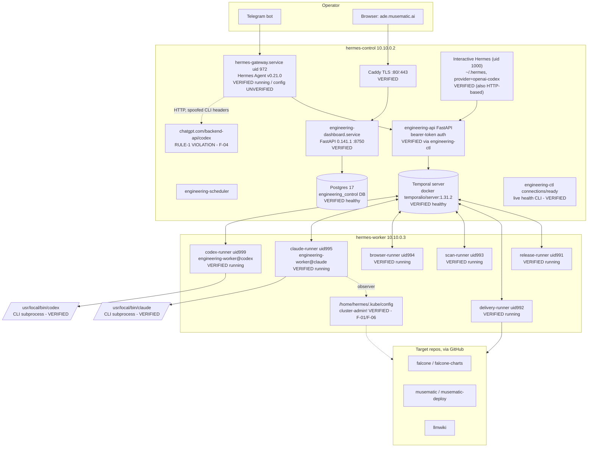

# Architecture — Verified (2026-09-17)

Read-only live audit of `engineering-control` and its surrounding platform, performed on
branch `go-status/2026-09-17`. Every row below is tagged **VERIFIED** (with the exact command
used, evidence in `.go-status/notes/*.md`) or **UNVERIFIED** (with the reason — almost always
"permission denied, no sudo"). Nothing in this document is taken from a prior report without
being re-checked live today, except where explicitly marked "carried forward, not reverified."

Full raw evidence: `.go-status/notes/controller.md`, `worker.md`, `dataflow.md`,
`security-surface.md`, `claims-inventory.md`, `sources.md`.

## 1. System diagram

## 2. Per-component table

| Component | What it is | Where it runs | Starts how | Runs as | Talks to | Verification |
|---|---|---|---|---|---|---|
| Interactive Hermes agent | Hermes Agent v0.21.0, operator's own CLI sessions | Controller | manual/tmux | uid 1000 (`hermes`) | `chatgpt.com/backend-api/codex` (HTTP, OAuth) | **VERIFIED** — `hermes --version`, `~/.hermes/config.yaml`/`auth.json` read live |
| Production Hermes gateway | Same codebase, hardened production identity | Controller | `hermes-gateway.service` (systemd system unit, `Restart=always`) | uid 972 (`hermes-gateway`, isolated) | `chatgpt.com/backend-api/codex` (HTTP, OAuth) — **same F-04 violation**, confirmed from the deployed release's own code | **VERIFIED running** (`systemctl status`, PID, uptime); **config/env/logs UNVERIFIED** (permission denied, no sudo) |
| Temporal server | `temporalio/server:1.31.2` in Docker, Postgres-backed | Controller | `docker ps` container, `Up 10 days (healthy)` | container | Worker role-workers (7233); `engineering-api`/`engineering-ctl` | **VERIFIED** — `docker ps`, live SDK round-trip (namespaces, workflow queries) |
| Temporal CLI (`temporal`/`tctl`) | — | — | — | — | — | **VERIFIED ABSENT** — not in PATH, not in venv, not in the server image; only the Python SDK is usable |
| `engineering-control` API/scheduler/dashboard | The Temporal-orchestrator control plane (Python, FastAPI + Temporal SDK) | Controller | systemd units, `User=engineering-control` | `engineering-control` (unprivileged) | Postgres, Temporal, GitHub, target repos | **VERIFIED** — `engineering-ctl ready core`/`connections all` live health check |
| Dashboard | FastAPI 0.141.1, cookie-session login | Controller, `127.0.0.1:8750` / `10.10.0.2:8750` | `engineering-dashboard.service` | `engineering-control` | Postgres (projections, not live Temporal) | **VERIFIED** — `curl` 303→/login, security headers present |
| Reverse proxy / TLS | Caddy | Controller, ports 80/443 | `caddy.service` | root (Caddy's own privilege-drop internal to the binary) | Dashboard only (`/v1*` blocked at the edge) | **VERIFIED** — Caddyfile read, `ss -tlnp` confirms listeners |
| Telegram integration | Bot token + single-chat allowlist | Controller | part of Hermes gateway + `engineering-control` notifier | uid 972 / `engineering-control` | Telegram API | **VERIFIED wired**; **STALE** per live health check (no successful check in ~4.5h at scan time, last real send unproven this pass) |
| Runner users (6) | Dedicated Linux users, one per role, `nologin` shell | Worker | `engineering-worker@<role>.service` ×5 + `engineering-release-worker.service` | `codex-runner`/`claude-runner`/`browser-runner`/`scan-runner`/`delivery-runner`/`release-runner` | Temporal (poll `engineering-<role>` queue), Claude/Codex CLI, target repo worktrees | **VERIFIED** — `/etc/passwd`, `ps aux`, `systemctl list-units` |
| Claude Code CLI | `/usr/local/bin/claude` → `2.1.239` | Worker (all runners), controller (operator only) | invoked non-interactively per-activity | whichever runner user | stdin prompt, subprocess only | **VERIFIED** binary + version; **UNVERIFIED** per-runner auth session (permission denied) |
| Codex CLI | `/usr/local/bin/codex` → `codex-cli 0.149.0` | Worker (all runners) | invoked non-interactively per-activity | whichever runner user | stdin prompt, subprocess only | **VERIFIED** binary + version; **UNVERIFIED** per-runner auth session |
| Docker (worker) | Docker Engine 29.7.2 | Worker | daemon | root | — | **VERIFIED installed/running, zero containers** — runner isolation is Linux-user-based, not container-based |
| Kubeconfig (worker) | `/home/hermes/.kube/config` | Worker, hermes's own home | — | hermes | external cluster `178.104.182.200:6443` | **VERIFIED cluster-admin** (`kubectl auth can-i --list` → `*.*→[*]`) — explicitly called "prohibited" by the repo's own `config/kubernetes/README.md`. Scoped per-project credentials are designed (`adapters/kubernetes/observer.py`) but their actual files under `/etc/engineering-control/credentials/` are **UNVERIFIED** (permission denied) |
| GitHub access | App/PAT/deploy-key (unconfirmed which) | Worker (`github` role runs as `hermes` on **controller**, per `worker_registry.py`) | `engineering-github-worker.service` | `hermes` | GitHub API/`gh` CLI | **UNVERIFIED** — credential dir permission-denied, client code not read in depth this pass |
| Postgres | `postgres:17.11-alpine3.24` | Controller, `127.0.0.1:55432` | Docker container `engineering-postgresql` | container | `engineering-control` app, dashboard | **VERIFIED healthy**, up 10 days |

## 3. Data-flow traces (all three mission types)

Full hop-by-hop tables with exact `file:line` references are in `.go-status/notes/dataflow.md`.
Summary:

**All three mission types share the same spine**: HTTP trigger (`api/main.py`, bearer-token
auth) → `Temporal.start_workflow(..., task_queue="engineering-control")` → a workflow in
`workflows/definitions.py` → per-step activity routing to a role task queue
(`engineering-codex`/`-claude`/`-scan`/`-github`/`-browser`/`-delivery`/`-release`) → the
**single** generic activity `execute_control_step` (`activities/core.py`) → a handler
(`ProviderActivityHandler`/`GitHubActivityHandler`/`ScanActivityHandler`/etc.) → for agent
steps, `ClaudeCLIAdapter.execute`/`CodexCLIAdapter.execute` → `asyncio.create_subprocess_exec`
of the real `claude`/`codex` binaries with the prompt on stdin and API-key env vars stripped
(`adapters/process.py:24-60`) → results persisted to Postgres → dashboard/API read them back.

| Mission | Workflow types (task queue `engineering-control`) | Trigger | Terminal artefact |
|---|---|---|---|
| 1. Issue resolution | `IssueSolutionLoopWorkflow` → child `IssueDeliveryWorkflow`; `ExistingGitHubBacklogLoopWorkflow`/`AutonomousBacklogCampaignWorkflow` → `FinalClosureWorkflow` | `POST /v1/loops`, `/v1/campaigns` | branch + PR (source-PR outcome only — see F-03/NEW-01 for the full-delivery gap) |
| 2. Product audit | `AuditCampaignWorkflow` (+`MultiProjectAuditWorkflow` wrapper, child `FindingVerificationWorkflow`) | `POST /v1/campaigns` | rows in `campaigns`/`coverage_cells`/`findings` tables, exposed via dashboard/API |
| 3. Enhancement detection | `EnhancementDiscoveryWorkflow` → (human approval) → `EnhancementDeliveryWorkflow`/`EnhancementSolutionLoopWorkflow` (reuses Mission 1's pipeline) | `POST /v1/enhancements/discover` | enhancement issue/PR, gated the same way as Mission 1 |

**Open discrepancy (NEW-07, UNVERIFIED):** `~/.hermes/skills/audit-product/SKILL.md` and
`~/.hermes/skills/implement-issue/SKILL.md` describe a parallel path where an interactive Hermes
agent session drives `kubectl`/`hmw`/`hflow` directly, only optionally handing off to
`/issue-delivery` (which itself disclaims shell/SSH/git-push/GitHub-write authority and submits a
typed `/run` request instead). Whether this "typed `/run` request" is just hop 0 of the pipeline
above, or a genuinely separate execution path, was not resolved this pass — see NEW-07.

## 4. Gates table (fail-closed switches)

| Gate | Location | Current value (this checkout, 2026-09-17) | Opened by | Ever opened in a real run? |
|---|---|---|---|---|
| GitHub writes master switch | `config.py:83` `github_writes_enabled` | `False` by default; `True` only for the `github` role worker via unit env var | Per-service `Environment=` override | Not observed — `github-broker` STALE since 2026-09-01 |
| GitHub write policy (repo allowlist) | `/etc/engineering-control/policy/github-issue-write-validation.yaml` | Shipped default `enabled: false`; **live value UNVERIFIED** (permission denied) | Operator edits YAML + reconciler picks it up | No evidence found |
| Full-delivery orchestration | `workflow.patched("existing-backlog-full-delivery-orchestration-v1")` | Execution-history-dependent, not a static flag | N/A (code-version gate) | N/A |
| Delivery-approval API | `api/main.py:824-836`/`838-856` | **Hardcoded stub** — always 409 / always BLOCKED | Requires a code change (NEW-01) | Never — no success path exists in code |
| Kubernetes observer credential | `config/credentials/contracts.yaml`, `/etc/engineering-control/credentials/<project>/*.kubeconfig` | Design is least-privilege; **actual file UNVERIFIED**; the only reachable kubeconfig (`~/.kube/config`) is cluster-admin | Operator provisions scoped credential | Unknown — likely never (F-01) |
| Application data-mutation | `config.py:85` `application_data_mutation_enabled` | `False` | Deploy-time env var | Not observed |
| LLMWiki staging bootstrap | `config.py:84` | `False` | Deploy-time env var | Not observed |
| Cleanup execution | `config.py:104`, `control.yaml:44` | `False` | Deploy-time env var | Not observed |
| Preview/production deployment | `control.yaml:34-38` | `False`/`False` | Per-target override file | Not observed |
| Paid-API fallback | `control.yaml:68-69`, enforced by `validation/c01.py:37-46` | `False` — **this is the control that should stay closed** | N/A | Correctly never opened for the mission-execution layer; **F-04 bypasses it at the Hermes-gateway layer, not through this gate** |

## 5. What could not be verified, and exactly why

The single largest verification gap across every agent's pass: **`hermes` has no non-interactive
sudo on either host**, and several of the most security-relevant files are root-or-service-user-owned
0600/0700/0750:

- Production gateway's own config/.env/post-migration logs (`/var/lib/hermes-gateway/home/*`,
  `/etc/engineering-control/env/gateway-platform.env`) — NEW-04.
- The 6 runner identities' auth/session state and per-process environment — F-12.
- `/etc/engineering-control/policy/*` (live GitHub write policy value) — F-02.
- `/etc/engineering-control/credentials/*` (per-project kubeconfigs, GitHub credential material) — F-01/F-06/F-10.
- `journalctl` for any unit not originally run as uid 1000 (journald per-UID ACL).

None of these gaps were worked around by escalating privilege; they are recorded as UNVERIFIED
findings requiring either a scoped grant of read access or the operator running a short read-only
command and pasting the output back.
