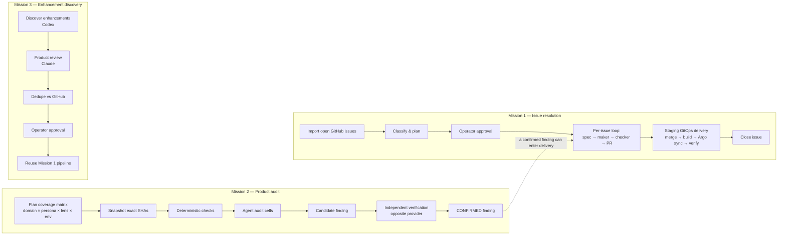
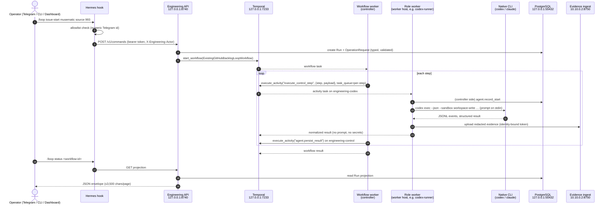

# Lecture 1 — What is Engineering Control?

> **Course:** Engineering Control — architecture and functionality
> **Audience:** engineers and architects who want to understand how an autonomous, policy-bound software-engineering control plane is built.
> **Prerequisites:** basic familiarity with Git, CI/CD, Kubernetes, and large-language-model (LLM) coding assistants.

---

## 1.1 The problem this product solves

Imagine a small company that maintains three real software products — **Falcone**, **Musematic**, and **LLMWiki** — each with a source repository, a deployment (GitOps) repository, a staging Kubernetes cluster, and a GitHub backlog of open issues. The company wants LLM coding agents (OpenAI **Codex** and Anthropic **Claude Code**) to audit those products, implement fixes for backlog issues, open pull requests, promote builds to staging, verify the running system, and close the issues — **autonomously**, around the clock, driven from a Telegram chat.

The naive way to do this is to hand an agent a shell, a GitHub token, and a kubeconfig and tell it to "fix the backlog". That is unacceptable for three reasons:

1. **An LLM is not a trustworthy principal.** It can be prompt-injected by issue text, it can hallucinate a digest, it can run `git push --force`, it can read a secret it was never meant to see.
2. **Long-running work must survive crashes.** Implementing one issue can take hours (spec, implementation, review, CI, build, deploy, verification). A process restart must not lose the work or repeat a non-idempotent step such as a merge.
3. **Every state transition must be auditable and reversible.** Who approved what, bound to which exact commit, image digest, and manifest hash?

**Engineering Control** is the answer: an *external, durable control plane* that sits **outside** the products and **outside** the agents. It owns all authoritative state, it decides which bounded task an agent may do next, it runs the agents under isolated Unix identities with no credentials, and it places every Git, GitHub, deployment, approval, and evidence transition behind **deterministic policy code** rather than behind a model's judgement.

The README states the thesis in one sentence:

> `engineering-control` is the external, durable control plane for autonomous engineering work on Falcone and Musematic. It keeps authoritative workflow state in Temporal and PostgreSQL, invokes native subscription-authenticated Codex and Claude CLIs through isolated workers, and places all Git, deployment, approval, and evidence transitions behind deterministic policy code.

## 1.2 One sentence per word

Let us take that sentence apart, because each phrase is a design decision we will spend a lecture on.

| Phrase | Meaning | Lecture |
|---|---|---|
| **external** | Nothing of the control plane runs inside Falcone, Musematic, or their clusters. The products are *targets*, never hosts. | 2 |
| **durable** | Workflow state lives in **Temporal** (a workflow engine with persistent histories) so that a crash, deploy, or reboot resumes exactly where it stopped. | 3 |
| **control plane** | The system does not *do* engineering itself; it *controls* who does what, when, with which inputs, and records the evidence. | 1, 7 |
| **authoritative state in Temporal and PostgreSQL** | Temporal owns *execution* state (which step is running); PostgreSQL owns *searchable metadata* (ChangeSets, findings, approvals, evidence index). Neither the agents nor the chat client are a source of truth. | 3, 6 |
| **native subscription-authenticated Codex and Claude CLIs** | The agents are the vendors' own command-line tools, logged in with a human subscription. There are **no API keys** anywhere, and therefore no paid-API fallback. | 4 |
| **isolated workers** | Each kind of work runs under its own Unix user on a separate host, sandboxed by systemd, with ACL-scoped worktrees. | 5 |
| **deterministic policy code** | Transitions (publish, merge, deploy, approve, delete) are decided by ordinary Python that validates hashes, signatures, and approvals. A model may *propose*; code *decides*. | 6, 9 |

## 1.3 The three missions

Everything the platform does serves one of three "missions". We will trace each one end-to-end in Lecture 7.

* **Mission 1 (issue loop)** is the one exercised most in production. A backlog campaign imports open issues, a human approves a bounded campaign, and a Temporal workflow works one issue at a time: a Claude "spec" pass, a Codex "maker" pass in a leased worktree, an independent Claude "checker" pass, deterministic validation, a draft PR, then (in *full delivery* mode) merge, image build, Argo CD sync, runtime verification, and issue closure.
* **Mission 2 (audit)** builds a Cartesian **coverage matrix** of cells, runs deterministic scanners first, then asks an agent to audit each cell read-only. Any candidate finding must be reproduced by the *other* provider before it is called `CONFIRMED`.
* **Mission 3 (enhancements)** is a discovery flow whose approved outputs are fed back into the Mission 1 pipeline.

## 1.4 The cast of characters

Before diving into layers, learn the vocabulary. Each term is precise in this codebase.

| Term | What it is |
|---|---|
| **Controller** | The host (`hermes-control`, `10.10.0.2`) that runs the API, Temporal, PostgreSQL, scheduler, notifier, dashboard, evidence ingest, and the GitHub broker worker. |
| **Worker** | The host (`hermes-worker`, `10.10.0.3`) that runs six isolated execution identities: `codex-runner`, `claude-runner`, `browser-runner`, `scan-runner`, `delivery-runner`, `release-runner`. |
| **Hermes** | A third-party Telegram gateway agent (version 0.20/0.21). Engineering Control installs a *plugin* and a *hook* into it so that fixed slash commands become authenticated API calls. Hermes is a **client**; it has no workflow state and no release credentials. |
| **Workflow** | A Temporal workflow class (there are about thirty) that encodes one durable business process: an audit campaign, one issue delivery, a staging deployment, a cleanup run… |
| **Step / activity** | One bounded unit of work executed by a worker. There is a *single* Temporal activity type, `execute_control_step`, and ~220 named steps dispatched by name to handlers. |
| **Agent** | A *bounded invocation* of a native provider CLI (Codex or Claude) loaded with exactly one role from the **agent pack**, one skill contract, one project domain pack, a tool allowlist, and a JSON output schema. An agent is not a long-lived process; it is one activity. |
| **Maker / checker** | The implementing agent (maker, write access) and the independent reviewing agent (checker, read-only), which must be *different invocations* and, by default, *different providers*. |
| **ChangeSet** | The first-class record binding one bounded change across the source repository and the deployment repository: branches, base/head SHAs, PRs, image digests, chart version, CI, approvals, verification, recovery. One ChangeSet per issue, one worktree pair per ChangeSet. |
| **Worktree** | A Git worktree allocated by `scan-runner` at an exact SHA under `/srv/engineering/worktrees/<repo>/<change-set-id>` with POSIX ACLs that give the maker write and the checker/delivery/release identities read. |
| **Evidence** | Content-addressed, redacted artifacts (scanner reports, agent results, screenshots, manifests) uploaded by workers to the controller through identity-bound upload tokens. |
| **Risk class** | `R0`–`R3`. Deterministic diff classification can only *raise* the floor. R0/R1 get a deterministic policy approval; R2/R3 need a human; R3 needs both providers and a typed confirmation phrase. |
| **Approval binding** | A SHA-256 over the immutable candidate payload (SHAs, digests, target, CI result, reviewer result, migration flag, recovery plan). Any change invalidates the approval. |
| **Fail-closed** | The platform's default posture: a missing credential, an unconfigured target, an unverifiable artifact, or a malformed policy produces a typed *blocker* and stops — it never guesses, invents, or bypasses. |

## 1.5 The spine: one request, one path

The same path is taken by every mission, so memorise it now.

Three things to notice, because they recur everywhere:

1. **The API is the only writer of intent.** Hermes, the CLI, and the dashboard all converge on the same typed *command bus* (`POST /v1/commands`) and the same `OperationRequest` record. None of them can express an arbitrary shell string.
2. **The workflow never touches a product directly.** It only *asks* a role worker to perform a named, allowlisted step on a specific task queue. The worker kind decides which steps it will accept.
3. **Every provider call is bracketed by controller-owned bookkeeping.** `agent.record_start` is written *before* dispatch and `agent.persist_result` *after*, in PostgreSQL, so that an invocation is never invisible — even if the worker dies mid-call.

## 1.6 Safety invariants (the design's constitution)

The README lists the invariants that every change to the codebase must preserve. Treat them as axioms; later lectures show the mechanism that enforces each.

| # | Invariant | Enforced by (preview) |
|---|---|---|
| 1 | One ChangeSet and one bounded issue per worktree. | Worktree manager, component leases (L5, L6) |
| 2 | Maker and checker are separate invocations, preferably separate providers. | Quota broker routing, `delivery.route_providers` (L4) |
| 3 | LLM identities cannot deploy or merge. | Unix identities, task-queue allowlists, GitHub broker runs as a different user (L5, L9) |
| 4 | Release identities cannot read model credentials. | systemd `InaccessiblePaths`, distinct homes (L5) |
| 5 | Approvals bind to immutable source, deployment, image, target, and evidence digests. | `policy/approvals.py` binding SHA-256 (L6, L9) |
| 6 | R3 work requires typed human approval and cross-provider verification. | Risk policy (L6) |
| 7 | Unknown quota is represented as unknown, never invented. | Quota broker (L4) |
| 8 | Provider outcomes and exposed usage are durably tracked by role **without storing prompts**. | `agent_invocations`, `provider_usage` tables (L4, L6) |
| 9 | Native CLI rate limits produce a durable `RATE_LIMITED` handoff, never paid-API fallback. | Adapter environment stripping, handoff bundle (L4) |
| 10 | All persisted output passes through central secret redaction. | `security/redaction.py` (L9) |
| 11 | Every controller, worker, bootstrap, upgrade, and verification runs the fail-closed `verify-no-omniroute.sh` negative policy. | Validation scripts (L10) |

## 1.7 A note on maturity and honesty

This is a real, deployed system with a documented history. The repository ships its own live audits (`docs/ARCHITECTURE-VERIFIED.md`, `docs/inventory/*`, `docs/GO-STATUS.md`) that distinguish **IMPLEMENTED** (code and tests exist), **ACTIVE** (installed and verified on the host), and **BLOCKED** (a credential or security gate the platform refuses to bypass). Several capabilities — Falcone candidate-build attestation, Musematic digest promotion, scoped Kubernetes identities — are *implemented but blocked* by external prerequisites. We will point these out where relevant, because "fails closed until the prerequisite exists" is itself a central architectural property, not a defect.

## 1.8 Course map

| Lecture | Title | Core question |
|---|---|---|
| 1 | What is Engineering Control? | What problem, what vocabulary, what invariants? |
| 2 | Platform, software, and hosts | Which software is used, why, and where does it run? |
| 3 | The orchestration engine (Temporal) | How is durable, resumable, pausable work modelled? |
| 4 | Agents, providers, and the agent pack | What exactly is an "agent" here and how is it invoked safely? |
| 5 | The execution harness | How are workers, worktrees, scanners, browsers, and evidence isolated? |
| 6 | Data model and state machines | What are the entities and their lifecycles? |
| 7 | The missions end to end | How do audit, issue loop, delivery, deployment, and closure actually flow? |
| 8 | Control surfaces | API, CLI, Telegram/Hermes, dashboard, notifier, watchdog. |
| 9 | Security, policy, and fail-closed gates | Where are the trust boundaries and the switches? |
| 10 | Operations, validation, and lifecycle | Bootstrap, verify, schedule, clean up, upgrade, recover. |
| 11 | Glossary | Every term and code in one place. |
