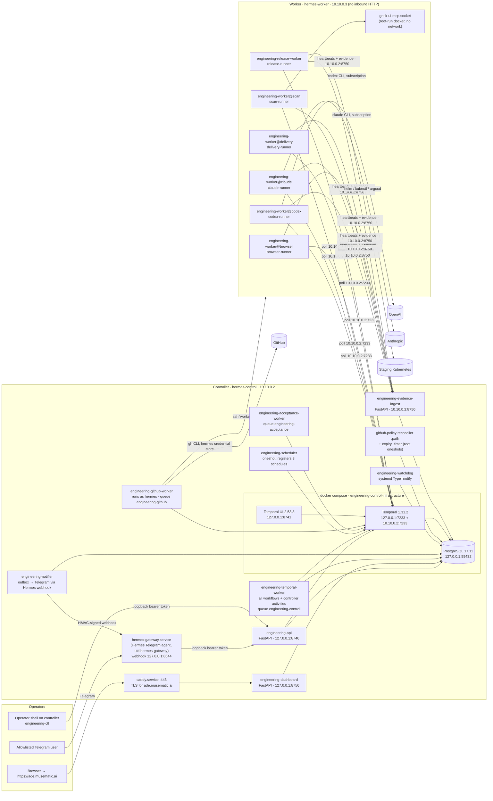

# Lecture 2 — Platform, software, and hosts

> This lecture answers "what is this thing made of, and why?". We inventory every piece of third-party software with the reason it was chosen, then walk the two hosts process by process. By the end you should be able to draw the deployment from memory and justify each box.

Source anchors: `pyproject.toml`, `requirements.lock`, `docker/compose.yaml`, `systemd/*`, `scripts/bootstrap-controller.sh`, `scripts/bootstrap-worker.sh`, `scripts/install-scanners.sh`, `src/engineering_control/config.py`, `src/engineering_control/workflows/worker_registry.py`.

---

## 2.1 The shape of the platform in one picture



Two hosts, one private network (`10.10.0.0/24`), one direction of trust: the worker host **polls** the controller; nothing on the controller ever connects *into* the worker except the GitHub worker's narrow SSH fetch of validated commits (Lecture 7). Nothing on either host is reachable from the Internet except Caddy's TLS front for the dashboard and the Telegram bot's outbound connection.

## 2.2 Software inventory and rationale

### 2.2.1 Runtime and frameworks (Python)

| Software | Version | Role in this product | Why this choice |
|---|---|---|---|
| **Python** | 3.12–3.14 (lock resolved on 3.14) | The entire control plane is one Python package, `engineering_control`, with ten console scripts (`pyproject.toml`). | One language for workflows, activities, API, CLI, dashboard; strict `mypy` and `ruff` keep 90k lines honest. |
| **Temporal** (server 1.31.2, Python SDK `temporalio` 1.31) | Docker, digest-pinned | **The workflow engine.** Every mission is a Temporal workflow; every unit of work is a Temporal activity; schedules drive quota refresh, connection probes, and cleanup. | Durable execution: a workflow's history is persisted event by event, so a crash, deploy, or host reboot resumes exactly at the last completed step. Signals (`pause`, `resume`, `cancel`, `approval`, `skip`, `retry`) and queries (`status`) give operators control without bespoke state machines. Task queues give per-identity routing. `continue-as-new` bounds history size for long campaigns. Lecture 3 is devoted to it. |
| **PostgreSQL** 17.11 | Docker, digest-pinned, `127.0.0.1:55432` | Two jobs: Temporal's own persistence (`temporal`, `temporal_visibility` databases) and the control-plane metadata database `engineering_control` (ChangeSets, runs, findings, evidence index, approvals, outbox, heartbeats…). | Searchable, transactional metadata that Temporal histories are not designed to answer ("list open findings", "which ChangeSet owns this worktree"). Advisory locks implement component leases. |
| **SQLAlchemy 2.0 + psycopg 3 + Alembic** | 2.0.52 / 3.3.4 / 1.19.1 | ORM, driver, and 21 linear migrations (`0001_initial_control_plane` … `0021_ui_gap_consolidation`). | Typed repository layer; migrations run by a dedicated `engineering-migrate` oneshot before any writer starts. |
| **FastAPI + uvicorn + Starlette** | 0.141 / 0.52 / 1.6 | Three separate HTTP processes: the private API (8740), the evidence ingest (8750 on the private IP), and the dashboard (8750 on loopback). | Pydantic-native request validation; the "strict discriminated request models" that make the command bus safe are plain Pydantic unions. |
| **pydantic + pydantic-settings** | 2.13 / 2.15 | All request/response models; the `Settings` object (`config.py`) with `ENGINEERING_` env prefix and `extra="forbid"`. | A typo in an environment variable is a startup failure, not a silently ignored setting. |
| **structlog** | 25.5 | JSON logs to stdout → journald. A redaction processor runs on **every** event dict before rendering. | Logs are evidence; they must be secret-free by construction. |
| **prometheus-client** | 0.26 | `GET /internal/metrics` on the loopback API and dashboard. | Gauges are rebuilt from PostgreSQL on each scrape, so metrics reflect durable state, not process memory. |
| **argon2-cffi** | 25.1 | Dashboard password hashing (Argon2id). | Single operator password, memory-hard hash. |
| **Jinja2** | 3.1 | Server-rendered dashboard templates. No JavaScript framework. | Minimal attack surface; CSP `self`-only. |
| **httpx** | 0.28 | Outbound HTTP from workers (evidence upload, heartbeats), notifier, watchdog, persona admin clients. | `trust_env=False`, no redirects: proxies and env can't redirect uploads. |
| **jsonschema** | 4.26 | Draft 2020-12 validation of agent output, journey plans, targets, manifests. | The "structured output is the contract" principle from Lecture 4. |
| **PyYAML** | 6.0 | Reading `config/*.yaml` (projects, personas, flows, policies, targets). | Declarative, operator-editable configuration. |

### 2.2.2 Agent providers (worker host)

| Software | Version | Role | Why |
|---|---|---|---|
| **Codex CLI** (`@openai/codex`) | 0.159.3 (model pin `gpt-6.1-sol`) | The default **maker** (implementer) and one of two possible checkers/verifiers. Run as `codex-runner`. | Native sandboxing (`--sandbox read-only|workspace-write`), `--output-schema`, JSONL events, subscription auth. |
| **Claude Code CLI** (`@anthropic-ai/claude-code`) | 2.1.239 pinned in bootstrap (worker manually at 2.1.282 for Opus 5.5) | The default **spec architect** and **checker**; opposite-provider verifier. Run as `claude-runner`. | `--safe-mode`, `--json-schema`, `--permission-mode dontAsk`, `--tools` allowlist, stream-json. |
| **Node.js** 22 (optional 24.21.0 side-by-side) + **pnpm** | — | Runs both CLIs and the Playwright journey runner; project toolchains select Node 22 or 24. | The CLIs are npm packages. |
| **Hermes agent** | 0.20/0.21 | Telegram gateway. Engineering Control installs a plugin and a hook; vendor source is not patched. | Existing operator chat surface; constrained to fixed commands. |

> Note the absence: there is **no** `openai`, `anthropic`, or `litellm` Python package. The platform never calls a model API directly.

### 2.2.3 Deterministic tooling (worker host, SHA-verified downloads)

| Tool | Version | Used by | Purpose |
|---|---|---|---|
| **git** | system | scan, github, delivery | Mirrors, worktrees, shadow bare repos. |
| **gh** (GitHub CLI) | 2.98.0 | `engineering-github-worker` as `hermes` | The *only* GitHub credential path: the `gh` credential store of the `hermes` user, never a token file. `gh attestation verify` for image provenance. |
| **gitleaks** | 8.30.0 | scan-runner | Secret scanning of worktrees; install refuses unless a canary `ghp_` token is detected. |
| **trivy** | 0.74.0 | scan-runner | Vulnerability, misconfiguration, secret, licence scan (offline). |
| **semgrep** | 1.174.0 (own venv) | scan-runner | Static analysis with `p/ci` rules, metrics off. |
| **syft** | 1.51.0 | scan-runner | SBOM (CycloneDX). |
| **kubeconform** | 0.8.0 | scan/release | Kubernetes manifest schema validation. |
| **kubectl** | 1.36.3 | scan-runner (observer), release-runner | Read-only observation with `auth can-i` negative checks; release operations. |
| **helm** | 4.2.3 | scan (lint/template), release-runner | Falcone chart validation and `upgrade --install --atomic --wait`. |
| **argocd** CLI | 3.5.1 | release-runner / controller gitops | Musematic Argo CD observation and sync. |
| **Playwright** | 1.62.1 (Chromium, Firefox) | browser-runner | Fixed journeys for audits and runtime verification. |
| **bubblewrap** (`bwrap`) | system | scan-runner | Network-less sandbox for re-running maker-chosen `node --test` suites at the base commit. |
| **uv**, **Go** | — | scan-runner | Python and Go dependency resolution during delivery toolchain preparation. |
| **Docker** | host | controller: compose stack; worker: only the root-run gntik-ui MCP socket service | Workers themselves are **not** containers; isolation is by Unix user and systemd. |
| **Caddy** | host service | controller | TLS termination for the dashboard only; rejects `/v1*` at the edge. |

## 2.3 The controller host

The controller is the **brain**: it owns state and policy, and it holds exactly one external write credential (the `hermes` user's GitHub login). Every service runs as the unprivileged Unix user `engineering-control` except where noted.

| Unit | Identity | Listens | Purpose |
|---|---|---|---|
| `engineering-infrastructure.service` | root (needs Docker) | — | `docker compose up` for PostgreSQL, Temporal, Temporal UI. |
| `engineering-migrate.service` | engineering-control | — | `alembic upgrade head`; every other unit `Requires=` it. |
| `engineering-api.service` | engineering-control | `127.0.0.1:8740` | The private API: starts and signals workflows, serves projections, hosts the command bus and the pending-operation dispatcher. |
| `engineering-evidence-ingest.service` | engineering-control | `10.10.0.2:8750` | Upload-only listener for evidence, worker heartbeats, agent transcripts, publication receipts. No workflow-control routes. |
| `engineering-dashboard.service` | engineering-control | `127.0.0.1:8750` | Operator web console (behind Caddy). Reads PostgreSQL projections only; has no API token and no Temporal client. |
| `engineering-temporal-worker.service` | engineering-control | — | The **only** process hosting workflow code: all 31 workflow classes plus the controller-side activities on queue `engineering-control`. |
| `engineering-scheduler.service` | engineering-control | — | Oneshot that creates or updates the three Temporal schedules. |
| `engineering-notifier.service` | engineering-control | — | Polls the notification outbox and delivers to the Hermes webhook (`127.0.0.1:8644`) with HMAC-SHA256 signatures. The most heavily sandboxed unit. |
| `engineering-watchdog.service` | engineering-control | — | `Type=notify`, `WatchdogSec=300`; probes units, heartbeats, backups, loop stalls; alerts through the outbox. |
| `engineering-acceptance-worker.service` | engineering-control | — | Synthetic lifecycle activities on queue `engineering-acceptance`, write-bounded to `/srv/engineering/tmp/acceptance`. |
| `engineering-github-worker.service` | **hermes** (+ supplementary group `engineering-control`) | — | The typed GitHub broker on queue `engineering-github`. Runs as `hermes` so it can use that user's already-authenticated `gh` store in place. |
| `engineering-github-policy-reconciler.path/.service` | **root** | — | Path unit watching `/var/lib/engineering-control/github-policy-requests/activate.json`; atomically enables the GitHub write policy after verifying the database approval. |
| `engineering-github-policy-expiry.timer/.service` | **root** | every 5 min | Disables expired write-policy bindings. |

Plus the Docker containers: `engineering-postgresql` (`127.0.0.1:55432`), `engineering-temporal` (`127.0.0.1:7233` and `10.10.0.2:7233`), `engineering-temporal-ui` (`127.0.0.1:8741`), all with `cap_drop: ALL`, `no-new-privileges`, memory and pid limits, digest-pinned images. Two one-shot containers bootstrap the databases and the Temporal schema; a third creates the `engineering-control` namespace with 30-day retention.

Why is the GitHub worker on the controller and not the worker host? Because the design forbids copying or extracting the GitHub credential. The `hermes` user is the human operator's identity on the controller and already has `gh auth login`. The broker uses that store **in place**, under a systemd sandbox that hides every other credential, and exposes only typed operations (Lecture 7). The worker host therefore has **no GitHub credential at all**; its mirrors are pushed to it by the controller over SSH.

## 2.4 The worker host

The worker is the **hands**: it runs model CLIs, scanners, browsers, and release tools, each under a dedicated `nologin` Unix user with its own home, run, evidence, cache, and temp directories. There is no inbound HTTP; every worker is an outbound Temporal poller.

| Unit | Unix user | Task queue | Concurrency | What it may do (summary) |
|---|---|---|---|---|
| `engineering-worker@codex` | `codex-runner` | `engineering-codex` | 2 | Provider steps via the Codex CLI; cleanup of its own temp files. |
| `engineering-worker@claude` | `claude-runner` | `engineering-claude` | 2 | Provider steps via Claude Code. |
| `engineering-worker@scan` | `scan-runner` | `engineering-scan` | 4 | Mirrors, snapshots, worktree allocation, scanners, toolchain preparation, ChangeSet validation, Kubernetes observation, promotion edits, UI inventory. |
| `engineering-worker@browser` | `browser-runner` | `engineering-browser` | 4 | Playwright journeys, API flows, persona lifecycle, superadmin attestation. |
| `engineering-worker@delivery` | `delivery-runner` | `engineering-delivery` | 4 | Only cleanup of its own run files today (publication moved to the controller broker, NEW-61). |
| `engineering-release-worker` | `release-runner` | `engineering-release` | 4 | Deterministic Helm/Argo/kubectl preflight, deploy, verify, recover, preview-namespace cleanup. No model homes, no worktree write. |

The worker-step allowlist that each identity enforces is `ControlActivities._worker_steps` in `activities/core.py` (Lecture 3). The registry that binds kind → user → unit → queue is `workflows/worker_registry.py`, and `scripts/verify-worker-registry.py` fails the bootstrap if any unit file disagrees with it.

A systemd template (`engineering-worker@.service`) produces the five role workers; each instance differs only by `%i` and its env drop-ins. The sandbox is strict: `ProtectHome=true`, `ProtectSystem=strict`, explicit `ReadWritePaths` limited to `/var/lib/engineering-control/{workers,identities}/%i*`, `/srv/engineering/{mirrors,worktrees,runs/%i,evidence/%i,cache/%i,tmp/%i}`. Codex and Claude instances get a `MemoryMax=7G` drop-in (5G until NEW-167) because makers run full project test suites. The release worker has `ReadOnlyPaths=/srv/engineering/worktrees` and no identities directory at all.

## 2.5 Ports and binds, and why wildcards are refused

| Port | Bind | Service | Consumer |
|---|---|---|---|
| 55432 | `127.0.0.1` | PostgreSQL | controller processes only |
| 7233 | `127.0.0.1`, `10.10.0.2` | Temporal frontend | controller processes; worker pollers over the private network |
| 8741 | `127.0.0.1` | Temporal UI | operator via SSH tunnel |
| 8740 | `127.0.0.1` | Engineering API | Hermes hook, `engineering-ctl`, dashboard health read |
| 8750 | `10.10.0.2` | Evidence ingest | worker identities |
| 8750 | `127.0.0.1` | Dashboard | Caddy |
| 8644 | `127.0.0.1` | Hermes gateway webhook | notifier |
| 443/80 | public | Caddy | dashboard users |

`Settings` validators reject `0.0.0.0`/`::` for the API and ingest and force the dashboard to loopback; `verify-controller.sh` greps `ss -ltn` and fails if any of 55432/7233/8740/8741/8750 is bound to a wildcard. The private API is never proxied by Caddy (`/v1*` is rejected at the edge).

## 2.6 Directory layout on the hosts

Understanding the filesystem explains most of the security model.

```text
/opt/engineering-control/releases/<commit>/source   immutable git-archive of each deployed commit
/opt/engineering-control/source  -> releases/<commit>/source     (symlink = the live release)
/opt/engineering-control/venv                       Python venv built under requirements.lock
/opt/engineering-agent-pack/releases/<commit>/source   immutable agent pack; source symlink
/opt/engineering-cli                                npm prefix for codex + claude   (worker)
/opt/engineering-browser-runtimes/<commit> + /opt/engineering-browser/runtime  Playwright runner (worker)
/opt/engineering-scanners/semgrep                   semgrep venv                     (worker)

/etc/engineering-control/
  control.yaml  projects.d/  personas.d/  flows.d/  policies/  targets/  runtime/  journeys/
  policy/github-issue-write-validation.yaml         root:engineering-control 0640 in a 0750 dir
  env/   control.env  api.token  telegram-allowlist  evidence-uploaders/<identity>.token  (controller)
         worker-common.env  evidence-<identity>.token  observer/  release/  delivery/registry/ (worker)
  credentials/<project>/superadmin.env              root:browser-runner 0640
  dashboard/session.key
  systemd/                                          snapshot of installed units (must match /etc/systemd/system)

/var/lib/engineering-control/
  identities/<identity>-runner/                     runner HOMEs (CLI OAuth stores live here, 0700)
  workers/<kind>/   leases/   github-policy-requests/   github-policy-backups/   postgresql/

/srv/engineering/
  mirrors/<repo>.git                                canonical bare mirrors (scan-runner owned on the worker)
  worktrees/<repo>/<change-set-id>                  one bounded ChangeSet per worktree
  cache/scan/worktree-git/<repo>/<id>.git           per-ChangeSet shadow bare repos
  cache/scan/toolchain                              toolchain and baseline caches
  runs/<kind>/   evidence/<kind>/   tmp/<kind>/     per-identity roots
  evidence/                                         content-addressed redacted evidence (controller)
```

Three properties to remember:

1. **Releases are immutable and commit-addressed.** Upgrading is "install a new release directory, flip a symlink, restart". Rollback is flipping it back. `retention-releases.sh` keeps the newest fifteen plus anything referenced by a running process.
2. **Credentials are files with exact owner, group, and mode**, declared in `config/credentials/contracts.yaml`, and every consumer re-checks those modes at use time (Lecture 5 and 9).
3. **Every identity has disjoint writable roots.** The template unit's `ReadWritePaths` and the directory ownership (`<kind>-runner 0700`) agree, so even a compromised model process cannot read another identity's token or home.

## 2.7 Why two hosts and not one?

The split is a trust boundary, not a scaling decision:

* The controller holds the database password, the API token, the write-policy file, and the `hermes` GitHub login. It never runs a model.
* The worker holds the model subscriptions, the scanners, and the release kubeconfigs (in disjoint directories). It never holds a GitHub token or the database password; it cannot even reach the database (role workers talk only to Temporal and the ingest listener).
* A model process on the worker can, at worst, write to its leased worktree and upload redacted evidence with a token that grants nothing else. It cannot start a workflow, approve, merge, deploy, or read the policy.

That is Invariants 3 and 4 made physical.

## 2.8 Configuration as a contract

`config/control.yaml` is the operator-facing declaration of the same values the `Settings` class enforces: loopback binds, `arbitrary_shell: false`, evidence ingest with identity-bound tokens and a 32 MiB cap, `agents.invalid_pack_policy: fail-closed`, `deployments.default_enabled: false`, `production_enabled: false`, `cleanup.execution_enabled: false`, and `paid_api_fallback.enabled: false`. The bootstrap installs it, the verifiers read it, and the code's defaults match it. Lecture 9 walks the switches one by one; Lecture 10 covers bootstrap and verification scripts.

## 2.9 Summary

Engineering Control is a Python control plane built on **Temporal** for durable execution and **PostgreSQL** for searchable metadata, exposed through three small **FastAPI** services, driving vendor-native **Codex** and **Claude Code** CLIs and a fixed set of **deterministic scanners and release tools** on a separate worker host, with **systemd** and Unix identities as the isolation mechanism and **Docker** used only for the infrastructure stack. Every version is pinned, every bind is loopback or private, and every credential is a mode-checked file owned by exactly one identity.
