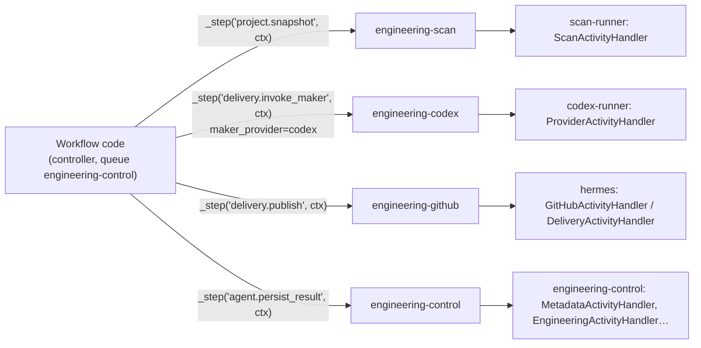
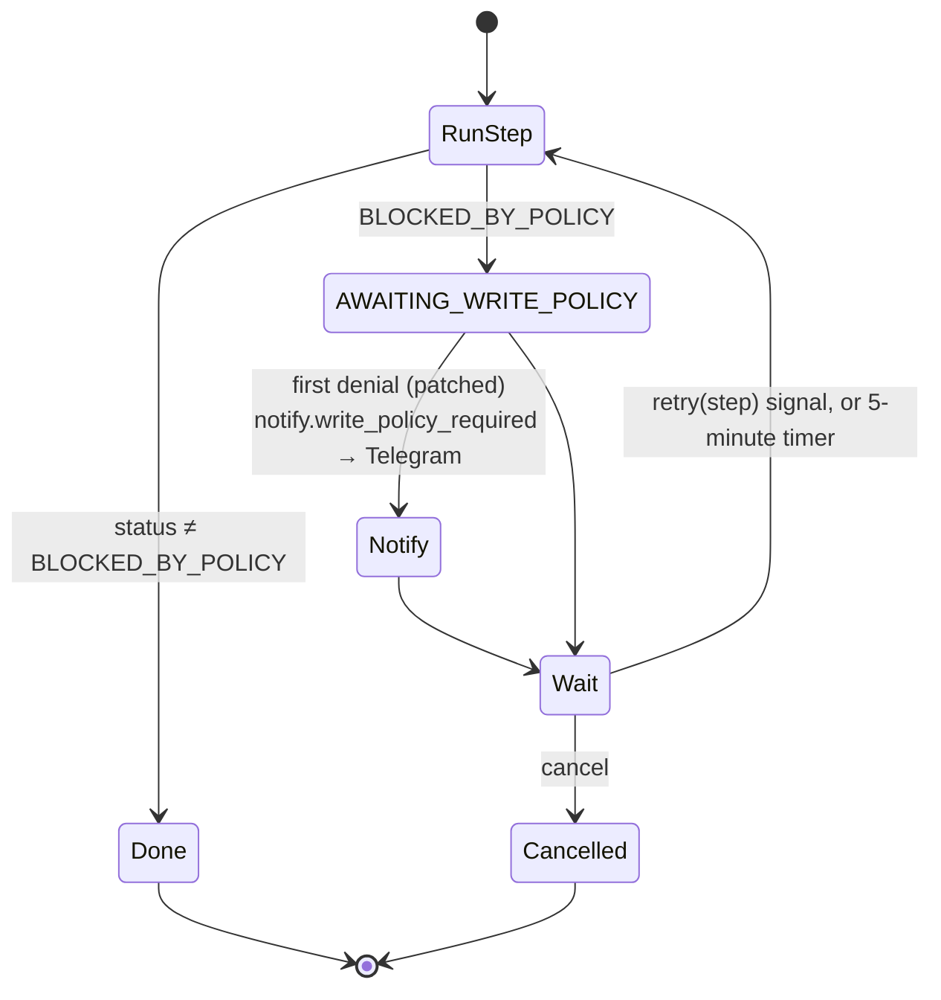
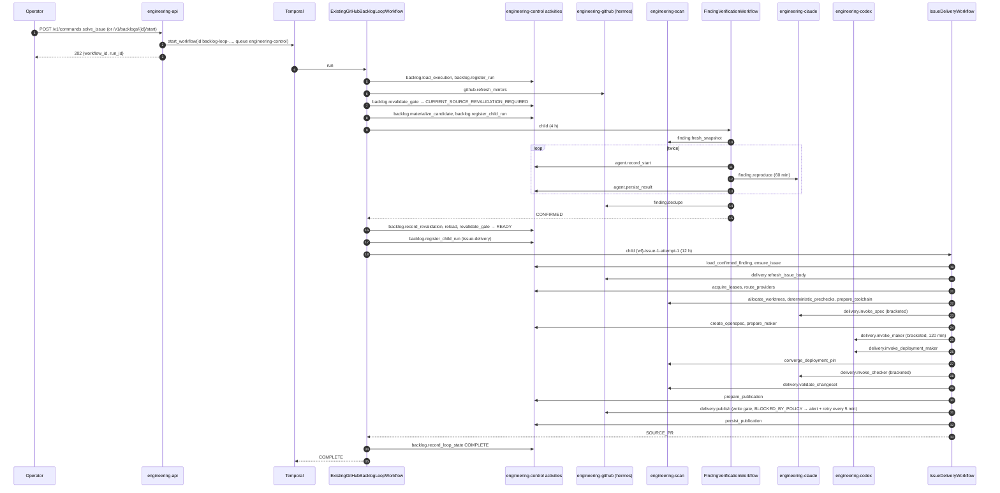

# Lecture 3 — The orchestration engine: Temporal as the flow engine

> Lecture 1 said "Temporal owns execution state". This lecture explains what that means concretely: why a workflow engine was chosen over a job queue or a cron script, how the project uses exactly one activity type for ~220 named steps, how work is routed to isolated workers, how humans pause and resume it, and how a running history survives code upgrades. We finish with the catalogue of all thirty-one workflows.

Source anchors: `src/engineering_control/workflows/definitions.py` (6,280 lines; abbreviated `D:`), `workflows/inputs.py`, `workflows/worker.py`, `workflows/role_worker.py`, `workflows/worker_registry.py`, `workflows/supervision.py`, `scheduler.py`, `activities/core.py` (`CORE:`).

---

## 3.1 Why a flow engine, and why Temporal

Consider what one backlog issue needs: refresh mirrors, revalidate the issue against the current source, maybe run a two-reproduction verification, allocate worktrees, prepare a toolchain, run a spec agent (minutes), a maker agent (up to two hours), a deployment maker, an opposite-provider checker, deterministic validation, publish a draft PR, wait for CI (up to 90 minutes, polled every minute), merge, tag, wait for an image build, check environment health with bounded remediation, wait for an Argo CD image pin, trigger and wait for a sync, verify workloads, close the issue. Along the way an operator may pause it, skip the issue, retry a step, or approve a GitHub write policy, and a worker may be restarted for a deploy.

A plain job queue cannot express "wait durably for a signal", "poll with a timer for 90 minutes without holding a thread", or "if the process dies here, resume *here* and not from the beginning". A hand-written state machine in PostgreSQL could, but then every one of the ~30 processes above needs its own persistence, retry, timeout, and replay logic.

**Temporal** gives all of that as primitives:

| Need | Temporal primitive | How this project uses it |
|---|---|---|
| Survive crashes and deploys | Event-sourced workflow history, deterministic replay | Every workflow is a Python class whose code is replayed from history after a restart; the lifecycle acceptance test kills the worker mid-run and proves resumption (`docs/VALIDATION.md`). |
| Run work on specific machines/identities | Task queues | One queue per Unix identity (`engineering-codex`, `engineering-scan`, …). |
| Long, possibly silent operations | Activities with heartbeats and `start_to_close_timeout` | Provider calls heartbeat every 10 s; 2-minute heartbeat timeout; 30–120 min start-to-close. |
| Retries with typed non-retryable failures | `RetryPolicy` with `non_retryable_error_types` | `PolicyViolation`, `SecurityBlocker`, `ApprovalMismatch`, `DirtyWorktree`, `NotConfigured`, `SchemaViolation`, `MANUAL_AUTH_REQUIRED_*`, `PROVIDER_CLI_MISSING_*` are never retried. |
| Human-in-the-loop | Signals, queries, `wait_condition` | `pause`, `resume`, `cancel`, `approval`, `skip`, `retry`, `pause_after_current`, `stop_after_current`; query `status`. |
| Waiting without threads | Durable timers (`workflow.sleep`) | CI polling (90 × 1 min), image pin (30 × 1 min), write-policy re-check (5 min). |
| Bounded history | `continue_as_new` | Audit campaigns every 50 cells; the global backlog selector every 25 iterations; UI fan-out per batch. |
| Composition | Child workflows | A backlog loop spawns verification, delivery, GitOps, and closure children with their own timeouts (4 h, 12 h, 7 d). |
| Safe code evolution | `workflow.patched(marker)` | ~55 markers let new code coexist with in-flight histories recorded by older code. |
| Recurring work | Schedules | Quota refresh, connection probes, daily cleanup. |

Temporal server 1.31.2 runs in Docker on the controller, backed by PostgreSQL, in one namespace `engineering-control` with 30-day retention. There is no Temporal CLI on the hosts; the Python SDK is the only client.

## 3.2 One activity to rule them all

The single most important design decision in this layer: **there is exactly one Temporal activity type**, `execute_control_step`, and it takes `{"step": "<dotted name>", "payload": {...}}`.

```python
# workflows/definitions.py:198-237 (abridged)
async def _step(self, step, payload, *, timeout_minutes=30, retry_policy=ACTIVITY_RETRY):
    result = await workflow.execute_activity(
        "execute_control_step",
        {"step": step, "payload": payload},
        task_queue=self._activity_queue(step, payload),
        start_to_close_timeout=timedelta(minutes=timeout_minutes),
        heartbeat_timeout=timedelta(minutes=2),
        retry_policy=retry_policy,
    )
```

Why not one activity function per step? Because the *name* of the step is now data that can be allowlisted twice:

1. **In the workflow**, `_activity_queue(step, payload)` (`D:460-612`) decides which task queue — and therefore which Unix identity — may execute it. Provider steps read `spec_provider`, `maker_provider`, `checker_provider`, `release_review_provider`, or `provider` from the payload to choose `engineering-codex` or `engineering-claude`. Anything not listed goes to `engineering-control`.
2. **In the worker**, `ControlActivities._worker_steps[worker_kind]` (`CORE:336-538`) is the set of steps that identity will accept at all. A step that arrives on the wrong worker raises a non-retryable `PolicyViolation`.

The two tables are maintained by hand and verified by `scripts/verify-worker-registry.py`, which fails the bootstrap if any GitHub step could route anywhere but `engineering-github`.

The payload is a **context dictionary** that accumulates: each step returns `{**payload, ...additions}` and the next step receives it. This is why you will see the same dictionary carry `change_set_id`, `source_worktree`, `maker_provider`, `agent_invocation_id`, and `source_pr_url` by the end of a delivery.



### 3.2.1 The dispatcher's gates (`CORE:603-727`)

In order:

1. Step must be in `_allowed_steps` (the ~220-name master list) → else non-retryable "unknown or invalid control step".
2. Step must be in `_worker_steps[worker_kind]` → else `PolicyViolation`.
3. On the controller, the call is wrapped in `verified_activity_run_binding()` / `enroll_activity_run()` so the activity is tied to a known application Run (Lecture 6).
4. The payload is **redacted** before any handler sees it, and `orchestration` ids (workflow id, run id, activity id, attempt, queue) are attached.
5. A first heartbeat `{"step", "phase": "validated"}` is sent.
6. **Mutation steps** (`_mutation_steps`: `preview.deploy`, `staging.deploy`, `recovery.execute`, all `cleanup.execute_*`, `reconcile.apply_promotion`, `reconcile.publish_promotion`, `final.merge_*`, `final.comment_issue`, `final.close_issue`, `enhancement.publish`, `llmwiki.bootstrap.execute`, `identity.recover_stale`) look up `dry_run` recursively in the payload with **default `True`**. Unless the payload explicitly says `dry_run: false`, the step returns a synthetic `DRY_RUN` envelope without touching any handler. This is why "commands default to dry-run" is true platform-wide, not per command.
7. An ordered chain of handlers claims the step; the first match wins. If none matches → `ApplicationError(type="NotConfigured", non_retryable=True)`. A step without a production handler **cannot** silently succeed.

### 3.2.2 Timeouts and retries

| Setting | Value | Where |
|---|---|---|
| Default `start_to_close` | 30 min | `D:219` |
| Heartbeat timeout | 2 min for every `_step` | `D:211` |
| `ACTIVITY_RETRY` | 2 s initial, ×2 backoff, 2 min cap, 5 attempts | `D:66-83` |
| `SINGLE_ATTEMPT` | 1 attempt, only for `gitops.remediate_sync` | an Argo remediation write is never retried blindly because a lost attempt may already have taken effect |
| Long steps | 120 min: audit stages, agent cells, all delivery provider calls, `validate_changeset`, `resolve_dependencies`, enhancement discovery; 90 min: `prepare_toolchain`, release reviewer; 60 min: `finding.reproduce`, deploy/preflight/verify, `apply_promotion`; 10 min: observability canaries; 1 min: the two read-only observation workflows | per call site |
| Child workflow execution timeouts | 4 h (FindingVerification), 12 h (IssueDelivery, DeliveryReconciliation, Preview/Staging deployment, RuntimeVerification, StagingGitOps), 7 d (AuditCampaign children, FinalClosure, global backlog children) | per call site |

## 3.3 The base class: `ControlledWorkflow`

Every one of the thirty-one workflows inherits `ControlledWorkflow` (`D:88-622`). It gives them a common control surface.

**Signals** (all inherited; many workflows only use a subset):

| Signal | Effect |
|---|---|
| `pause` | Sets `_paused`; the next `_checkpoint` blocks. |
| `resume` | Clears `_paused` and `_pause_after_current`. |
| `cancel` | Sets `_cancelled`; clears pause flags; the next checkpoint returns `False` and the workflow returns `CANCELLED`. |
| `pause_after_current` / `stop_after_current` | Honoured by the backlog loop and the global selector at an *issue boundary*, not mid-issue. |
| `approval(payload)` | Stores an approval payload for Preview/Staging/Recovery workflows waiting at `AWAITING_*_APPROVAL`. |
| `skip(reason)` | Up to 500 chars; the backlog loop requires `"<owner/repo>#<n>|<REASON_CODE>"` for the issue it is waiting on. |
| `retry(step)` | Up to 120 chars; unblocks `_github_write_step` (step name) or the backlog loop (`"<owner/repo>#<n>"`). |

**Query** `status` returns phase, pause/cancel flags, whether an approval was received, the pending skip/retry, the write-policy reason, and any ignored signals. Operators see it as `/status` and `/loop status`.

**`_checkpoint(phase)`** sets the phase, blocks while paused, and returns `not cancelled`. Every workflow calls it between steps, which is the only place a `pause` takes effect — a running activity is never interrupted by `pause`.

**`_agent_step`** (Lecture 4) brackets a provider step with `agent.record_start` and `agent.persist_result`.

**`_github_write_step`** is the human gate for every GitHub write (`D:380-419`):



A `BLOCKED_BY_POLICY` result (the GitHub write policy is disabled or does not allowlist the repository, Lecture 9) does not fail the workflow. It parks it in phase `AWAITING_WRITE_POLICY`, sends one Telegram alert naming the approve commands, and re-tries every five minutes. An operator approval alone therefore resumes the flow; no signal is required.

## 3.4 Workers

| Process | Registers | Queue | Where |
|---|---|---|---|
| `engineering-worker` (`workflows/worker.py`) | **all 31 workflows** + `execute_control_step` with `worker_kind=controller`; 50 concurrent workflow tasks, 8 activities | `engineering-control` | controller |
| `engineering-role-worker` (`workflows/role_worker.py`) | `workflows=[]`, only `execute_control_step` with the role's `worker_kind`; also starts the `WorkerHeartbeatPublisher` | one role queue | worker host (6) and controller (`github`) |
| `engineering-acceptance-worker` (`validation/worker.py`) | the six `acceptance.*` activities, concurrency 1 | `engineering-acceptance` | controller |

Only the controller's `engineering-temporal-worker` hosts workflow *code*; role workers execute activities only. Child workflows therefore always run on `engineering-control`; only activities fan out.

`worker_registry.py` binds kind → host → Unix user → systemd unit → queue → concurrency (Codex and Claude at 2, others at 4). It also prepares Temporal **Worker Deployment** versioning: when `ENGINEERING_BUILD_ID` is set, workers join deployment `engineering-control` with `AUTO_UPGRADE`, and `scripts/activate-worker-deployment.sh` must promote the build before new workers receive work.

`supervision.py` handles SIGTERM: `worker.shutdown()` with a 30-second bound so that an in-flight activity can finish heartbeating before the process exits.

## 3.5 Schedules

`engineering-scheduler.service` is a oneshot that creates or updates three Temporal Schedules (`scheduler.py`), all with overlap policy `SKIP`:

| Schedule | Workflow | Interval | Notes |
|---|---|---|---|
| `engineering-quota-refresh` | `QuotaRefreshWorkflow` | every 240 s, 45 s execution timeout | keeps provider auth status within the 300 s freshness window the dashboard expects |
| `engineering-connections-refresh` | `ConnectionsRefreshWorkflow` | every 15 min | fixed loopback/public probes |
| `engineering-safe-cleanup` | `CleanupWorkflow` | daily at +3 h | `CleanupInput(dry_run = not cleanup_execution_enabled)` — dry-run unless the operator flipped the switch |

## 3.6 Versioning in-flight histories: `workflow.patched`

Temporal replays a workflow's code against its recorded history. If the code changes (a new step inserted, a different branch taken), replay of an old history would diverge — a non-determinism error. Temporal's answer is `workflow.patched("marker")`: it returns `True` for new executions and records that decision, and returns `False` when replaying a history recorded before the marker existed.

This codebase has about **fifty-five** markers in `workflows/definitions.py`. Examples:

| Marker | Gates |
|---|---|
| `write-policy-alert-auto-resume-v1` | the Telegram alert + 5-minute auto-retry in `_github_write_step` |
| `delivery-prepare-toolchain-v1` | the `delivery.prepare_toolchain` step in `IssueDeliveryWorkflow` |
| `delivery-resolve-dependencies-v1` | the maker dependency-resolution rounds |
| `existing-backlog-full-delivery-orchestration-v1` | the whole full-delivery path in the backlog loop |
| `existing-backlog-staging-gitops-v1` | the post-merge GitOps child |
| `existing-backlog-gitops-ci-repair-v1` | automatic CI-regression repair |
| `final-closure-recovery-v2` | the 120 × 1-minute build wait in `FinalClosureWorkflow` |
| `new-138-two-redrafts-{kind}-{index}` | per-part third draft attempt in UI planning |

Per-issue and per-round suffixes (`-v1-{n}`, `-v1-{n}-{r}`) exist because Temporal memoises a patch decision once per execution; a long-running loop that must adopt new behaviour for its *next* issue needs a fresh marker name. The repository keeps replay fixtures (`tests/pre_new_*`) to prove that old histories still replay. `docs/UPGRADE.md` makes "never unregister a workflow while an execution can still replay" an operational rule.

## 3.7 Workflow catalogue

All thirty-one classes are registered in `ALL_WORKFLOWS` and mirrored by the `WorkflowName` enum. Grouped by mission.

### 3.7.1 Audit (Mission 2)

| Workflow | Purpose | Structure |
|---|---|---|
| `AuditCampaignWorkflow` | One project audit campaign. | Attest identities (superadmin via browser for e2e/security presets; observer via scan) → `campaign.plan` (return if `plan_only`) → build the cell matrix (`>100,000` cells → `BLOCKED COVERAGE_MATRIX_LIMIT`) → per 50-cell batch: refresh mirrors, `project.snapshot` (failure → per-cell `PROJECT_SNAPSHOT_UNAVAILABLE` blockers, never a crash), optional runtime pair snapshot, fixed stages (static source/deployment, render, e2e flows, classify, discover enhancements, verify cleanup), then per cell: deterministic cell → prepare → `audit.agent_cell` (agent) → persist; `CANDIDATE_FOUND` spawns `FindingVerificationWorkflow` (4 h); confirmed + `publish_findings` → `finding.publish` through the write gate. `continue_as_new` every 50 cells. |
| `MultiProjectAuditWorkflow` | Sequential audits of falcone, musematic, llmwiki under one parent. | Child `AuditCampaignWorkflow` × 3, 7-day timeout each; group status FAILED / BLOCKED / SUCCESS. |
| `FindingVerificationWorkflow` | Independent reproduction of a candidate finding. | load candidate → fresh snapshot (scan) → two reproductions (`finding.reproduce`, opposite provider, 60 min each) → controls → GitHub dedupe → finalize (`CONFIRMED`, `REJECTED`, `FLAKY`, `BLOCKED`, `DUPLICATE`). |

### 3.7.2 Issue delivery (Mission 1)

| Workflow | Purpose | Structure |
|---|---|---|
| `GitHubBacklogImportWorkflow` | Import open issues as a backlog campaign. | `backlog.github_import` (github, read-only) → `backlog.persist_import` → `backlog.plan`. |
| `ExistingGitHubBacklogLoopWorkflow` | **The main issue loop.** | Detailed in §3.8. |
| `IssueDeliveryWorkflow` | One implementation attempt for one issue → `SOURCE_PR`. | Fixed ordered steps (§7.3 in Lecture 7): load finding, ensure issue, refresh body, leases, route providers, allocate worktrees, prechecks, toolchain, spec agent, OpenSpec, maker agent (+ up to 2 dependency rounds), deployment maker, pin convergence, checker agent, validate ChangeSet, prepare publication, `delivery.publish` (write gate), persist. Any non-success stops and releases leases. |
| `StagingGitOpsDeliveryWorkflow` | Post-merge staging delivery (the path actually used by falcone and musematic). | PR checks (90 × 1 min) → merge source and deployment PRs (write gate) → optional release tag → main CI and image build runs → environment gate (≤3 remediation rounds) → image pin (30 × 1 min) → Argo trigger and sync (bounded remediation: resync, replace, replace-force, escalate) → verify workloads → close issue. Terminal `STAGING_VERIFIED`, `MERGE_DELIVERED`, or `BLOCKED`. |
| `DeliveryReconciliationWorkflow` | Legacy pre-merge candidate path: CI → signed candidate → digest promotion → release review → `DEPLOY_PR`. | `reconcile.inspect_ci` (github) → persist → prepare/apply promotion (scan) → `reconcile.publish_promotion` (write gate) → release reviewer agent (90 min) → persist. |
| `FinalClosureWorkflow` | Legacy closure: merge source, wait for the signed artifact at the merge SHA (≤120 × 1 min), promote, review, merge deployment, sync worktrees, child staging deployment and runtime verification, comment and close. | Resumable from each persisted state; four write gates. |
| `IssueSolutionLoopWorkflow` | Older loop over *audit findings* (not GitHub issues). | Select eligible findings → component lease → up to 3 `IssueDeliveryWorkflow` attempts → optional reconciliation + preview/staging children. (The notes flag that its expected child statuses do not match what the children return, so its preview/staging modes effectively pause; the source-PR mode works.) |
| `AutonomousBacklogCampaignWorkflow` | Global selector across the three projects. | Pinned policy (staging, R2, one active issue, correction limits 5/3, `production=false`); `global_backlog.select_next` → child `ExistingGitHubBacklogLoopWorkflow` with `maximum_items=1` → record; `continue_as_new` every 25 iterations. |
| `IssueAmendObservationWorkflow`, `PublicationHeadsObservationWorkflow` | One-minute read-only observations used by `/v1/issues/amend` and publication reconciliation. | Single GitHub step each. |

### 3.7.3 Deployment, verification, recovery

| Workflow | Purpose | Human gate |
|---|---|---|
| `PreviewDeploymentWorkflow` | Preview namespace deployment (falcone, musematic). | `AWAITING_PREVIEW_APPROVAL` waits for the `approval` signal unless the candidate carries `automatic_approval` (R0/R1). |
| `StagingDeploymentWorkflow` | Staging deployment: prepare → preflight (release) → record candidate → approval → validate → deploy → finalize. | `AWAITING_STAGING_APPROVAL`. |
| `RuntimeVerificationWorkflow` | Post-deploy verification: snapshot → deterministic Kubernetes checks (scan) → browser checks → one or more `runtime.independent_review` agents → finalize `RUNTIME_VERIFIED` or open an incident. | none |
| `RecoveryWorkflow` | Rollback or forward recovery: inspect → validate binding → prepare candidate → approval → execute (release) → verify. | `AWAITING_RECOVERY_APPROVAL`. |
| `LLMWikiStagingBootstrapWorkflow` | First deterministic LLMWiki staging bootstrap. | out-of-band `approval_binding`. |

### 3.7.4 Enhancements (Mission 3)

| Workflow | Purpose |
|---|---|
| `EnhancementDiscoveryWorkflow` | load evidence → prepare → `enhancement.discover` (Codex) → validate → dedupe → GitHub dedupe → `enhancement.product_review` (Claude) → persist as `CANDIDATE_ENHANCEMENT`. |
| `EnhancementSolutionLoopWorkflow` | load approved enhancement → child `IssueSolutionLoopWorkflow` with one item. |
| `EnhancementDeliveryWorkflow` | Publish an approved enhancement's OpenSpec to GitHub. Registered but currently has no API trigger (documented discrepancy). |

### 3.7.5 Change requests and UI migration (newest)

| Workflow | Purpose |
|---|---|
| `ChangeRequestWorkflow` | `change_request.draft` (fixed Claude) → `change_request.review` (fixed Codex) → up to one redraft → GitHub dedupe → persist. Never approves. |
| `UiMigrationPlanWorkflow` | Model-free UI inventory + kit snapshot (scan), then batched part drafting (Claude) and review (Codex) with bounded redrafts, assembly, and publication of a UI migration blueprint. |
| `UiBlueprintFanOutWorkflow` | Turns blueprint items into change-request drafts (≤80 per run, `continue_as_new`). |
| `UiGapConsolidationPlanWorkflow` | One Claude planning step over detected UI gaps. |

### 3.7.6 Platform maintenance and acceptance

| Workflow | Purpose |
|---|---|
| `QuotaRefreshWorkflow` | `quota.refresh` on each provider worker → `quota.persist`. Scheduled. |
| `ConnectionsRefreshWorkflow` | `connections.refresh` probes. Scheduled. |
| `CleanupWorkflow` | discover → protect active (scan) → inspect files on each owner (controller, delivery, browser, codex), stale identities (browser), preview namespaces (release) → authorize (controller hash) → execute per owner → prune orphan worktrees → metadata cleanup → finalize. Scheduled daily, dry-run by default. |
| `AcceptanceLifecycleWorkflow` | Synthetic end-to-end lifecycle on the acceptance queue; the only workflow that does not use `execute_control_step`. Triggered by `/validate`. |
| `ObservabilityAcceptanceWorkflow`, `ReverseObservabilityAcceptanceWorkflow` | Provider canaries (Codex→Claude and Claude→Codex). |
| `GitHubWriteDenialAcceptanceWorkflow` | Defined in `validation/github_write.py`; run only by a script on an ephemeral queue to prove the write policy denies. |

## 3.8 The main loop in detail: `ExistingGitHubBacklogLoopWorkflow`

This is the workflow that delivered real issues in production, so study its shape (`D:3411-4951`).

```mermaid
stateDiagram-v2
    [*] --> LOAD : backlog.load_execution
    LOAD --> END_BLOCKED : BLOCKED
    LOAD --> REGISTER : backlog.register_run
    REGISTER --> GATE

    state "per issue n" as ISSUE {
        GATE : github.refresh_mirrors → backlog.revalidate_gate
        GATE --> REVALIDATE : CURRENT_SOURCE_REVALIDATION_REQUIRED
        REVALIDATE : materialize candidate → FindingVerificationWorkflow (4 h) → record → reload
        REVALIDATE --> GATE : CONFIRMED
        REVALIDATE --> GATE_BLOCKED : other verdict
        GATE --> GATE_BLOCKED : other blocker
        GATE_BLOCKED --> NEXT : continue_after_blocked_issue and no operator-pause marker
        GATE_BLOCKED --> WAIT_GATE : record PAUSED; phase AWAITING_OPERATOR:repo#n:blocker
        WAIT_GATE --> GATE : retry "repo#n"
        WAIT_GATE --> NEXT : skip "repo#n|REASON"
        WAIT_GATE --> CANCELLED : cancel

        GATE --> DELIVER : READY
        DELIVER : IssueDeliveryWorkflow attempts 1..correction_limit+1 while REQUEST_CHANGES
        DELIVER --> DONE_SOURCE_PR : SOURCE_PR, mode source-pr
        DELIVER --> FULL : SOURCE_PR, mode full-delivery
        DELIVER --> WAIT_DELIVERY : FAILED / operator blocker / CORRECTION_LIMIT_EXHAUSTED
        WAIT_DELIVERY --> DELIVER : retry (new round)
        WAIT_DELIVERY --> NEXT : skip
        WAIT_DELIVERY --> CANCELLED : cancel

        FULL : gitops.flow_for_project
        FULL --> GITOPS : flow enabled
        FULL --> LEGACY : flow disabled
        GITOPS : StagingGitOpsDeliveryWorkflow (12 h)
        GITOPS --> DONE_STAGING : STAGING_VERIFIED / MERGE_DELIVERED
        GITOPS --> CI_REPAIR : *_PR_CI_REGRESSION, repair_round < 2
        CI_REPAIR : record_ci_repair → IssueDeliveryWorkflow (ci-repair) → new GitOps child
        CI_REPAIR --> GITOPS
        GITOPS --> WAIT_GITOPS : other blocker (PAUSED)
        WAIT_GITOPS --> GITOPS : retry (recheck / restore / repair)
        WAIT_GITOPS --> NEXT : skip
        LEGACY : DeliveryReconciliation → StagingDeployment → RuntimeVerification → FinalClosure
        LEGACY --> DONE_STAGING : FIXED
        LEGACY --> END_BLOCKED

        DONE_SOURCE_PR --> BOUNDARY
        DONE_STAGING --> BOUNDARY
        NEXT --> BOUNDARY
        BOUNDARY : _after_issue_boundary
        BOUNDARY --> STOPPED : stop_after_current
        BOUNDARY --> PAUSED_AFTER_CURRENT : pause_after_current
        PAUSED_AFTER_CURRENT --> GATE : resume
        BOUNDARY --> GATE : more items
    }

    ISSUE --> COMPLETE : no more items (COMPLETE or COMPLETE_NOTHING_DELIVERED)
    ISSUE --> END_BLOCKED : global child mode (any blocker returns BLOCKED)
    COMPLETE --> [*]
    END_BLOCKED --> [*]
    STOPPED --> [*]
    CANCELLED --> [*]
```



Points worth teaching:

* **Operator pauses have no timeout.** When a blocker needs a human (anything mentioning `R3`, `MIGRATION`, `SECRET`, `CREDENTIAL`, `CROSS_TENANT`, `PRODUCTION`, `EXTERNAL_DRIFT`, `REVISION_DRIFT`, `APPROVAL`), the loop records `PAUSED` in PostgreSQL, sends a Telegram notice, and `wait_condition`s on `cancel`, `skip`, or `retry`. Signals naming a *different* issue are recorded as ignored, never acted on.
* **Correction budget.** `correction_limit` (default 2; 5 under the global selector) bounds how many `REQUEST_CHANGES` rounds a checker may trigger before `CORRECTION_LIMIT_EXHAUSTED`. A later `/loop extend-correction` operation can grant one extension.
* **Bookkeeping failures pause, they do not crash.** Under `existing-backlog-resilient-loop-steps-v1`, if a controller step such as `backlog.register_child_run` raises, the loop pauses as `LOOP_STEP_FAILED_<STEP>` so an operator can retry or skip.
* **Slot refill.** When an issue is skipped or rejected, the loop may pull one more eligible issue into its window (`maximum_items`, capped at 100).
* **Results are compacted** before return to stay under Temporal's 2 MB payload limit.
* **Child runs are registered first.** `backlog.register_child_run` creates the application Run for a child *before* the child starts and passes its id in the child's memo, so the database and Temporal agree on identity even if the parent is replayed (Lecture 6).

## 3.9 Sequence: from API call to `SOURCE_PR`



## 3.10 Summary

The orchestration layer is Temporal used in a very disciplined way:

* **one** activity type whose step name is allowlisted on both sides of the queue;
* **one** base class giving every workflow the same pause/resume/cancel/skip/retry/approval surface;
* **durable waiting** for CI, image builds, Argo syncs, write-policy approvals, and human decisions, without threads;
* **fail-closed defaults** (`dry_run=True`, `NotConfigured`, non-retryable policy errors);
* **patch markers** so the code can evolve while weeks-long histories keep replaying.

Everything that *decides* lives in the activities, not in the workflow code; the workflow only sequences and waits. That is what makes it safe to keep the same spine for an audit, a delivery, and a cleanup.
