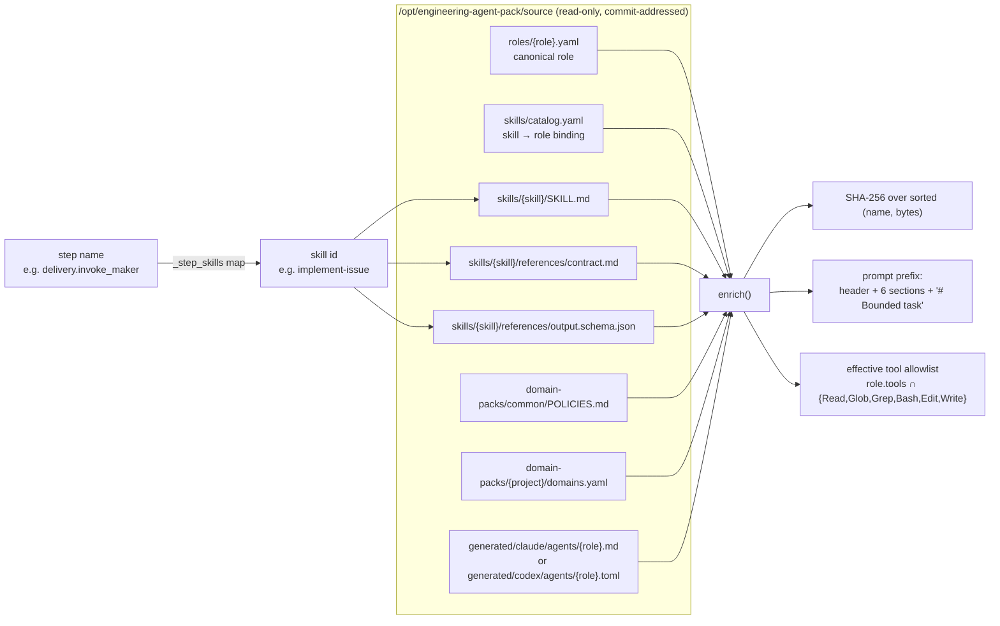
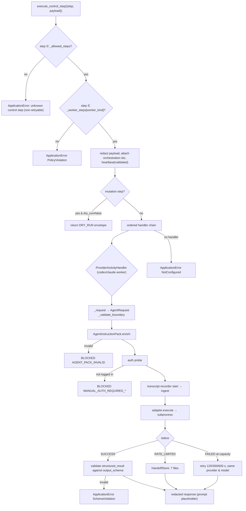

# Lecture 4 — Agents, providers, and the agent pack

> In this lecture we answer the question students ask first: *"Where is the AI?"* The answer is deliberately unglamorous. There is no long-lived agent process, no chat loop, no tool-calling framework written by this project. An **agent** is one bounded, schema-constrained invocation of a vendor's own command-line tool, wrapped in a thick layer of deterministic validation. We will see exactly what goes in, what comes out, what is remembered, and what is forbidden.

Source anchors for this lecture: `src/engineering_control/activities/core.py`, `activities/provider.py`, `adapters/claude/client.py`, `adapters/codex/client.py`, `adapters/process.py`, `agents/instructions.py`, `quota/broker.py`, `handoff/store.py`, `security/redaction.py`, `observability/agent.py`.

---

## 4.1 Why native CLIs and not an SDK?

A conventional LLM application imports an SDK, holds an API key, and calls `messages.create`. Engineering Control does **none** of that. A grep of `src/` for `anthropic`, `openai`, `litellm`, `api.anthropic.com`, `api.openai.com`, or `/v1/chat/completions` returns nothing, and `pyproject.toml` lists no LLM SDK. Instead:

* The worker host has `/usr/local/bin/codex` (OpenAI Codex CLI) and `/usr/local/bin/claude` (Anthropic Claude Code CLI) installed by the bootstrap, each **logged in with a human subscription** under its own Unix user (`codex-runner`, `claude-runner`).
* The platform spawns those binaries as subprocesses, writes the prompt to **stdin**, and reads a **JSON Lines** event stream from stdout.
* Before spawning, it **strips every API-key and base-URL variable** from the environment, so the CLI cannot silently switch to a paid API route or a third-party router.

Three reasons motivate this design:

| Reason | Consequence |
|---|---|
| **Cost containment.** Subscriptions have fixed cost; API keys have unbounded cost. | Invariant 9: a rate limit produces a durable `RATE_LIMITED` handoff, never paid fallback. |
| **Vendor tooling parity.** The CLIs already implement file tools, sandboxing (`--sandbox`, `--permission-mode`), structured output (`--json-schema`, `--output-schema`), and session handling. | The platform does not reimplement an agent loop; it constrains one. |
| **Credential isolation.** The login state lives in the runner's home (`/var/lib/engineering-control/identities/<runner>`), readable only by that user. | The controller never sees, copies, or transports provider credentials. |

## 4.2 The anatomy of an agent invocation

### 4.2.1 `AgentRequest` — the immutable order

Every provider call is described by a Pydantic model, `AgentRequest` (`models/core.py:58-86`). Its fields are the complete specification of what the agent may do:

| Field | Meaning |
|---|---|
| `run_id` | UUID. Doubles as the primary key of `agent_invocations` and `agent_executions`. |
| `project` | `falcone`, `musematic`, `llmwiki`, `gntik-ui`. |
| `role` | The **agent-pack role id**, e.g. `implementer`, `code-reviewer`, `domain-auditor`. |
| `provider` | `codex` or `claude`. |
| `model_class` | `scout`, `routine`, `worker`, `judge` — a logical class, not a model name. |
| `prompt` | The bounded task text (1–200,000 chars). Never persisted. |
| `working_directory` | Must be a leased worktree under `/srv/engineering/worktrees`. |
| `output_schema` | A JSON Schema (Draft 2020-12) the result **must** satisfy. |
| `timeout_seconds` | 30–21,600, default 1,800. |
| `effort`, `model` | Optional reasoning effort and model pin. |
| `writable` | `False` by default. Only the maker may be `True`. |
| `allowed_tools` | Subset of `{Read, Glob, Grep, Bash, Edit, Write}`. |
| `instruction_bundle_sha256`, `instruction_bundle_sources`, `agent_pack_revision` | Filled in by the agent pack loader (below). Persisted as provenance. |
| `change_set_id`, `campaign_id` | Links to the ChangeSet or campaign the work belongs to. |

Notice what is *not* here: no credentials, no repository URL, no shell command, no GitHub token. The agent receives a directory and a question.

### 4.2.2 The agent pack — roles, skills, domain packs

The **agent pack** is a separate, provider-neutral Git repository (`engineering-agent-pack`) installed read-only at `/opt/engineering-agent-pack/source`, a symlink into `releases/<40-hex-commit>/source`. Engineering Control is its only runtime consumer. It is the "personality library": thirteen canonical roles and about two dozen skills, generated into Claude-flavoured Markdown and Codex-flavoured TOML from one catalog.

For **every** invocation, `AgentInstructionPack.enrich` (`agents/instructions.py:70-151`) loads exactly eight files:



The skill is chosen **by step name**, not by the model (`instructions.py:30-57`):

| Step | Skill | Role (typical) |
|---|---|---|
| `audit.agent_cell` | `audit-domain` | `domain-auditor` (`security-auditor` for R3) |
| `finding.reproduce` | `verify-finding` | `finding-verifier` |
| `delivery.invoke_spec`, `change_request.draft` | `create-openspec` | `product-spec-architect` |
| `delivery.invoke_maker`, `delivery.invoke_deployment_maker` | `implement-issue` | `implementer` |
| `delivery.invoke_checker`, `change_request.review` | `review-change` | `code-reviewer` |
| `reconcile.invoke_release_reviewer` | `prepare-staging` | `release-plan-reviewer` |
| `runtime.independent_review` | `verify-runtime` | `runtime-verifier` |
| `enhancement.discover` | `discover-enhancements` | `domain-auditor` |
| `enhancement.product_review` | `review-enhancement` | `product-spec-architect` |
| `ui_plan.draft`, `ui_plan.review` | `plan-ui-migration` | `ui-migration-architect` |
| `ui_fanout.gap_draft`, `ui_consolidate.plan` | `triage-ui-gap` | `ui-gap-triager` |

The loader is strict. Each source must resolve under the pack root, be a regular file, be **not world-writable**, and be at most 256 KiB. The role YAML must declare `deployment_permissions: false`, `merge_permissions: false`, `release_credentials: false` — literally `False`, not merely falsy. `recursion_depth` must be `0` or `1` (shipped roles use `0`: agents do not spawn agents; Temporal owns the topology). `writable=True` is legal only for role `implementer`, and only if that role lists both `Edit` and `Write`. A read-only request may not carry `Edit` or `Write`. The skill catalog must bind the chosen skill to the requested role. The domain pack must belong to the requested project. The skill's `output.schema.json` must be a valid Draft 2020-12 schema, and for the release reviewer it must equal the request's schema byte for byte.

Any violation becomes the blocker `AGENT_PACK_INVALID` and the step is recorded as `BLOCKED` without spawning anything (`provider.py:197-204`). This is Invariant 11's cousin: **a drifted or tampered agent pack cannot run**.

The output of `enrich` is a new `AgentRequest` whose prompt is:

```
<header: Bundle SHA256, Agent-pack revision, Role, Skill, Project, schema SHA256>
## Canonical role
## Provider-specific generated role
## Common policy
## Project domain pack
## Selected skill
## Skill execution contract

# Bounded task

<the original prompt>
```

The header sentence "The control-plane supplied structured output schema is authoritative" is the reason structured output is reliable: the model is told, and the platform later enforces, that the JSON schema is the contract.

### 4.2.3 What is remembered and what is forgotten

| Persisted (in `agent_invocations`) | Never persisted |
|---|---|
| `agent_pack_revision`, `instruction_bundle_sha256`, `instruction_sources_json`, `allowed_tools_json` | The prompt text and the prompt prefix |
| `status`, `summary`, `structured_result`, `error_code`, `provider_session_id`, timestamps | Raw tool results, model "thinking" or reasoning events |
| `provider_usage`: input/output/cached token counts where the CLI exposes them | Any invented cost or capacity number |

Because the controller re-validates every payload as an `AgentRequest` (which requires `prompt` to be non-empty), the prompt is **replaced** with a placeholder string rather than deleted when the payload is echoed back through Temporal history (`provider.py:668-693`). That detail closes finding F-14 in the project's own audit: workflow histories no longer carry hundreds of kilobytes of prompt.

## 4.3 The two adapters

### 4.3.1 Claude Code

`adapters/claude/client.py:79-102` builds this exact command line:

```
claude --print --output-format stream-json --verbose
       --json-schema <compact sorted output_schema, "$schema" key removed>
       --no-session-persistence --safe-mode --strict-mcp-config
       --mcp-config {"mcpServers":{}}
       --permission-mode dontAsk
       --tools <list> --allowed-tools <same list>
       [--model <pin>] [--effort <level>]
```

Reading each flag as a safety decision:

* `--print` and `--output-format stream-json`: non-interactive, machine-readable JSONL.
* `--json-schema`: the CLI's own structured-output mode; the `$schema` meta-key is removed only for the CLI copy because Claude Code rejects it, while the full schema is still enforced by the platform afterwards.
* `--no-session-persistence`: nothing is written to a session store between calls.
* `--safe-mode`: disables the repository's `CLAUDE.md`, skills, plugins, hooks, MCP servers, and custom agents. The *product's* repository cannot instruct the agent; only the agent pack can.
* `--strict-mcp-config --mcp-config {"mcpServers":{}}`: an explicitly empty, strict Model Context Protocol configuration, so no external tool server loads.
* `--permission-mode dontAsk`: the agent never prompts a human; a disallowed action simply fails. No "dangerously skip permissions" bypass is used anywhere.
* `--tools` and `--allowed-tools`: identical bounded lists. A read-only request containing `Edit`, `Write`, or `NotebookEdit` raises before spawn.

Authentication is probed first with `claude auth status`; the JSON must report `loggedIn`/`authenticated` as true, or the step is blocked as `MANUAL_AUTH_REQUIRED_CLAUDE`.

Parsing: the last `result` event supplies `structured_output` and `result` text (both redacted). Usage is taken from the last event carrying a `usage` object (`input_tokens`, `output_tokens`, `cache_read_input_tokens`). A notable robustness patch (NEW-53): if the CLI exhausts its own structured-output retries, the adapter recovers the last `StructuredOutput` tool call from the final assistant event, validates it against the original schema, and if needed decodes arrays that arrived as JSON strings. A recovered result is marked `recovered_from_structured_retry`.

Model pins (`config.py:81-82`): the spec architect and the checker are pinned to `claude-opus-5-5`; other Claude steps pass no `--model` and inherit the runner's CLI default.

### 4.3.2 Codex CLI

`adapters/codex/client.py:147-178` builds:

```
codex exec --json --color never --ephemeral --strict-config
     --cd <worktree>
     --sandbox workspace-write | read-only
     --output-schema <tmp>/output-schema.json
     --output-last-message <tmp>/final.json
     [--skip-git-repo-check]            # observability canary only
     [--add-dir <gitdir> --add-dir <commondir>]   # writable linked worktrees only
     --model <request.model or settings.codex_model>
     [--config model_reasoning_effort="<effort>"]
     --config projects={"<cwd>"={trust_level="untrusted"}, "<repo root>"={trust_level="untrusted"}}
     -
```

* `--sandbox workspace-write` is granted only to a `writable` request (the maker); everything else is `read-only`.
* `--add-dir` exists because a Git *linked worktree* keeps its metadata in a separate `.git` directory; without it a sandboxed `git commit` would fail (NEW-37).
* The `projects={…trust_level="untrusted"}` override (NEW-130) makes Codex ignore the **product repository's** own `.codex/config.toml`, so a repository cannot inject MCP servers, model choice, sandbox relaxations, or hooks into the agent that is editing it.
* `--model` is always passed; the default is pinned in settings (`gpt-6.1-sol` at the time of writing) because an upstream CLI default once changed under the operators (NEW-36).
* `-` means "prompt on stdin".

Each attempt runs in a `0700` temporary directory under `/srv/engineering/tmp/codex/<run_id>/attempt-*`, created with symlink and permission checks and deleted when the attempt ends. Authentication is `codex login status` exit code 0.

### 4.3.3 The shared subprocess runner

`adapters/process.py:165-272` (`run_jsonl_process`) is common to both adapters:

1. The prompt is **redacted** before it is written to stdin. (Yes: the platform scrubs secrets from what it sends to the model, too.)
2. The child is spawned with `start_new_session=True` so that a timeout can kill the whole process group, and with a 2 MiB per-line limit.
3. Every stdout line passes through `redact_json_line`; every stderr line through `redact_text` (stderr is capped at 256 kB).
4. Timeout → SIGTERM to the group, 10 s grace, SIGKILL. Temporal cancellation → the same, then the cancellation is re-raised.

The environment is built by `subscription_only_environment` (`process.py:87-145`). It **removes** 27 variables including `OPENAI_API_KEY`, `OPENAI_BASE_URL`, `ANTHROPIC_API_KEY`, `ANTHROPIC_AUTH_TOKEN`, `ANTHROPIC_BASE_URL`, `OPENROUTER_API_KEY`, `DEEPSEEK_API_KEY`, `OMNIROUTE_URL`, `LLM_BASE_URL`, `MODEL_GATEWAY`, `CLAUDE_CODE_USE_BEDROCK`/`VERTEX`/`FOUNDRY`, all `AWS_*` credentials, `CLAUDE_CODE_OAUTH_TOKEN`, `CLAUDE_CONFIG_DIR`, `CODEX_HOME`, and every proxy variable. It **adds** offline toolchain settings (`GOPROXY=off`, `GOTOOLCHAIN=local`, Trivy offline flags, `NO_COLOR=1`). Any caller trying to override a forbidden key raises `ValueError`. This single function is the mechanical enforcement of "no paid fallback".

## 4.4 From step to subprocess: the dispatcher

Recall from Lecture 3 that there is one Temporal activity, `execute_control_step`. On a provider worker the dispatcher (`core.py:629-727`) does the following:



`_validate_boundary` (`provider.py:548-599`) is worth memorising: the request's `provider` must equal the worker's own kind (a Codex worker cannot be tricked into running a Claude request); the working directory must be inside `worktree_root`; only `delivery.invoke_maker` and `delivery.invoke_deployment_maker` may be writable and they *must* be; `skip_git_repository_check` is permitted only for the observability canary inside `worktree_root/observability-canary/`.

## 4.5 Bracketing: the controller never loses an invocation

A workflow never calls a provider step directly. It calls `_agent_step` (`workflows/definitions.py:416-429`):

```python
started = await self._step("agent.record_start", {**payload, "provider_step": step})
try:
    result = await self._step(step, started, timeout_minutes=timeout_minutes)
except ActivityError as error:
    failed = _agent_failure_payload(started, error.cause)
    return await self._step("agent.persist_result", failed)
return await self._step("agent.persist_result", result)
```

* `agent.record_start` runs on the **controller** (`engineering-control` queue). It finds or creates the control `Run`, inserts an `agent_invocations` row with status `RUNNING` and the full provenance, and inserts an `agent_executions` row with status `QUEUED`. The worker's later "execution started" call is **rejected** if this pre-registration is missing (`observability/agent.py:349-351`).
* The provider step runs on `engineering-codex` or `engineering-claude` with a long `start_to_close_timeout` (120 min for maker/checker, 60 for reproduction, 90 for release review, 10 for canaries) and a 2-minute heartbeat timeout.
* `agent.persist_result` runs on the controller again and writes the outcome, the usage row (`provider_usage`, id derived deterministically from the run id so replays are idempotent), the run status, and the execution summary. A `RATE_LIMITED` run is left without `finished_at` so that it can be resumed.

Because both brackets are idempotent and replay-validated (`_validate_invocation_binding`), a Temporal replay after a crash cannot double-count an invocation or attach a result to the wrong request ("provider result identity does not match its immutable request" is a real error seen in production history).

## 4.6 Heartbeats and transcripts

During a long, quiet model turn nothing may be printed for minutes. Two mechanisms keep the activity alive and observable:

* **Event heartbeats.** Every JSONL event triggers `activity.heartbeat({provider, run_id, sequence, event_type})`.
* **Keepalive.** A background task heartbeats every 10 seconds regardless of output and flushes the transcript buffer to the evidence ingest service. Temporal's heartbeat timeout is 2 minutes, so a recovered activity stays on its original attempt even through a silent 20-minute test run (verified in `docs/VALIDATION.md`).

The transcript path is `AgentTranscriptRecorder` → HTTP `POST /v1/observability/executions/{id}/{start|heartbeat|logs|finish}` on the evidence ingest listener → `agent_executions` / `agent_log_chunks` tables → dashboard **Logs** page via Server-Sent Events. Normalisation keeps `system`, `progress`, `assistant`, `tool`, `test`, and `stderr` events and **drops** `user`, `prompt`, `input`, `thinking`, and `reasoning` events. Limits: 5 MiB per execution, 16 KiB per line, 64 KiB or 64 chunks per batch. Beyond the cap, `output_truncated` is set once and execution continues. Persistence failure never changes the provider result; the summary is merely marked `transcript_incomplete`.

## 4.7 Maker and checker: the separation of powers

The system's central anti-hallucination device is that **the agent that writes code is never the agent that judges it**, and by default they are different vendors.

| Role in a delivery | Agent-pack role | Default provider | Writable? | Effort |
|---|---|---|---|---|
| Spec | `product-spec-architect` | Claude (Opus 5.5 pin) | no | high |
| Maker (source and deployment repos) | `implementer` | Codex | **yes**, `--sandbox workspace-write` | high |
| Checker | `code-reviewer` | the **opposite** of the maker | no | high |
| Release-plan reviewer | `release-plan-reviewer` | the checker's provider | no | high |
| Runtime verifier | `runtime-verifier` | opposite of the maker | no | high |
| Finding verifier | `finding-verifier` | opposite of the finding's discoverer | no | high |

Routing is a controller step, `delivery.route_providers` (`metadata.py:3020-3062`), which asks the **quota broker** for a decision. The result (`spec_provider`, `maker_provider`, `checker_provider`) is then used by the workflow to choose the task queue for each later step. Effort is derived deterministically (`models/core.py:89-109`): trivial canaries → `low`; writable work, R3, or `judge` class → `high`; otherwise `medium`.

ACLs reinforce the split at the filesystem level (Lecture 5): the maker's Unix user has write permission on the worktree; the checker's user has read permission only.

## 4.8 The quota broker

`quota/broker.py` is small but conceptually important because it embodies Invariant 7 ("unknown is unknown").

* `QuotaRefreshWorkflow` runs every 30 minutes and calls `quota.refresh` on each provider worker. The step probes `claude auth status` / `codex login status` and **reports capacity as `None`** with source `native_cli_auth_status;capacity_not_exposed`. Neither CLI exposes remaining quota, so the platform records exactly that: authenticated or not, CLI present or not, and nothing invented.
* `QuotaBroker.route(role, model_class, risk_class, maker=None)`: if no snapshot exists the provider is treated as available with reason `capacity_unknown`; if a snapshot says `rate_limited` the provider is unavailable until `reset_at` passes; if a numeric fraction *were* available, a **25 % reserve** (bounds 20–30 %) is protected for verification roles (`finding-verifier`, `code-reviewer`, `runtime-verifier`, `security-auditor`, `incident-analyst`, `release-plan-reviewer`) and for R3 work.
* Preference lists are hard-coded: planners and spec architects prefer Claude; implementers prefer Codex; the checker is always the opposite of the maker. If no provider is available the decision is `RATE_LIMITED` with `handoff_required=True`; R3 with no checker available is `BLOCKED`.

## 4.9 Rate limits and the seven-file handoff

When stderr contains a marker such as `rate limit`, `usage limit`, `quota exceeded`, `too many requests`, or `http 429`, the result is `RATE_LIMITED`. The platform then writes a **handoff bundle** so that a human or a later run can resume without re-deriving context (`handoff/store.py:16-24`, mirrored by `schemas/handoff.schema.json` which demands exactly seven files):

| File | Content |
|---|---|
| `TASK.md` | Project, role, ChangeSet, and the instruction to resume from immutable source references without inferring credentials or changing provider. |
| `CONTEXT.json` | The redacted runtime payload. |
| `DECISIONS.md` | Decisions the agent recorded. |
| `SOURCE-REFS.json` | Source references. |
| `DIFF.patch` | The redacted diff so far. |
| `TEST-RESULTS.json` | Test results so far. |
| `OPEN-QUESTIONS.md` | Open questions. |

Files are written atomically (temp file, `os.replace`, fsync) under `/srv/engineering/runs/<provider>/<run_id>/handoff/`, each redacted again, and their SHA-256 digests are returned in the activity result. The Run stays open. Retention cleanup explicitly protects rate-limited runs.

A related but distinct case is **capacity**: if the provider reports "model is at capacity" or `overloaded_error`, the handler waits 120, 300, then 600 seconds and retries the *identical* request on the *same* provider and model, at most three times, and only if at least 600 seconds of activity budget remain. The code comment says it plainly: "never a substitute".

## 4.10 Redaction: the last line of defence

`security/redaction.py` is invoked at every boundary: payload entry, prompt before stdin, every stdout and stderr line, structured results, transcript lines (twice: on the worker and again on ingest), blocker details, handoff files, and `SafeCommandRunner` output. Twelve pattern families are covered: bearer and basic authorization headers, cookies, JWTs, GitHub tokens (`ghp_`, `gho_`, `github_pat_`…), provider tokens (`sk-`, `sk-ant-`, `hcloud_`), AWS access keys, PEM private keys, `password=`/`secret=`/`token=`-style assignments, credentials embedded in URLs, credential-bearing query parameters, and kubeconfig `token:`/`client-key-data:` lines. Structured redaction additionally blanks any value whose **key** looks sensitive (`password`, `secret`, `token`, `api_key`, `kubeconfig`…) unless the key is a safe reference (`*_path`, `*_id`, `*_sha256`). Token counters pass through.

The contract that makes the evidence store trustworthy is "reject on any replacement": the ingest service re-runs the redactor on content that should already be clean and treats a non-zero replacement count as a leak signal. That is why every pattern carries a negative look-ahead so that already-redacted text produces zero replacements on a second pass.

## 4.11 The observability canaries

Two tiny workflows exist purely to prove the agent path works: `ObservabilityAcceptanceWorkflow` (Codex maker → Claude checker) and `ReverseObservabilityAcceptanceWorkflow` (Claude maker → Codex checker). Each creates an empty workspace under `worktree_root/observability-canary/<uuid>`, runs both providers read-only with tools `Read, Glob, Grep` and effort `low`, persists transcripts, and removes the workspace. They accept no repository, prompt, or tool argument. They are triggered by `POST /v1/validation/observability` and were run 31 times during go-live.

## 4.12 Summary

An **agent** in Engineering Control is:

> one subprocess of a vendor CLI, started by a dedicated Unix user, in a leased worktree, with API keys stripped from its environment, fed a prompt composed of an immutable role/skill/policy/domain bundle plus a bounded task, restricted to an explicit tool list and sandbox mode, required to answer in a validated JSON schema, heartbeated every ten seconds, transcribed and redacted, and bracketed by two database writes on the controller so that its existence and outcome are never in doubt.

Everything the model *decides* is advisory. Everything that *happens* afterwards is decided by the deterministic code we study in Lectures 5, 6, and 7.
