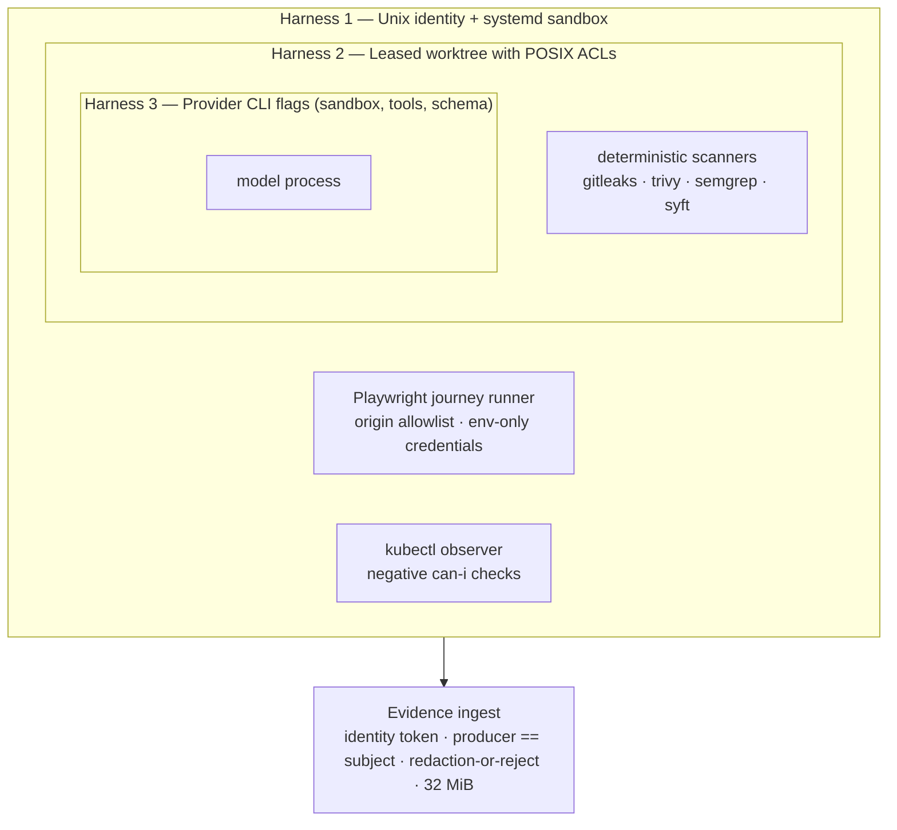
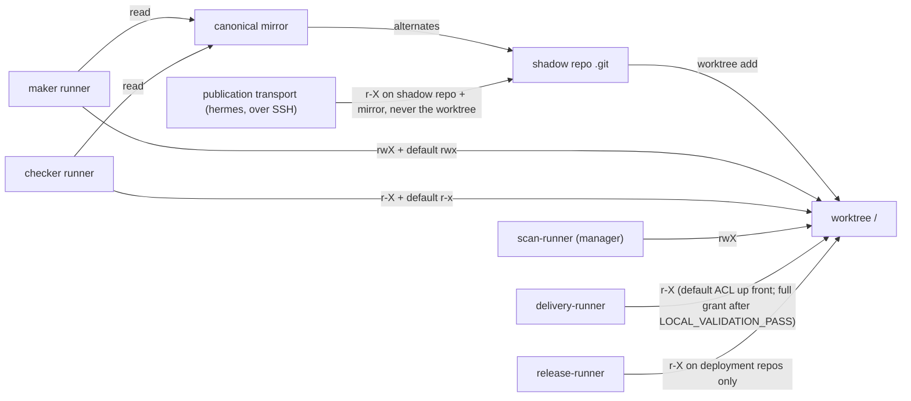
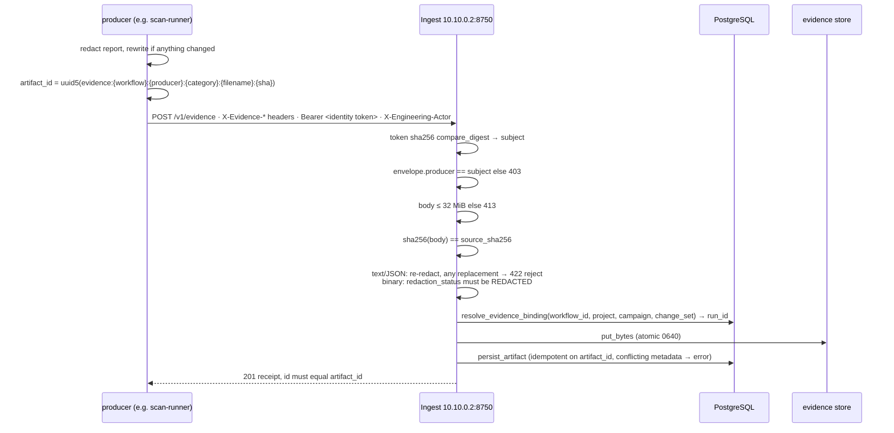

# Lecture 5 — The execution harness: workers, worktrees, scanners, browsers, evidence

> If Lecture 3 was the nervous system and Lecture 4 the brain-in-a-box, this lecture is the body: the machinery that gives an agent a safe place to work, measures what it did with deterministic tools, lets a browser touch a staging product without leaking credentials, and ships every result home as content-addressed, redacted evidence. The recurring theme is **harness**: the platform does not trust the thing it runs, so it wraps it.

Source anchors: `src/engineering_control/activities/scan.py`, `worktrees/manager.py`, `leases/*`, `adapters/scanning/tooling.py`, `adapters/kubernetes/observer.py`, `activities/browser.py`, `browser/run-journey.mjs`, `identity/*`, `evidence/*`, `activities/retention.py`, `activities/preview_cleanup.py`, `activities/connections.py`.

---

## 5.1 What "harness" means here

In this product a *harness* is any layer that constrains an untrusted or semi-trusted executor to a bounded, observable, reversible envelope. There are four of them, nested:



Lecture 4 covered Harness 3. This lecture covers Harnesses 1 and 2, the deterministic tools, the browser and observer harnesses, and the evidence pipeline.

## 5.2 Harness 1: six identities

| Identity | Owns | May never |
|---|---|---|
| `codex-runner` | its CLI home, its temp root, one shadow repo per ChangeSet it is maker of | read Claude auth, release creds; deploy; merge |
| `claude-runner` | same for Claude | read Codex auth, release creds; deploy; merge |
| `scan-runner` | canonical mirrors, worktree allocation, shadow repos, scanner caches, observer kubeconfig | read model auth, release creds |
| `browser-runner` | Playwright runtime, journey outputs, superadmin credential files | read model auth, release creds, production admin |
| `delivery-runner` | its run files, GHCR registry config | read model auth, release creds; merge; force-push |
| `release-runner` | release kubeconfigs, Helm/Argo/kubectl | read model homes; run prompts |

The systemd template gives each `ReadWritePaths` only for its own `/srv/engineering/{runs,evidence,cache,tmp}/<kind>` and identity home; `scan` additionally writes mirrors, worktrees, and the shadow-git cache; `release` has `ReadOnlyPaths=/srv/engineering/worktrees` and no identity home at all. `verify-worker.sh` tests the negatives live: no runner can read another's evidence token; Codex and Claude cannot read `release-worker.env`; only `delivery-runner` reads the registry config; only `scan-runner` reads the observer credential directory.

## 5.3 Harness 2: mirrors, shadow repos, worktrees, ACLs

### 5.3.1 Layout

```text
/srv/engineering/mirrors/<repo>.git                       canonical bare mirror — scan-owned, never written by scan
/srv/engineering/cache/scan/worktree-git/<repo>/<id>.git  shadow bare repo per ChangeSet or campaign
/srv/engineering/worktrees/<repo>/<change-set-id>         the maker's working copy, branch agent/<project>/<issue>/<cs>
/srv/engineering/worktrees/<repo>/<campaign-id>           detached read-only audit snapshot
/srv/engineering/worktrees/observability-canary/<uuid>    empty canary workspace
/var/lib/engineering-control/leases/worktrees/*.lease     flock files
```

The **canonical mirror** is refreshed only by the controller's GitHub worker (which has the credential) and pushed to the worker host over SSH. `GitWorktreeManager.fetch` on the worker deliberately does **not** fetch; it only verifies `origin` exists. The scan worker never handles a GitHub credential.

The **shadow repo** is created with `git clone --bare --shared <mirror>`: it reads objects through an alternates file from the canonical mirror and owns its own refs. A maker therefore writes commits and branch refs to *its* shadow repo and can never rewrite another ChangeSet's refs or the canonical mirror.

The **worktree** is `git worktree add -b agent/<project>/<issue>/<cs> <path> <base-sha>` from the shadow repo. Allocation holds a file lease; a dirty leftover is archived under `refs/archive/<cs>/<stamp>-head` and `-worktree` (a stash) before reset; a retry of the same ChangeSet may resume prior commits that descend from the base (NEW-52). Audit snapshots are `--detach` at the exact SHA and must be clean.

### 5.3.2 ACL matrix



`WorktreeAccess` accepts only `codex-runner`/`claude-runner` and requires maker ≠ checker. Grants are applied with `setfacl` and the worktree is removed if a grant fails. Shared group write is never used.

### 5.3.3 Leases

Two layers:

* `FileLease` — host-local `flock` on `<root>/<key>.lease` recording owner, pid, and time. Guards allocation races.
* `ComponentLeaseManager` (PostgreSQL) — modes `implementation`, `deployment`, `migration-secret`; TTL ≤ 8 h; scopes implemented as `pg_advisory_xact_lock`. Limits: at most **2 implementations per project**, **1 deployment per environment**, **1 global migration-secret**. Acquire and release are refused while a `delivery.publication_effect` for the project is `STARTED|UNKNOWN`, so a publication whose outcome is not yet known can never be raced by a second maker.

These encode `config/policies/concurrency.yaml` and Invariant 1.

## 5.4 Deterministic scanners

`DeterministicScanner` wraps a `SafeCommandRunner` whose executable allowlist is exactly `gitleaks`, `trivy`, `semgrep`, `syft`, `kubeconform`. `SafeCommandRunner` runs without a shell, with a minimal environment (`PATH`, `LANG`, `LC_ALL`, `NO_COLOR`), `start_new_session`, and redacted output. Each scanner's report is **reused** if already present (idempotent retries) and never overwritten.

| Tool | Invocation | Normalisation |
|---|---|---|
| gitleaks | `gitleaks dir --redact=100 --report-format json --no-banner --exit-code 2 <worktree>` | keep `RuleID, Description, File, StartLine, EndLine, Commit, Entropy, Fingerprint`; force `Secret = REDACTED` |
| trivy | `trivy filesystem --format json --scanners vuln,misconfig,secret,license --exit-code 0 <worktree>` (offline, 30 min) | allowlisted fields per result class, then structural redaction |
| semgrep | `semgrep scan --config p/ci --json --metrics=off <worktree>` | keep `check_id, path, start, end, extra.message, extra.severity` |
| syft | `syft <worktree> --output cyclonedx-json` | generic redaction |
| kubeconform | `kubeconform -strict -summary -ignore-missing-schemas` | manifest bounded inside the worktree |

Reports are written atomically at mode `0640` and published with `producer="scan-runner"`.

### 5.4.1 Baseline and "introduced" findings (NEW-28)

`delivery.deterministic_prechecks` scans the worktree **before** the maker runs (for a resumed worktree, a scratch checkout of the base) and stores finding identities as a baseline. `delivery.validate_changeset` scans again after the checker and computes **introduced** findings against that baseline. Identities are line-independent (`[RuleID, file]`, `[check_id, path]`, trivy HIGH/CRITICAL keyed by target/id/package/version) and counted with multiplicity, so a line shift does not create a false "new" finding while a second real occurrence still counts. No baseline → every finding is introduced (fail closed).

### 5.4.2 `delivery.validate_changeset` — the deterministic gate before any PR

In order:

1. The independent checker's structured `decision` must be `PASS`, else `REQUEST_CHANGES / INDEPENDENT_CHECKER_DID_NOT_PASS`.
2. Any maker-reported test `FAIL` blocks with `MAKER_TEST_FAILURE` unless proven **pre-existing at the base commit** (next section).
3. Per repository side: clean ignored toolchain artifacts; compute change evidence (`git diff --check`, binary diff versus base, untracked hashes); **refuse any change to `.codex/`, `.claude/`, or `.mcp.json`** (`AGENT_CONFIG_CHANGE_REFUSED`, NEW-130 — an agent may not reconfigure the agent that reviews it); an empty source change blocks.
4. Post-check scans into a per-head directory; introduced findings → `REQUEST_CHANGES / CHANGESET_VALIDATION_FINDINGS` (identities only, max 40).
5. If secrets were introduced, the patch is **withheld** (only a receipt with its SHA-256 is kept).
6. `_classify_release_impact` matches the diff against five regex categories — `migration`, `secret_lifecycle`, `cluster_scoped`, `auth_or_tenant_boundary`, `destructive_lifecycle` — and sets a `risk_floor`: **R3** if any matched, **R2** for a deployment-repository change, else **R1**. The floor can only rise later; a model cannot lower it.
7. On pass, grant `delivery-runner` read on both worktrees and `release-runner` read on the deployment worktree, return `LOCAL_VALIDATION_PASS`.

### 5.4.3 Pre-existing test failures (NEW-49 / NEW-161)

A maker may honestly report that a test fails for reasons unrelated to its change. The harness checks this claim **without trusting the maker**:

* Contract test commands (declared by the project manifest) are rerun at the **base** commit in a cached toolchain-prepared checkout; results are cached under a file lock.
* Any other failing command must parse as a strict `node --test` invocation under `tests/` or `test/`, and is rerun **only at the base**, inside **bubblewrap** with no network, a read-only system, the checkout mounted as an overlayfs copy-on-write view whose upper layer is discarded afterwards, a size-capped `/tmp`, and a nonce-tagged reporter. Budgets: 1,200 s per command, 4,800 s total, 256 KiB output.
* The failure is "pre-existing" only if the base run exits non-zero **with at least one test-level failure**; sandbox errors and file-level failures never count. The head is never executed.

## 5.5 Harness for the browser

The browser worker executes **fixed journeys**, never model-generated ones.

* A journey is a JSON plan validated against `schemas/journey-plan.schema.json`: `start_url`, 1–20 `allowed_origins`, ≤100 steps from a closed action set (`goto`, `click`, `click-selector`, `fill`/`fill-selector` with `value_from_env` matching `^JOURNEY_[A-Z0-9_]+$`, `expect-selector`, `expect-url`, `wait-for-text`, `capture`). **A literal fill value cannot be expressed.**
* Catalog flows (`config/flows/<project>/*.yaml`) describe personas, preconditions, steps on `browser` or `api` channels, positive/negative controls, cleanup instructions, and a `mutation` class (`non-mutating` or `disposable`). `_browser_plan` compiles them to runner actions and sets `capture_visual_evidence = not credentialed`.
* **Credentials never enter the plan.** The handler loads the superadmin credential (`/etc/engineering-control/credentials/<project>/superadmin.env`, root-owned `0640`, HTTPS base URL, `username_password` only), logs in, creates an **ephemeral persona** (`e2e-<project>-<campaign>-<persona>-<hex>`, ≤8 users and ≤4 roles per campaign, 120-minute TTL, random 32-byte password), and passes values to the Node runner **only as environment variables** (`JOURNEY_USERNAME`, `JOURNEY_PASSWORD`, optional `JOURNEY_ACCESS_TOKEN`, …). Every value is registered with the redactor for the duration. A persistent `credential_file` in a runtime-verification payload is refused outright.
* `run-journey.mjs` (Playwright 1.62.1): headless Chromium/Firefox, `ignoreHTTPSErrors: false`, service workers blocked, **every request outside the allowed origins is aborted**, console (≤5,000) and network (≤5,000, origin/path/status only) events recorded, screenshots and traces **only when no credential was used**. Output is `result.json` (mode `0600`) plus `final.png`/`failure.png`/`trace.zip` when capturing.
* Only `result.json` is published (redacted twice; credential values replaced by `[REDACTED:journey-credential]`). Screenshots and traces are marked `REVIEW_REQUIRED` and never uploaded. A credentialed journey that somehow produced visual evidence raises a `SecurityBlocker`.
* Cleanup: the persona is logged out, deleted or restored, and proven absent; any failure raises `INCOMPLETE_IDENTITY_CLEANUP`, which blocks publication. Falcone cannot create roles (`IDENTITY_BOOTSTRAP_ROLE_UNSUPPORTED`); LLMWiki identities come from Falcone's OIDC and have no password-grant token.

API-channel flows (`audit.api_flow`) run with `httpx`, 30-second timeout, no redirects; a `disposable` flow requires `JOURNEY_SAFE_E2E_MUTATION=true` and verified cleanup, and created ids are reported only as `resource-sha256:<hash>`.

## 5.6 Harness for Kubernetes observation

`KubernetesObserver` is a read-only `kubectl` façade. Before **every** observation it runs `kubectl auth can-i` and requires:

* **Denied** (`no`, per namespace): `get|list|watch secrets`; `create|update|patch|delete|deletecollection` on each observed resource and on `*`, `configmaps`, `pods`, `secrets`, `serviceaccounts`, `roles`, `rolebindings`; `create pods/exec|attach|portforward`.
* **Denied** (cluster-wide): mutation on `*`, `create|delete namespaces`, `create clusterroles|clusterrolebindings|customresourcedefinitions`, `impersonate`, `escalate`, `bind`.
* **Allowed**: `get`, `list`, `watch` on the observed resources plus `pods`, `pods/log`, `events`.

A `yes` where `no` is required is "overprivileged"; anything else is "could not be proven least-privileged". Both are `SecurityBlocker`s. The kubeconfig must be a non-symlink regular file under `/etc/engineering-control/credentials`, mode `0600` owned by the worker or `0640` root-owned with the worker's group. The observer returns only **reduced metadata** — names, readiness, revisions (from a deployment annotation or Argo `status.sync.revision`), image digests (`sha256:` from `image`/`imageID`), and bounded redacted log tails (100 lines, 16 KiB) — never raw objects. `identity()` returns only context, API server, and username.

This is why `docs/SECURITY.md` can state the discovered shared cluster-admin kubeconfig is "prohibited": the code would refuse it on the first `can-i` check.

## 5.7 The evidence pipeline

### 5.7.1 Store

`LocalEvidenceStore` at `/srv/engineering/evidence` lays out `<project>/<campaign-id | changesets/<cs> | runs/<run>>/<category>/<artifact_id>-<filename>` with categories exactly `snapshot`, `findings`, `changes`. Files are written atomically at `0640`. The artifact id is deterministic: `uuid5(NAMESPACE_URL, "evidence:{workflow_id}:{producer}:{category}:{filename}:{sha256}")`, so a retried upload of the same bytes is the same artifact. Retention classes: `standard`, `ephemeral`, `security`, `release`, `incident`; only `ephemeral` artifacts are ever cleanup candidates.

### 5.7.2 Upload



Each worker identity has its **own** upload token (`/etc/engineering-control/env/evidence-<identity>.token`, group-readable only, ≥32 chars). The token's subject must equal the envelope's `producer`, so a compromised scan worker cannot upload "browser" evidence. The token grants nothing else: the ingest listener has no workflow-control routes, and the API does not accept it. The same listener also receives worker heartbeats, agent transcripts (Lecture 4), and publication claim/receipt calls from the GitHub and delivery identities.

### 5.7.3 Binding

An upload must name an existing `workflow_id` whose latest Run belongs to the stated project, and the campaign/ChangeSet ids must match that Run. Evidence therefore cannot be attached to the wrong campaign, and evidence for a workflow that never existed is rejected.

## 5.8 Retention and the triple agreement

Cleanup is the one place the platform deletes things, so it is the most defensive flow in the codebase. The daily `CleanupWorkflow` is dry-run unless `ENGINEERING_CLEANUP_EXECUTION_ENABLED=true` on **both** hosts.

Candidate categories: released or abandoned worktree leases (14-day retention, 24-hour grace), terminal delivery run directories, browser output directories, Codex per-run temp directories, ephemeral evidence artifacts, stale terminal component leases, and — only with explicit per-target opt-in and the three management labels — expired preview namespaces.

Three independent parties must agree before anything is removed:

1. **PostgreSQL eligibility** — the controller derives candidates from Run, ChangeSet, lease, and artifact rows.
2. **Owner inspection** — the identity that owns the path inspects it (no symlinks, exact expected path, a manifest of every entry with size and mtime, hash match for artifacts; `kubectl get namespace` with uid, resourceVersion, and label hash for namespaces) and reports `CLEAN`, `ABSENT`, or `MODIFIED_AFTER_CUTOFF`.
3. **Controller authorization** — `cleanup.authorize` re-derives eligibility, rejects any candidate whose identity changed since inspection, and computes `cleanup_authorization_sha256` over the canonical sorted list.

Every executor recomputes the hash from its payload and refuses a mismatch, then **re-inspects** and refuses if the manifest, uid, resourceVersion, or labels changed. `cleanup.finalize` verifies `completed ∪ protected == authorized`. Protected without override: active, rate-limited, or unfinished runs; open incidents; published-but-unmerged ChangeSets; `standard`/`security`/`release`/`incident` evidence; release-runner artifacts; dirty worktrees; unmanaged namespaces; identity-blocked projects. A purged ephemeral artifact leaves a tombstone row (`purged_at`, `purge_reason`).

## 5.9 Connections and heartbeats

`ConnectionsRefreshWorkflow` runs fixed probes under a 35-second budget: API and dashboard `/health/ready`, the dashboard SSE endpoint (expecting 401), Temporal TCP, public DNS (`ade.musematic.ai` must resolve to exactly the configured address), public HTTPS with the Caddy header, and TLS certificate SAN/expiry. Worker status derives from heartbeats each role worker posts every 30 seconds; workers expire after 180 s, providers after 300 s. `unknown` is never treated as healthy.

## 5.10 Summary

The harness gives an agent exactly one directory it can write, backed by a private shadow repository, under a Unix identity that can read nothing it should not; measures the result with pinned deterministic scanners against a pre-recorded baseline; rejects any attempt to reconfigure the agent tooling or to lower the risk floor; lets browsers and observers see only what least-privilege allows; and ships every byte of output through an identity-bound, redaction-or-reject evidence pipeline that even the cleanup process must negotiate with three-way agreement.
