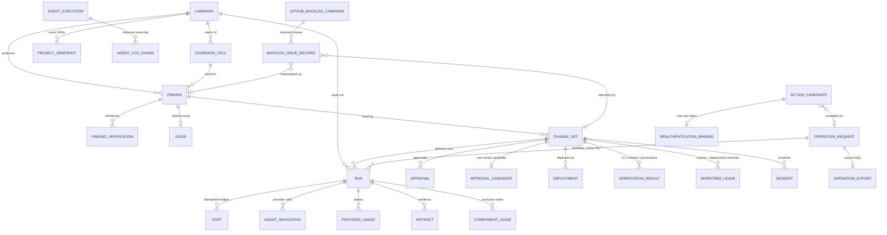
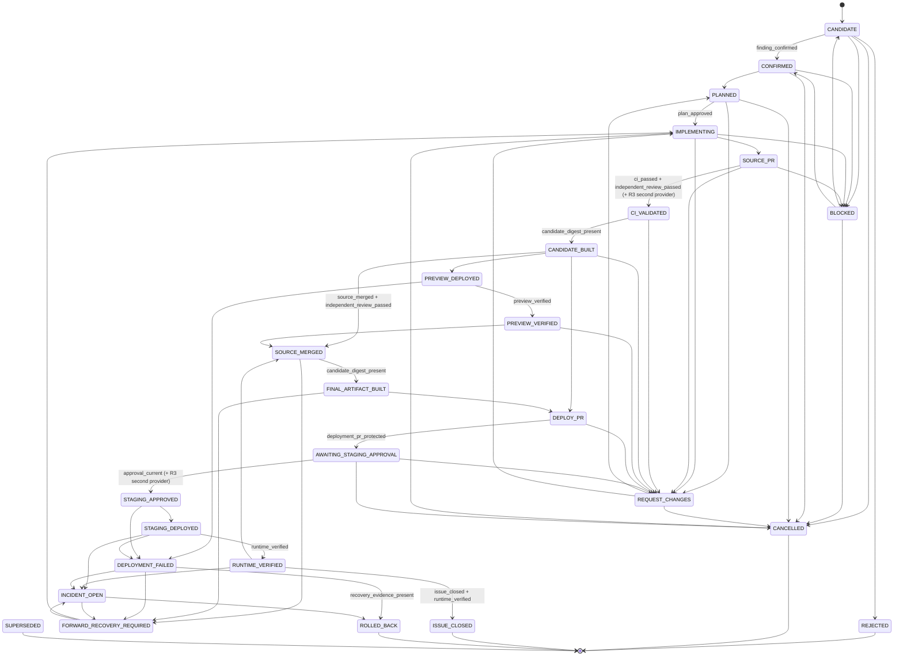
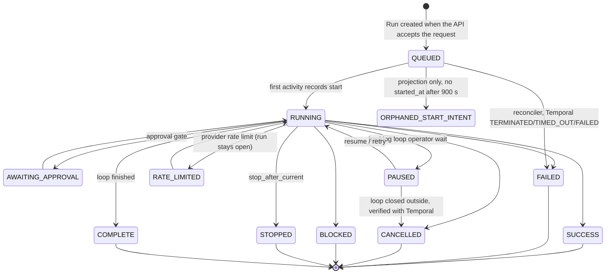
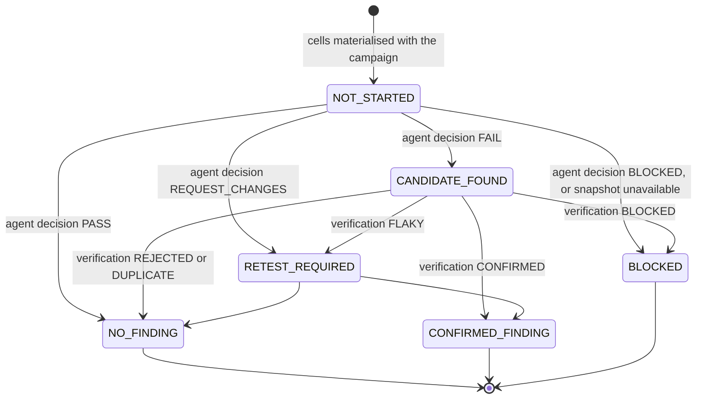
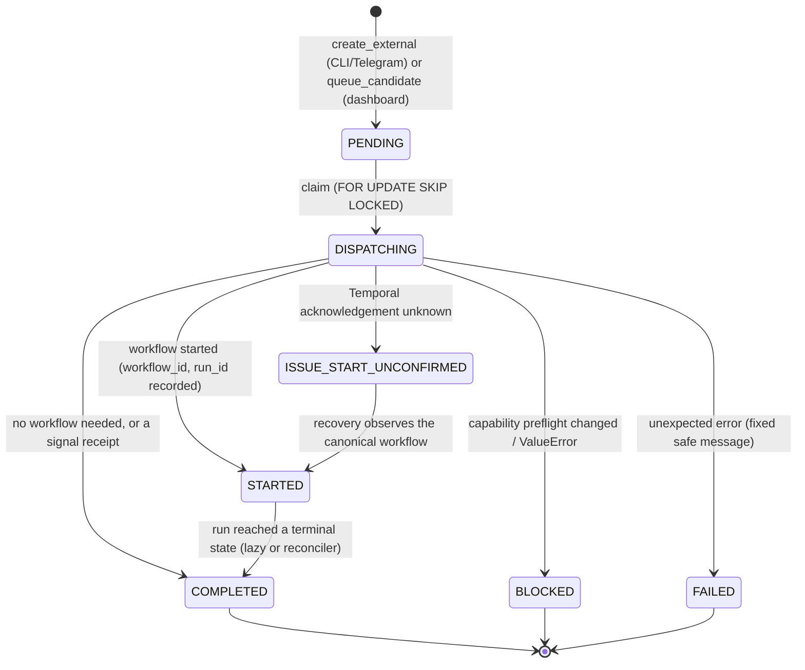

# Lecture 6 — Data model and state machines

> Temporal remembers *what is running*; PostgreSQL remembers *what is true*. This lecture is about the second store: the entities, how they relate, the lifecycles they move through, and the few places where the two stores are deliberately tied together so that neither can lie about the other.

Source anchors: `src/engineering_control/db/models.py`, `models/enums.py`, `models/core.py`, `policy/change_sets.py`, `policy/approvals.py`, `migrations/versions/0001…0021`, `operations/*`, `run_projection.py`, `workflow_outcome.py`, `coverage_outcome.py`.

---

## 6.1 Two stores, one truth

| Store | Owns | Never owns |
|---|---|---|
| **Temporal** (`engineering-control` namespace, 30-day retention) | Workflow histories, timers, signals, child relationships, activity attempts. | Searchable business state. A finding's disposition or a ChangeSet's risk class is not a Temporal concept. |
| **PostgreSQL** (`engineering_control`, 36 tables, 21 Alembic migrations) | Campaigns, cells, findings, ChangeSets, runs, approvals, deployments, evidence index, leases, agent invocations, backlog inventories, operations, dashboard projections. | Execution. No table says "step 7 is running"; that is Temporal's. |

The bridge between them is the **Run**: one row per application run, keyed by the Temporal `workflow_id`, and — since migration `0018` — bound to the Temporal `first_execution_run_id` as the only trusted link. Everything else (operation → run → campaign) is correlated by `workflow_id` strings, not foreign keys, and every reconciliation path re-derives identity from Temporal proofs rather than trusting the projection (§6.7).

## 6.2 Entity relationship overview

### 6.2.1 Tables by domain

**Core audit and delivery** (migration `0001`, extended by `0002`, `0003`, `0005`, `0008`, `0018`)

| Table | One row is… | Key columns |
|---|---|---|
| `campaigns` | one audit campaign (or a backlog/global "campaign" of kind `existing-github-backlog` / `autonomous-global-backlog`) | `project`, `status`, `source_sha`, `deployment_sha`, `required_cells`, `metadata_json` (preset, environment, `reconciliation_binding`) |
| `coverage_cells` | one `(surface, domain, persona, flow, lens, environment)` cell | `status`, `blocker`, `evidence_json`, `result_json`; unique on the tuple |
| `findings` | one candidate or confirmed defect | `fingerprint` (unique), `severity`, `confidence`, `risk_class`, `disposition`, affected SHAs/digest/component, `minimal_reproduction` |
| `finding_verifications` | one independent verifier result | `verifier_provider`, `disposition`, `reproduction_count`, positive/negative control |
| `issues` | the GitHub issue for a finding | `repository`, `number`, `url`, `state` |
| `change_sets` | one bounded change across the source and deployment repos | `project`, `risk_class`, `state`, `version`, source/deployment `repository/branch/base_sha/head_sha/pr_url`, `image_digests`, `chart_version`, `recovery_json` |
| `runs` | one application run bound to one Temporal workflow | `workflow_id`, `run_type`, `status`, `started_at`, `finished_at`, `error_code`, `temporal_first_execution_run_id` |
| `steps` | idempotent sub-records of a run; also the **ledger** for approvals, publication custody, pause targets | `name`, `status`, `idempotency_key` (unique), `result_json` |
| `artifacts` | one evidence file | `relative_path` (unique), `sha256`, `producer`, `redaction_status`, `retention_class`, `purged_at` |
| `approvals`, `approval_candidates` | an operator decision and the bound payload it must match | `artifact_binding_sha256`, `approver_subject`, `payload_json`; one **active** candidate per ChangeSet (partial unique index) |
| `deployments` | a preview/staging deployment | `environment`, `strategy`, `desired_sha`, `status`, `recovery_json` |
| `verification_results`, `incidents`, `project_snapshots` | CI/runtime/provenance results; open incidents; paired SHA snapshots | — |

**Agents and providers** (`0001`, `0006`, `0007`, `0011`)

| Table | One row is… |
|---|---|
| `agent_invocations` | one CLI invocation: provider, role, model class, status, summary, `structured_result`, provenance (`agent_pack_revision`, `instruction_bundle_sha256`, sources, allowed tools). No prompt. |
| `agent_executions` | the worker-side observability record: host, queue, CLI version, heartbeat, exit code, blocker, truncation flags. |
| `agent_log_chunks` | redacted transcript chunks (`BigInteger` PK, unique per execution + sequence). |
| `provider_usage` | token counts per run and role. `estimated_cost` is always null today because the CLIs do not expose it. |
| `quota_snapshots` | provider presence/authentication observations with capacity fields that are `None` by design. |

**Backlog** (`0008`, `0009`)

| Table | One row is… |
|---|---|
| `github_backlog_campaigns` | one imported inventory: repositories, heads at import, counts, `plan_hash`, `approval_binding`, `approval_json` (binding + `policy_role` owner/inventory), `maximum_risk`, `delivery_mode`, `status` |
| `backlog_issue_records` | one imported issue: classification (`issue_type`, `severity`, `calculated_risk`), plan (`planned_wave`, `planned_order`), eligibility, `delivery_status`, `body_sha256`, `github_updated_at`, snapshot JSON (including operator amendments) |
| `solution_loops`, `enhancements` | durable state of the older finding loop; discovered enhancement proposals with `approval_binding_sha256` |

**Operations and dashboard** (`0010`, `0012`, `0013`, `0014`, `0015`, `0016`, `0017`)

| Table | One row is… |
|---|---|
| `operation_requests` | **the command-bus ledger**: action, target, payload, `source_channel` (dashboard/telegram/cli), `operator_class`, `idempotency_key`, `binding_hash`, dispatch receipt (`status`, `workflow_id`, `temporal_run_id`, `safe_error`). Partial unique index: one active owner per `(action, target_id)`. |
| `action_candidates`, `reauthentication_bindings` | a dashboard-prepared command with its 10-minute binding, and the 5-minute one-use password re-auth token |
| `operation_exports` | a bounded redacted JSON export (≤1 MiB, 7-day retention) |
| `dashboard_events` | append-only redacted operational event stream, fed by eleven PostgreSQL triggers and by the gateway event ingest |
| `dashboard_authentication`, `dashboard_session_revocations` | the single Argon2id password row; durable per-session revocations |
| `connection_snapshots` | one row per probed component; the `projection-reconciler` row doubles as the reconciler's cursor |

**Leases, outbox, heartbeats** (`0001`, `0003`, `0004`): `worktree_leases` (unique per ChangeSet+repository and per repository+branch), `component_leases` (partial unique on active key), `notification_outbox` (deterministic ids, retry backoff), `worker_heartbeats` (one per identity).

**Change requests and UI migration** (`0019`, `0020`, `0021`): `change_requests` (CHECK on seven statuses), `ui_blueprints`, `ui_gap_consolidations`.

## 6.3 The enums

`models/enums.py` is small and worth quoting, because these words appear in every log line and Telegram message.

| Enum | Values |
|---|---|
| `Project` | `falcone`, `musematic`, `llmwiki`, `gntik-ui` |
| `Provider` | `codex`, `claude` |
| `ModelClass` | `scout`, `routine`, `worker`, `judge` |
| `RunStatus` | `QUEUED`, `RUNNING`, `SUCCESS`, `FAILED`, `RATE_LIMITED`, `CANCELLED`, `TIMED_OUT`, `BLOCKED` |
| `RiskClass` | `R0`, `R1`, `R2`, `R3` |
| `CoverageStatus` | `NOT_STARTED`, `IN_PROGRESS`, `CANDIDATE_FOUND`, `BLOCKED`, `NO_FINDING`, `CONFIRMED_FINDING`, `RETEST_REQUIRED`, `VERIFIED_FIXED` |
| `FindingDisposition` | `CANDIDATE`, `CONFIRMED`, `REJECTED`, `FLAKY`, `BLOCKED`, `DUPLICATE` |
| `RootBlockerClassification` | `PRODUCT_DEFECT`, `DEPLOYMENT_DEFECT`, `ENGINEERING_CONTROL_DEFECT`, `TEST_HARNESS_DEFECT`, `MISSING_OPERATOR_INPUT`, `EXTERNAL_DEPENDENCY_FAILURE`, `RUNTIME_PROVENANCE_GAP` |
| `AuditLens` | `correctness`, `contract`, `security`, `authorization`, `tenant-isolation`, `reliability`, `data-lifecycle`, `performance`, `ux`, `accessibility`, `observability`, `operations`, `deployment`, `supply-chain`, `documentation` |
| `RedactionStatus` | `NOT_REQUIRED`, `REDACTED`, `REJECTED` |
| `ChangeSetState` | 26 states, next section |

A note on honesty in the schema: `runs.status` and `campaigns.status` are unconstrained strings, and loops and deployments write values beyond `RunStatus` (`PAUSED`, `STOPPED`, `COMPLETE`, `AWAITING_APPROVAL`). The dashboard's status normaliser (Lecture 8) exists precisely to fold these vocabularies into nineteen canonical states, with any unknown raw value failing closed as `blocked / UNKNOWN_STATUS_MAPPING`.

## 6.4 The ChangeSet state machine

The ChangeSet is the central business object. `policy/change_sets.py` encodes exactly which transitions are legal and what **evidence** each requires; `transition()` raises on anything else and increments `version`.

Reading the diagram as a story: a **CANDIDATE** finding is **CONFIRMED** by independent verification; planning produces an OpenSpec (**PLANNED**); the maker works (**IMPLEMENTING**); a draft PR appears (**SOURCE_PR**); CI passes and the checker approves (**CI_VALIDATED**); a signed image manifest exists (**CANDIDATE_BUILT**); a digest-only deployment PR exists (**DEPLOY_PR**); a human (or deterministic R0/R1 policy) approves (**STAGING_APPROVED**); Helm or Argo deploy (**STAGING_DEPLOYED**); observers and verifiers agree (**RUNTIME_VERIFIED**); the issue is closed. Any failure after approval goes to **DEPLOYMENT_FAILED** or **INCIDENT_OPEN**, from which only **ROLLED_BACK** or **FORWARD_RECOVERY_REQUIRED** are possible. **REQUEST_CHANGES** is the loop-back for a checker rejection.

Two modern paths do not pass through every box. The post-merge `staging_flow` (Lecture 7) goes `SOURCE_PR → SOURCE_MERGED → RUNTIME_VERIFIED/ISSUE_CLOSED` because Argo CD Image Updater pins the image after the merge; and the no-runtime project `gntik-ui` ends at `ISSUE_CLOSED` straight after a protected merge (`MERGE_DELIVERED`).

### 6.4.1 Gate evidence

`TransitionEvidence` is a set of booleans — `finding_confirmed`, `plan_approved`, `independent_review_passed`, `second_provider_review_passed`, `ci_passed`, `candidate_digest_present`, `preview_verified`, `source_merged`, `deployment_pr_protected`, `approval_current`, `runtime_verified`, `issue_closed`, `recovery_evidence_present`. A transition into a gated state is refused unless its evidence flags are true. For **R3**, entering `CI_VALIDATED`, `SOURCE_MERGED`, or `STAGING_APPROVED` additionally requires `second_provider_review_passed`.

## 6.5 Risk classes

| Class | Examples (from `config/policies/risk.yaml`) | Reviews | Cross-provider | Human staging approval | Typed phrase |
|---|---|---|---|---|---|
| **R0** | documentation, comments, isolated tests | 1 | — | no (deterministic `policy:low-risk-<env>` approval) | — |
| **R1** | bounded UI or backend bug | 1 | — | no | — |
| **R2** | API contract, gateway, resource lifecycle, deployment values | 1 | preferred | **yes** | — |
| **R3** | tenant isolation, auth, secrets, encryption, migration, backup/restore, cluster-scoped, production, destructive | **2** | **mandatory** | **yes** | `APPROVE R3 <change_set_id> <digest[:16]>` |

Where risk comes from, in order of precedence:

1. The backlog classifier's keyword rules (Lecture 7) set an initial `calculated_risk`; a `Risk: R<n>` line in an issue can only **raise** it.
2. `delivery.validate_changeset` computes a **diff-bound floor**: R3 if the diff matches migration, secret-lifecycle, cluster-scoped, auth/tenant-boundary, or destructive patterns; R2 for any deployment-repository change; else R1.
3. `delivery.persist_publication` re-validates the classifier's self-hash and **raises** `change_set.risk_class` to the highest floor. It never lowers it.

R3 has consequences everywhere: two runtime reviewers, the GitOps flow refuses to merge unless the project sets `allow_r3_merge`, final closure requires a current R3 approval binding at prepare time and again before the deployment merge, and the backlog loop pauses for an operator instead of continuing.

## 6.6 Approvals and bindings

An approval in this system is never "yes". It is "yes **to exactly this**".

`ApprovalService.artifact_payload` (`policy/approvals.py`) assembles `{change_set_id, project, risk_class, source_pr, source_sha, deployment_pr, deployment_sha, image_digests, target_context, target_namespace, migration, backup_requirement, rollback_plan_sha256, ci_result_sha256, independent_review_sha256, release_preflight_sha256}`; the **binding** is the SHA-256 of its canonical JSON. The operator approves by quoting that digest (and, for R3, the typed phrase containing its first sixteen hex characters). `is_current` recomputes the payload from the live ChangeSet and compares; **any** drift — a new head, a different digest, a changed preflight hash, a changed recovery plan — invalidates the candidate, moves the ChangeSet to `REQUEST_CHANGES`, and marks the deployment `APPROVAL_INVALIDATED`.

The same pattern recurs at other scopes with different payloads:

| Binding | Hashes | Phrase |
|---|---|---|
| Backlog campaign approval (24 h) | campaign id, repository pair, branches, **heads at import**, filter, **plan hash**, risk, items, delivery mode, correction limits, allowed GitHub operations, staging targets, `production=false`, expiry | `APPROVE_EXISTING_GITHUB_BACKLOG_LOOP` |
| Issue operation approval | the `solve_issue` command plus the campaign's repositories and heads, `plan_hash`, and the issue's `title`, `state`, `body_sha256`, `calculated_risk` | — (binding stored on the operation, re-verified at every child boundary) |
| R3 issue approval | project, repository, issue number, heads, environment, `issue_body_sha256`, `issue_updated_at`, `production=false` | `APPROVE_R3_<PROJECT>_<n>_<16HEX>` |
| Change request | id, revision, fingerprint, target repository, title, `body_sha256` | `APPROVE_CHANGE_<PROJECT>_<16HEX>` |
| UI blueprint | blueprint, reviewed, inventory, kit snapshot, source SHAs | `APPROVE_UI_BLUEPRINT` |
| Recovery | recovery plan hash, original artifact binding, target | second immutable approval |

The lesson: a binding is a *content address for a decision*. If the content changes, the decision is void.

## 6.7 Run lifecycle and the Temporal bridge

Mechanisms that keep this honest:

* **Execution binding** (`db/run_binding.py`): the first activity to run proves its identity against `activity.info()` and a `describe` of the same execution, then writes `temporal_first_execution_run_id` once (first write wins, conditional `UPDATE … WHERE … IS NULL`). A Run without this binding is `UNVERIFIED` and no projection may claim a business outcome for it.
* **Start proof** (`db/start_proof.py`): fetches history event 1, requires `WorkflowExecutionStarted` with matching workflow id, type, first run id, and the memo pair `engineering_application_run_id` / `engineering_binding_version=1`. This is why parents register child Runs *before* starting children and pass the Run id in the child's memo.
* **Run projection** (`run_projection.py`): a `PLANNED`/`QUEUED` run with no `started_at` whose `updated_at` is older than 900 s is projected as `ORPHANED_START_INTENT`, so the dashboard never shows "active" merely because a row is non-terminal.
* **Recurring reconciler** (`operations/recurring_reconciliation.py`, API-owned, opt-in): takes leadership with a PostgreSQL advisory lock, walks non-terminal runs, asks Temporal for the real status, and repairs only `TERMINAL_REPAIR_AVAILABLE` cases. It never promotes a run to `SUCCESS` unless the row is already a finished success, never overwrites an existing `error_code`, and never touches `finished_at`. Its own health is persisted in the `projection-reconciler` connection row and downgraded to `DEGRADED`/`STALE` by a shared freshness rule.
* **Campaign reconciliation** (`GET/POST /v1/campaigns/reconcile`): preview classifications such as `ORPHANED_CAMPAIGN`, `TEMPORAL_WORKFLOW_MISSING`, `EXECUTION_LINEAGE_MISMATCH`, `DUPLICATE_CANARY`; a repair requires the exact `(snapshot_token, observation_token)` pair and the phrase `APPLY_EXACT_RECONCILIATION_ROWS`.

## 6.8 Coverage cell lifecycle

The Pydantic model forbids a terminal status without evidence and `BLOCKED` without a blocker. Campaign finalisation derives from cells: `INCOMPLETE` if the cell count differs from `required_cells`, `VERIFICATION_REQUIRED` if any cell is `CANDIDATE_FOUND` or `RETEST_REQUIRED`, `COMPLETE` if every cell is excluded, blocked with a reason, or terminal with evidence. A separate **coverage outcome** (`NOT_RUN`, `FAILED`, `BLOCKED`, `PARTIAL_BLOCKED`, `COMPLETED_WITH_FINDINGS`, `PASSED`, `IN_PROGRESS`) is exposed alongside the execution status so a terminal workflow with unfinished cells reads as `BLOCKED`, never as a clean pass. (`VERIFIED_FIXED` exists in the enum but no activity writes it today.)

Blocked cells that share an upstream cause reference one **root blocker** (`rb-<hash>` over `campaign:code`) classified as exactly one `RootBlockerClassification`; `MISSING_OPERATOR_INPUT` is never promoted to a product finding.

## 6.9 The operation ledger

Every operator action, from any surface, becomes one `operation_requests` row:

`record_dispatch_receipt` is the single atomic writer: it locks the row, refuses to demote or reopen, writes the receipt, one `dashboard_events` row, and — for `STARTED` — one `notification_outbox` row (`telegram.engineering-operation-started`). A partial unique index guarantees one active owner per `(action, target_id)`, which is how "another loop owns this campaign" is enforced at the database level. Lecture 8 covers how the three surfaces converge on this ledger.

## 6.10 The `steps` table as a ledger

A subtle but important pattern: the operations layer reuses `steps` as a **durable, idempotent ledger** with deterministic `uuid5` ids:

| Step name | Records |
|---|---|
| `delivery.issue_approval` | the exact request a child delivery was approved for, with campaign binding and issue snapshot hash |
| `delivery.publication_intent` / `publication_effect` / `publication_attempt` | the publication plan hash and each admitted `git_push` / `pr_create` effect with its `COMPLETE` / `UNKNOWN` / `NOT_ATTEMPTED` receipt |
| `delivery.issue_touch_refresh` | an operator-confirmed "GitHub updated_at moved but content did not" |
| `backlog.loop_pause_target` | which issue a paused loop is waiting on, fenced by the Temporal run id |
| `backlog.ci_repair_authorization` | each authorised CI-repair round (≤20) |

Because the ids are content-derived, a replayed activity can detect a conflicting re-execution by comparing content, and an `UNKNOWN` publication effect can block every implementation lease in the project until an operator reconciles it (`POST /v1/publication-effects/reconcile`).

## 6.11 Summary

The data model is organised around one object — the **ChangeSet** — whose 26-state machine with evidence-gated transitions is the normative contract for delivery. Around it: campaigns and cells for audits, findings with independent verifications, runs that are cryptographically bound to Temporal executions, approvals that are content addresses, a command ledger with one active owner per target, and a `steps` ledger that makes custody and publication idempotent. Reconciliation code exists to repair projections from Temporal truth, never the other way around.
