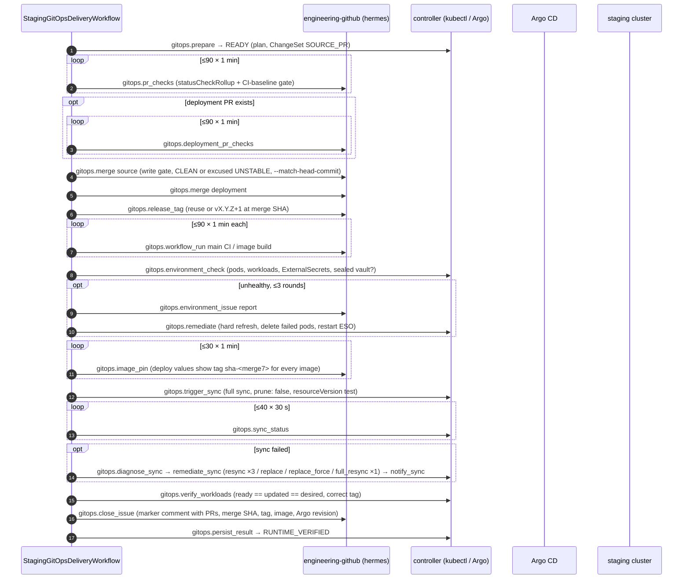
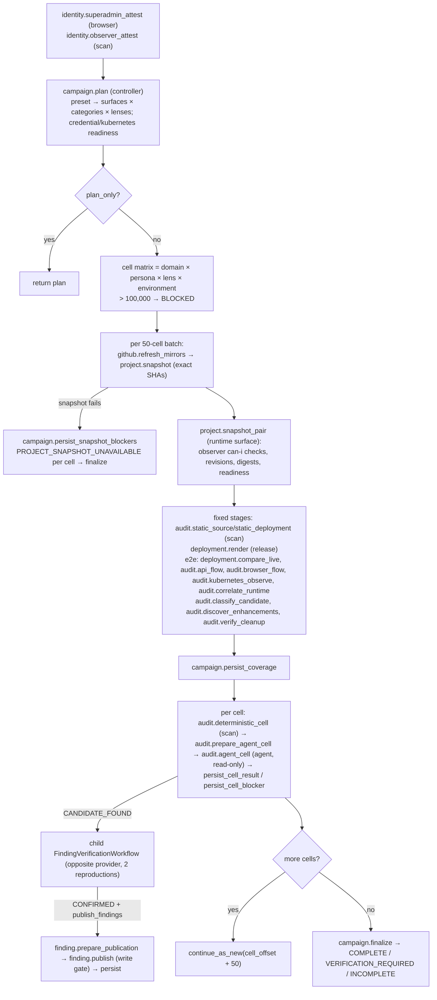
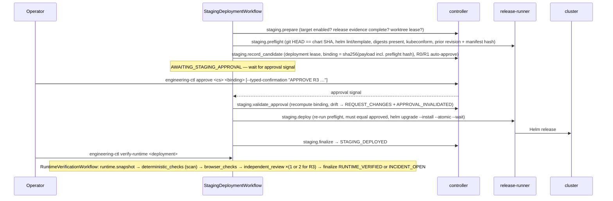

# Lecture 7 — The missions, end to end

> Now we assemble the parts. This lecture follows each of the three missions from an operator's first command to the last durable write, naming the workflow, the step, the worker, and the gate at every hop. If you understand this lecture you can read any Temporal history or dashboard timeline in the system.

Source anchors: `workflows/definitions.py`, `activities/engineering.py`, `activities/metadata.py`, `activities/gitops.py`, `activities/delivery.py`, `engineering/backlog.py`, `config/projects/*.yaml`, `docs/inventory/flows.md`, `docs/inventory/cross-reference.md`.

---

## 7.1 The projects being worked on

Everything is parameterised by a **project manifest** (`config/projects/<project>.yaml`, validated by `engineering/models.py:ProjectManifest`). Four projects exist; three have runtimes.

| | falcone | musematic | llmwiki | gntik-ui |
|---|---|---|---|---|
| Source → deployment repos | `gntik-ai/falcone` → `gntik-ai/falcone-charts` | `gntik-ai/musematic` → `gntik-ai/musematic-deploy` | `gntik-ai/llmwiki` (self-contained, branch `master`) | `gntik-ai/gntik-ui` (self-contained, **no runtime**) |
| Deployment strategy | Argo CD (`falcone-staging`, ns `in-falcone-staging`) | Argo CD (`musematic-platform`, ns `musematic-platform`, `platform-data`) | repo-local manifest, staging only | none; `merge_delivery` (protected merge, changesets, npm registry) |
| Images | 6 `ghcr.io/gntik-ai/in-falcone-*` | 6 `ghcr.io/gntik-ai/musematic/*` | 2 | — |
| `staging_flow` (post-merge GitOps) | **enabled**, deployment CI `Chart release`, image workflow `release-images.yml`, `allow_r3_merge: true` | **enabled**, deployment CI `gitops-release-guard`, image workflow `deploy.yml`, chart pinned to merge | — | — |
| `candidate_build` (pre-merge signed manifest) | disabled, `FALCONE_CANDIDATE_BUILD_CONTRACT_MISSING` | disabled | disabled | — |
| `immutable_promotion` (digest-only chart edit) | **enabled**, six digest paths in `charts/in-falcone/values/staging.yaml` | disabled (`MUSEMATIC_DIGEST_RENDERING_UNSUPPORTED`) | disabled | — |
| Toolchain | — | `uv sync`, `pnpm install`, `go mod download`, 12 contract test commands | — | Node 24, pnpm 11.28.3, 7 contract tests |
| UI migration | legacy `apps/web-console` → `apps/web-console-next` on `@gntik-ai` 0.2.0 | — | — | is the kit |

The manifest also carries maker rules (free-text rules appended to maker and checker prompts), the deployment pin (a `FALCONE_CHARTS_REF` variable the platform converges to the deployment worktree head), and the CI-baseline markers used to excuse pre-existing CI failures. The manifest loader refuses symlinks, oversized files, and a `project` field that disagrees with the file name.

## 7.2 Mission 1 — Issue resolution, step by step

### 7.2.1 Import and plan

```
/loop import musematic github-open all 50
```

`GitHubBacklogImportWorkflow` runs three steps: `backlog.github_import` on the **GitHub worker** (read-only `gh issue list` and `gh pr list` over the authoritative repository pair, snapshotting title, body excerpt, labels, comments, PR links), then `backlog.persist_import` and `backlog.plan` on the controller.

`persist_import` is where the **deterministic classifier** lives (`engineering/backlog.py:classify_issue`). It combines normalised labels with whole-word text rules. Labels drive the type and severity when present, and through them the R0–R2 risk; the **R3 rule reads only the text**, so no label can take an issue below R3 when its text mentions production, a data migration, a destructive change, credential rotation, secret lifecycle, or cluster roles (the repository's `EXISTING-GITHUB-BACKLOG.md` calls the classification "independent of labels", which is only true of that R3 floor):

| Dimension | How it is decided |
|---|---|
| `issue_type` | an ordered cascade, first match wins: DUPLICATE (label, or text "duplicate of #N") → ALREADY_FIXED → SUPERSEDED → STALE → INVALID_OR_UNREPRODUCIBLE (labels) → ENHANCEMENT when enhancement metadata (label, `kind:` line, title prefix) has no independent defect evidence → SECURITY_DEFECT (`security` label or text "vulnerability", "tenant isolation", "authorization bypass") → SPEC_DECISION (labels or text) → ENHANCEMENT → DEPLOYMENT_DEFECT (deployment repository or labels) → DOCUMENTATION_DEFECT (labels or a `docs:` prefix) → OPERATIONS_DEFECT → META_TOOLING (labels) → QUESTION (label or a title ending in "?") → PRODUCT_BUG. Whole-word matching with regular plurals, so "source-reproduction" no longer matches "production". |
| `severity` | `severity:` labels, else text such as "remote code execution" or "data loss" → critical. |
| `calculated_risk` | **R3** on word roots `data migrat`, `destructiv`, `credential rotat`, `secret lifecycle`, `production`, `clusterrole` ("must over-match, never under-match"); R2 for security defects or critical/high severity; R0 for docs/questions/meta; else R1. A `Risk:` line can only raise it. |
| `reproduction_mode` | DOCUMENTATION_REQUIRED, DEPLOYMENT_REQUIRED, RUNTIME_REQUIRED (login, 401, 404, browser, staging), STATIC_PLUS_TEST, or SOURCE_ONLY. |
| `dependencies` | `blocked by / depends on … [repo]#N` references within the allowlist. |
| `wave` | W0 blockers (login, build blocker, degraded), W1 security/high, W2 dependent, W3 default, W4 docs/meta, W5 enhancements. |
| `eligibility` | by filter (`bugs`, `bugs-and-docs`, `security`, `enhancements`, `all`); R3 is **never** eligible without an operator (`R3_REQUIRES_OPERATOR`); Hermes's own operational issues are never eligible. |

Linked PRs are detected by issue URL, closing keywords, or the issue number in the branch name, and classed `ALREADY_MERGED`, `CLOSED_WITHOUT_MERGE`, `CONFLICTING_PR`, `STALE_PR` (>45 days), or `ADOPTABLE_ACTIVE_PR` — the last of which blocks delivery until reconciled, so the platform never duplicates a human's open PR.

`plan_records` orders issues topologically by `(wave, severity, risk, −blocked-count, repo, number)` with a cycle fallback, and the whole plan is hashed (`plan_hash`). Re-import is idempotent only if project, plan hash, and both heads are unchanged.

### 7.2.2 Approve

```
/loop approval-candidate musematic <campaign> full-delivery R2 1
/loop approve musematic <campaign> <binding> APPROVE_EXISTING_GITHUB_BACKLOG_LOOP
```

The candidate binding (Lecture 6) freezes heads-at-import, plan hash, mode, limits, and allowed GitHub operations for **24 hours**. Approval requires the typed phrase and a re-authenticated actor (`telegram:<id>`, `cli:engineering-ctl`, `dashboard:reauthenticated`). The first approved campaign becomes the **policy owner** and triggers the GitHub write-policy enablement path (Lecture 9); further inventories are approved as `inventory` role and never touch the policy.

### 7.2.3 Start one issue

```
/loop issue-start musematic source 993 full-delivery
```

The hook locates the issue, then posts `solve_issue` to the command bus. The bus prepares a one-item approval bound to that issue's `title`, `state`, `body_sha256`, and risk, waits up to 60 s for policy activation, and starts `ExistingGitHubBacklogLoopWorkflow` with a **canonical id derived from the operation id**. The NEW-162 rule enforces one open loop per campaign.

### 7.2.4 Revalidate against the current source

The loop refreshes mirrors and runs `backlog.revalidate_gate`. The first result is `CURRENT_SOURCE_REVALIDATION_REQUIRED`: the imported issue must be proven real on **today's** heads. `backlog.materialize_candidate` creates a `Campaign` of kind `existing-github-backlog`, a `CoverageCell` with persona `existing-github-issue`, a `Finding` (fingerprint over campaign, repo, issue number, body hash), and an `Issue` row, then starts a child `FindingVerificationWorkflow`:

1. `finding.fresh_snapshot` (scan): resolve the current heads, require they fast-forward from the import heads, snapshot at the exact SHAs.
2. Two `finding.reproduce` agent calls on the **opposite** provider from the deterministic "discoverer" (Codex for even issue numbers, Claude for odd), each bound to the snapshot evidence hash, with positive and negative controls.
3. `finding.controls` → `CONFIRMED` only if both reproduced; `REJECTED` if neither; `FLAKY` otherwise; `finding.dedupe` searches GitHub for duplicates; `finding.finalize` records the **revalidated heads** so delivery starts from the current base.

### 7.2.5 Deliver: `IssueDeliveryWorkflow`

Each attempt is one `IssueDeliveryWorkflow` child (12 h). The ordered steps and who runs them:

| # | Step | Where | What happens |
|---|---|---|---|
| 1 | `delivery.load_confirmed_finding` | controller | Lock the finding; validate the child issue approval; create the ChangeSet (`uuid5("changeset:<finding>")`) at the delivery base heads; bind the consumed issue revision. |
| 2 | `delivery.ensure_issue` → `delivery.refresh_issue_body` | controller → github | Re-read the issue; a body changed since approval blocks (`ISSUE_BODY_CHANGED_SINCE_APPROVAL`) until `/loop amend`. |
| 3 | `delivery.acquire_leases` | controller | Component implementation lease (≤2 per project), 4 h. |
| 4 | `delivery.route_providers` | controller | Quota broker: maker (Codex-first), spec (Claude-first), checker (opposite of maker). |
| 5 | `delivery.allocate_worktrees` | scan | Source and deployment worktrees at exact SHAs with maker/checker ACLs; resume prior commits on retry. |
| 6 | `delivery.persist_worktree_leases` | controller | 8 h leases at the exact paths. |
| 7 | `delivery.deterministic_prechecks` | scan | gitleaks, trivy, semgrep, syft **baseline**. |
| 8 | `delivery.prepare_toolchain` | scan (90 min) | Manifest `prepare` commands (`uv sync`, `pnpm install`, `go mod download`) in a private cache; blocks if artifacts are not git-ignored or tracked files changed. |
| 9 | `delivery.prepare_spec` → **`delivery.invoke_spec`** → `delivery.create_openspec` | controller → Claude → controller | `product-spec-architect` writes the OpenSpec (reused if the issue text is unchanged, NEW-53); ChangeSet → `PLANNED`. |
| 10 | `delivery.prepare_maker` → **`delivery.invoke_maker`** | controller → Codex (120 min) | `implementer`, writable, 7,200 s; the prompt carries the OpenSpec, prior checker findings, validation findings, CI regressions, maker rules, and the fenced issue text. Up to two `delivery.resolve_dependencies` rounds (scan, network) regenerate `go.sum` / `pnpm-lock.yaml` if the maker asks. |
| 11 | `delivery.prepare_deployment_maker` → **`delivery.invoke_deployment_maker`** → `delivery.converge_deployment_pin` | controller → Codex → scan | Deployment-repo changes; the `FALCONE_CHARTS_REF` pin is rewritten to the deployment head byte-for-byte. |
| 12 | `delivery.prepare_checker` → **`delivery.invoke_checker`** | controller → Claude | `code-reviewer`, read-only, 5,400 s, after both makers report `COMPLETE`. |
| 13 | `delivery.validate_changeset` | scan (120 min) | Checker must say `PASS`; maker test failures must be pre-existing at base; no `.codex/`/`.claude/`/`.mcp.json` edits; no introduced scanner findings; secrets withhold the patch; compute the **risk floor**. |
| 14 | `delivery.prepare_publication` | controller | Draft-PR plan; deployment PR only if files changed, else `AWAITING_IMMUTABLE_ARTIFACT`; persist the **publication intent**. |
| 15 | **`delivery.publish`** | github (write gate) | Fetch the validated branch from the worker's shadow repo over SSH, `git push <sha>:refs/heads/<branch>` (no force), bind or create a **draft** PR, wait ≤120 s for GitHub to show the head. |
| 16 | `delivery.persist_publication` | controller | Record PR URLs, raise risk to the floor, ChangeSet → `SOURCE_PR`, release implementation leases, queue `PRS_PUBLISHED`. |

Any non-success stops the pipeline and releases leases. A checker `REQUEST_CHANGES` triggers another attempt up to `correction_limit + 1` (three attempts at the API default of `correction_limit=2`; six for `/loop issue-start` and the global selector, which set 5; one more can be granted once via `/v1/change-sets/extend-correction`).

### 7.2.6 Staging delivery: `StagingGitOpsDeliveryWorkflow`

In `full-delivery` mode for falcone or musematic the loop starts this child (12 h). All waiting is durable timers.



Notable protections:

* **CI baseline gate (NEW-63).** A PR failure is a regression only if the same job passes on a baseline branch `hermes/ci-baseline/<main12>-<markers8>` opened as a draft PR with marker files; pre-existing failures are excused, but a PR touching `.github/` never gets the exemption.
* **Merge semantics.** `gh pr merge --merge --match-head-commit <sha>`; `DIRTY` → conflict blocker; `UNSTABLE` allowed only when every failing check is excused.
* **Automatic CI repair.** `SOURCE_PR_CI_REGRESSION` or `DEPLOYMENT_PR_CI_REGRESSION` triggers up to two repair rounds: a fresh `IssueDeliveryWorkflow` with the failing job excerpts in the maker prompt, then a new GitOps child.
* **Argo remediation is bounded and never prunes.** Diagnoses are classified `PATCH_CONFLICT`, `JOB_IMMUTABLE`, `TRANSIENT`, `SCOPE_INHERITED`, `PRUNE_REQUIRED`; a remediation write is `SINGLE_ATTEMPT` because an unknown outcome must escalate, not repeat.
* **Merge-only projects** (gntik-ui) stop after the protected merge: `MERGE_DELIVERED → ISSUE_CLOSED`.

### 7.2.7 The legacy pre-merge path

Before the staging flow existed, full delivery ran `DeliveryReconciliationWorkflow → StagingDeploymentWorkflow → RuntimeVerificationWorkflow → FinalClosureWorkflow`. It is still registered and is the path a project without `staging_flow` would take. It requires the **candidate build contract**: a successful GitHub Actions run at the exact PR head whose `engineering-control-artifacts` artifact contains `engineering-artifacts.json` (`schemas/ci-artifact-manifest.schema.json`) listing one `sha256:` digest per first-party image, each verified with `gh attestation verify` against the signer workflow with self-hosted runners denied. Then `reconcile.apply_promotion` (scan) rewrites exactly the six digest paths in `charts/in-falcone/values/staging.yaml`, runs `helm lint` and `helm template`, proves every digest appears in the render, commits, and the GitHub worker publishes a draft deployment PR (`DEPLOY_PR`). An opposite-provider `release-plan-reviewer` must `PASS` on an immutable plan including the recovery strategy before any deployment is prepared. Today every project's `candidate_build.enabled` is `false`, so this path reports `FALCONE_CANDIDATE_BUILD_CONTRACT_MISSING` etc. — implemented, fail-closed, waiting on the products' CI.

### 7.2.8 The global selector

`AutonomousBacklogCampaignWorkflow` is pinned to exactly three projects, staging, R2, one active issue, correction limits 5/3, `production=false`. It requires current approvals for all three inventories with exactly one policy owner, selects the next eligible issue across inventories by `(wave, severity, −blocked, risk, repo, number)`, runs a single-issue child loop, records completed/skipped/blocked, retries temporary blockers with exponential backoff (15 min × 2ⁿ, max 6 h, five attempts), and `continue_as_new`s every 25 iterations. Finalisation terminates every inventory and queues one policy-deactivation request.

## 7.3 Mission 2 — Product audit

```
/audit-plan falcone e2e-smoke staging
/audit falcone e2e-smoke staging --execute
```



Points to emphasise:

* **Presets** (`snapshot`, `static-full`, `e2e-smoke`, `full-e2e`, `security`, `ux`, `deployment`, `falcone-intensive`) select surfaces, flow categories, and lenses; LLMWiki is staging-only; `falcone-intensive` is bound to falcone and adds the LLMWiki consumer suite.
* **Deterministic first.** Every cell gets a scanner-based `DETERMINISTIC_PASS` with an evidence hash before an agent is asked; the agent's result must bind to that hash.
* **Agent routing.** Security, authorization, and tenant-isolation lenses use the `security-auditor` role at R3/`judge`; others use `domain-auditor` at R1/`routine`. The default provider is Codex with Claude as fallback.
* **Personas are ephemeral.** e2e presets create `e2e-<project>-<campaign>-<persona>-<hex>` users through the product's admin API using the superadmin credential, run browser or API flows with credentials passed only as environment variables, and prove deletion afterwards.
* **No automatic filing.** Candidate findings are verified by the opposite provider and published only with `--publish-findings`, through the write gate.
* **Failures are evidence.** A missing snapshot or a stale live revision becomes per-cell blockers grouped under one root blocker; the workflow finalises instead of crashing.

## 7.4 Mission 3 — Enhancement discovery

```
/enhancements discover falcone <campaign> --execute
/enhancements approve enh-… <binding>
/enhancements run enh-… R1 source-pr --execute
```

`EnhancementDiscoveryWorkflow`: load redacted evidence handles from an audit campaign → `enhancement.discover` (**Codex**, `domain-auditor`, read-only, at most one proposal from allowlisted handles) → validate the proposal's evidence references → fingerprint dedupe → GitHub dedupe → `enhancement.product_review` (**Claude**, `product-spec-architect`, `judge`) → persist as `CANDIDATE_ENHANCEMENT` with an approval binding over `{enhancement_id, fingerprint, payload}`. An operator approves with the binding; `EnhancementSolutionLoopWorkflow` then reuses the Mission 1 pipeline through `IssueSolutionLoopWorkflow`.

## 7.5 Deployment, verification, and recovery (the approval-gated path)

For completeness, the explicit deployment workflows that the legacy path and `engineering-ctl deployment` use:



For Musematic the release step does not mutate the cluster: it re-runs the GitOps preflight (rejecting `newest-build`, `latest`, and direct-main write-back patterns), observes `argocd app get`, and requires the exact approved revision `Synced` and `Healthy`. Desired state changes only through the protected deployment PR.

**Recovery** (`RecoveryWorkflow`): inspect → validate the original artifact binding → plan `helm-revision-rollback` (restore the captured previous revision and require the manifest hash to match), `helm-forward-recovery` (migrations never roll back automatically), or `protected-git-revert-pr` (Musematic: `PROTECTED_RECOVERY_PR_REQUIRED`) → a **second** approval → `helm rollback --cleanup-on-fail --wait` → verify → `ROLLED_BACK` with the incident left `RUNTIME_RETEST_REQUIRED`.

## 7.6 Newer flows: change requests and UI migration

**Change requests (NEW-108).** An operator writes free text (`engineering-ctl change-draft`); `ChangeRequestWorkflow` snapshots the repo, Claude drafts an OpenSpec-style proposal (`create-openspec`), Codex reviews it (`review-change`, up to two rounds), a read-only GitHub dedupe runs, and the result is a `CANDIDATE` with a deterministic rendering whose first lines are `kind:` and `Risk:` so the backlog classifier can later read them. The operator approves with `APPROVE_CHANGE_<PROJECT>_<16HEX>` and publishes the issue with **their own** `gh` (`engineering-ctl change-publish`); Hermes never publishes change requests.

**UI migration (NEW-120…154).** For falcone's console migration to the gntik-ui kit: the scan worker builds a model-free inventory of the legacy console (routes → pages → endpoint closure cross-checked against five backend route tables, dead modules, tests) and snapshots the kit catalogue over a digest-pinned MCP image through a root-owned socket (read-only tools only). `UiMigrationPlanWorkflow` then has Claude draft only the *judgement* fields of a blueprint in a frame plus 8-page batches while Hermes fills the *mechanical* fields, Codex reviews each part, deterministic part ids bind content and provenance, and the assembled blueprint (dispositions MIGRATE/WRAP/DELETE, waves u0–u5, gaps, cutover) is approved with `APPROVE_UI_BLUEPRINT`. `UiBlueprintFanOutWorkflow` turns items into change requests (≤80 per run, idempotent ids), and `UiGapConsolidationPlanWorkflow` lets Claude propose merging duplicate gap requests into `gap:merged-*` canonical items that the operator applies with `CONSOLIDATE_GAPS`. Models never receive an MCP connection; the kit reaches them only as Hermes-collected data.

## 7.7 What actually ran

The repository's own September inventory is a useful reality check: `IssueDeliveryWorkflow` had 95 retained runs, `ExistingGitHubBacklogLoopWorkflow` 31, `FindingVerificationWorkflow` 25, `StagingGitOpsDeliveryWorkflow` 7 (all completed), `AuditCampaignWorkflow` 11, and the GO record in `.go-status/progress.json` reads "GO REACHED 2026-09-27: musematic #993 delivered end to end by Hermes". The legacy reconciliation/staging/runtime/final-closure chain, the global selector, the enhancement workflows, and recovery had zero retained runs — implemented and tested, but not yet exercised in production.

## 7.8 Summary

All three missions share the spine of Lecture 1, but Mission 1 is the one that touches the outside world, so it carries the most gates: a deterministic classifier whose R3 rule no label can override, a 24-hour content-bound approval, revalidation by the opposite provider on current heads, a sixteen-step delivery with a deterministic validator before any push, a write-policy gate on every GitHub mutation, a CI-baseline gate before merge, bounded Argo remediation, and a closing comment that lists every artifact the platform produced. Mission 2 produces evidence and candidate findings; Mission 3 produces proposals; both feed Mission 1 only through an approval.
