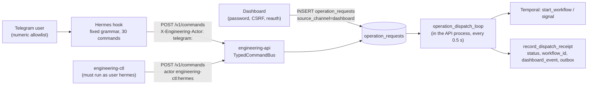
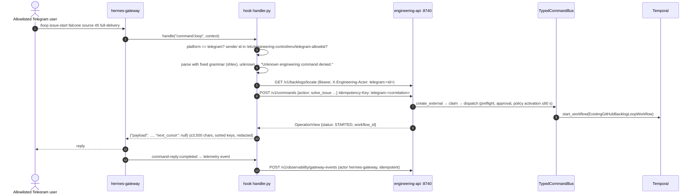
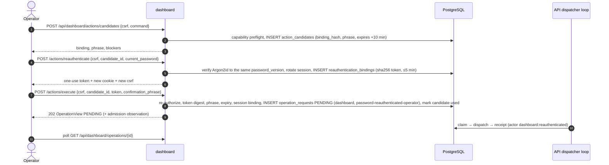

# Lecture 8 — Control surfaces: API, CLI, Telegram, dashboard, notifier, watchdog

> Humans touch this system through four doors — a private HTTP API, a command-line tool, a Telegram bot, and a web dashboard — and the system talks back through a notifier and a watchdog. This lecture explains each door, shows that they all open onto the **same** typed command bus, and makes clear what none of them can do.

Source anchors: `api/main.py`, `api/service.py`, `api/auth.py`, `api/admission.py`, `operations/service.py`, `operations/models.py`, `operations/registry.py`, `cli.py`, `integrations/hermes-engineering-control/`, `dashboard/*`, `notifier.py`, `delivery_notifications.py`, `watchdog.py`, `docs/telegram/commands.yaml`.

---

## 8.1 One bus, three channels

The **typed command bus** (`operations/service.py:TypedCommandBus`) accepts a discriminated union of seventeen Pydantic command models (`extra="forbid"`): `solve_issue`, `solve_backlog`, `start_autonomous_backlog`, `audit_plan`, `audit_start`, `audit_all_projects`, `audit_campaign`, the workflow controls (`pause`, `pause_after_current`, `resume`, `stop_after_current`, `cancel`, `skip`, `retry`, `nudge`), `refresh_connections`, `enhancement_discover/approve/reject/run`, `finding_verify`, `llmwiki_bootstrap_plan`, `evidence_export_campaign/workflow`. There is **no** command whose payload is a shell string, a repository outside the catalog, a production target, or an arbitrary Temporal argument.

Submission writes one `operation_requests` row (Lecture 6). CLI and Telegram submissions are dispatched **synchronously** inside the request, so the caller receives `STARTED`, `COMPLETED`, `BLOCKED`, or `FAILED`; dashboard submissions are left `PENDING` for the API's dispatcher loop because the dashboard process has neither the API token nor a Temporal client. Dispatch re-runs the **capability preflight** (`BACKLOG_CAMPAIGN_ALREADY_ACTIVE`, `ISSUE_RISK_EXCEEDS_BOUND`, `GITHUB_WRITE_POLICY_NOT_ACTIVE`, `R3_APPROVAL_REQUIRED`, `WORKFLOW_IS_TERMINAL`, …) immediately before touching Temporal, so a stale candidate cannot act.

## 8.2 The private API

* **Bind:** `127.0.0.1:8740`; the settings validator rejects wildcard binds; Caddy returns 404 for `/v1*` at the public edge; no OpenAPI/Swagger is served.
* **Auth:** one bearer token from `/etc/engineering-control/env/api.token` (≥32 chars, strict file mode), compared as SHA-256 under `hmac.compare_digest`; plus an `X-Engineering-Actor` header. Actor classes: `engineering-ctl:hermes` (the CLI), `telegram:<digits>` (the hook), `hermes-gateway` (gateway telemetry only). Approval routes map these to durable approval actors (`cli:engineering-ctl`, `telegram:<id>`) and refuse anything else with 403.
* **Admission modes** (`api/admission.py`, startup-only): `normal`; `synthetic-only` (only `GET`/`HEAD` and the three `/v1/validation/*` canaries; everything else 503 with `Retry-After`); `diagnostics-only` (additionally admits `refresh_connections` commands and gateway events). `/health/ready` reports the mode and whether the dispatcher is running, credential-free, so the dashboard can show "SYNTHETIC ONLY".
* **Background tasks** in the API process: the operation dispatcher (`claim_pending` with `FOR UPDATE SKIP LOCKED`, issue-start recovery every 5 s, run-less operation reconciliation every 60 s) and, when enabled, the recurring run reconciler.

Route families (about seventy-five routes):

| Family | Examples | Notes |
|---|---|---|
| Health and diagnostics | `/health/live`, `/health/ready`, `/v1/admission`, `/v1/readiness/{core\|all}`, `/v1/connections`, `/v1/workers`, `/v1/providers`, `/v1/channel-check`, `/v1/temporal/summary`, `/v1/usage`, `/internal/metrics` | read-only projections |
| Commands and operations | `POST /v1/commands` (requires `Idempotency-Key`), `GET /v1/operations/{id}`, `GET /v1/operations/{id}/export` | the bus |
| Campaigns | `POST /v1/campaigns`, `POST /v1/audit-plan`, `GET /v1/campaigns`, `GET/POST /v1/campaigns/reconcile`, `/v1/campaigns/{wf}/{pause\|resume\|cancel}`, `/v1/workflows/{wf}/tail` | reconcile apply needs `APPLY_EXACT_RECONCILIATION_ROWS` and exact tokens |
| Findings and deliveries | `GET /v1/findings`, `POST /v1/findings/verify`, `POST /v1/deliveries` (dry-run → `IssueDeliveryWorkflow`; real → adopts the approved issue operation), `POST /v1/deliveries/reconcile` | |
| Runs | `GET /v1/runs/{wf}`, `POST /v1/runs/{wf}/cancel` | used by `/status` |
| Approvals and deployments | `POST /v1/approvals`, `GET /v1/approvals/{cs}/candidate`, `POST /v1/deployments/prepare`, `/rollback`, `/verify-runtime`, `GET /v1/deployments/{id}` | the `approval` signal is sent after the binding (and R3 phrase) check |
| Backlog and loops | `POST /v1/backlogs/import`, `GET /v1/backlogs/…`, `GET /v1/backlogs/locate`, `POST /v1/backlogs/{id}/approval-candidate`, `/approve`, `/release-ownership`, `/start`, `POST /v1/backlog-loops/{wf}/{pause\|resume\|cancel\|skip\|retry}`, `/v1/r3-issues/candidate`, `/v1/r3-issues/approve`, `/v1/change-sets/extend-correction`, `/v1/issues/reapprove`, `/v1/issues/amend`, `/v1/issues/touch-refresh`, `/v1/publication-effects/reconcile` | every mutation has a typed phrase |
| Enhancements, change requests, UI blueprints | `/v1/enhancements/…`, `/v1/change-requests/…`, `/v1/ui-blueprints/…` | |
| Bootstrap, validation, evidence, gateway | `/v1/bootstrap-plan`, `/v1/bootstrap`, `/v1/validation/{lifecycle\|observability\|observability/reverse}` (404 unless `acceptance_enabled`), `GET /v1/evidence/{id}` (metadata only), `POST /v1/observability/gateway-events` (subject must be `hermes-gateway`) | |

One error contract deserves attention: when Temporal's acknowledgement of a start is unknown, the API answers `503 {"status": "START_UNCONFIRMED"}` and the operation stays `DISPATCHING` with `ISSUE_START_UNCONFIRMED`. The caller must **not** start a replacement; a recovery loop observes the canonical workflow id and records the receipt when it appears.

## 8.3 The CLI: `engineering-ctl`

A thin HTTP client. It refuses to run unless the Unix user is `hermes`, checks the token file permissions, sends `X-Engineering-Actor: engineering-ctl:<operator>`, adds `Idempotency-Key: engineering-ctl-<uuid>` to command posts, and redacts every response before printing JSON. About seventy subcommands map one-to-one onto routes: `audit`, `audit-plan`, `audit-start`, `audit-all`, `campaigns`, `findings`, `verify-finding`, `delivery`, `reconcile`, `deployment`, `approval-candidate`, `approve`, `reject`, `verify-runtime`, `rollback`, `status`, `tail`, `pause`/`resume`/`cancel`, `usage`, `evidence`, `export-*`, `backlog-import`, `backlog-plan`, `backlog-approval-candidate`, `backlog-approve`, `backlog-release-ownership`, `backlog-start`, `backlog-pause`/`resume`/`stop-after-current`/`cancel`, `backlog-skip`, `backlog-retry`, `issue-locate`, `issue-start`, `r3-candidate`, `r3-approve`, `issue-amend`, `issue-touch-refresh`, `issue-reapprove`, `change-extend-correction`, `publication-reconcile`, `global-backlog-start`, `change-*`, `ui-*`, `validate-lifecycle`, `bootstrap-plan`, `bootstrap`, `ready`, `connections`, `workers`, `providers`, `temporal`, `channel-check`, `recheck-connections`, `campaign-reconcile`.

Three subcommands bypass the API: `dashboard init-password` / `reset-password` write the Argon2id hash directly to PostgreSQL and stage the generated password into a `0600` file; `ui-inventory` and `ui-kit-snapshot` run the model-free inventory locally; `change-publish` creates the approved change-request issue with the **operator's own** `gh` login.

## 8.4 Telegram through Hermes

**Hermes** is a third-party Telegram gateway agent (0.20 installed, 0.21 observed live) running as its own Unix user. Engineering Control does not patch it; it installs two things:

* a **plugin** (`integrations/hermes-engineering-control/plugin/`) that registers the thirty command names so Hermes recognises them, with a no-op fallback handler ("gateway hook unavailable; use engineering-ctl locally"), because plugin handlers do not receive the platform user identity;
* a **hook** (`hook/HOOK.yaml`, `hook/handler.py`) subscribed to `command:*` and `command-reply:completed`, which performs the actual execution.

Rules the hook enforces:

* **Telegram only**; other platforms are denied.
* **Numeric allowlist** file, root-owned, group `hermes`, mode `0640`; comments allowed.
* **Fixed route map**: every command maps to one or two loopback API calls with a validated grammar (UUIDs, 40-hex SHAs, enums, bounded integers). There is no passthrough. `/help` and `/whoami` are denied because they are not in the hook's set.
* **JSON envelope** `{"payload", "next_cursor"}`, rendered with indentation and sorted keys, redacted, at most **3,500 characters** per page; pages split only between complete records; an oversized record becomes a digest; cursors are 32-hex, bound to actor and command, valid ten minutes, consumed once, held in a bounded in-process cache.
* **Idempotency keys** derived from the Telegram delivery correlation id, so a redelivered update cannot start two workflows.
* **Acceptance evidence**: `usage`, `validate`, and `status` replies append release-bound receipts to a protected JSONL that the C-01 validators consume (Lecture 10).

The thirty commands fall into groups: health (`/ready`, `/connections`, `/temporal`, `/providers`, `/workers`, `/channel-check`, `/usage`), runs (`/status`, `/pause`, `/resume`, `/cancel`, `/evidence`), exports (`/export-campaign`, `/export-workflow`), audits (`/audit-plan`, `/audit`, `/audit-all`, `/campaigns`, `/campaign`, `/findings`, `/verify`), issue loop (`/run`, `/loop import|inventory|queue|issue|issue-locate|issue-start|approval-candidate|approve|start|plan|status|tail|diagnose|nudge|pause|resume|cancel|skip|retry|retry-issue|amend|global-start|r3-candidate|approve-r3`), releases (`/approve`, `/reject`, `/rollback`, `/bootstrap-plan`, `/bootstrap`, `/validate`), enhancements (`/enhancements discover|list|show|approve|reject|run`).

Explicitly **not** possible from Telegram: any shell, SSH, kubectl, Helm, or Argo passthrough; releasing write-policy ownership; `pause_after_current` / `stop_after_current`; delivery reconciliation, deployment preparation, or runtime verification; downloading an export body; change requests or UI blueprints; raising risk above R2 without the separate R3 candidate and phrase.

Notifications travel the other way: the notifier posts to the gateway's **webhook** on `127.0.0.1:8644/webhooks/engineering-alerts` with an HMAC-SHA256 signature, and the gateway renders the message to Telegram (§8.6).

## 8.5 The dashboard

A separate FastAPI process on `127.0.0.1:8750`, server-rendered Jinja2 with vanilla JavaScript, fronted by Caddy as `https://ade.musematic.ai`. It **reads** PostgreSQL projections and **never** holds the API token, a Temporal client, or any provider, GitHub, or Kubernetes credential (its systemd unit makes those paths inaccessible).

**Authentication.** One password, no username, Argon2id (`time_cost=3`, 64 MiB, parallelism 2). The session is an HMAC-SHA256-signed cookie (`secure`, `httponly`, `samesite=strict`) valid 12 hours, carrying the `password_version`; a password change or reset invalidates every older session. Logout writes a durable revocation row so the exact cookie stays dead across restarts. Every request re-checks the DB; a DB outage fails closed. Five login failures per client address in 15 minutes → 429. Host must be allowlisted; unsafe methods need an allowlisted `Origin` (or same-origin `Referer`); strict CSP, HSTS, `DENY` framing, `no-referrer`.

**Pages.** Overview (admission panel, work summary, service and provider health), Backlog (issues with workflow/provider state and per-row actions), Workflows (cursor-paginated list and durable detail timelines with typed controls), Audits (campaigns, cells, root blockers), Logs (redacted events and native agent transcripts over SSE, tabs for Hermes/Codex/Claude/services), Commands (the allowlisted registry with `AVAILABLE`/`DISABLED` and effect labels), Findings, Enhancements, Connections (fixed probes and persisted snapshots), Settings (password change). Legacy `/activity` redirects to `/logs`.

**Controlled operations** use a three-step flow so that a stolen session alone cannot act:

"Retry same operation" replays the stored acceptance receipt instead of creating a second operation. High-impact actions require a server-generated phrase bound to the candidate digest (`SOLVE BACKLOG XXXXXXXX`, `START AUDIT …`). R3 actions fail closed for operator handling.

**Status normalisation** (`dashboard/status_mapping.py`) folds every raw status into nineteen canonical states — `backlog`, `eligible`, `queued`, `preparing`, `implementing`, `reviewing`, `reworking`, `testing`, `awaiting_ci`, `awaiting_approval`, `building`, `deploying`, `verifying`, `blocked`, `paused`, `completed`, `failed`, `cancelled`, `skipped` — with context rules for `RUNNING`/`IN_PROGRESS` by phase marker. An **unknown raw status becomes `blocked` with `UNKNOWN_STATUS_MAPPING`**, never a green state. Audit completion is terminal cells over total cells; a zero-cell campaign reports zero, never a false percentage.

**Streams.** Activity and transcript streams are Server-Sent Events with ordered ids, `Last-Event-ID`, ~15-second heartbeats, and a revocation watcher that closes the stream within about five seconds of a session being revoked, even if the client stalls.

## 8.6 The notifier and the outbox

Producers never call Telegram. They insert into `notification_outbox` with a **deterministic id** (`uuid5("notification:<topic>:<dedupe_key>")`) so a retried activity never sends twice. `engineering-notifier` polls every 10 s, takes up to 20 due rows under `FOR UPDATE SKIP LOCKED`, redacts, POSTs `{"topic","payload"}` to the Hermes gateway webhook with `X-Request-ID`, `X-Webhook-Timestamp`, and `X-Webhook-Signature-V2 = HMAC-SHA256(token, "<ts>.<body>")`, and backs off `min(3600, 2^attempts)` seconds on failure. Its systemd unit is the most hardened in the repository: empty capability set, `IPAddressDeny=any` except localhost, seccomp `@system-service` minus privileged groups, `MemoryDenyWriteExecute`.

Topics: `telegram.engineering-operation-started` (every `STARTED` receipt), `telegram.engineering-backlog-loop-state` (`PAUSED`, `RESUMED`, `COMPLETE`, `FAILED`, `STOPPED`, `CANCELLED`, blocked start — with a plain-language blocker explanation and the exact `/loop …` or `engineering-ctl …` commands that resolve it), `telegram.engineering-delivery-milestone` (`DELIVERY_STARTED`, `PRS_PUBLISHED`, `CI_REPAIR_STARTED`, `PRS_MERGED`, `STAGING_VERIFIED`, `MERGE_DELIVERED`, `DELIVERY_BLOCKED`, `STAGING_BLOCKED`, `UI_BLUEPRINT_READY`, `UI_FANOUT_DONE`), `telegram.engineering-write-policy-required`, `telegram.engineering-backlog-nothing-delivered`, `telegram.engineering-cleanup-failed`, `telegram.engineering-gitops-sync`, and the watchdog's `telegram.engineering-operational-watchdog`. Payloads are redacted, strings bounded, untrusted text wrapped as inline code, code spans never split, and the whole message held under 3,000 rendered characters so the gateway's 4,000-character cut never breaks a span.

## 8.7 The watchdog

`engineering-watchdog` is independent of the workflow engine. It is a systemd `Type=notify` service (`WatchdogSec=300`) that every 60 seconds probes: the six controller units via `systemctl show`; `/health/ready` on the API and dashboard and TCP on Temporal; the backup status file (fresh backup within 1 h, restore test within 8 days, worker mirror and receipt signature verified); the database (cleanup ran within 26 h, exactly one fresh heartbeat per worker role within 180 s, outbox not stalled — more than 20 pending, 10 attempts, or 15 minutes old); and every unfinished backlog loop (`PAUSED_TOO_LONG` after 15 min, `NO_PROGRESS` after 45 min unless inside a GitOps child or an approval wait). It keeps a write-ahead state file so that alerts carry deterministic ids and survive its own crash, emits `ALERT` / `RECOVERY` / `CHANGE` events (repeat alerts hourly), and sends them **directly** through the HMAC sink. It never mutates application data.

## 8.8 Summary

Four doors, one bus. Every mutation becomes a typed command row with one active owner per target, is preflighted at dispatch, and is receipted atomically with a dashboard event and a Telegram notice. The Telegram hook has a fixed grammar and no passthrough; the CLI must run as the operator user; the dashboard needs password re-authentication and a server-generated phrase for anything impactful and never holds a credential. The notifier and watchdog close the loop so that an operator on a phone sees every pause, milestone, and stall with the exact command that resolves it.
