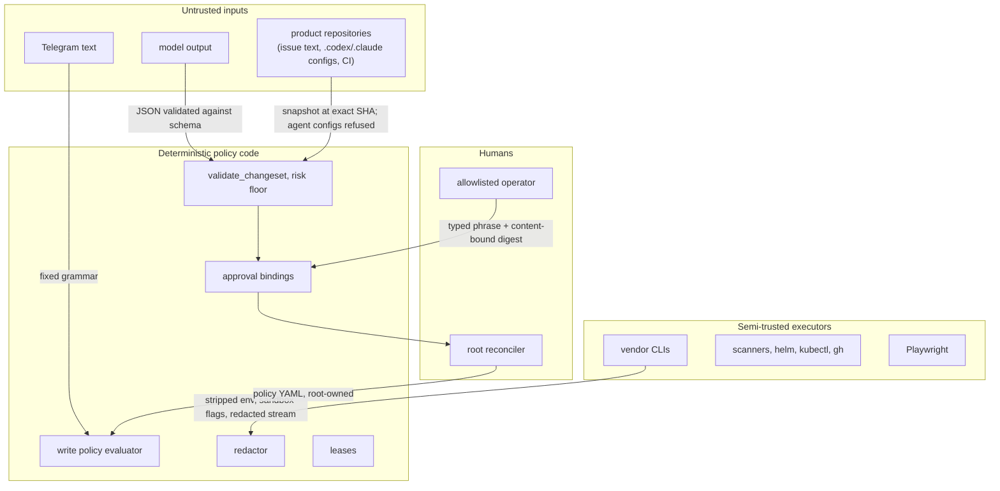
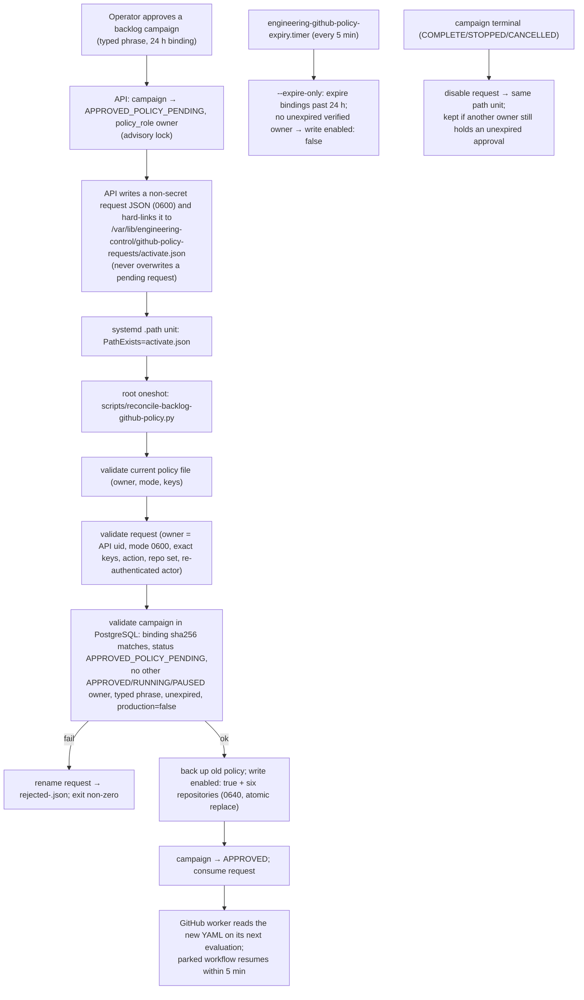

# Lecture 9 — Security, policy, and fail-closed gates

> Every earlier lecture mentioned a gate in passing. This lecture collects them. The organising idea is simple: the platform runs code it does not trust (LLM output, product repositories, third-party CLIs), so it never lets a single component both *decide* and *act*, and it treats every missing prerequisite as a reason to stop.

Source anchors: `docs/SECURITY.md`, `policy/github_write.py`, `policy/github_write_install.py`, `adapters/github/client.py`, `scripts/reconcile-backlog-github-policy.py`, `systemd/*`, `config/credentials/contracts.yaml`, `config/kubernetes/*`, `security/redaction.py`, `config.py`.

---

## 9.1 Trust boundaries

Four principles recur:

1. **Separation of identities.** The identity that writes code cannot push; the identity that pushes cannot merge or deploy; the identity that deploys cannot read model credentials; the identity that approves cannot run anything.
2. **Content-bound authorisation.** Approvals, policies, and operations bind to hashes of exact content. Drift voids them (Lecture 6).
3. **Deterministic gates between every stage.** A model proposes; code validates before anything leaves the worktree.
4. **Fail closed.** Missing file, wrong mode, unparseable policy, unknown status, unknown capacity, unverifiable artifact → a typed blocker, never a default.

## 9.2 Identity and credential isolation

| Credential | Lives | Readable by | Enforced how |
|---|---|---|---|
| Codex / Claude subscription login | `/var/lib/engineering-control/identities/<runner>/` (mode `0700`) | that runner only | directory mode; `ProtectHome`; `InaccessiblePaths` on every other unit |
| API bearer token | `/etc/engineering-control/env/api.token` (`root:engineering-api-clients 0640`, named ACL for `hermes`) | API, CLI as `hermes`, Hermes hook | mode checks at read; refused if group-writable or other-readable |
| Evidence upload tokens | `/etc/engineering-control/env/evidence-uploaders/<identity>.token` (controller); `env/evidence-<identity>.token` on the worker (`root:<identity> 0640`) | one identity each | token subject must equal producer; `verify-worker.sh` tests cross-reads |
| GitHub login | the `hermes` user's `gh` credential store, used **in place** | `engineering-github-worker` as `hermes` | never copied, never a token file, never `gh auth token`; `GH_TOKEN`/`GITHUB_TOKEN` references in the unit fail `verify-worker-registry.py` |
| Database password | `control.env`, root-owned | `engineering-control` services | hidden from `hermes` and the github worker by `InaccessiblePaths` |
| Observer kubeconfigs | `/etc/engineering-control/credentials/<project>/*.kubeconfig` (`0600` scan-runner or `0640` root) | `scan-runner` | `kubectl auth can-i` negative checks before every read |
| Release kubeconfigs | `/etc/engineering-control/env/release/` | `release-runner` | disjoint directory from observer; no group/other bits |
| GHCR read config | `/etc/engineering-control/env/delivery/registry/config.json` (`root:delivery-runner 0640`) | `delivery-runner` | passed only as `DOCKER_CONFIG` parent dir |
| Superadmin product credentials | `/etc/engineering-control/credentials/<project>/superadmin.env` (`root:browser-runner 0640`) | `browser-runner` | HTTPS only; values become env vars, registered with the redactor, never in plans |
| Dashboard password | Argon2id hash in PostgreSQL | dashboard | reset only via `engineering-ctl` as root |
| Telegram allowlist | `/etc/engineering-control/env/telegram-allowlist` (`root:hermes 0640`) | hook | numeric ids only |

`config/credentials/contracts.yaml` declares every contract with its consumer, owner, group, and mode, plus two global rules: `secret_values_in_workflow_inputs: false` and `session_material_persistence: prohibited`. The code honours both: workflow payloads carry paths and handles, never values, and browser session material lives only in worker memory for the duration of a journey.

## 9.3 No paid API, no routers

Invariant 9 is enforced mechanically rather than by policy text:

* `subscription_only_environment` strips 27 variables before any CLI spawn (`OPENAI_API_KEY`, `ANTHROPIC_API_KEY`, `ANTHROPIC_AUTH_TOKEN`, base URLs, Bedrock/Vertex/Foundry switches, AWS keys, `CLAUDE_CODE_OAUTH_TOKEN`, `CODEX_HOME`, `OMNIROUTE_*`, proxies) and raises if a caller tries to re-add one.
* No LLM SDK is a dependency; no code path builds an HTTP request to a model API.
* The capacity retry re-runs the same provider and model; the quota broker never substitutes a paid route.
* `scripts/verify-no-omniroute.sh` is a **negative policy** run before and after every bootstrap and upgrade. OmniRoute was the previous LLM-routing layer (an npm package, a user service, and a Caddy container on `omni.musematic.ai`, ports 20128/20131/20132). The script scans systemd, `/etc`, cron, hosts, binaries, Hermes dotfiles, node modules, live processes and environments, listeners, and Docker containers for any residue and exits `FAIL` on a finding or `BLOCKED` if it could not inspect everything.

## 9.4 The GitHub write policy

GitHub is the one external system the platform mutates (pushes, draft PRs, merges, tags, comments, issue closes). Those writes are controlled by **two independent switches and one broker**:

1. **Process switch.** `ENGINEERING_GITHUB_WRITES_ENABLED` defaults to `False` in `Settings`; only the GitHub worker's systemd unit sets it `true`. The scan worker's env explicitly sets it `false`.
2. **Policy file.** `/etc/engineering-control/policy/github-issue-write-validation.yaml`, root-owned, mode `0640`, in a `0750` directory, with **exactly two keys**: `enabled` and `safe_repositories`. The shipped default is `enabled: false, safe_repositories: []`. The evaluator fails closed on a missing, symlinked, wrongly-owned, wrongly-moded, or unparseable file (`POLICY_MISSING`, `POLICY_UNREADABLE`, `POLICY_INVALID`), on `enabled: false` (`POLICY_DISABLED`), on an empty list (`EMPTY_SAFE_REPOSITORY_LIST`), and on a target outside the list (`REPOSITORY_NOT_ALLOWLISTED`).
3. **`GhCliBroker`.** Every write-capable method goes through `_write`, which requires `writes_enabled`, the repository in the six-entry allowlist (`falcone`, `falcone-charts`, `musematic`, `musematic-deploy`, `llmwiki`, `gntik-ui`), and a **change binding** of the form `changeset:<id>`, `campaign:<id>`, `finding:<id>`, or `enhancement:<id>`. Every call preflights `gh auth status`, `gh api user`, and `gh repo view`. Arbitrary arguments are impossible: values must match a safe regex, cannot start with `-`, cannot contain shell metacharacters; `gh auth token` and the `secret`/`environment`/`variable`/`collaborator` subcommands are forbidden; API routes are built only from allowlisted repositories and validated values; merges use `--match-head-commit` and require `CLEAN` (or excused `UNSTABLE`); tags are never moved; pushes are exact-SHA refspecs without `--force`.

A denial is a **business result**, not an exception: `GitHubWritePolicyDenial` carries `status=BLOCKED_BY_POLICY`, `terminal=True`, `retryable=False`, and literal zero counters proving no command was constructed, started, or mutated anything. The workflow parks in `AWAITING_WRITE_POLICY` and re-checks every five minutes (Lecture 3).

### 9.4.1 How the policy gets enabled

The enablement path deliberately crosses a **privilege boundary**: the API runs as `engineering-control` and cannot write the policy file; only root can.

Consequences worth stating aloud: writes are enabled for at most 24 hours per approval; at most one campaign per project owns the policy, and at most two projects at once (NEW-163; a limit of 1, or an open global backlog run, restores one global owner), while each delivery write must target its own project's repositories; the component that enables writes (root) is not the component that performs them (`hermes`) or the one that decides what to perform (`engineering-control`); and an acceptance workflow (`GitHubWriteDenialAcceptanceWorkflow`) exists to prove the denial path returns `PASS_DENIAL_ENFORCED` with zero external effect.

## 9.5 Deterministic validation before any push

Lecture 5 covered `delivery.validate_changeset`; here is the security reading of it:

| Check | What it prevents |
|---|---|
| Checker must `PASS` | the maker alone cannot publish |
| Maker-reported test failures must be pre-existing **at the base** (re-run in bubblewrap, head never executed) | a maker cannot claim "it was already broken" |
| `.codex/`, `.claude/`, `.mcp.json` changes refused | the agent cannot reconfigure the tools that constrain or review it |
| Introduced scanner findings against a pre-maker baseline | a maker cannot introduce a secret, vulnerability, or SAST finding |
| Secrets introduced → patch withheld, only a hash retained | a leaked secret never reaches evidence or a PR |
| Diff-bound **risk floor** that only rises | a model cannot talk the platform into treating a migration as R1 |
| Deployment-repo digests must be `sha256:`; `latest`/`newest`/Image-Updater/direct-main patterns rejected | mutable promotion is impossible |
| Helm render must contain every approved digest; chart version must match | a promotion cannot be masked by `--set-string` overrides |
| Signed provenance (`gh attestation verify`, self-hosted denied) for every candidate image | an unsigned or wrong-source image cannot be promoted |

## 9.6 Approval and confirmation phrases

Phrases are the human-facing half of content-bound authorisation. They are server-generated and include a hash prefix so that copying a phrase from an older message cannot approve a newer artefact.

| Action | Phrase |
|---|---|
| R3 deployment approval | `APPROVE R3 <change_set_id> <digest[:16]>` |
| Backlog campaign approval | `APPROVE_EXISTING_GITHUB_BACKLOG_LOOP` |
| Release write-policy ownership early | `RELEASE_GITHUB_WRITE_POLICY_OWNERSHIP` |
| Global selector start | `START_GLOBAL_STAGING_R2_BACKLOG` |
| R3 issue approval | `APPROVE_R3_<PROJECT>_<n>_<16HEX>` |
| Correction extension | `EXTEND_CORRECTION_ONCE_<8HEX>` |
| Issue re-approval | `REAPPROVE_ISSUE_<8HEX>` |
| Publication reconcile | `RECONCILE_PUBLICATION_<8HEX>` |
| Campaign reconciliation apply | `APPLY_EXACT_RECONCILIATION_ROWS` |
| Change request approval | `APPROVE_CHANGE_<PROJECT>_<16HEX>` |
| UI blueprint approval / fan-out retry / consolidation | `APPROVE_UI_BLUEPRINT`, `RETRY_UI_FANOUT`, `CONSOLIDATE_GAPS` |
| Dashboard candidates | `SOLVE BACKLOG XXXXXXXX`, `START AUDIT …`, `APPROVE ENHANCEMENT …` |
| Historical cutovers | `APPLY NATIVE HERMES CONFIG CUTOVER`, `STOP C01 OMNIROUTE ONLY`, `UNINSTALL C01 OMNIROUTE PACKAGE`, `REMOVE C02 OMNIROUTE CADDY ONLY` |

## 9.7 Redaction as a boundary, not a filter

The redactor (Lecture 4) is applied at every edge, but the important property is the **reject-on-replacement** contract at the evidence ingest: text or JSON evidence that still needs redaction is refused with a 422, so a producer that forgot to redact cannot persist. Binary evidence must carry an explicit `REDACTED` assertion. Logs pass through a structlog processor that redacts every event dict. Prompts are redacted before they reach a model. Transcripts are redacted on the worker and again on ingest. Dashboard SSE and HTML render only redacted rows. Original unredacted text is never retained next to a redacted value.

## 9.8 The fail-closed switches

| Switch | Default | Lives | What it gates |
|---|---|---|---|
| `github_writes_enabled` | `False` | `Settings`; `true` only in the github worker unit | every `GhCliBroker._write` |
| Write policy `enabled` + `safe_repositories` | `false`, `[]` | root-owned YAML | every write-capable step |
| `application_data_mutation_enabled` | `False` | `Settings` | disposable e2e flows that create product data (also needs a per-campaign approval flag) |
| `llmwiki_staging_bootstrap_enabled` | `False` | `Settings` | `llmwiki.bootstrap.execute` |
| `cleanup_execution_enabled` | `False` | `Settings` on **both** hosts | every `cleanup.execute_*`; the daily schedule bakes `dry_run = not enabled` |
| `acceptance_enabled` | `False` | `Settings` | the three `/v1/validation/*` canaries (404 when off) |
| `api_admission_mode` | `normal` | `Settings` (startup only) | maintenance fences `synthetic-only` / `diagnostics-only` |
| Deployment targets `enabled` | `false` with a `blocker` | `/etc/engineering-control/targets/*.yaml` | `preview.*`, `staging.*` preparation |
| Runtime targets `enabled` | `false` with a `blocker` | `/etc/engineering-control/runtime/*.yaml` | `runtime.snapshot` |
| `candidate_build.enabled` | `false` per project | `config/projects/*.yaml` | pre-merge signed-artifact reconciliation |
| `immutable_promotion.enabled` | `true` only for falcone | project manifest | digest-only chart promotion |
| `staging_flow.enabled` | `true` for falcone, musematic | project manifest | post-merge GitOps delivery |
| `allow_r3_merge` | `true` falcone/musematic/gntik-ui (gntik-ui since NEW-193) | project manifest | GitOps merge of an R3 ChangeSet |
| Mutation steps' `dry_run` | `True` unless the payload says `false` | `activities/core.py` | `*.deploy`, `recovery.execute`, `cleanup.execute_*`, `reconcile.apply/publish_promotion`, `final.merge_*`, `final.close_issue`, … |
| `production` | literal `False` in every schema | typed command and policy models | production is **not modelled**; a `true` is a validation error |

The pattern "`enabled: false` + a mandatory `blocker` code" is deliberate: a disabled target is not silent, it names the prerequisite (`SCOPED_FALCONE_STAGING_TARGET_REQUIRED`, `MUSEMATIC_SECURITY_AND_IMAGE_UPDATER_BLOCKERS_REMAIN`, `LLMWIKI_PREVIEW_PROHIBITED`…) so an operator reading a blocked workflow knows exactly what to provision.

## 9.9 Kubernetes posture

`config/kubernetes/` ships ClusterRole **definitions only**; the bootstrap applies none of them. The observer role grants `get/list/watch` on workloads, logs, events, ConfigMaps, Argo applications, and ExternalSecrets, and **no** Secret access or mutation verbs. Releaser roles are bound per approved namespace only. No production binding exists and cluster-admin is forbidden. The observer adapter proves this at runtime with negative `kubectl auth can-i` checks before every read; a shared cluster-admin kubeconfig would be refused as "overprivileged". `docs/SECURITY.md` lists `SECURITY_BLOCKER_KUBERNETES_CLUSTER_ADMIN_IDENTITY` as an active blocker until scoped identities exist.

## 9.10 Known, documented gaps

A security lecture should also say what the project itself flags as open. From `docs/ARCHITECTURE-VERIFIED.md`, `docs/BACKLOG.md`, and `.go-status/findings.json`:

* The Temporal frontend on the private LAN IP has no authoriser or TLS (accepted within the trusted `10.10.0.0/24` for the pilot).
* Deterministic activities call subprocesses without `asyncio.to_thread` in many places (confirmed, deferred as its own pass).
* A shared cluster-admin kubeconfig exists on the worker host outside the platform's credential roots (operator declined to remove it during the engagement; the platform refuses to use it).
* GitHub access uses the operator's personal login rather than a bot identity (operator decision).
* `docs/issue-worker-effect-acceptance.md` records an open gate about binding publication effects to the approved issue revision; the publication-authority Steps and the operator reconcile path are the partial remedy.

Documenting these honestly is itself part of the security model.

## 9.11 Summary

Security here is structural. Six Unix identities with disjoint credentials; a GitHub broker that only speaks typed operations and is gated by a root-owned policy that an approval can open for 24 hours; deterministic validation with a monotonic risk floor before any push; content-bound approvals with server-generated phrases; a redactor that rejects rather than filters at the evidence boundary; and a long list of switches that ship closed and name their prerequisite when they block.
