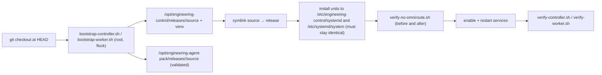

# Lecture 10 — Operations, validation, and lifecycle

> How does this platform get installed, proven, kept clean, upgraded, and recovered? This lecture is about the scripts and services that operate the control plane itself, and about the unusual amount of self-verification the repository ships.

Source anchors: `scripts/*`, `systemd/*`, `docker/*`, `validation/*`, `scheduler.py`, `docs/OPERATIONS.md`, `docs/RUNBOOK.md`, `docs/UPGRADE.md`, `docs/RECOVERY.md`, `docs/VALIDATION.md`, `.github/workflows/postgresql-acceptance.yml`, `.go-status/`.

---

## 10.1 Release model: immutable, commit-addressed

A deployment of Engineering Control is a `git archive` of one commit installed under `/opt/engineering-control/releases/<sha>/source` with a `.release-complete` marker, a venv built under `requirements.lock`, and a symlink flip of `/opt/engineering-control/source`. The agent pack is installed the same way under `/opt/engineering-agent-pack/releases/<sha>/source`. Both hosts must run the **same** commit because adapters and worker instrumentation are one release. Rollback is flipping the symlinks back and restarting in controlled order.

`retention-releases.sh` (dry-run by default) keeps the fifteen newest releases plus the live one and any venv referenced by a running process or a unit drop-in.

## 10.2 Bootstrap

**Controller** (`scripts/bootstrap-controller.sh`, root): creates the `engineering-control` user and the `engineering-api-clients` group; creates the directory tree with exact owners and modes; installs the release and agent pack; builds the venv; installs `control.yaml`, `projects.d`, `personas.d`, `flows.d`, `policies`; reconciles the GitHub write policy from the strict template (creating the disabled default only if absent, preserving any valid operator policy, replacing only one known-invalid legacy document after backing it up); installs targets and runtime targets **only if absent** so operator edits survive; generates `infrastructure.env` (PostgreSQL admin password via `openssl rand`), `api.token`, seven evidence-uploader tokens, `evidence-ingest.env`, and an empty `telegram-allowlist`; installs the Hermes plugin and hook and runs the Hermes policy verifiers; writes `control.env` once and `github-worker.env` with canonical checks; installs fourteen units, validates compose config and `systemd-analyze verify`, runs the registry and no-omniroute checks, then enables and restarts everything. It never touches product repositories, Kubernetes, or the Hermes service definition.

**Worker** (`scripts/bootstrap-worker.sh`, root): optionally installs SHA-verified Node 24 and pnpm 11.28.3 behind atomically switched symlinks; requires Node 22; creates the six runner users with homes under `/var/lib/engineering-control/identities/`; creates per-identity run/evidence/cache/tmp roots and per-repository worktree roots; installs the release, agent pack, venv, and scanners (`install-scanners.sh`: SHA256-verified gitleaks, trivy, kubeconform, syft, kubectl, helm, argocd, gh; semgrep in its own venv; a gitleaks canary test); `npm install`s Codex and Claude Code into `/opt/engineering-cli`; builds the versioned Playwright runtime; writes `worker-common.env`, `evidence-upload.env`, `delivery-worker.env`, `scan-worker.env`; drops `MANUAL_*_REQUIRED` marker files when credentials are missing; installs the two units; verifies the registry; restarts six services; probes `codex login status` and `claude auth status` per identity and touches `MANUAL_AUTH_REQUIRED_{CODEX,CLAUDE}` markers if needed. Provider login is a separate, interactive, human step — the bootstrap never copies credentials.

**Mirrors** (`scripts/bootstrap-mirrors.sh`, root on the worker): clones the six repositories as bare mirrors using the `hermes` user's `gh` credential helper in place, fscks them, hands ownership to `scan-runner` with the documented ACLs, and never re-owns an existing mirror.

## 10.3 Verification

The repository treats "installed" and "verified" as different states.

| Script | Proves |
|---|---|
| `verify-controller.sh` | no-omniroute gate; agent pack matches its checkout; Hermes commands registered; nine services active; registry; `validate-gh-cli-broker.py` and `validate-github-write-denial.py` as `hermes`; unit-file parity; Docker health; `/health/ready` on 8740 and `/health/live` on 10.10.0.2:8750; no wildcard binds; `ssh worker true` |
| `verify-worker.sh` | agent pack; unit parity; six identities and services; exact CLI versions; auth status (exit 2 `BLOCKED` if missing); browser smoke; scanner versions; `gh` version/auth/repo visibility; registry credential mode; the evidence-token impersonation matrix; credential-isolation negatives |
| `verify-end-to-end.sh` | the two above plus `validate-temporal-lifecycle.py`; exit 2 means blocked on credentials only |
| `verify-worker-registry.py` | the static contract between `worker_registry.py`, unit files, and bootstrap scripts; GitHub steps route only to `engineering-github`; policy file ownership and mode |
| `validate-temporal-lifecycle.py` | durability: starts an in-process API, posts `/v1/validation/lifecycle`, **kills the workflow worker mid-run**, starts a replacement, and requires the run to reach `AWAITING_STAGING_APPROVAL` with distinct maker and checker |
| `validate-native-providers.sh` + `native-provider-smoke.py` | both cross-provider directions (Codex maker → Claude checker, Claude maker → Codex checker) in synthetic worktrees with the released agent pack, schema-validated output, and a redacted manifest asserting `paid_api_fallback: false` |
| `validate-github-write-denial.py` | `GitHubWriteDenialAcceptanceWorkflow` on the real `engineering-github` queue returns `PASS_DENIAL_ENFORCED` with one activity start and zero external effects |
| `browser-runtime-smoke.py` | Playwright launches Chromium and Firefox against a loopback page and produces `final.png` and `trace.zip` |
| `validate-telegram-acceptance.py` | a release-bound `/usage` → `/validate` → `/status` triple exists in the gateway's acceptance JSONL and is persisted as canonical evidence |
| `verify-hermes-policy.py`, `verify-hermes-runtime.py` | Telegram allowlist, no admin, plugin registered, no OmniRoute, all engineering commands resolve in the live gateway |
| `verify-no-omniroute.sh` | the negative policy of Lecture 9 |

### 10.3.1 The synthetic lifecycle

`AcceptanceLifecycleWorkflow` is the only workflow that does not use `execute_control_step`. It runs six dedicated activities (`acceptance.project_snapshot`, `worktree`, `maker`, `checker`, `evidence`, `transition`) on the `engineering-acceptance` queue, served by a separate worker that writes only under `/srv/engineering/tmp/acceptance`. It performs real Git and evidence mechanics with synthetic provider labels (`codex-synthetic`, `claude-synthetic`) and no external mutation, and ends at `AWAITING_STAGING_APPROVAL`. Telegram `/validate 30` triggers it, so an operator can prove the API → Temporal → worker → evidence chain from a phone without touching a product.

### 10.3.2 The C-01 / C-02 / C-03 cutovers

The repository's history includes a controlled migration away from OmniRoute. The validators in `validation/c01.py` assemble a twelve-gate manifest from provider acceptance, lifecycle acceptance, and Telegram acceptance evidence, all bound to the installed release SHA; cutover scripts (`prepare-hermes-c01-cutover.py`, `execute-c01-cutover.py --phase stop|uninstall`, `collect-c02-consumers.py`, `validate-c02-readiness.py`, `execute-c02-cutover.py`) each require a typed confirmation and refuse to proceed without a fresh PASS manifest, and the post-stop builder rejects evidence created before the stop. The pattern — *gate, stop only, re-prove with fresh evidence, then remove* — is the same discipline the platform applies to product deployments, applied to itself.

## 10.4 Schedules and routine maintenance

| Schedule | Interval | Effect |
|---|---|---|
| `engineering-quota-refresh` | 240 s | provider presence/auth snapshots |
| `engineering-connections-refresh` | 15 min | fixed health probes into `connection_snapshots` |
| `engineering-safe-cleanup` | daily, +3 h | `CleanupWorkflow` in dry-run unless `cleanup_execution_enabled` on both hosts |

Enabling real cleanup is an operator decision: review at least one dry-run result, set `ENGINEERING_CLEANUP_EXECUTION_ENABLED=true` with `sudoedit` in `control.env` and `worker-common.env`, restart the scheduler, workflow worker, and the scan, delivery, browser, Codex, and release workers. Reverting restores fail-closed behaviour. Preview-namespace cleanup needs an additional per-target opt-in and the three management labels.

Routine commands (`docs/OPERATOR-CHEATSHEET.md`): `engineering-ctl campaigns`, `findings`, `status <wf>`, `pause|resume|cancel`, `usage`, `evidence`, `delivery … --risk R1`, `reconcile`, `deployment … --environment staging`, `approval-candidate`, `approve`, `verify-runtime`, `rollback`, `validate-lifecycle`. Commands default to dry-run; `--execute` is required for mutation and still passes every gate.

## 10.5 Observability

* **Logs**: structlog JSON to stdout → journald (the authoritative store; `/var/log/engineering-control` is reserved and empty). A redaction processor runs on every event.
* **Metrics**: `GET /internal/metrics` (loopback, authenticated) rebuilds Prometheus gauges from PostgreSQL on each scrape: active campaigns, queued findings, active implementations, runs by status, provider rate-limit events, `engineering_worker_health` and last-heartbeat per `(worker, host)`, deployment duration and failures, evidence bytes, dashboard session revocations, notification backlog and oldest-pending age. The dashboard exposes its own persistence-failure counters on loopback.
* **Heartbeats**: each role worker posts to `/v1/workers/heartbeat` every 30 s with its identity token and hostname; workers are healthy within 3× that interval.
* **Health**: `/health/live` and `/health/ready` on the API (ready includes the admission mode), `/health/live` on ingest, `/health/ready` on the dashboard (fails closed on DB errors).
* **Watchdog**: Lecture 8.
* **Dashboard projections**: eleven PostgreSQL triggers write `dashboard_events` on inserts/updates to the core tables so that the Logs page is a durable, ordered stream rather than a log tail.

## 10.6 Upgrade

From `docs/UPGRADE.md` and the dashboard document:

1. Take fresh root-owned runtime, configuration, and PostgreSQL backups.
2. Install the exact committed tree with the bootstrap on **both** hosts (same commit).
3. Apply the linear Alembic chain (`engineering-migrate.service`) with the affected writers stopped; verify new tables exist before starting new code (the dashboard fails closed if `dashboard_session_revocations` is missing).
4. Preserve the dashboard password row and version, the session key, DNS, Caddy, and TLS state.
5. Set `ENGINEERING_BUILD_ID` if using Temporal Worker Deployments and promote with `activate-worker-deployment.sh`; otherwise rely on `workflow.patched` markers (Lecture 3).
6. Run `verify-no-omniroute.sh` and the verification scripts.

Rollback: stop new-release writers, flip the `source`/`venv` symlinks on both hosts, restart in order, leave additive tables in place (the previous release ignores them), and never unregister a workflow while an execution can still replay. Specific downgrade notes exist for migration `0014` (increment the password version before dropping revocations so old cookies cannot revive).

## 10.7 Recovery of the platform (as opposed to product recovery)

* **Stuck operations**: the active-owner index can wedge if an operation is `STARTED` without a Run; the run-less reconciler and `recover_issue_start_once` self-heal; `docs/issue-start-recovery.md` says never start a replacement on `START_UNCONFIRMED`.
* **Orphaned start intents**: projected as `ORPHANED_START_INTENT` after 15 minutes with a reconciliation next action.
* **Campaign repair**: `engineering-ctl campaign-reconcile` previews, then applies one exact row with its snapshot and observation tokens.
* **Policy reconciler failures**: a stale `activate.json` leaves the `.path` unit failed; `docs/RUNBOOK.md` documents removing the stale request and restarting the unit (this exact situation was found and fixed during go-live).
* **Backups**: the watchdog requires a backup status file showing a backup within an hour and a verified restore within eight days.
* **Hermes**: restart `hermes-gateway.service` separately after any allowlist change; rollback material for the configuration cutover lives under `/home/hermes/engineering-backups`.

## 10.8 Testing and CI

* 196 test files and about 2,100 test functions under `tests/`, run with `pytest -ra --strict-markers`, `asyncio_mode = auto`.
* A `postgresql` marker gates tests that need a disposable database; `test_postgresql_acceptance.py` refuses any URL except the local network-less fixture or the GitHub Actions service container, because it drops and recreates the database.
* `.github/workflows/postgresql-acceptance.yml` runs on pull requests and pushes to `main` with a digest-pinned PostgreSQL 17 service container, SHA-pinned actions, Python 3.14, and `pip install --constraint requirements.lock`.
* Replay fixtures (`tests/pre_new_*`) prove old Temporal histories still replay under new code.
* `ruff` (`E F I B UP ASYNC S`) and strict `mypy` over the whole package.

## 10.9 The `.go-status/` ledger

A version-controlled record of the "GO status" engagement that started on 2026-09-17: `progress.json` (phase history ending in "GO REACHED 2026-09-27: musematic #993 delivered end to end by Hermes", remaining blockers, follow-ups), `findings.json` (51 findings with claimed versus real status, evidence, root cause, proposed fix, and whether an operator decision is needed), read-only discovery notes per host and per data flow, a trust-level inventory of every source read, and one-off remediation scripts. It is the project's own worked example of the posture taught in this course: verify live, distinguish implemented from active from blocked, and record decisions.

## 10.10 Summary

Operating Engineering Control means installing immutable releases with root-run bootstraps that never copy credentials, proving each layer with dedicated verifiers (including killing a worker mid-run), keeping three schedules alive with cleanup in dry-run until an operator opts in, upgrading both hosts to the same commit with migrations applied before code, and treating every reconciliation as a preview-then-apply operation with typed confirmation. The repository's own status ledgers show the method applied to itself.
