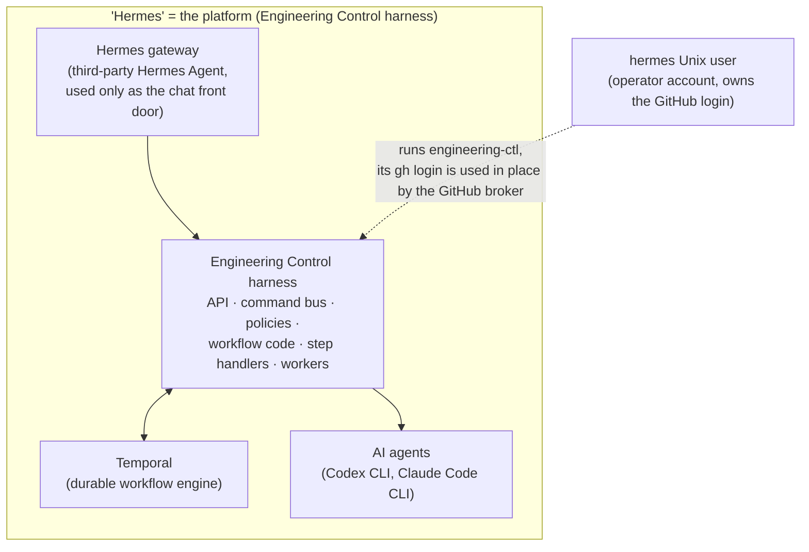
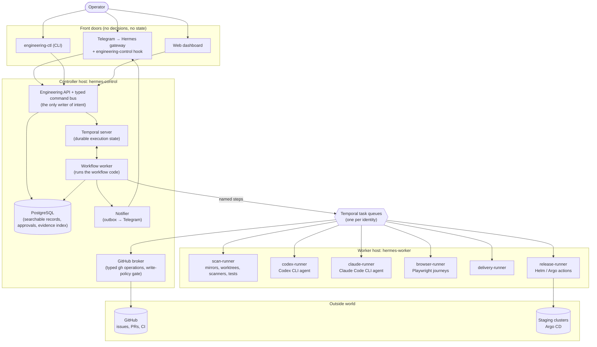
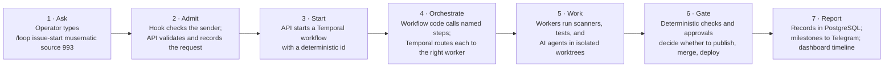

# Chapter 1 — The big picture

> **The idea in one sentence.** Hermes is an AI software-engineering operation in which **Temporal runs the process**, **deterministic code makes every decision that matters**, **AI coding agents do bounded pieces of thinking and typing**, and **a human approves anything risky**, all driven from a Telegram chat.

---

## 1.1 One name, three things: what "Hermes" means

Before anything else, clear up the name. In this project the word **Hermes** is used for three different things. Mixing them up is the most common source of confusion when the platform is explained.

| When people say… | They mean | What it really is | Where it lives |
|---|---|---|---|
| "**Hermes** delivered issue #993", "Hermes opened the PR", the `hermes/ci-baseline/…` branches, issues titled "Hermes staging Argo CD sync failed…" | **The platform as a whole.** | The deterministic harness built in this repository (its technical name is **Engineering Control**) together with Temporal, the workers, and the AI agents it drives. | Two hosts named `hermes-control` (10.10.0.2) and `hermes-worker` (10.10.0.3). |
| "the Hermes gateway", "send it to Hermes on Telegram" | **Hermes Agent**, a third-party AI agent runtime. | An open agent framework (Hermes Agent v0.21.0 on the controller) with its own model loop, skills, tools, memory, and a Telegram gateway. This platform uses **only its gateway**, as a chat front door and a message deliverer. | `hermes-gateway.service`, running as the isolated user `hermes-gateway`. |
| "run it as `hermes`", "the `hermes` GitHub login" | **The `hermes` Unix user.** | The operator's own account on the controller. It owns the GitHub CLI login that the platform's GitHub broker uses, and it is the only account allowed to run the `engineering-ctl` command-line tool. | `/home/hermes` on `hermes-control`. |

In this overview, **"the Hermes harness"** means the first sense: the Engineering Control code plus the infrastructure around it. **"The Hermes gateway"** means the Hermes Agent front door. When the `hermes` user matters, we say "the `hermes` user".

> **For architects.** The repository's own `docs/ARCHITECTURE.md` puts it precisely: "Hermes is a Telegram client of that API; it is neither a workflow store nor a release principal." The colloquial use of "Hermes" for the whole platform comes from the project's history. In mid-August 2026 the Hermes Agent itself still ran audits and fixes through its own skills (Chapter 2, §2.6). From late August the authority moved into Engineering Control and Temporal, but the name stayed.

## 1.2 An analogy for non-technical audiences

Picture a well-run **engineering workshop** that repairs and improves three products for clients.

| In the workshop | In the platform | Why it matters |
|---|---|---|
| The **front desk** takes requests by phone and passes back status updates. It never repairs anything. | The **Hermes gateway** on Telegram (plus a command-line tool and a web dashboard). | Requests arrive in a fixed format. The desk cannot improvise new kinds of work. |
| The **work-order system** turns a request into a numbered order and checks that the client is allowed to ask for it. | The **Engineering API** and its **command bus**. | One single entrance for every request, whatever channel it came from. |
| The **foreman with a binder of procedures** follows each procedure step by step, remembers where every job stands even after a power cut, and waits patiently for parts or signatures. | **Temporal** running the **workflow code**. | Long jobs (hours, days) survive crashes and restarts and resume exactly where they stopped. |
| **Specialist contractors** each work alone in a locked room with only the tools handed to them, and must hand back a filled-in form. | **AI agents**: Codex and Claude Code, run as isolated processes in a prepared copy of the code. | The AI does thinking and typing, but it cannot reach the outside world, and its answer must fit a strict form. |
| **Inspectors with measuring instruments** check the work against fixed rules. | **Deterministic checks**: scanners, tests, hash and signature checks, policy code. | A machine-checkable rule beats an opinion, including the AI's opinion. |
| A **second contractor from a different firm** reviews the first one's work. | The **checker agent**, normally from the other AI vendor. | The one who builds is never the one who approves. |
| The **key-holder** is the only person who can open the client's building, and only while a signed permit is valid. | The **GitHub broker** and the **write policy**. | No agent holds a GitHub credential. Writes happen only through one guarded door, for at most 24 hours per approval. |
| The **manager** signs anything risky. | The **operator**, approving with typed confirmation phrases. | High-risk changes cannot happen without a human decision bound to the exact content. |
| The **logbook** records every order, decision, and piece of evidence. | **PostgreSQL** and the **evidence store**. | Everything can be audited afterwards. |

## 1.3 The building blocks

| Block | One-line role | Makes decisions? | Holds durable state? |
|---|---|---|---|
| **Front doors** (Hermes gateway, CLI, dashboard) | Turn a human request into a typed API call and show answers. | No. They only parse fixed grammars. | No. |
| **Engineering API and command bus** | Validate and record every request, then start or signal workflows. | Yes: admission checks (allowlists, approvals, "is something already running?"). | It writes to PostgreSQL. |
| **Temporal** | Remember which step of which process is running, schedule the next step, wait durably, resume after crashes. | No business decisions. It executes what the workflow code says. | Yes: execution history. |
| **Workflow code** | The procedures: the ordered steps of an audit, a delivery, a deployment. | It sequences and branches on step results. | Through Temporal. |
| **Step handlers on workers** (the harness) | Do the actual work of each named step under a dedicated Unix identity. | Deterministic policy decisions: validate, scan, compare hashes, gate writes. | They write records and evidence. |
| **AI agents** | Think and type within one bounded task: write a spec, change code, review a change, reproduce a bug. | **Advisory only.** Their output is a proposal that code then checks. | No. Each agent is a single process that ends. |
| **PostgreSQL and evidence store** | The system of record. | No. | Yes. |
| **Operator** | Approve risky or policy-changing actions, unblock paused work. | Yes, for anything that needs a human. | Their approvals are recorded. |

## 1.4 What each piece is *not*

Most misunderstandings come from attributing to one component a job that belongs to another.

| Component | It is **not**… | Because… |
|---|---|---|
| Hermes gateway | …the brain, the scheduler, or the place where AI runs on Telegram. | Engineering commands are answered by a hook **without any model turn**, and the gateway's Telegram tool set is empty (Chapter 2). |
| Temporal | …an AI orchestrator that "decides" what to do. | It replays code. Every branch it takes is written in the workflow code. |
| AI agents | …autonomous actors with credentials. | They get a directory, a task, a tool list, and an output form. No GitHub token, no kubeconfig, no API key, no network to the products. |
| The backlog | …a live mirror of GitHub, or something the AI writes. | It is a frozen, deterministic snapshot taken when the operator asks for an import (Chapter 3). |
| Skills | …scripts that start workflows. | In this platform a skill is an instruction contract given to an agent. No skill can start a workflow (Chapter 5). |
| The operator | …someone who has to babysit every step. | Low-risk steps run on their own. The operator is needed for approvals, high-risk work, and real blockers. |

## 1.5 What the platform does: three missions

| Mission | In plain words | Status in production |
|---|---|---|
| **1. Issue resolution** | Take open GitHub issues, check they are still real, fix them, open pull requests, and (in full-delivery mode) merge, build, deploy to staging, verify, and close the issue. | Proven end to end. The project's status ledger records "GO REACHED 2026-09-27: musematic #993 delivered end to end by Hermes". |
| **2. Product audit** | Systematically inspect a product (code, deployment, running system) for defects, and have a *second* AI independently reproduce each suspected defect before it counts. | Implemented and run (11 retained campaign runs in the September inventory). |
| **3. Enhancement discovery** | Propose improvements from audit evidence, review them, and feed approved ones into Mission 1. | Implemented, not yet exercised in production. |

The products being worked on are **Falcone**, **Musematic**, **LLMWiki**, and the shared UI kit **gntik-ui**, each with a source repository and, for the first two, a separate deployment (GitOps) repository and a staging cluster.

## 1.6 The five golden rules

The architecture course lists eleven formal invariants ([Lecture 1, §1.6](../01-what-is-engineering-control.md#16-safety-invariants-the-designs-constitution)). For a general audience they reduce to five rules:

1. **AI proposes, code disposes.** Everything an agent produces is checked by deterministic code before anything happens with it.
2. **Nothing important lives in a chat or in an agent's memory.** Execution state is in Temporal; records and evidence are in PostgreSQL. Agents start fresh every time.
3. **The builder never approves its own work.** The checker is a separate invocation, normally from the other vendor, with read-only access.
4. **Writing to the outside world needs a live permit.** Every GitHub write passes one gate that consults a root-owned policy, enabled only by an approved campaign and only for 24 hours.
5. **When in doubt, stop and say why.** A missing credential, an unknown quota, a changed issue, or an unverifiable artifact produces a typed *blocker* code and a pause, never a guess.

## 1.7 The life of a request in seven steps

Chapter 6 follows this path in full detail for one real issue. Chapters 2 to 5 explain each stage first.

---

**Key takeaways**

* "Hermes" is the platform. The *Hermes gateway* is only its chat front door; the `hermes` user is the operator account.
* Temporal provides memory and patience. The workflow code provides the procedure. The harness provides the hands and the rules. The agents provide bounded intelligence. The operator provides authority.
* No component does two of those jobs. That separation is the design.
