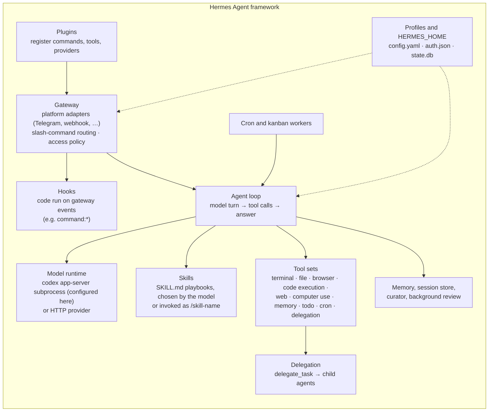
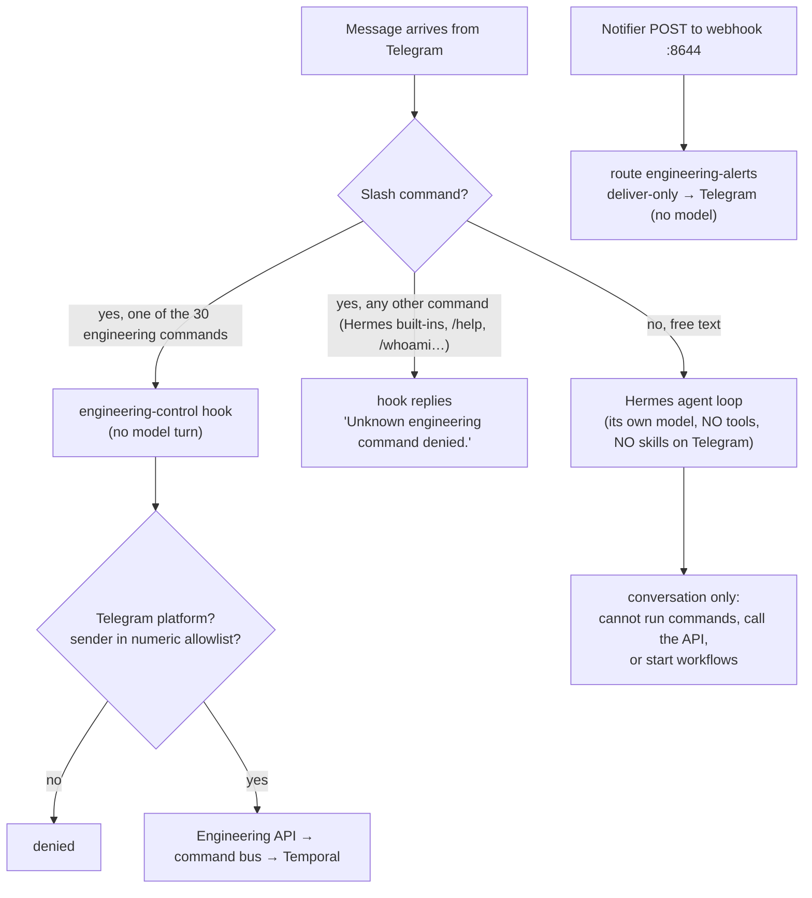
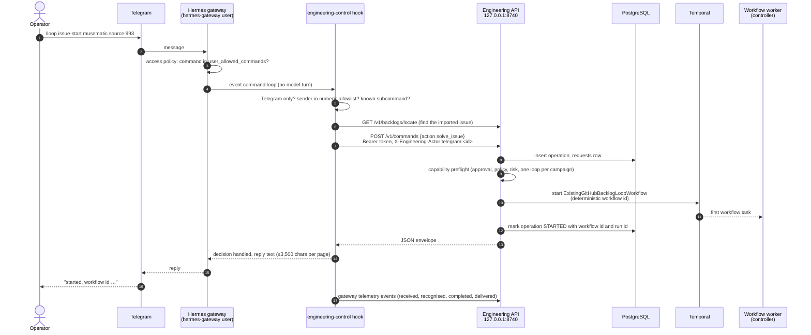
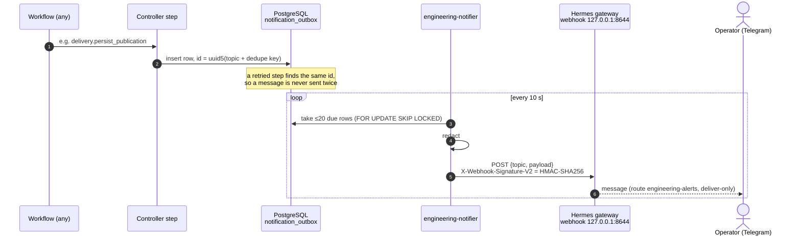
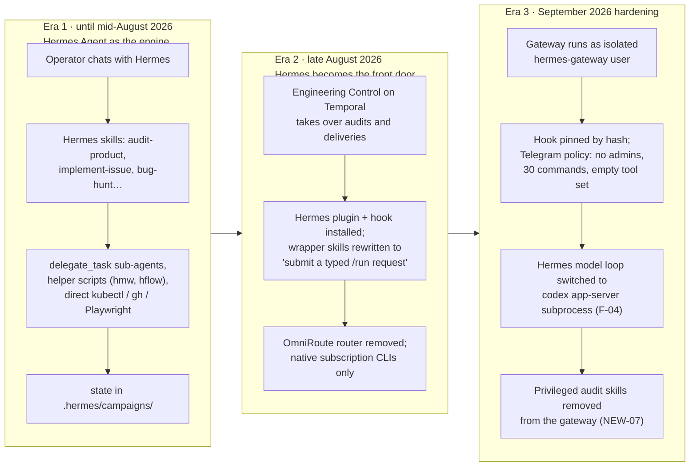

# Chapter 2 — The Hermes Agent framework working alongside Temporal

> **The idea in one sentence.** Hermes Agent is an **agent framework**: a model decides, turn by turn, what to do next. Temporal is a **workflow engine**: code decides, step by step, and the engine guarantees it happens. In this platform the two sit side by side with a deliberately narrow contract between them. Hermes is the **conversational front end and the messenger**; Temporal, driven by the Engineering Control harness, is the **execution backbone**. The bounded AI work inside workflows is done by Codex and Claude CLIs, not by Hermes.

---

## 2.1 Two kinds of "orchestrator"

Both Hermes Agent and Temporal are sometimes called orchestrators. They orchestrate in opposite ways, and the whole design follows from that difference.

| | **Agent framework** (Hermes Agent) | **Workflow engine** (Temporal + workflow code) |
|---|---|---|
| Who decides the next action | A language model, at run time, from the conversation and the available tools | Code written in advance by engineers |
| Unit of work | A *turn*: the model reads context, calls tools, answers | A *step*: a named, allowlisted activity on a specific worker |
| Memory | Conversation history, a memory store, session database | Event-sourced execution history, replayed exactly |
| Long waits (hours, days) | Not its strength; a session waits for the next message | Native: durable timers and signals, no resources held |
| Crash in the middle | The current turn is lost; a new session starts | The workflow resumes after the last completed step |
| Same input, same path? | Not guaranteed | Guaranteed (deterministic replay) |
| Extending it | Add a skill (instructions) or a tool | Add a workflow or a step (code, reviewed and released) |
| Best at | Open-ended conversation, exploration, improvisation with a human present | Long, auditable, repeatable procedures with side effects |

> **In plain words.** Hermes Agent is like a **clever assistant** you can talk to, who decides what to do as the conversation goes. Temporal is like a **factory production line** with a perfect logbook: it does exactly the planned steps, waits for parts without forgetting anything, and restarts where it stopped after a power cut. The platform uses the assistant to *take your order and tell you the news*, and the production line to *do the work*.

## 2.2 Anatomy of the Hermes Agent framework

Hermes Agent (version 0.21.0 on the controller, installed under `/opt/hermes-agent/releases/<commit>/source`) is a general-purpose framework. Its main parts, as found by the repository's inventory (`docs/inventory/skills.md`, `docs/inventory/models.md`):

| Part | What it does in general | Example in this installation |
|---|---|---|
| **Gateway** | Connects the agent to messaging platforms; applies an access policy (admins, allowed commands); routes slash commands. | `hermes_cli.main gateway run`, Telegram platform, a `webhook` platform with the route `engineering-alerts`. |
| **Hooks** | Python handlers the gateway calls on events, before or instead of the model. | The `engineering-control` hook on `command:*` and `command-reply:completed` events. |
| **Plugins** | Extend the framework: register commands, tools, model providers. | The `engineering-control` plugin registers the 30 command names. |
| **Agent loop** | The model reads the conversation, decides to call tools or skills, and answers. | Used for free-text messages and interactive CLI sessions; never for engineering commands. |
| **Model runtime** | How the loop reaches a model: an HTTP provider, or the Codex CLI running as an `app-server` subprocess. | `openai-codex` provider with `openai_runtime: codex_app_server` (subscription login, no API key); main model `gpt-5.6-terra` in the operator's configuration. |
| **Skills** | Markdown playbooks (`SKILL.md`) the model loads when relevant, or that a user invokes by name. | 36 engineering/custom and 83 bundled skills in the operator's `~/.hermes/skills`. |
| **Tool sets** | The functions the model may call: run shell commands, edit files, browse, run code, search the web, delegate to sub-agents, schedule cron jobs, keep memory and to-do lists. | Enabled for the operator's CLI; **empty for Telegram**. |
| **Delegation** | `delegate_task` starts child agents with their own context, model, and tools. | Delegation model `gpt-5.6-luna`; used by the legacy audit skills; disabled (`max_concurrent_children: 0`) in the `engineering` profile. |
| **Memory and background work** | Long-term memory, session search, a curator, background skill and memory review. | Present in the operator's configuration; not part of the platform's path. |
| **Cron and kanban** | Scheduled agent runs and a task board with worker agents. | Present in the framework; not used by the platform. |
| **Profiles** | Separate homes (`HERMES_HOME`) with their own config, credentials, skills, and state. | The operator's default profile, an `engineering` profile generated from the agent pack (never run), and the gateway's own home. |

## 2.3 Two installations, two very different jobs

The same framework runs twice on the controller, under different Unix users, with different homes and different permissions.

| | **Production gateway** | **Interactive operator agent** |
|---|---|---|
| Process | `hermes-gateway.service` (systemd system unit, `Restart=always`, watchdog) | The `hermes` CLI, started by the operator by hand (for example in `tmux`) |
| Unix user | `hermes-gateway` (isolated, uid 972) | `hermes` (the operator, uid 1000) |
| Home | `/var/lib/hermes-gateway/home` (unreadable to other users) | `/home/hermes/.hermes` |
| Sandbox | `ProtectSystem=strict`, `ProtectHome=yes`, explicit read/write paths, system-call filter, capped capabilities, `MemoryMax=768M`, `CPUQuota=150%` | The operator's normal session |
| Job in the platform | **Front door and messenger**: runs the engineering hook for slash commands, delivers notifications from the webhook | **None in the production path.** A personal assistant for the operator. |
| Tools available to the model | **None on Telegram**, by policy (tool set configured empty; see the verification note in §2.4) | Terminal, files, browser, code execution, delegation, cron, memory, web, … |
| Skills | The privileged legacy audit skills (`audit-cluster`, `audit-product`, `audit-runtime-journeys`, `audit-ux`) were **moved out** of the gateway's skill folder on 2026-09-21 (finding NEW-07) | All skills, including legacy ones |
| Credentials it holds | Telegram bot token (systemd credential), the Engineering API token, the allowlist, and its own model configuration (not readable during the inventory) | The operator's ChatGPT subscription login for the model; the `gh` login (used in place by the platform's GitHub broker, not by the agent) |

## 2.4 The integration contract between Hermes and the platform

Everything that connects the framework to the platform is small, explicit, and verified at install time.

| Element | What it is | Enforced by |
|---|---|---|
| **Hook** `engineering-control` | `HOOK.yaml` subscribes to `command:*` and `command-reply:completed`; `execution: threaded`; `command_delivery: durable`. `handler.py` implements the 30 commands' grammar and calls the API. | Installed by `scripts/bootstrap-controller.sh`; pinned by SHA-256 in `/etc/engineering-control/gateway-required-hooks.json`, passed to the gateway with `--required-hook-contract` |
| **Plugin** `engineering-control` | Registers the 30 names so the gateway recognises them. Its handler only replies "Engineering Control gateway hook unavailable; use engineering-ctl locally." It never executes anything. | `verify-hermes-policy.py` requires the plugin to be enabled; `verify-hermes-runtime.py` requires the commands to resolve in the live registry |
| **Access policy** | Nobody is a gateway administrator (`allow_admin_from: [engineering-control-no-admin]`); non-admins may run only the 30 engineering commands (`user_allowed_commands`, also for groups). | `verify-hermes-policy.py` (`apply_telegram_lockdown` writes it with a backup), against the operator-home configuration |
| **Telegram tool set** | `platform_toolsets.telegram: []` — the model gets no tools on Telegram. | `verify-hermes-policy.py` fails if it is not explicitly empty (run at bootstrap against the operator-home configuration) |
| **Telegram allowlist** | Numeric user ids in `/etc/engineering-control/env/telegram-allowlist` (`root:hermes 0640`), loaded by systemd `LoadCredential`. | The hook checks every command against it |
| **API token** | Bearer token the hook uses for `127.0.0.1:8740`. | API authentication and actor header (`telegram:<id>`) |
| **Webhook route** `engineering-alerts` | The gateway's webhook platform on `127.0.0.1:8644`, configured *deliver-only*: payloads go straight to Telegram, no agent run. | HMAC-SHA256 signature from the platform's notifier |
| **Gateway telemetry** | The hook reports its own events (command received, recognised, rejected, API completed, response delivered) to `POST /v1/observability/gateway-events`. | Idempotent ingestion keyed by gateway identity (`docs/gateway-event-ingestion.md`) |
| **No OmniRoute** | No residue of the former model router in Hermes configuration, profiles, or dotfiles. | `verify-hermes-policy.py --require-no-omniroute`, `verify-no-omniroute.sh` |

The vendor's source code is never patched. The platform only adds a plugin, a hook, and configuration, and checks them.

> **For architects: a verification gap to state honestly.** The bootstrap installs the plugin and hook into the `hermes` user's Hermes home (`/home/hermes/.hermes`) and runs the policy verifiers against that configuration. The production gateway runs with its own home (`HERMES_HOME=/var/lib/hermes-gateway/home`), which was not readable to the September inventory. What protects the gateway path is therefore partly verified (the hook is pinned by hash at gateway start; the four privileged skills were confirmed absent from the gateway's skill folder on 2026-09-21) and partly carried over from the operator-home copy (the empty Telegram tool set, the access policy). The repository's own inventory marks the gateway-side configuration as UNVERIFIED.

## 2.5 Three paths through the gateway

A Telegram message takes one of three paths, depending on what it is.

1. **Engineering commands** (the production path) are handled entirely by the hook, without any model involvement. This is how the operator imports backlogs, starts loops, approves, and controls workflows.
2. **Free text** reaches the Hermes agent loop. Under the platform's policy the model has no tools and no skills on Telegram, so it can talk but cannot act (see the verification note in §2.4). The repository's command reference says: "Model-mediated use is only free text (non-slash messages)… it has no command grammar and is out of scope."
3. **Notifications** come from the platform through the webhook route and are delivered without an agent run.

### The command path in detail

### The notification path in detail

Topics you will see (`delivery_notifications.py` and others):

| Topic | When it fires |
|---|---|
| `telegram.engineering-operation-started` | A command was accepted and its workflow started. |
| `telegram.engineering-delivery-milestone` | `DELIVERY_STARTED`, `PRS_PUBLISHED`, `CI_REPAIR_STARTED`, `PRS_MERGED`, `STAGING_VERIFIED`, `MERGE_DELIVERED`, `DELIVERY_BLOCKED`, `STAGING_BLOCKED`, `UI_BLUEPRINT_READY`, `UI_FANOUT_DONE`. |
| `telegram.engineering-backlog-loop-state` | A backlog loop paused on a blocker, resumed, or finished. The message names the blocker in plain language and the exact command to unblock it. |
| `telegram.engineering-write-policy-required` | A GitHub write was refused because no write policy is active. The workflow waits and retries every five minutes. |
| `telegram.engineering-backlog-nothing-delivered` | A loop finished without delivering anything. |
| `telegram.engineering-gitops-sync` | Argo CD sync trouble during staging delivery. |
| `telegram.engineering-cleanup-failed`, `telegram.engineering-operational-watchdog` | Maintenance problems found by the cleanup workflow or the watchdog. |

Producers never call Telegram. If the gateway is down, rows wait in the outbox and the notifier retries with exponential backoff (up to one hour).

## 2.6 Who does what: the responsibility matrix

| Activity | Hermes gateway + hook | Hermes agent loop | Engineering API / command bus | Temporal + workflow code | Step handlers on workers | Codex / Claude agents | Operator |
|---|---|---|---|---|---|---|---|
| Receive a chat message | **Does it** | | | | | | Types it |
| Parse an engineering command | **Hook: fixed grammar** | Never | Re-validates as a typed command | | | | |
| Answer free text | | **Does it (no tools)** | | | | | |
| Check who is asking | **Numeric allowlist** | | Token + actor header | | | | |
| Record the request, admission checks | | | **Does it** | | | | |
| Start or signal a workflow | | Never | **Calls Temporal** | Executes | | | |
| Decide the order of steps, wait, resume | | | | **Does it** | | | |
| Run scanners, tests, Git, GitHub, Helm | | | | Calls the step | **Does it** | | |
| Write a spec, change code, review, reproduce | | | | Calls the step | Prepares and validates | **Does it** | |
| Approve risky work | | | Validates phrase and binding | Waits for it | | | **Does it** |
| Deliver news to Telegram | **Webhook, deliver-only** | | | Queues it | Notifier sends it | | Reads it |

## 2.7 What Temporal contributes

| Capability | In plain words | Where you see it |
|---|---|---|
| **Durable execution** | Every step's result is recorded; after a crash the procedure resumes after the last completed step. | A published pull request is never published twice after a restart. |
| **Durable timers and waiting** | "Wait 90 minutes for CI" or "wait for an approval" without holding a process. | CI polling every minute; the write-policy re-check every 5 minutes; operator pauses with no timeout. |
| **Task queues** | Each step goes to a named queue that only one kind of worker listens on. | `engineering-codex`, `engineering-claude`, `engineering-scan`, `engineering-github`, … |
| **Signals and queries** | Outsiders can poke a running workflow or ask for its state. | `/loop pause`, `/loop skip`, `/loop retry`, `/approve`, and the `status` query. |

What Temporal **does not** do: choose what to do next (the workflow code does), hold secrets or call models (workers do), or serve as the searchable record (PostgreSQL does; the dashboard reads projections).

## 2.8 Two kinds of sub-agents: Hermes delegation versus Temporal steps

The framework has its own way of using several agents: `delegate_task` child agents. The platform does not use it. It runs bounded Codex and Claude invocations as Temporal steps instead. The comparison explains why.

| | **Hermes `delegate_task` child agent** | **Platform agent invocation (Temporal step)** |
|---|---|---|
| Who starts it | The parent model, when it decides to | Workflow code, at a fixed point in the procedure |
| Instructions | Whatever the parent writes, plus loaded skills | A pinned agent-pack bundle (role, skill, policy, domain pack) plus a bounded task |
| Tools | Inherited tool sets (terminal, files, browser…) | An explicit list from `{Read, Glob, Grep, Bash, Edit, Write}`; `Edit`/`Write` only for the maker |
| Credentials | Whatever the running Unix user can reach | None; a dedicated runner identity with only its model login |
| Output | Free text back to the parent | JSON validated against a schema |
| Review | Optional, by the same parent | Mandatory checker from the other vendor, then deterministic validation |
| Survives a crash | No | Yes: bracketed by database records, resumable, handoff on rate limit |
| Audit trail | Session database of the agent | `agent_invocations`, redacted transcripts, Temporal history |

## 2.9 How the relationship evolved

* **Era 1.** The Hermes Agent was the engine. Skills such as `audit-product` ran multi-phase audits by delegating to sub-agents and helper scripts, called `kubectl` and `gh` directly, and kept state in `.hermes/campaigns/`. Their recorded use stops on 2026-08-16.
* **Era 2.** The Temporal-based harness took over the work. The hook and plugin became the bridge. Wrapper skills (`bug-fix`, `issue-delivery`, `fix-loop`, `feature-loop`, …) were rewritten on 2026-08-24 to say "submit a typed request through the Engineering Control adapter, otherwise return BLOCKED". The OmniRoute model router was removed through gated cutover scripts.
* **Era 3.** Hardening found two remaining gaps in the framework's own behaviour and closed them. **F-04**: the gateway's model loop still called the model backend over HTTP; it was switched to the framework's own `codex_app_server` runtime, which spawns the Codex CLI as a subprocess (applied 2026-09-17). **NEW-07**: four legacy audit skills with direct cluster and GitHub access were still loadable by the gateway, an ungated path outside Temporal; they were moved out of the gateway's skill folder on 2026-09-21 (they remain in the operator's personal profile).

> **For architects.** The lesson the project drew is visible in the controls: an agent framework's instructions ("never mutate", "read-only audit") are *advice to a model*, not technical controls. Authority was therefore moved out of the framework into code that the model cannot bypass: a hook with a fixed grammar, an empty tool set, a pinned hook hash, an API that re-validates everything, and Temporal workflows whose steps run under identities that hold the credentials. The framework keeps the jobs it is good at and that carry no authority: conversation and delivery of messages.

## 2.10 Where the two could meet more closely

The current contract is the narrowest possible. For architects evaluating changes, these are the integration patterns and their consequences:

| Pattern | Status | Consequence |
|---|---|---|
| **Fixed commands through a hook** (Hermes → API → Temporal) | **Current** | No model in the command path; every request is typed, authenticated, and re-validated. |
| **Notifications through a deliver-only webhook** (Temporal → Hermes) | **Current** | No model in the notification path; deduplicated, signed, retried. |
| Give the Hermes model a tool that calls the command bus | Not done | Natural-language requests would become possible, but a model would choose the command. The API would still re-validate and require approvals, yet the "no model in the command path" property would be lost. |
| Let Hermes skills start workflows | Not done (no skill contains an API, CLI, or Temporal call) | Same trade-off as above, with less structure. |
| Run the Hermes agent as an activity inside a workflow | Not done | Would bring the framework's tools and memory into steps that are currently strictly bounded CLI invocations. |
| Let Hermes `delegate_task` replace platform agent steps | Not done | Would lose schema validation, the pinned agent pack, cross-vendor checking, and durable bracketing (§2.8). |

## 2.11 The full interaction vocabulary

| Operator does | Through | API action | Temporal interaction |
|---|---|---|---|
| `/loop import …`, `/loop issue-start …`, `/loop start …`, `/audit … --execute`, `/verify`, `/run`, `/enhancements run`, `/rollback`, `/validate` | hook / CLI / dashboard | command bus or dedicated route | **Start** a workflow (deterministic id) |
| `/loop pause`, `/loop resume`, `/loop cancel`, `/pause`, `/resume`, `/cancel`; pause-after-current and stop-after-current (CLI `backlog-pause-after-current` / `backlog-stop-after-current`, dashboard buttons) | hook / CLI / dashboard | `WorkflowControlCommand` | **Signal** `pause`, `pause_after_current`, `resume`, `stop_after_current`, `cancel` |
| `/loop skip <wf> <repo> <n> <REASON>`, `/loop retry <wf> <repo> <n>` | hook / CLI / dashboard | `WorkflowControlCommand` | The API first **queries** `status` to confirm the loop is waiting on *that* issue, then **signals** `skip` or `retry`. A signal for another issue is refused before it is sent. |
| `/approve <changeset> <binding> [phrase]` | hook / CLI | `POST /v1/approvals` | Records the approval in PostgreSQL, then **signals** `approval` to the waiting workflow. |
| `/loop approval-candidate`, `/loop approve` | hook / CLI / dashboard | backlog approval routes | None. Database records, plus the write-policy request file (Chapter 3). |
| `/status`, `/loop status`, `/campaigns`, `/findings`, `/usage`, `/connections` | hook / CLI / dashboard | read routes | None. These are **database projections** kept in step with Temporal. |
| Nothing (automatic) | schedules | — | **Scheduled** workflows: quota refresh every 240 s, connection probes every 15 min, cleanup daily (dry-run by default). |

## 2.12 Why split the work this way?

| Concern | What the split buys |
|---|---|
| **Durability** | A chat session dies with its process. A Temporal workflow survives restarts, deploys, and reboots, and was proven to resume mid-run in the lifecycle acceptance test. |
| **Determinism and auditability** | Workflow code and step handlers are versioned, tested Python with a replayable history. A model choosing tools on the fly cannot offer that. |
| **Least privilege** | The gateway holds a chat token and an API token. GitHub, Kubernetes, and model credentials for the work live with separate Unix identities the gateway cannot read. |
| **Cost control** | AI work runs only inside bounded steps on subscription-authenticated CLIs, with no API-key fallback. |
| **Replaceable front door** | If Telegram or the gateway is down, nothing in flight is lost; `engineering-ctl` and the dashboard reach the same command bus. |

The trade-off is flexibility: the operator cannot ask for something new in free text and have it executed. New capabilities are added as reviewed code.

---

**Key takeaways**

* Hermes Agent is a full agent framework (gateway, model loop, skills, tools, delegation, memory, cron, plugins, hooks, profiles). The platform uses only its gateway, a hook, a plugin, and a deliver-only webhook route.
* Engineering commands never pass through the Hermes model. Free text does, but with no tools and no skills on Telegram.
* Temporal, driven by the Engineering Control harness, carries all durable work; the AI inside that work is Codex and Claude, invoked as bounded steps, not Hermes sub-agents.
* The relationship moved from "Hermes does the work" to "Hermes takes the order and delivers the news", because model instructions are advice, while hooks, tool sets, identities, and workflow code are controls.
