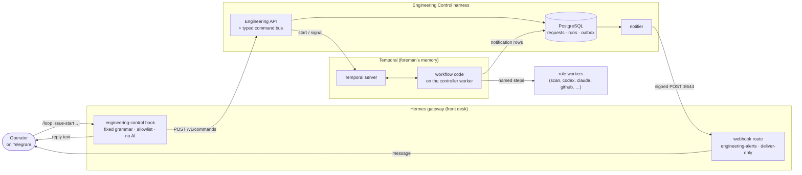
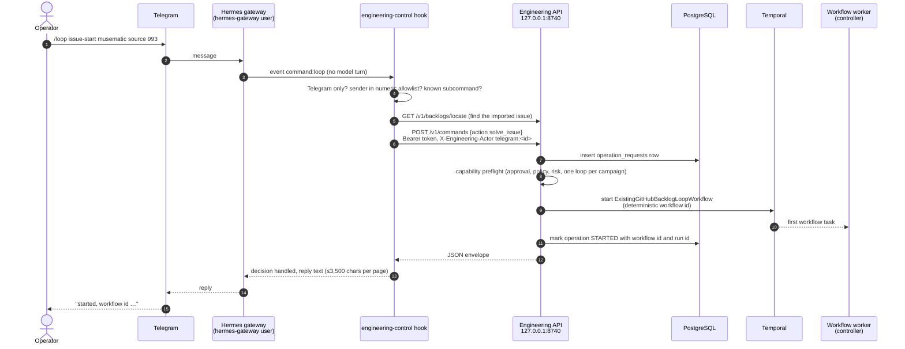
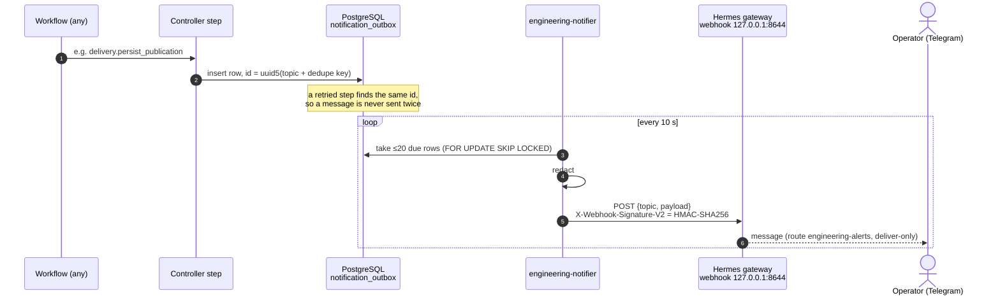
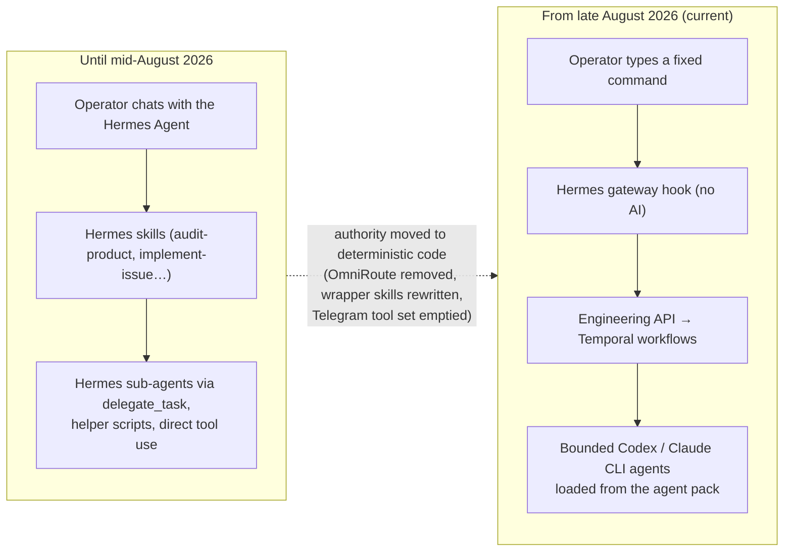

# Chapter 2 — Hermes and Temporal working together

> **The idea in one sentence.** The Hermes gateway is the **front desk**: it takes a typed request from Telegram and hands back news. Temporal is the **foreman's memory**: it keeps every long-running procedure alive and on track. Between them sits the Engineering Control harness, which owns every decision.

---

## 2.1 In plain words

When the operator types a command in Telegram, three very different things happen, and each is done by a different part:

1. **Someone has to listen and check who is talking.** That is the Hermes gateway and the small *hook* the platform installs in it. It accepts only about thirty fixed commands from approved Telegram accounts, and it answers without involving any AI.
2. **Someone has to decide whether the request is allowed and record it.** That is the Engineering API and its *command bus*. It checks approvals, limits, and "is this already running?", writes the request to the database, and then asks Temporal to start or nudge a workflow.
3. **Someone has to carry the work through, step by step, for hours or days, without losing track.** That is Temporal running the platform's workflow code. It calls each step on the right machine, waits for CI or approvals without wasting resources, and resumes exactly where it stopped after any crash.

When something noteworthy happens (a pull request is published, a loop pauses, a write permit is needed), the path runs backwards. A workflow step writes a notification into the database. A small service called the **notifier** picks it up and posts it to the Hermes gateway's webhook, and the gateway delivers it to Telegram, again without any AI.

## 2.2 Who does what: the responsibility matrix

Use this table when someone asks "is it Hermes or Temporal that does X?" The answer is usually "neither, it is the harness", and the table shows why.

| Activity | Hermes gateway + hook | Engineering API / command bus | Temporal server | Workflow code | Step handlers on workers | AI agents | Operator |
|---|---|---|---|---|---|---|---|
| Receive a chat command | **Does it** | | | | | | Types it |
| Check the sender is allowed | **Numeric Telegram allowlist** | Checks the bearer token and actor header | | | | | |
| Parse the command | **Fixed grammar, 30 command names** | Re-validates as a typed command | | | | | |
| Record the request (`operation_requests`) | | **Does it** | | | | | |
| Admission checks (approval current? campaign already running? risk within bound?) | | **Does it** | | | | | |
| Start a workflow or send it a signal | | **Calls Temporal** | Executes it | | | | |
| Decide the order of steps | | | | **Does it** | | | |
| Remember progress, survive crashes, wait durably | | | **Does it** | | | | |
| Route a step to the right machine and identity | | | Delivers to the task queue | **Chooses the queue** | Refuses steps not on its list | | |
| Run scanners, tests, Git operations | | | | | **Does it** | | |
| Write a spec, change code, review a change | | | | | Prepares, launches, and validates | **Does it** | |
| Decide whether a result is acceptable | | | | Branches on the verdict | **Deterministic checks** | Gives an advisory verdict | |
| Write to GitHub | | | | Calls the gated step | **GitHub broker, only with a live write policy** | Never | Approves the policy |
| Deploy to staging | | | | Calls the step | **Release / GitOps steps** | Never | Approves when required |
| Approve risky work | | Validates the typed phrase and binding | | Waits for it | | | **Does it** |
| Keep the system of record | | Writes it | Keeps execution history | | Writes it | | |
| Send news to Telegram | **Delivers it** (webhook, no AI) | | | Queues it | Notifier sends it | | Reads it |

## 2.3 The inbound path: how a chat command becomes durable work

### How it works

What makes this path safe and predictable:

* **The hook is code, not AI.** The gateway raises an event named `command:<name>` for each slash command, and the hook (`integrations/hermes-engineering-control/hook/handler.py`) handles it directly. The gateway's agent loop is never consulted for these commands.
* **A closed set of commands.** The hook knows thirty command names (`audit`, `loop`, `run`, `verify`, `approve`, `pause`, `resume`, `cancel`, `status`, `usage`, …). Each has a fixed argument grammar with allowlisted values (projects, presets, modes, risk classes, reason codes). Anything else is denied with "Unknown engineering command denied". There is no shell, SSH, `kubectl`, `helm`, or free-text passthrough.
* **Who you are is checked twice.** The hook checks the sender's numeric Telegram id against a root-owned allowlist file. The API checks the bearer token and records the actor as `telegram:<id>`.
* **The hook itself is pinned.** The gateway service starts with a required-hook contract (`--required-hook-contract /etc/engineering-control/gateway-required-hooks.json`) that pins the hook's handler and manifest by SHA-256, so the integrity of the code that parses commands is checked rather than assumed.
* **Every surface ends in the same place.** The command-line tool `engineering-ctl` (it refuses to run unless the Unix user is `hermes`) and the web dashboard (which demands password re-authentication for actions) post the same typed commands to the same command bus. The Hermes gateway is one of three equivalent front doors, not a privileged one.
* **The gateway reports on itself.** The hook posts its own lifecycle events (command received, recognised, rejected, API request completed, response delivered) to `POST /v1/observability/gateway-events`, which feeds the dashboard's connection health.

> **For architects.** The hook runs inside the third-party gateway process, which is why the platform treats it as an *untrusted client*. It holds only an API token, and the API re-validates everything it sends. The plugin part of the integration (`plugin/__init__.py`) exists only so the gateway recognises the thirty names. If the hook is not available, the plugin's fallback handler answers "Engineering Control gateway hook unavailable; use engineering-ctl locally" and does nothing.

## 2.4 The outbound path: how news comes back

* **Producers never talk to Telegram.** Workflow steps only insert a row into `notification_outbox`. The notifier is the single sender; it backs off exponentially (up to one hour) when the gateway is unreachable.
* **The gateway delivers without thinking.** The webhook route `engineering-alerts` is configured as *deliver-only*: the payload is formatted and forwarded to Telegram with no agent run (`docs/inventory/skills.md`, §2.3).
* **Topics you will see** (`delivery_notifications.py` and others):

| Topic | When it fires |
|---|---|
| `telegram.engineering-operation-started` | A command was accepted and its workflow started. |
| `telegram.engineering-delivery-milestone` | `DELIVERY_STARTED`, `PRS_PUBLISHED`, `CI_REPAIR_STARTED`, `PRS_MERGED`, `STAGING_VERIFIED`, `MERGE_DELIVERED`, `DELIVERY_BLOCKED`, `STAGING_BLOCKED`, `UI_BLUEPRINT_READY`, `UI_FANOUT_DONE`. |
| `telegram.engineering-backlog-loop-state` | A backlog loop paused on a blocker, resumed, or finished. The message names the blocker in plain language and the exact command to unblock it. |
| `telegram.engineering-write-policy-required` | A GitHub write was refused because no write policy is active. The workflow waits and retries every five minutes. |
| `telegram.engineering-backlog-nothing-delivered` | A loop finished without delivering anything. |
| `telegram.engineering-gitops-sync` | Argo CD sync trouble during staging delivery. |
| `telegram.engineering-cleanup-failed`, `telegram.engineering-operational-watchdog` | Maintenance problems found by the cleanup workflow or the watchdog. |

## 2.5 What Temporal contributes, in plain words

Temporal is a **workflow engine**: software that runs long, multi-step procedures reliably. Four of its capabilities do almost all the work here.

| Capability | In plain words | Where you see it in Hermes |
|---|---|---|
| **Durable execution** | Temporal records every step's result. If a machine restarts, the procedure resumes after the last completed step instead of starting over. | A delivery that has already published a pull request never publishes it twice after a restart. |
| **Durable timers and waiting** | A workflow can "wait 90 minutes for CI" or "wait for an approval" without holding a thread or a process. | CI polling every minute, waiting up to 90 minutes; the write-policy re-check every 5 minutes; operator pauses with no timeout. |
| **Task queues** | Each step is placed on a named queue; only the worker that listens on that queue picks it up. | One queue per Unix identity: `engineering-codex`, `engineering-claude`, `engineering-scan`, `engineering-github`, … |
| **Signals and queries** | Outsiders can poke a running workflow (pause, resume, approve) or ask for its state. | `/loop pause`, `/loop skip`, `/loop retry`, `/approve`, and the `status` query behind `/loop status`. |

And what Temporal **does not** do here:

* It does not choose what to do next. The workflow code (Python, in `src/engineering_control/workflows/definitions.py`) decides; Temporal faithfully replays it.
* It does not hold secrets, call AI models, or talk to GitHub. Workers do, under their own identities.
* It is not the record people search. Searchable records (ChangeSets, findings, approvals, issues, evidence) are in PostgreSQL. The dashboard reads those *projections*; it does not read Temporal histories directly.

## 2.6 What is left of the Hermes Agent's own "brain"?

Hermes Agent is a full AI agent framework: a model loop, skills, tool sets (terminal, files, browser, delegation to sub-agents, cron), and memory. The platform deliberately uses almost none of that in the production path. It helps to know exactly what exists, because people find these things on disk and assume they are in use.

| Hermes Agent instance | Runs as | Model | What it does today |
|---|---|---|---|
| **Production gateway** (`hermes-gateway.service`) | the isolated user `hermes-gateway` (home `/var/lib/hermes-gateway/home`) | configured, but not used for engineering commands | Receives Telegram messages, fires the engineering hook for the thirty commands, and delivers webhook notifications. The Telegram tool set is configured empty, and the hook denies every gateway-known slash command that is not one of the thirty. |
| **Interactive operator agent** (the `hermes` CLI) | the `hermes` user (home `/home/hermes/.hermes`) | `gpt-5.6-terra` through the operator's ChatGPT subscription (`openai-codex` provider) | Used by the operator for manual, ad-hoc sessions. Its skills cannot start workflows (below). |

**Hermes skills (the agent framework's skills) are a different thing from agent-pack skills (Chapter 5).** The September inventory (`docs/inventory/skills.md`) found:

* 36 engineering or custom skills and 83 bundled generic skills in the operator's `~/.hermes/skills`. Many are **legacy "lane" skills** from the period before the Temporal platform (`audit-product`, `audit-code`, `bug-hunt`, `implement-issue`, …). They drove audits by fanning out Hermes sub-agents with `delegate_task`. Their recorded use stops on **2026-08-16**.
* Nine **wrapper skills** (`bug-fix`, `issue-delivery`, `fix-loop`, `feature-loop`, …) were rewritten on 2026-08-24 to say: "submit a typed `/run` (or `/loop`, `/enhancements`, `/audit`) request through the Engineering Control adapter, otherwise return BLOCKED". In practice no model path executes them: skills do not load on Telegram, and in the CLI the hook never fires.
* An `engineering` Hermes profile with 33 skills (24 **generated from the agent pack** plus the 9 wrappers) exists but has never run.
* **"None of the skills starts a Temporal workflow directly."** Only the hook, the API and CLI, the dashboard's command bus, schedules, and one validation script start workflows.

> **For architects.** This history explains two things you will meet in the code. First, the "Hermes" naming (Chapter 1). Second, the strong negative policies: the `verify-no-omniroute.sh` gate, the environment stripping of API keys, and the refusal to let any repository's own `.codex/` or `.claude/` configuration influence an agent. They exist because the earlier, agent-centric design had broad, hard-to-audit authority. The current split gives the gateway the smallest possible role: an authenticated parser and a mailbox.

## 2.7 The full interaction vocabulary

Every operator interaction maps to one of four Temporal interactions, or to a plain database operation.

| Operator does | Through | API action | Temporal interaction |
|---|---|---|---|
| `/loop import …`, `/loop issue-start …`, `/loop start …`, `/audit … --execute`, `/verify`, `/run`, `/enhancements run`, `/rollback`, `/validate` | hook / CLI / dashboard | command bus or dedicated route | **Start** a workflow (deterministic id) |
| `/loop pause`, `/loop resume`, `/loop cancel`, `/pause`, `/resume`, `/cancel`; pause-after-current and stop-after-current (CLI `backlog-pause-after-current` / `backlog-stop-after-current`, dashboard buttons) | hook / CLI / dashboard | `WorkflowControlCommand` | **Signal** `pause`, `pause_after_current`, `resume`, `stop_after_current`, `cancel` |
| `/loop skip <wf> <repo> <n> <REASON>`, `/loop retry <wf> <repo> <n>`, `/loop nudge` | hook / CLI / dashboard | `WorkflowControlCommand` | The API first **queries** `status` to confirm the loop is waiting on *that* issue, then **signals** `skip` or `retry`. A signal for another issue is refused before it is sent. |
| `/approve <changeset> <binding> [phrase]` | hook / CLI | `POST /v1/approvals` | Records the approval in PostgreSQL, then **signals** `approval` to the waiting workflow. |
| `/loop approval-candidate`, `/loop approve` | hook / CLI / dashboard | backlog approval routes | None. Database records, plus the write-policy request file (Chapter 3). |
| `/status`, `/loop status`, `/campaigns`, `/findings`, `/usage`, `/connections` | hook / CLI / dashboard | read routes | None. These are **database projections** kept in step with Temporal. |
| Nothing (automatic) | schedules | — | **Scheduled** workflows: quota refresh every 240 s, connection probes every 15 min, cleanup daily (dry-run by default). |

## 2.8 Why split the work this way?

| Concern | What the split buys |
|---|---|
| **Durability** | A chat agent's session dies with its process. A Temporal workflow survives restarts, deploys, and reboots, and was proven to resume mid-run in the lifecycle acceptance test (kill the worker, check it resumes). |
| **Determinism and auditability** | Workflow code and step handlers are ordinary, versioned, tested Python. The same input gives the same path, and the history shows every step. A chat agent choosing tools on the fly cannot offer that. |
| **Least privilege** | The gateway holds a chat token and an API token, nothing else. GitHub, Kubernetes, and model credentials live with separate Unix identities that the gateway cannot read. |
| **Cost control** | AI runs only inside bounded steps, on subscription-authenticated CLIs, with no API-key fallback. Nothing "chats" in the background. |
| **Replaceable front door** | Telegram can be down or replaced and nothing in flight is lost. The CLI and dashboard reach the same command bus. |

The trade-off is flexibility: an operator cannot ask the system to do something new in free text. New capabilities are added as code (a new command, a new workflow, a new step), reviewed, and deployed. That is intentional.

---

**Key takeaways**

* The Hermes gateway listens and delivers. The harness decides. Temporal remembers and waits. Agents think inside boxes.
* Chat commands are parsed by code, never by a model, and every front door ends at the same typed command bus.
* Hermes skills found on disk are mostly historical; none of them can start a workflow.
