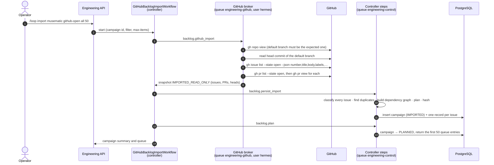
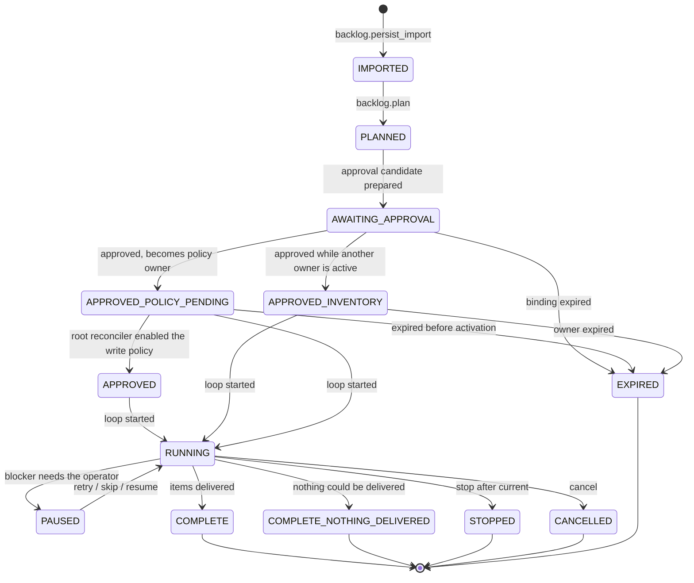
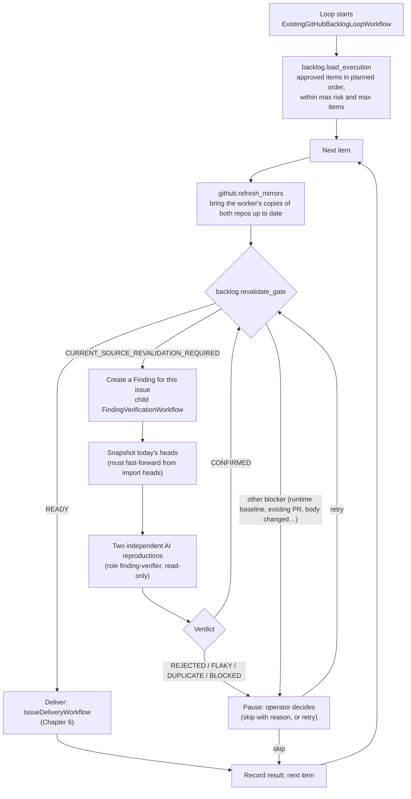

# Chapter 3 — From GitHub issues to the backlog

> **The idea in one sentence.** The Hermes backlog is a **frozen, classified, ordered photograph** of a project's open GitHub issues, taken when the operator asks for it, built entirely by deterministic code (no AI), and turned into work only after a human approves a bounded plan.

---

## 3.1 In plain words

Think of a hospital emergency department. Patients (issues) arrive through the door (GitHub). A **triage nurse** looks at each one, writes down what kind of problem it seems to be, how serious it is, and whether it depends on something else, and gives it a place in the queue. A **senior doctor** then signs off how many patients the team may treat today and at what risk level. Before anyone operates, a doctor **examines the patient again**, because the symptoms may have changed since triage.

In Hermes:

| Hospital | Hermes | Who or what does it |
|---|---|---|
| Patients arriving | Open issues in the project's GitHub repositories | GitHub |
| Taking in the patients | **Import**: read the open issues and pull requests | `GitHubBacklogImportWorkflow`, GitHub broker (read-only) |
| Triage | **Classification**: type, severity, risk, how to reproduce, dependencies, eligibility | Deterministic Python rules, **no AI** (`engineering/backlog.py`) |
| The queue | **Plan**: waves, dependency order, a hash of the whole plan | Deterministic Python (`plan_records`) |
| Senior doctor's sign-off | **Approval** of a bounded campaign: which delivery mode, maximum risk, how many issues, for 24 hours | The operator, with a typed phrase or an authenticated command |
| Examining again before surgery | **Revalidation** on today's code by two independent AI reproductions | `FindingVerificationWorkflow` (this is the first time AI is involved) |
| Treatment | **Delivery**: spec, code change, independent review, PR, merge, staging | `IssueDeliveryWorkflow`, `StagingGitOpsDeliveryWorkflow` |

Three facts people often get wrong:

* **The backlog is not live.** It reflects GitHub at the moment of import. The platform never polls GitHub for new issues on its own; there is no scheduled import. A new import creates a new campaign.
* **The backlog is not written by AI.** Every field of every backlog record comes from GitHub data and fixed rules. The AI first sees an issue when the loop asks it to reproduce that issue on current code.
* **Labels help, but they cannot hide the highest risk.** The issue's *type* and *severity* use GitHub labels when present (plus some title and text patterns), and they influence the R0–R2 risk. The **R3** (highest-risk) rule reads only the issue text, so no label can stop an issue that mentions, for example, production or a data migration from requiring a human's explicit approval.

## 3.2 The objects involved

| Object | What it is | Stored in |
|---|---|---|
| **Backlog campaign** | One import of one project: the repository pair, the head commit of each repository at import time, the filter used, the plan hash, counts, and later the approval. | `github_backlog_campaigns` |
| **Backlog issue record** | One open issue as classified: type, severity, risk, reproduction mode, wave, order, dependencies, linked PRs, possible duplicates, and four progress tracks (eligibility, revalidation, delivery, final closure). | `backlog_issue_records` (id `uuid5("backlog:<campaign>:<repo>:<number>")`) |
| **Plan** | The ordered list of records plus two hashes: the dependency-graph hash and the plan hash over every record's decisive fields. | Inside the campaign |
| **Approval binding** | A SHA-256 over what the operator approves: campaign, project, filter, both import heads, plan hash, maximum risk, maximum items, delivery mode, and expiry. | Inside the campaign (`approval_json`) |
| **Loop** | The Temporal workflow that works through the approved items: `ExistingGitHubBacklogLoopWorkflow`. | Temporal (execution) and `runs` (projection) |

## 3.3 Step 1: the import

### Who can trigger it

| Channel | Command | Projects |
|---|---|---|
| Telegram (Hermes gateway hook) | `/loop import <project> github-open <filter> [max-items]` | falcone, musematic, llmwiki |
| Command line (as user `hermes`) | `engineering-ctl backlog-import <project> --max-items N` | the CLI's project list |
| API | `POST /v1/backlogs/import` | allowlisted projects |

`<filter>` is one of `bugs`, `bugs-and-docs`, `security`, `enhancements`, `all`. `max-items` is 1–500 (default 500). The API creates a new campaign id (`uuid4`) and starts a workflow named `backlog-import-<project>-<campaign-id>`.

### What happens

`GitHubBacklogImportWorkflow` is one of the shortest workflows in the system. This is its real core (from `workflows/definitions.py`):

```python
for step in ("backlog.github_import", "backlog.persist_import", "backlog.plan"):
    if not await self._checkpoint(step.upper().replace(".", "_")):
        return {"status": "CANCELLED", "backlog_campaign_id": request.backlog_campaign_id}
    context = await self._step(step, context, timeout_minutes=30)
    if context.get("status") in {"BLOCKED", "FAILED"}:
        return context
```

Three steps, each one an allowlisted step name that Temporal sends to a specific worker:



### What is read from GitHub, and what is kept

The GitHub broker runs fixed, structured `gh` commands. It cannot run arbitrary `gh` or `gh api` calls, and the import performs **no write** of any kind.

| Item | Command (abridged) | Kept in the snapshot |
|---|---|---|
| Repository | `gh repo view` | Default branch, which must equal the project's expected branch (`main`, or `master` for LLMWiki). A changed default branch stops the import (`PolicyViolation`). |
| Head commit | branch lookup | The exact 40-character SHA of each repository at import time. |
| Open issues | `gh issue list --state open --json number,title,body,labels,milestone,assignees,comments,url,state,updatedAt --limit 1000` | Up to `max-items` issues across the pair: title (≤300 chars), body excerpt (≤6,000 chars), SHA-256 of the full body, labels, milestone, assignees, up to 10 comments (≤512 chars each), `updatedAt`. |
| Open pull requests | `gh pr list --state open … --limit 100`, then `gh pr view` per PR | Number, branch, head SHA, merge state, draft flag, comments, commits. Used to detect existing work. |

**The repository pair.** Each project has a source repository and, where it has one, a deployment repository: `falcone` + `falcone-charts`, `musematic` + `musematic-deploy`. `llmwiki` and `gntik-ui` are single repositories. Both repositories of a pair are imported together, and every record states whether its issue belongs to the `source` or `deployment` side.

## 3.4 Step 2: classification (triage by rules)

`classify_issue` (`engineering/backlog.py`) turns each issue snapshot into a backlog record. It normalises the labels, lower-cases the title and body excerpt, matches whole words and phrases (with regular plurals, so "reproduction" never matches "production"), and applies ordered rules. The rules are intentionally simple and readable. When in doubt they **over-classify risk**, never under-classify.

| Dimension | Possible values | How it is decided, in plain words |
|---|---|---|
| **Issue type** | `PRODUCT_BUG`, `SECURITY_DEFECT`, `DEPLOYMENT_DEFECT`, `DOCUMENTATION_DEFECT`, `OPERATIONS_DEFECT`, `ENHANCEMENT`, `SPEC_DECISION`, `QUESTION`, `META_TOOLING`, `DUPLICATE`, `STALE`, `ALREADY_FIXED`, `SUPERSEDED`, `INVALID_OR_UNREPRODUCIBLE` | An ordered cascade; the first match wins. (1) Housekeeping labels: `duplicate` (or the text "duplicate of #N"), `already-fixed`, `superseded`, `stale`, `invalid` / `wontfix` / `not reproducible`. (2) **Enhancement** when an enhancement label (`enhancement`, `feature`, …), a `kind: enhancement` line, or a title prefix such as `feature request:` is present, unless there is independent defect evidence (a `bug` label, a `bug:` title prefix…). (3) **Security** when labelled `security` or the text mentions "vulnerability", "tenant isolation", or "authorization bypass". (4) **Spec decision** for decision labels or text such as "needs product decision". (5) **Deployment** for issues in the deployment repository or with deployment/Helm/Argo CD/GitOps labels. (6) **Documentation** for documentation labels or text starting with `docs:`. (7) Operations and tooling labels. (8) **Question** for a `question` label or a title ending in "?". (9) Otherwise **product bug**. Issues created by the platform's change-request flow carry a `kind:` line that maps directly to a type. |
| **Severity** | `critical`, `high`, `medium`, `low`, `unspecified` | A `severity:<level>` or `severity/<level>` label if present. Otherwise text such as "critical severity", "remote code execution", or "data loss" means `critical`. Otherwise `unspecified`. |
| **Risk** | `R0`–`R3` | **R3** if the text contains a word starting with `data migrat…`, `destructiv…`, `credential rotat…`, `secret lifecycle`, `production…`, or `clusterrole…`. **R2** for security defects or critical/high severity. **R0** for documentation, questions, and tooling. **R1** otherwise. A `Risk: Rn` line in a change-request issue can only *raise* the risk. |
| **Reproduction mode** | `DOCUMENTATION_REQUIRED`, `DEPLOYMENT_REQUIRED`, `RUNTIME_REQUIRED`, `STATIC_PLUS_TEST`, `SOURCE_ONLY` | How the issue must be proven: from docs, from the deployment repository (or text about Helm, Argo CD, GitOps), on a running system (text about login, HTTP 401/404, runtime, staging, browser), with tests (labels `unit-test`, `regression`), or from source alone. |
| **Dependencies** | references like `gntik-ai/musematic#12` | Phrases such as "blocked by" or "depends on" pointing at an issue in the allowlisted repositories. The import then fills the reverse list (`issues_blocked`). |
| **Linked pull requests** | `ADOPTABLE_ACTIVE_PR`, `STALE_PR`, `CONFLICTING_PR`, `ALREADY_MERGED`, `CLOSED_WITHOUT_MERGE`, `UNRELATED_PR` | An open PR that mentions the issue (URL, closing keyword, or the number in the branch name). An active human PR blocks delivery until it is reconciled, so the platform never duplicates someone's work. |
| **Possible duplicates** | list of issue URLs | Issues whose titles are identical after normalising to lower-case letters and digits. |
| **Wave** | `W0`–`W5` | `W0` for blockers of everything else (login, identity endpoint, build blocker, out-of-sync, degraded, deployment or runtime blocker); `W1` security or critical/high; `W2` has dependencies; `W3` default; `W4` documentation and tooling; `W5` enhancements. |
| **Eligibility** | `ELIGIBLE_FOR_REVALIDATION` or `DEFERRED`, with a reason | First, the import filter must admit the type (for example `bugs` admits product, security, deployment, and operations defects). Duplicates, stale, already-fixed, superseded, invalid, product-decision, and question issues are deferred with that reason. **R3 issues are always deferred** as `R3_REQUIRES_OPERATOR`. Issues the platform itself opened about staging operations (`HERMES_OPERATIONAL_ISSUE`) are never eligible. |

Every new record starts with:

* `candidate_status = NEEDS_CURRENT_STATE_REVALIDATION`: nothing is believed until reproduced on current code;
* `delivery_status = NOT_STARTED` and `final_closure_status = OPEN`;
* `documentation_impact = BLOCKED_BY_UNRESOLVED_DOCUMENTATION_IMPACT`: documentation impact must be resolved explicitly later.

> **For architects.** Why keyword rules and not an AI classifier? Three reasons. They are **reproducible**: the same issue text and labels always yield the same class, so the plan hash is meaningful. They are **cheap and instant**: hundreds of issues in seconds, no model quota. And they are **safe in the right direction**: the R3 rule is written to over-match ("must over-match, never under-match", NEW-128), so wording like "productionisation" or "**destructive**" still triggers the human gate. Their weakness, imprecise typing, is acceptable because every eligible issue is independently reproduced by AI on current code before any change is attempted (§3.7).
>
> A documentation note: `docs/EXISTING-GITHUB-BACKLOG.md` says issues are "classified independently of labels". The code is more nuanced. Labels do drive the *type* and *severity*, and therefore the R0–R2 risk; what is label-independent is the R3 floor (text-based keywords) and the requirement to revalidate every issue on current code.

## 3.5 Step 3: ordering (the plan)

The plan answers "in which order should these issues be worked?" It is a **topological order** (an issue never comes before the issues it depends on) with a priority tie-break:

```text
priority = (wave, severity, risk, −number of issues this one blocks, repository, issue number)
           W0 first · critical first · R3 first · unblocks-most first · stable tie-break
```

If dependencies form a cycle, the cycle is broken by the same priority. Each record receives `planned_order` 1, 2, 3, …. Then two hashes are computed:

* `dependency_graph_hash` over every record's dependencies, wave, and order;
* `plan_hash` over every record's decisive fields: repository, number, body hash, `updatedAt`, type, risk, eligibility and reason, wave, order, dependencies, linked PRs.

**A small worked example.**

An import with filter `all` of six issues in the `musematic` repository:

| Issue | Title (labels) | Type | Severity | Risk | Reproduction | Wave | Depends on | Order and eligibility |
|---|---|---|---|---|---|---|---|---|
| #40 | "Login fails with HTTP 401 after token refresh" (none) | PRODUCT_BUG | unspecified | R1 | RUNTIME_REQUIRED | **W0** ("login") | — | **1**, eligible |
| #52 | "Remote code execution in upload handler" (`security`) | SECURITY_DEFECT | critical ("remote code execution") | R2 | SOURCE_ONLY | **W1** | — | **2**, eligible |
| #61 | "Export button broken, blocked by #40" (none) | PRODUCT_BUG | unspecified | R1 | SOURCE_ONLY | **W2** (has a dependency) | musematic#40 | **3**, eligible |
| #80 | "Rotate the production database credentials" (`operations`) | OPERATIONS_DEFECT | unspecified | **R3** ("production") | SOURCE_ONLY | **W3** | — | **4**, **deferred** `R3_REQUIRES_OPERATOR` |
| #70 | "docs: typo in README install section" (none) | DOCUMENTATION_DEFECT (starts with `docs:`) | unspecified | R0 | DOCUMENTATION_REQUIRED | **W4** | — | **5**, eligible |
| #75 | "Add dark mode" (`enhancement`) | ENHANCEMENT | unspecified | R1 | SOURCE_ONLY | **W5** | — | **6**, eligible (the filter is `all`) |

The example uses invented issue texts to illustrate the rules; it is not a real campaign. Notice three things: the wave dominates the order; #80 keeps its place in the plan but cannot be worked without its own R3 approval; and if #40 were missing from the import, #61 would still be ordered, because only dependencies inside the imported set constrain the order.

The persisted campaign is **idempotent**. If the same campaign id is persisted again (for example after a Temporal retry), the project, plan hash, and both heads must be identical, or the step fails with "backlog import idempotency binding changed".

## 3.6 Step 4: approval (turning a plan into permission)

A planned campaign does nothing until it is approved. Approval creates a **content-bound permission** for 24 hours.

There are two ways to approve, both ending in the same records:

| Style | Commands | Notes |
|---|---|---|
| **Explicit, two steps** | `/loop approval-candidate <project> <campaign> <source-pr\|full-delivery> <R0–R3> [max-items]` then `/loop approve <project> <campaign> <binding-sha256> APPROVE_EXISTING_GITHUB_BACKLOG_LOOP` | The operator sees the binding first and then confirms it with the exact typed phrase. |
| **Implicit, in one command** | `/loop start …` (`solve_backlog`) or `/loop issue-start …` (`solve_issue`), CLI and dashboard equivalents | The command bus prepares the candidate and approves it on the authenticated operator's behalf, then starts the loop. For `issue-start` the approval is bound to that single issue's title, state, body hash, and risk. If the issue changes between submission and dispatch, the command is refused ("issue approval snapshot changed"). |

Approval does three things:

1. It freezes the binding: heads at import, plan hash, delivery mode, maximum risk, maximum items, the allowed GitHub operations, `production=false`, correction limits, and an expiry.
2. It decides the **write-policy role**. The first approved campaign becomes the **policy owner**: a non-secret request file is written, and a root-only reconciler enables GitHub writes for the allowlisted repositories, for at most 24 hours. Campaigns approved while an owner is active become **inventory** campaigns and never touch the policy ([Lecture 9](../09-security-policy-and-fail-closed-gates.md) explains the policy path).
3. It moves the campaign through these states:



The diagram is simplified to the main paths. The status names are the literal values the code writes.

**R3 issues** are never included by a campaign approval. Each needs its own candidate and approval bound to that issue (`/loop r3-candidate …`, then `/loop approve-r3 … <binding> <exact confirmation phrase>`). A generic phrase is rejected.

## 3.7 Step 5: from backlog to work (selection and revalidation)

Once approved, the **loop** works through the backlog one issue at a time.



* **Revalidation is the gate between triage and treatment.** The imported text is weeks old, so the loop proves the issue still exists **on today's code** before anyone touches it. Two reproductions run on the AI provider *opposite* to a deterministic "discoverer" choice (based on whether the issue number is even or odd), each bound to a snapshot evidence hash, with positive and negative controls. Only if both reproduce is the issue `CONFIRMED`.
* **Delivery starts from the revalidated heads**, not from the import heads.
* **Runtime-dependent issues wait for a healthy baseline.** Issues whose reproduction mode needs a running system stay blocked until the corresponding staging baseline is healthy and reproducible.
* **Changed issues are caught.** Delivery re-reads the issue body; if it changed since approval, the loop blocks with `ISSUE_BODY_CHANGED_SINCE_APPROVAL` until the operator runs `/loop amend` (the "issue-amend" flow).
* **Across projects**, the global selector `AutonomousBacklogCampaignWorkflow` (pinned to staging, R2 maximum, one active issue) picks the next eligible issue from all approved project backlogs by `(wave, severity, −issues blocked, risk, repository, number)` and runs one single-issue loop at a time. It is implemented but has no retained production runs.

## 3.8 The per-issue record over time

A backlog record carries four independent progress tracks, which the dashboard's Backlog page shows side by side:

| Track | Starts at | Typical later values | Meaning |
|---|---|---|---|
| `eligibility_status` | `ELIGIBLE_FOR_REVALIDATION` or `DEFERRED` | `COMPLETE` | May this issue be worked at all? |
| `candidate_status` | `NEEDS_CURRENT_STATE_REVALIDATION` | `CANDIDATE_MATERIALIZED`, `REPRODUCED_CURRENT_SOURCE`, `NOT_REPRODUCIBLE`, `REVALIDATION_BLOCKED`, `SKIPPED`, `FIXED` | Is the issue proven real on current code? |
| `delivery_status` | `NOT_STARTED` | `RETRY_PENDING`, `SKIPPED`, `COMPLETE`, … | How far has implementation gone? |
| `final_closure_status` | `OPEN` | `FINAL_CLOSURE_RUNNING`, `FINAL_EVIDENCE_PERSISTED`, `FIXED_CLOSURE_COMPLETE`, `BLOCKED_FINAL_SERVICE`, … | Is the fix deployed, verified, and the issue closed with evidence? |

## 3.9 Summary

```mermaid
flowchart LR
    GH[("GitHub<br/>open issues + PRs")] -- "read-only gh<br/>(GitHub broker)" --> SNAP["Snapshot<br/>issues, PRs, heads"]
    SNAP -- "rules, no AI" --> CLASS["Classified records<br/>type · severity · risk · mode · wave · eligibility"]
    CLASS -- "topological + priority" --> PLAN["Plan<br/>order + plan hash"]
    PLAN -- "operator approval<br/>24 h, content-bound" --> APPROVED["Approved campaign<br/>+ write policy (owner)"]
    APPROVED -- "Temporal loop" --> REVAL["Revalidation on today's code<br/>(2 AI reproductions)"]
    REVAL -- "CONFIRMED" --> DELIVER["Delivery<br/>(Chapter 6)"]
```



**Key takeaways**

* The backlog is built **on demand**, **read-only**, and **without AI**, from a frozen snapshot of the repository pair.
* Classification is rule-based on the issue text; the R3 rule deliberately over-matches; R3 issues always need their own human approval.
* Approval turns a plan into a 24-hour, content-bound permission, and the first approved campaign owns the GitHub write policy.
* AI enters only at revalidation, and every issue must be reproduced twice on current code before it can be changed.
