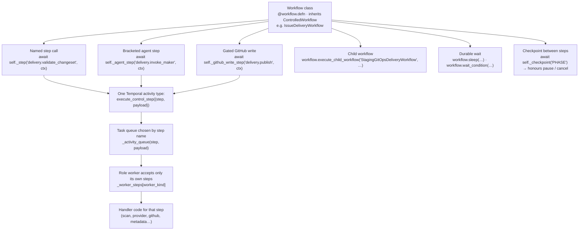
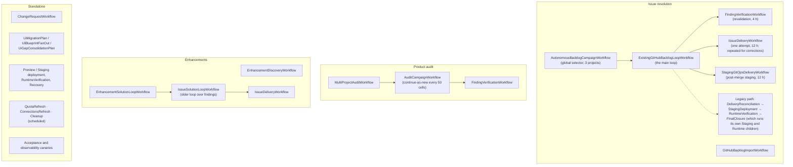
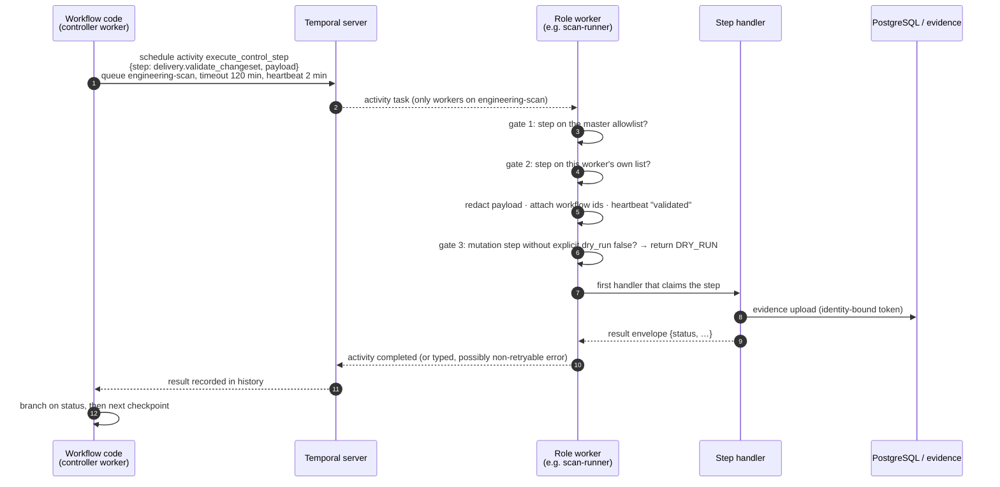
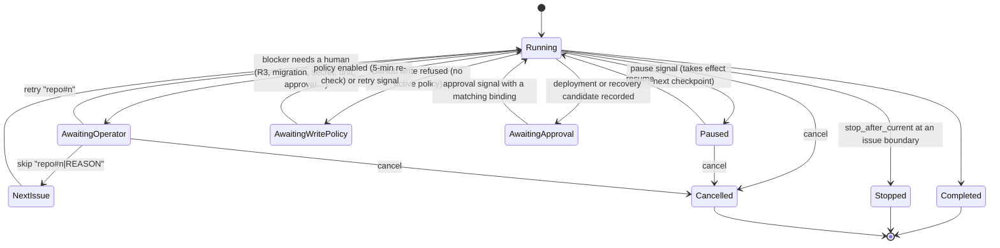

# Chapter 4 — Who orchestrates the workflows

> **The idea in one sentence.** Platform engineers **write** the workflows as ordinary Python code; the operator, three schedules, and parent workflows **start** them; Temporal and one controller process **run** them; and seven isolated role workers **perform** their steps. AI agents never orchestrate anything.

---

## 4.1 In plain words: an orchestra

| Orchestra | Platform | Who |
|---|---|---|
| The **score**, written in advance, saying who plays what and when | The **workflow code**: an ordered list of named steps with branches, waits, and retries | Platform engineers, in `src/engineering_control/workflows/definitions.py`, reviewed and released like any code |
| The **conductor**, who follows the score, keeps time, and remembers which bar the orchestra is at, even after an interruption | **Temporal** plus the controller's **workflow worker**, which executes the workflow code and records every step | Infrastructure on the controller host |
| The **musicians**, each playing their own instrument | **Role workers**: one per Unix identity (scan, codex, claude, browser, delivery, release, github) | Services on the worker host (and the GitHub broker on the controller) |
| A **soloist** given a short passage to play from a sheet | An **AI agent**: one Codex or Claude invocation inside one step | A role worker launches it; it ends when the passage ends |
| Whoever **decides that tonight's concert happens** | The **operator** (through Telegram, CLI, or dashboard), **schedules**, or a **parent workflow** | People and timers, never AI |

And the Hermes Agent framework? It is the **box office**: it takes the audience's request and announces news, but it neither conducts nor plays. Its gateway hook forwards typed commands to the API; its own model loop, skills, and `delegate_task` sub-agents take no part in running workflows (Chapter 2).

The soloist does not conduct, does not choose the next piece, and does not hire other musicians. In the agent pack every shipped role has `recursion_depth: 0`: agents cannot spawn agents. "Temporal owns orchestration; agents do not spawn an uncontrolled topology" (`docs/AGENTS-AND-SKILLS.md`).

## 4.2 Three meanings of "orchestrate"

When someone asks "who orchestrates?", find out which of three questions they mean.

| Question | Answer | Where |
|---|---|---|
| **Who defines the flow?** | Platform engineers write each workflow as a Python class. Changes go through version control, tests (including replay tests against recorded histories), and an immutable release installed on the hosts. | `workflows/definitions.py` (31 workflow classes), `workflows/inputs.py`, `activities/*.py` |
| **Who runs the flow?** | The **Temporal server** stores the history and hands out tasks. The **workflow worker** (`engineering-temporal-worker.service` on the controller, queue `engineering-control`) executes the workflow code for all 31 workflows. **Role workers** execute the steps. | Temporal 1.31 in Docker on the controller; namespace `engineering-control`; 30-day history retention |
| **Who decides that a flow starts, pauses, or stops?** | The **operator** through a front door; **Temporal Schedules** for maintenance; **parent workflows** for their children; one validation **script**. | API and command bus, `scheduler.py`, child-workflow calls |

## 4.3 How a workflow is defined

### The building blocks



Five ideas explain almost every workflow in the system:

1. **A workflow is a script of named steps.** Each step is a string such as `delivery.prepare_toolchain` or `gitops.trigger_sync`. About 220 step names exist, each on an allowlist.
2. **There is only one Temporal activity type.** Every step is executed by the same activity, `execute_control_step`, carrying `{"step": name, "payload": context}`. Because the step name is data, it can be checked twice: the workflow chooses the queue from the name, and each role worker refuses any step not on its own list (`PolicyViolation`).
3. **Context flows forward.** Each step returns the context dictionary plus its additions. By the end of a delivery the same dictionary carries the ChangeSet id, the worktree paths, the chosen providers, the agent results, and the PR URLs.
4. **The base class adds the control surface.** `ControlledWorkflow` gives every workflow the signals `pause`, `resume`, `cancel`, `pause_after_current`, `stop_after_current`, `approval`, `skip`, and `retry`, plus the `status` query. Pauses take effect only at checkpoints between steps; a running step is never interrupted by a pause.
5. **Special step wrappers encode policy.** `_agent_step` writes a database record before and after every AI call. `_github_write_step` turns a "no write policy" refusal into a durable wait with a Telegram alert and a retry every five minutes, instead of a failure.

### A real example, read aloud

`IssueDeliveryWorkflow` (one implementation attempt for one issue) reads, in simplified form:

```text
load the confirmed finding and create the ChangeSet           (controller)
re-read the issue body; stop if it changed since approval     (controller → GitHub broker)
take a component lease; choose maker / checker providers      (controller)
allocate source and deployment worktrees at exact commits     (scan worker)
run baseline scanners; prepare the toolchain                  (scan worker)
spec agent writes the OpenSpec                                (Claude worker, bracketed)
maker agent implements the change                             (Codex worker, bracketed, writable)
deployment maker, then pin convergence                        (Codex worker, then scan worker)
checker agent reviews, read-only                              (Claude worker, bracketed)
validate the ChangeSet deterministically                      (scan worker)
plan the publication                                          (controller)
push the branch and open draft PRs, through the write gate    (GitHub broker)
record the publication; release the leases                    (controller)
```

Every line is one or a few named steps. If any step does not succeed, the workflow stops, releases its leases, and reports a typed status. It does not improvise a different path.

### Where each step runs

| Task queue | Unix identity | Host | Typical steps |
|---|---|---|---|
| `engineering-control` | `engineering-control` | controller | All workflow code; bookkeeping and policy steps (`agent.record_start`, `delivery.prepare_*`, `backlog.*`, approvals, notifications); the GitOps cluster-observation and Argo CD sync steps |
| `engineering-github` | `hermes` | controller | Every GitHub read and write: imports, issue refresh, publish, PR checks, merge, tag, close |
| `engineering-scan` | `scan-runner` | worker | Mirrors, snapshots, worktrees, scanners, toolchain preparation, `validate_changeset`, observer checks |
| `engineering-codex` | `codex-runner` | worker | Codex agent steps |
| `engineering-claude` | `claude-runner` | worker | Claude agent steps |
| `engineering-browser` | `browser-runner` | worker | Playwright journeys, identity attestation |
| `engineering-delivery` | `delivery-runner` | worker | Today only the inspection and cleanup of its own delivery files (publishing runs on the GitHub broker) |
| `engineering-release` | `release-runner` | worker | Helm render, preview and staging preflight and deploy, recovery execution, preview-namespace cleanup |
| `engineering-acceptance` | `engineering-control` | controller | Synthetic lifecycle canary only |

Provider steps are routed by the payload: the workflow reads `maker_provider`, `checker_provider`, `spec_provider`, or `provider` and picks `engineering-codex` or `engineering-claude` accordingly. Codex and Claude workers run at most two activities at once; the others at most four.

## 4.4 Who starts workflows

| Starter | How | Examples |
|---|---|---|
| **Operator via Telegram** | Hermes gateway hook → `POST /v1/commands` or a dedicated route → API starts the workflow | `/loop import`, `/loop issue-start`, `/loop start`, `/audit`, `/verify`, `/run`, `/enhancements run`, `/rollback`, `/validate` |
| **Operator via CLI** | `engineering-ctl <subcommand>` (as user `hermes`) → same API | `backlog-import`, `issue-start`, `audit-start`, `change-draft`, `ui-*`, `deployment`, `verify-runtime`, `reconcile` |
| **Operator via dashboard** | Candidate → password re-authentication → execute; the API's dispatcher picks the queued operation up | Solve an issue, solve a backlog, start an audit, discover enhancements, workflow controls |
| **Schedules** (Temporal Schedules created by `engineering-scheduler.service`) | Temporal starts them on a timer, overlap policy `SKIP` | `QuotaRefreshWorkflow` every 240 s, `ConnectionsRefreshWorkflow` every 15 min, `CleanupWorkflow` daily (dry-run unless enabled) |
| **Parent workflows** | `workflow.execute_child_workflow(…)` with a deterministic child id | Loop → verification, delivery, GitOps delivery; audit → verification; global selector → loop |
| **Scripts** | A validation script on an ephemeral queue | `GitHubWriteDenialAcceptanceWorkflow` |
| ~~AI agents~~ | **Never.** Agents have no Temporal client, no API token, and `recursion_depth: 0`. | — |
| ~~Hermes skills~~ | **Never.** No skill contains a Temporal, API, or hook call (inventory of 2026-09-27). | — |

**Workflow ids are deterministic** wherever duplication would be harmful: an import is `backlog-import-<project>-<campaign-uuid>`, a loop's id is derived from the operation that started it, and child ids extend the parent's id (`…-issue-1-attempt-1`, `finding-verify-<finding-id>`). Starting the same thing twice therefore finds the existing execution instead of creating a second one. The API also refuses a second open loop for the same campaign (NEW-162).

## 4.5 The workflow family tree



The `GitHubBacklogImportWorkflow` is standalone: it fills the database, and the loop is started separately after approval.

## 4.6 The life of one step



What this guarantees:

* **A step cannot run in the wrong place.** Two independent allowlists (the queue choice in the workflow, the accept-list on the worker) must agree, and `scripts/verify-worker-registry.py` checks at bootstrap that GitHub steps can only reach `engineering-github`.
* **Unconfigured means stopped.** If no handler claims a step, it fails with `NotConfigured`; nothing silently succeeds.
* **Dangerous steps default to doing nothing.** Mutation steps (deploy, recovery, cleanup executions, promotions, final merges and closes, enhancement publishing) return a synthetic `DRY_RUN` result unless the payload explicitly says `dry_run: false`.
* **Retries are typed.** Transient errors are retried (5 attempts, exponential backoff up to 2 minutes); policy, security, approval, schema, and authentication errors are never retried. Argo CD remediation writes get exactly one attempt, because an unknown outcome must escalate rather than repeat.
* **Long steps stay alive.** Agent steps heartbeat every 10 seconds and every event, so a model that thinks quietly for twenty minutes is not mistaken for a dead worker.

## 4.7 Humans in the loop



* **Operator pauses have no timeout.** A loop that waits on the operator records `PAUSED` in the database, sends a Telegram message explaining the blocker and the exact command to unblock it, and waits as long as needed without consuming resources.
* **Signals are checked before they are sent.** For issue-bound `retry` and `skip`, the API first queries the workflow's `status` and refuses a signal that names an issue the loop is not waiting on.
* **Approvals are bound to content.** An approval carries a SHA-256 binding of exactly what is being approved. If anything changed (a commit, a digest, a manifest), the binding no longer matches and the approval is rejected.

## 4.8 How the orchestration evolves safely

Workflows can run for days, and the code changes while they run. Temporal replays a workflow's code against its recorded history, so a code change that alters the path would break in-flight executions. The platform handles this with:

* **Patch markers.** About fifty-five `workflow.patched("…")` markers let new behaviour apply to new executions while old histories keep replaying the old path. Long loops use per-issue marker names so they adopt new behaviour at the next issue.
* **Replay fixtures.** Recorded histories in `tests/` prove that old executions still replay against new code.
* **Immutable releases and worker versioning.** Each release is installed under its own directory; workers can join a Temporal Worker Deployment version that must be promoted before receiving work.
* **An operational rule.** "Never unregister a workflow while an execution can still replay" (`docs/UPGRADE.md`).

> **For architects.** The deliberate design choice is that **workflows sequence and wait; activities decide**. Workflow code contains almost no business logic. It calls a step, reads a status, and branches. All validation, hashing, policy, and side effects live in step handlers on the right identity. That keeps workflow code deterministic (a Temporal requirement), keeps policy testable as ordinary functions, and lets the same orchestration spine serve audits, deliveries, deployments, and cleanup. The cost is that the step-name allowlists on both sides must be maintained by hand; the registry verification script exists for exactly that reason.

---

**Key takeaways**

* Engineers define the flows in code; the operator, schedules, and parent workflows start them; Temporal and the controller worker run them; role workers perform the steps.
* Every step is a named, allowlisted unit sent to exactly one identity's queue. Dangerous steps are dry-run unless explicitly armed.
* AI agents and Hermes skills never start, stop, or route workflows.
