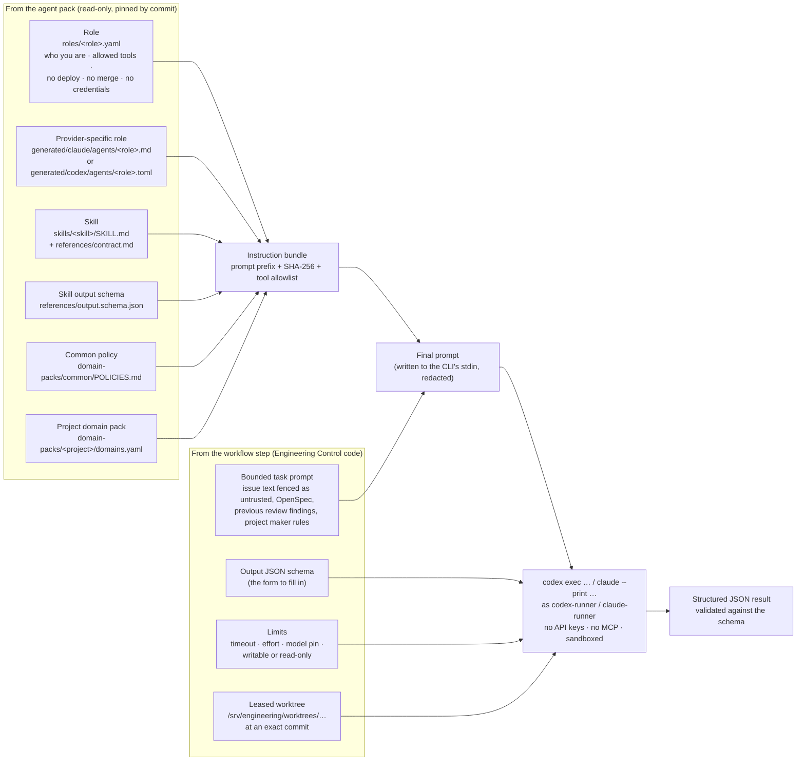
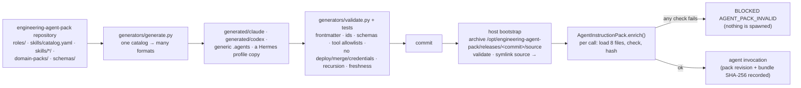
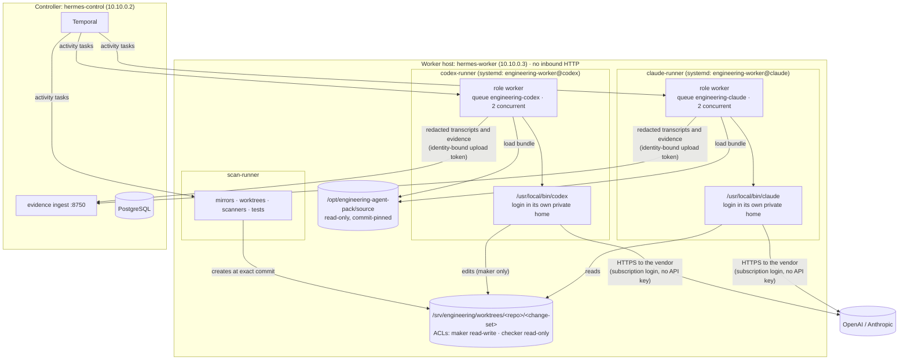
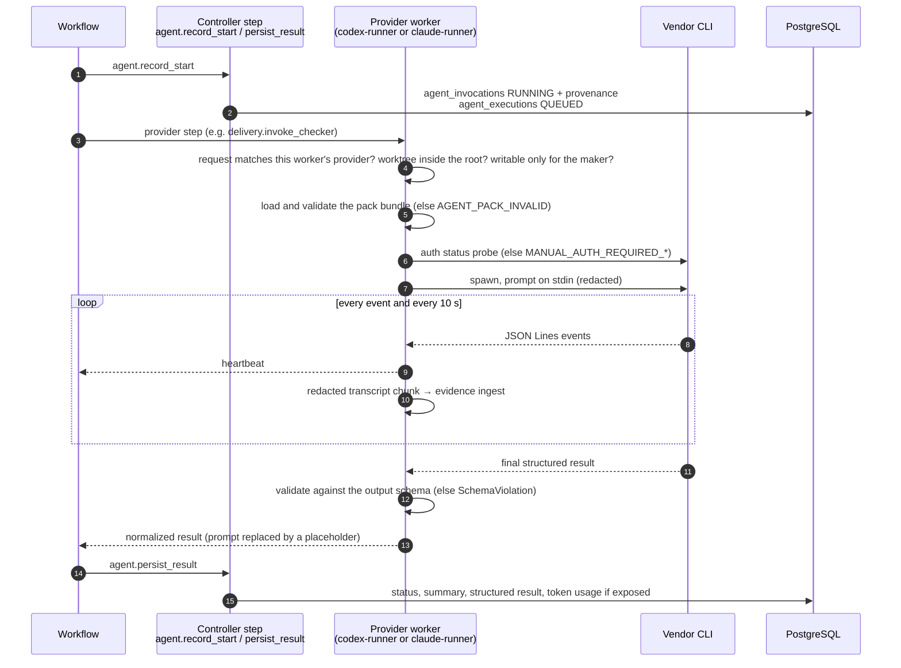
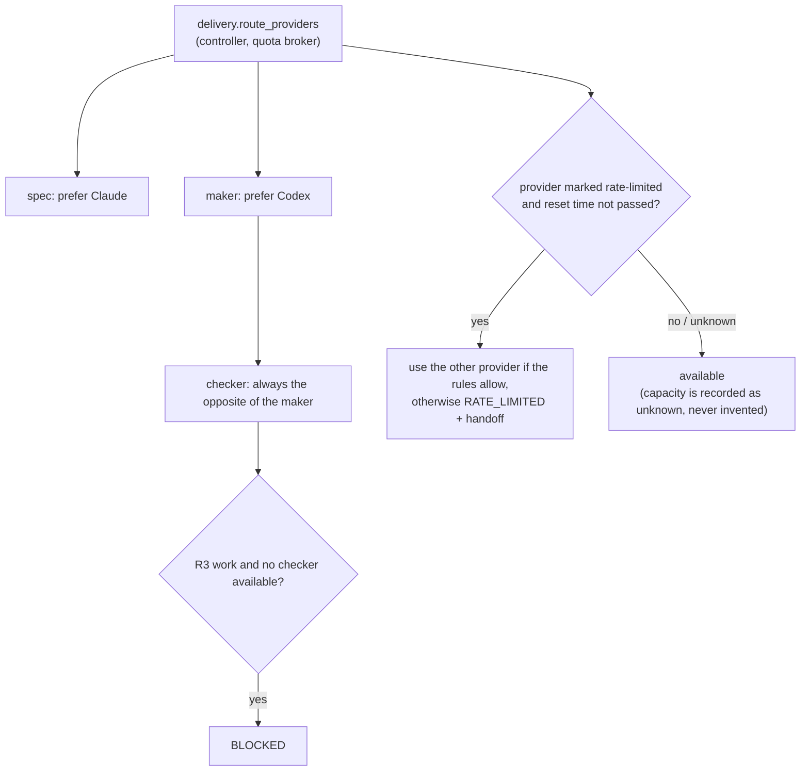

# Chapter 5 — Agents, skills, and tools

> **The idea in one sentence.** In Hermes an **agent** is not a robot that lives somewhere. It is **one run of a vendor's coding tool** (Codex CLI or Claude Code CLI), started by a workflow step, given a job description and a work contract from the **agent pack**, a bounded task, a short list of **tools**, a locked copy of the code, and a form it must fill in. It then exits.

---

## 5.1 Three things called "agent"

The word "agent" is used in three senses around this platform. Separate them first.

| Term | What it is | Lifetime | Used in the production path? |
|---|---|---|---|
| **Hermes Agent** | A third-party agent *framework* with its own model loop, skills, tools, and memory. | A long-running service. | Only its **gateway** is used, as the Telegram front door (Chapter 2). Its model loop is not used for engineering work. |
| **Agent role** | A *job description* in the agent pack: `implementer`, `code-reviewer`, `finding-verifier`, … | A versioned file. | Yes. Every AI call loads exactly one role. |
| **Agent invocation** (what this chapter calls simply "the agent") | One run of the `codex` or `claude` command-line tool with one role, one skill, one task, and one output schema. | Seconds to two hours; then the process ends. | Yes. This is where the AI work happens. |

## 5.2 In plain words: the contractor analogy

Imagine a workshop that hires specialist contractors for single jobs.

* A **staffing agency handbook** (the agent pack) describes each kind of specialist (the **role**), the standard procedure for each kind of job (the **skill**), the house rules everyone must follow (the **common policy**), and background knowledge about each client (the **domain pack**).
* For each job the foreman writes a **work order** (the bounded task), hands over a **toolbox** with only the allowed tools (the **tool list**), unlocks **one room** containing a copy of the product (the **worktree**), and gives a **form** to fill in (the **output schema**).
* The contractor works alone, cannot leave the room, cannot phone anyone, and must return the filled form. An **inspector** checks the form and the work against fixed rules before anything is used.
* A builder's work is always inspected by a **different contractor, preferably from another firm** (maker and checker).

## 5.3 Anatomy of one agent invocation

| Ingredient | What it contributes | Comes from | Example (delivery maker) |
|---|---|---|---|
| **Role** | Identity, responsibilities, the tool list, and the hard prohibitions (`deployment_permissions`, `merge_permissions`, `release_credentials` must all be literally `false`; `recursion_depth` 0). | Agent pack | `implementer` |
| **Provider-specific role** | The same role rendered in the format each CLI understands. | Agent pack, generated | `generated/codex/agents/implementer.toml` |
| **Skill** | The procedure for this kind of job and its execution contract. | Agent pack | `implement-issue` |
| **Common policy** | House rules shared by every role. | Agent pack | `domain-packs/common/POLICIES.md` |
| **Domain pack** | What the product is made of: domains, components, vocabulary. | Agent pack | `domain-packs/musematic/domains.yaml` |
| **Bounded task** | The actual work order for this one call. Issue-derived text is fenced as untrusted content so it cannot pose as instructions. | Workflow step code | "Implement the OpenSpec for issue …; source worktree …; deployment worktree …; the previous checker asked for …" |
| **Output schema** | The exact JSON the agent must return. Anything else is a `SchemaViolation`. | Workflow step code | `status`, changed files, tests run, summary… |
| **Tools** | The role's tools intersected with `{Read, Glob, Grep, Bash, Edit, Write}`, optionally narrowed by the step. Only `implementer` may hold `Edit` and `Write`. | Agent pack + step | Read, Glob, Grep, Bash, Edit, Write (writable) |
| **Sandbox and place** | A leased Git worktree at an exact commit; `workspace-write` only for the maker, `read-only` for everyone else. | Scan worker + adapter | `--sandbox workspace-write` |
| **Engine** | The vendor's CLI, logged in with a subscription under a dedicated Unix user. | Worker host | `codex` as `codex-runner` |
| **Limits** | Timeout, reasoning effort, optional model pin. | Step code + settings | 7,200 s, effort `high`, model `gpt-6.1-sol` |

The final prompt has a fixed shape: a header (bundle SHA-256, pack revision, role, skill, project, schema hash), then six sections (canonical role, provider role, common policy, domain pack, skill, skill contract), then `# Bounded task` and the work order. The header states that "the control-plane supplied structured output schema is authoritative".

## 5.4 Who defines the agents?

| Element | Defined by | Where | How it changes |
|---|---|---|---|
| Roles, skills, contracts, skill output schemas, common policy, domain packs | **Agent-pack maintainers** (the platform team) | The separate repository `engineering-agent-pack` (catalog in `skills/catalog.yaml`, roles in `roles/`) | Edit the catalog, run the generator (`generators/generate.py`) and validator (`generators/validate.py`), commit. The host bootstraps archive the exact commit under `/opt/engineering-agent-pack/releases/<commit>/source`, validate it, and point a symlink at it. |
| Which step uses which skill | **Engineering Control code** | `agents/instructions.py` (`_step_skills`) | Code change and release |
| Which role, model class, timeout, writability, and output schema each step uses | **Engineering Control code** | The step's `prepare_*` handler (for example `activities/metadata.py`) | Code change and release |
| Which provider runs a step (Codex or Claude) | **Quota broker** (deterministic code) at run time | `quota/broker.py`, called by `delivery.route_providers` | Code change; availability of each provider at run time |
| Model pins | **Settings** | `config.py`: Codex `codex_model` (currently `gpt-6.1-sol`, override `ENGINEERING_CODEX_MODEL`); Claude `claude_spec_model` and `claude_checker_model` (`claude-opus-5-5`) | Operator decision recorded in code (for example NEW-36, NEW-53) |
| Project-specific rules for makers and checkers, test commands, toolchain | **Project manifests** | `config/projects/<project>.yaml` | Configuration change |
| The agent loop itself, the file and shell tools, the sandbox | **The vendors** (OpenAI Codex CLI, Anthropic Claude Code CLI) | `/usr/local/bin/codex`, `/usr/local/bin/claude` | CLI upgrades on the worker host |
| Login (subscription authentication) | **The operator**, once per runner identity | Each runner's private home | Manual `login`; never copied between users |

**What nobody can do at run time:** the model cannot choose its role, skill, tools, or output format; the product's repository cannot inject instructions (Claude runs with `--safe-mode`, which ignores the repository's `CLAUDE.md`, skills, hooks, and MCP servers; Codex marks the repository as untrusted so its `.codex/config.toml` is ignored); and a drifted, writable, or permission-escalating pack fails the call with `AGENT_PACK_INVALID` before anything is spawned.

### The agent pack pipeline

Each invocation record in PostgreSQL (`agent_invocations`) stores the pack revision, the bundle SHA-256, the list of source files, and the effective tool allowlist, but never the prompt text.

## 5.5 The roles that run in production

These are the roles that Engineering Control code actually assigns to steps (`activities/*.py`), with their defaults.

| Role | In plain words | Steps that use it | Default provider | Writable | Class → effort | Timeout |
|---|---|---|---|---|---|---|
| `product-spec-architect` | Turns an issue into a precise change specification (OpenSpec); also judges proposed enhancements and drafts change requests. | `delivery.invoke_spec`, `enhancement.product_review`, `change_request.draft` | Claude (pinned to `claude-opus-5-5` for delivery specs) | No | judge → high | 60 min |
| `implementer` (the **maker**) | Changes the code and tests in the source or deployment worktree. | `delivery.invoke_maker`, `delivery.invoke_deployment_maker` | Codex | **Yes** | worker → high (writable) | 120 min |
| `code-reviewer` (the **checker**) | Independently reviews the maker's change and answers `PASS` or `REQUEST_CHANGES` with findings. | `delivery.invoke_checker`, `change_request.review`, UI fan-out review | The provider **opposite** to the maker (Claude pinned to `claude-opus-5-5`) | No | judge → high | 90 min |
| `finding-verifier` | Reproduces a reported problem on an exact snapshot, with positive and negative controls. | `finding.reproduce` (twice per verification) | Opposite of the "discoverer" | No | judge → high | 60 min |
| `domain-auditor` | Audits one coverage cell of a product; also proposes enhancements from audit evidence. | `audit.agent_cell` (non-security lenses), `enhancement.discover` | Codex | No | routine/worker → medium | step timeout 120 min |
| `security-auditor` | Audits security, authorization, and tenant-isolation lenses. | `audit.agent_cell` at R3 | Codex (Claude fallback) | No | judge → high | step timeout 120 min |
| `release-plan-reviewer` | Reviews an immutable release plan, including its recovery strategy, before deployment (legacy candidate path). | `reconcile.invoke_release_reviewer` | The checker's provider | No | judge → high | 90 min |
| `runtime-verifier` | Independently reviews evidence that a deployment really works; both providers for R3. | `runtime.independent_review` | Opposite of the maker | No | judge → high | step timeout 60 min |
| `ui-migration-architect` | Drafts and reviews parts of the UI-migration blueprint. | `ui_plan.draft` (Claude), `ui_plan.review` (Codex) | fixed per step | No (read-only tools only) | worker → medium | up to 3 h |
| `ui-gap-triager` | Drafts change requests for UI gaps and proposes consolidation of duplicates. | `ui_fanout.gap_draft`, `ui_consolidate.plan` | Claude | No (read-only tools only) | worker → medium | 60 min per gap draft |

Effort is derived by one rule (`resolve_agent_effort`): synthetic canaries `low`; writable work, R3 work, and judge-class work `high`; everything else `medium`.

The pack also defines roles that **no step uses today**, such as `campaign-planner`, `repository-cartographer`, `persona-auditor`, and `incident-analyst`. The quota broker knows their provider preferences, but no workflow invokes them.

## 5.6 Skills

### What a skill is here

In Hermes, an **agent-pack skill** is an **instruction contract for one kind of job**: a `SKILL.md` (what to do, step by step), a `references/contract.md` (inputs, obligations, prohibitions), and a `references/output.schema.json` (the shape of the answer). A skill is **text given to the agent**, not code, and it cannot start anything by itself.

The skill is chosen **by the step name, not by the model** (`agents/instructions.py`):

| Step | Skill | Role it is bound to |
|---|---|---|
| `audit.agent_cell` | `audit-domain` | `domain-auditor` / `security-auditor` |
| `finding.reproduce` | `verify-finding` | `finding-verifier` |
| `delivery.invoke_spec`, `change_request.draft` | `create-openspec` | `product-spec-architect` |
| `delivery.invoke_maker`, `delivery.invoke_deployment_maker` | `implement-issue` | `implementer` |
| `delivery.invoke_checker`, `change_request.review` | `review-change` | `code-reviewer` |
| `reconcile.invoke_release_reviewer` | `prepare-staging` | `release-plan-reviewer` |
| `runtime.independent_review` | `verify-runtime` | `runtime-verifier` |
| `enhancement.discover` | `discover-enhancements` | `domain-auditor` |
| `enhancement.product_review` | `review-enhancement` | `product-spec-architect` |
| `ui_plan.draft`, `ui_plan.review` | `plan-ui-migration` | `ui-migration-architect` |
| `ui_fanout.gap_draft`, `ui_consolidate.plan` | `triage-ui-gap` | `ui-gap-triager` |
| observability canaries | `implement-issue`, `review-change` | maker / checker roles |

The September inventory counted 24 skills in the pack's catalog, of which 14 (`audit-api`, `audit-integrations`, `audit-kubernetes`, `audit-persona`, `audit-product`, `audit-ux`, `build-candidate`, `dedupe-finding`, `plan-issue`, `prepare-preview`, `recover-deployment`, `run-browser-journey`, `run-tests`, `verify-preview`) were not mapped by any step. The two UI skills were added afterwards for the UI-migration flow.

### Three kinds of "skill": do not confuse them

| | **Agent-pack skill** | **Hermes Agent skill** | **Claude Code skills feature** |
|---|---|---|---|
| What | An instruction contract for a bounded job | A playbook the Hermes Agent's model may load during a chat | The vendor CLI's own mechanism for loading skills from a repository or user folder |
| Where | `/opt/engineering-agent-pack/source/skills/` | `~/.hermes/skills` (operator) and the gateway's own home | Product repositories, user folders |
| Who picks it | Engineering Control code, by step name | The Hermes model, by description, or the user by slash command | The Claude model |
| Used in production work? | **Yes**, on every agent call | **No.** Not on Telegram (empty tool set), and none can start a workflow | **No.** Disabled by `--safe-mode` |

## 5.7 Tools: three toolboxes

### Toolbox 1 — what an agent may use

| Tool | What it does | Who may have it |
|---|---|---|
| `Read`, `Glob`, `Grep` | Read files, list files by pattern, search text | Every role |
| `Bash` | Run shell commands inside the worktree and sandbox (for example, run the tests) | Roles whose definition lists it; makers and checkers run the project's full test suites this way |
| `Edit`, `Write` | Modify or create files | **Only `implementer`**, and only on a writable call |
| MCP servers (external tool servers) | — | **Nobody.** Claude runs with an explicitly empty, strict MCP configuration; UI roles list kit tools in their definition, but those grants are never given. The UI kit's data reaches models only as text collected by deterministic code. |
| Network to products, GitHub, clusters | — | **Nobody.** No credentials are present. Makers do not even download dependencies: a separate scan step with network access regenerates lock files when the maker asks (NEW-75). |

The Claude Code CLI receives the same list in `--tools` and `--allowed-tools`, runs with `--permission-mode dontAsk` (a disallowed action fails instead of prompting), and never uses a "skip permissions" bypass. The Codex CLI runs with `--sandbox read-only` or, for the maker only, `--sandbox workspace-write`.

### Toolbox 2 — what the harness uses (deterministic, no AI)

| Tool | Purpose | Run by |
|---|---|---|
| `gh` (GitHub CLI) | Every GitHub read and write, through fixed structured commands | GitHub broker (`hermes` user, controller) |
| `git` | Mirrors, worktrees, commits, shadow repositories | scan worker; GitHub broker for pushes |
| gitleaks, trivy, semgrep, syft, kubeconform | Secret, vulnerability, static-analysis, SBOM, and manifest scans before and after the change | scan worker |
| Project toolchains (`uv`, `pnpm`, `go`, Node) and `bubblewrap` | Prepare dependencies; re-run a maker's failing test on the base commit in a no-network sandbox to prove it was already failing | scan worker |
| `helm`, `kubectl`, `argocd` | Render, preflight, deploy, observe, sync | release worker, scan worker (observer), controller GitOps steps |
| Playwright (Chromium) | Browser journeys with an origin allowlist | browser worker |
| Temporal, PostgreSQL, evidence ingest | Orchestration, records, evidence | controller |

### Toolbox 3 — the Hermes Agent's own tool sets

The Hermes Agent framework has tool sets such as terminal, files, browser, code execution, delegation to sub-agents, cron, memory, and web. They are enabled only for the operator's **interactive CLI** sessions. For the Telegram gateway the tool set is configured **empty**, and no MCP servers are configured. None of them is used by the platform's workflows.

## 5.8 Where agents run

* **Machine.** All agents run on the worker host `hermes-worker`. The controller never runs a model.
* **Identity.** Codex runs as `codex-runner`, Claude as `claude-runner`. Each has its own home with its own subscription login, unreadable to the others. Provider workers have **no database access**; they report through Temporal results and the evidence ingest service.
* **Process.** Each agent is a child process of its role worker, in its own process group (so a timeout kills everything it started), with every API-key, base-URL, proxy, and credential-directory variable stripped from its environment.
* **Resources.** The role worker unit is sandboxed by systemd (`ProtectSystem=strict`, `ProtectHome`, `NoNewPrivileges`, explicit writable paths only) and capped (`CPUQuota=250%`; memory 5 GB for the Codex and Claude workers, because makers and checkers run full test suites).
* **Place in the code.** Exactly one leased worktree per ChangeSet, at an exact commit, under `/srv/engineering/worktrees`. File ACLs give the maker write access and the checker read-only access.

## 5.9 The lifecycle of one invocation

Possible outcomes (`RunStatus`): `SUCCESS`, `FAILED`, `TIMED_OUT`, `CANCELLED`, `BLOCKED` (for example pack invalid or login expired), and `RATE_LIMITED`. A rate limit never switches to a paid API. Instead the platform writes a seven-file **handoff** (`TASK.md`, `CONTEXT.json`, `DECISIONS.md`, `SOURCE-REFS.json`, `DIFF.patch`, `TEST-RESULTS.json`, `OPEN-QUESTIONS.md`) so the work can resume later. "Model at capacity" errors are retried after 120, 300, and 600 seconds on the *same* provider and model, never a substitute.

## 5.10 Choosing the provider

Neither CLI exposes remaining quota, so the quota refresh workflow (every 240 seconds) records only whether each CLI is installed and logged in, and capacity as **unknown**. If a numeric capacity were ever available, a 25% reserve would be protected for verification roles and R3 work.

## 5.11 What an agent can never do

| An agent cannot… | Because… |
|---|---|
| push, open PRs, merge, comment, or close issues | It has no GitHub credential. All GitHub operations run in the GitHub broker under another Unix user, behind the write policy. |
| deploy or touch a cluster | No kubeconfig or release credential exists in its identity; release identities cannot read model homes and vice versa. |
| call a paid API | API keys and alternative base URLs are stripped from its environment; any attempt to set them is a hard error. |
| choose its own instructions, tools, or format | Role, skill, tools, and schema are fixed by code and the pinned pack; the repository's own agent configuration is ignored. |
| start another agent or workflow | `recursion_depth: 0`; no Temporal client; no API token. |
| decide that its work is good enough | The checker, deterministic validation (`delivery.validate_changeset`), and policy gates decide. |
| remember anything between calls | `--no-session-persistence` / `--ephemeral`; every call starts fresh. Continuity is carried by the workflow's context, the OpenSpec, and recorded findings. |
| hide what it did | Transcripts (minus prompts and model reasoning) are redacted and stored; every invocation is bracketed by database records. |

---

**Key takeaways**

* An agent is one bounded CLI run: role + skill + policy + domain pack (from the pinned agent pack) + task + schema + tools + worktree.
* The agent pack's maintainers define *who* agents are and *how* they work; Engineering Control code decides *when* each is used and *what* exactly it is asked; the quota broker picks *which vendor*; the operator provides the logins and the approvals.
* Agents run on the worker host under `codex-runner` and `claude-runner`, in leased worktrees, without credentials, and their output is advisory until deterministic checks accept it.
