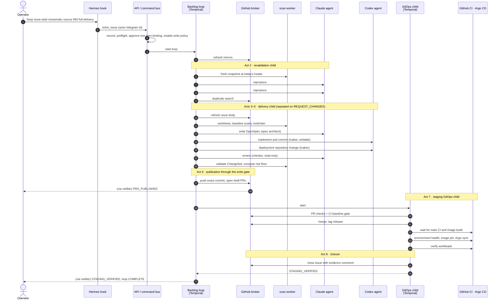

# Chapter 6 — One issue, end to end

> **The idea in one sentence.** One GitHub issue travels through eight acts (import, request, revalidation, planning, making and checking, deterministic proof, publication, staging delivery and closure), and at every act you can name **who** acts, **whether AI is involved**, **where** it runs, and **what is recorded**.

This chapter first tells the generic journey in `full-delivery` mode for a project with a staging GitOps flow (Falcone or Musematic). It then shows how the real run that reached the platform's go-live milestone, **musematic #993**, actually went.

---

## 6.1 The story in plain words

1. The operator asks, through Hermes on Telegram, for a photograph of the project's open issues. Rules sort them into a queue. *(No AI.)*
2. The operator says "work on issue 993, all the way to staging". The platform checks the request, records the permission, and opens a 24-hour window for GitHub writes. *(No AI.)*
3. Two AI reproductions check that the problem still exists in today's code. *(AI, read-only.)*
4. The platform prepares two clean copies of the code, scans them, installs dependencies, and asks an AI architect to write a precise change specification. *(Mostly no AI; one AI step.)*
5. One AI (the maker) changes the code. Another AI from a different vendor (the checker) reviews it. If the checker asks for changes, the maker tries again with the checker's findings. *(AI.)*
6. Fixed rules decide whether the change is acceptable: the checker said PASS, no new security findings, no secrets, failing tests already failed before, and so on. The risk class may go up, never down. *(No AI.)*
7. The platform pushes the branch and opens draft pull requests through the guarded GitHub door. *(No AI.)*
8. The platform waits for CI, merges, tags a release, waits for the image to be built, checks the staging environment, waits for Argo CD to pick up the new image, syncs, verifies the workloads, and closes the issue with a comment listing every artifact. *(No AI. Bounded automatic repair rounds use AI only to fix CI regressions.)*

## 6.2 The cast

| Actor | Kind | Runs on | In this story |
|---|---|---|---|
| Operator | Human | Telegram, CLI, dashboard | Imports, starts, approves, answers product questions, unblocks |
| Hermes gateway + hook | Deterministic front door | controller | Parses `/loop …`, forwards to the API, delivers notifications |
| Engineering API and command bus | Deterministic | controller | Admits the request, prepares and records the approval, starts the loop |
| Temporal + workflow worker | Orchestration | controller | Runs the loop and its children |
| `ExistingGitHubBacklogLoopWorkflow` | Workflow | controller | The parent for this issue |
| `FindingVerificationWorkflow` | Child workflow | controller | Revalidation |
| `IssueDeliveryWorkflow` | Child workflow (one per attempt) | controller | Spec, maker, checker, validation, publication |
| `StagingGitOpsDeliveryWorkflow` | Child workflow | controller | Merge to staging verification |
| GitHub broker | Deterministic, user `hermes` | controller | Every GitHub read and write |
| scan worker | Deterministic, user `scan-runner` | worker host | Mirrors, worktrees, scanners, toolchain, validation |
| Codex agent | AI, user `codex-runner` | worker host | Maker (default) |
| Claude agent | AI, user `claude-runner` | worker host | Spec architect, checker, finding verifier (defaults) |
| GitHub Actions, Argo CD, Argo CD Image Updater | External systems | GitHub, staging cluster | CI, image build, GitOps sync |

## 6.3 The eight acts

### Act 0 — Import (done beforehand)

| | |
|---|---|
| **Trigger** | `/loop import musematic github-open all` |
| **Workflow** | `GitHubBacklogImportWorkflow` |
| **What happens** | Read-only snapshot of open issues and PRs in `musematic` and `musematic-deploy`, rule-based classification, ordering, plan hash (Chapter 3). |
| **AI?** | No |
| **Recorded** | `github_backlog_campaigns` (status `PLANNED`), one `backlog_issue_records` row per issue |

### Act 1 — The request

| | |
|---|---|
| **Trigger** | `/loop issue-start musematic source 993 full-delivery` |
| **Who** | Hook → API command bus |
| **What happens** | The hook locates #993 in the latest imported campaign. The command bus records an `operation_requests` row bound to the issue's title, state, body hash, and risk; checks capabilities (no other open loop for the campaign, risk within bound, R3 approval if needed); prepares and approves a one-item campaign binding; if this campaign becomes the write-policy owner, writes the policy request and waits up to 60 s for the root reconciler to enable GitHub writes; then starts `ExistingGitHubBacklogLoopWorkflow` with a deterministic id. |
| **AI?** | No |
| **Recorded** | Operation `STARTED`, campaign `APPROVED_POLICY_PENDING` → `APPROVED` → `RUNNING`, a `runs` row; Telegram "operation started" |

### Act 2 — Is it still real? (revalidation)

| | |
|---|---|
| **Who** | Loop → child `FindingVerificationWorkflow` |
| **What happens** | `github.refresh_mirrors`; `backlog.revalidate_gate` says `CURRENT_SOURCE_REVALIDATION_REQUIRED`; the loop materialises a Finding for the issue and starts the verification child. The scan worker snapshots today's heads (they must fast-forward from the import heads). Two `finding.reproduce` calls (role `finding-verifier`, read-only) each try to reproduce the issue with positive and negative controls. Both must succeed for `CONFIRMED`. A read-only GitHub duplicate search follows. |
| **AI?** | **Yes**, twice, read-only, on the provider opposite to the deterministic "discoverer" |
| **Recorded** | `findings` (disposition), `agent_invocations` ×2, evidence; the backlog record's `candidate_status` |

### Act 3 — Planning the change

| | |
|---|---|
| **Who** | Child `IssueDeliveryWorkflow` (attempt 1) |
| **What happens** | Load the confirmed finding and create the **ChangeSet** at the revalidated heads. Re-read the issue body from GitHub (stop if it changed since approval). Take a component lease. Route providers (spec Claude, maker Codex, checker opposite of the maker). Allocate source and deployment **worktrees** at exact commits with maker/checker ACLs. Run baseline scanners. Prepare the toolchain (`uv sync`, `pnpm install`, `go mod download`) in a private cache. Ask the **spec architect** to write an OpenSpec. |
| **AI?** | One step: `delivery.invoke_spec` (role `product-spec-architect`, Claude Opus 5.5 pin, read-only) |
| **Recorded** | `change_sets` (state `CONFIRMED` → `PLANNED`), leases, scanner baselines, the OpenSpec |

### Act 4 — Making and checking

| | |
|---|---|
| **Who** | The same delivery child |
| **What happens** | The **maker** (`implementer`, Codex, writable, up to 120 min) implements the OpenSpec in the source worktree and commits. If it edited dependency manifests, a network-enabled scan step regenerates lock files (up to two rounds). The **deployment maker** does the same for the deployment repository (often "no change needed"); the deployment pin is converged byte-for-byte. The **checker** (`code-reviewer`, Claude, read-only, up to 90 min) reviews both and answers `PASS` or `REQUEST_CHANGES` with findings. |
| **Corrections** | On `REQUEST_CHANGES`, the loop starts another `IssueDeliveryWorkflow` attempt. The new maker prompt carries the checker's findings as must-fix items (NEW-39) and resumes from the previous attempt's commits (NEW-52). `/loop issue-start` allows 5 corrections (6 attempts). |
| **AI?** | **Yes**: maker, deployment maker, checker |
| **Recorded** | `agent_invocations`, redacted transcripts in the Logs page, ChangeSet `IMPLEMENTING` |

### Act 5 — Deterministic proof

| | |
|---|---|
| **Who** | `delivery.validate_changeset` on the scan worker |
| **What happens** | The checker must say `PASS`. Tests the maker reported as failing must fail on the base commit as well (re-run in a no-network sandbox). No edits to agent configuration (`.codex/`, `.claude/`, `.mcp.json`). No *introduced* scanner findings compared with the baseline. A secret in the diff withholds the patch. The **risk floor** is computed from the actual diff: migrations, secret lifecycle, cluster, tenant/auth, or destructive changes raise it (here, to R3 because of a database migration). |
| **AI?** | No |
| **Recorded** | Validation evidence, the ChangeSet's risk class (raised, never lowered) |

### Act 6 — Publication

| | |
|---|---|
| **Who** | `delivery.prepare_publication` (controller) → `delivery.publish` (GitHub broker, through the write gate) |
| **What happens** | Plan the draft PRs (a deployment PR only if the deployment repository changed) and persist the publication intent. The broker fetches the validated branch from the worker's shadow repository over SSH, pushes the exact commit (never force), and opens **draft** PRs. If no write policy is active, the step parks in `AWAITING_WRITE_POLICY`, alerts Telegram, and re-checks every 5 minutes. |
| **AI?** | No |
| **Recorded** | PR URLs, ChangeSet `SOURCE_PR`; Telegram milestone `PRS_PUBLISHED` |

### Act 7 — Merge and ship to staging

| | |
|---|---|
| **Who** | Child `StagingGitOpsDeliveryWorkflow` (12 h) |
| **What happens** | Poll the PR's CI (up to 90 × 1 min). A failing job counts as a regression only if the same job passes on a baseline draft PR opened from unchanged `main` (`hermes/ci-baseline/…`, NEW-63). Merge with `--match-head-commit` (an R3 change merges only if the project allows it: `staging_flow.allow_r3_merge`). Tag a release at the merge commit. Wait for main CI and the image build. Check the staging environment's health (bounded remediation, up to 3 rounds, never pruning). Wait until Argo CD Image Updater pins `sha-<merge7>` for every image. Trigger an Argo CD sync and wait for it (bounded remediation if it fails). Verify every workload is ready with the right tag. |
| **CI repair** | A `SOURCE_PR_CI_REGRESSION` triggers up to two automatic repair rounds: a new delivery attempt whose maker prompt includes the failing job excerpts, then a new GitOps child. |
| **AI?** | Only inside CI-repair delivery attempts |
| **Recorded** | Merge SHA, tag, image, Argo revision; milestones `PRS_MERGED`, `STAGING_VERIFIED` |

### Act 8 — Closing and reporting

| | |
|---|---|
| **Who** | GitOps child → GitHub broker; loop |
| **What happens** | Close the issue with a marker comment listing the PRs, merge SHA, tag, image, and Argo revision. Persist the result (`RUNTIME_VERIFIED`), release leases, record the loop state, move to the next issue or finish. |
| **AI?** | No |
| **Recorded** | Backlog record `delivery_status = COMPLETE`, campaign `COMPLETE`; Telegram loop-state message |

## 6.4 The whole journey in one diagram

## 6.5 Where the AI is, and where it is not

Counting the steps of one successful first-attempt run:

| Act | Deterministic steps | AI steps |
|---|---|---|
| 1. Request | Admission, approval, policy activation, workflow start | — |
| 2. Revalidation | Mirrors, snapshot, controls, duplicate search, record | 2 × `finding.reproduce` |
| 3. Planning | Finding load, issue refresh, leases, routing, worktrees, scans, toolchain, OpenSpec persistence | 1 × `delivery.invoke_spec` |
| 4. Making and checking | Prompt preparation, dependency resolution, pin convergence | `invoke_maker`, `invoke_deployment_maker`, `invoke_checker` |
| 5. Proof | `validate_changeset`, risk floor | — |
| 6. Publication | Publication plan, push, draft PRs, persistence | — |
| 7. Staging | CI polling, baseline gate, merge, tag, build wait, health, pin, sync, verify | only in CI-repair rounds |
| 8. Closure | Comment, close, persist, notify | — |

Six AI calls in the whole journey, each bracketed by two database writes, each read-only except the two maker calls, and none of them able to publish, merge, or deploy.

## 6.6 The real run: musematic #993

The project's status ledger (`.go-status/progress.json`) records how the go-live issue actually went. It is worth telling as it is, because it shows the controls doing their job, including stopping when they should.

| When (2026) | What happened | What it illustrates |
|---|---|---|
| 23 Sep | The operator chose #993 "[E8.1] Import ingestion" (R1, no stated blocker) after cancelling a loop on another issue whose maker had correctly reported `BLOCKED` on a product gap. `issue-start musematic source 993` started a source-PR loop. | Selection is a human decision; a maker's `BLOCKED` is a legitimate outcome, not a failure. |
| 23 Sep | Revalidation `CONFIRMED`; prechecks passed; the spec succeeded first time; the Codex maker committed 7 files (a database migration with row-level security, a service, a router, unit tests, a web page, an OpenSpec delta). | The normal path through Acts 2–4. |
| 23 Sep | The Claude checker returned `REQUEST_CHANGES` with substantive findings (for example, an upload size cap that ran too late to stop a denial-of-service). Validation refused the change: `INDEPENDENT_CHECKER_DID_NOT_PASS`. | The builder does not approve its own work. |
| 23 Sep | Correction rounds revealed platform gaps that the team fixed and deployed between rounds: checker findings now reach the next maker (NEW-39), agent commits get a platform author identity (NEW-40), and the deployment maker's instructions were clarified (NEW-41, NEW-42). | Workflows are code: the platform improves through reviewed releases, and patch markers let running loops adopt new steps safely. |
| 23 Sep | The operator switched #993 to `full-delivery`. The start was refused at preflight with `MUSEMATIC_CANDIDATE_BUILD_CONTRACT_MISSING`: the pre-merge candidate-build path needs CI artifacts the product did not produce. The team then built the post-merge GitOps staging flow, and a full-delivery loop started on it. | Fail-closed: a missing prerequisite is a typed blocker, never a workaround. |
| 23–24 Sep | Makers could not run the project's tests, so the checker kept asking for test evidence. A toolchain preparation step was added (`delivery.prepare_toolchain`), and the issue body is now re-read before delivery (NEW-44). | Deterministic preparation makes agent work verifiable. |
| 24 Sep | The maker stopped on open product questions (upload formats and limits). The operator decided (JSON only, 5 MB, 20 per hour) and recorded the decision in the issue body. | Humans own product decisions; the agent asks instead of guessing. |
| 26 Sep | Checker `PASS`, validation `PASS`; source PR `gntik-ai/musematic#1121` published. The staging flow then stopped with `R3_MERGE_REQUIRES_APPROVAL`, because the diff contained a database migration (`migration 142`), which raised the risk floor to R3. The operator decided that Musematic's staging-only cluster may accept R3 merges (`staging_flow.allow_r3_merge: true`, NEW-62). | The deterministic risk floor caught what the import classification (R1) could not know; only a human could lift it. |
| 26–27 Sep | A baseline-aware CI gate (NEW-63) and automatic CI-repair re-delivery (NEW-64) were added. The PR merged as `707ba5d` after the baseline gate and two CI repairs. | Pre-existing CI failures are excused only when proven on a baseline; regressions are repaired by new bounded attempts. |
| 27 Sep | The first tag (`v0.0.108`) was stopped by the product's own release gate on new security advisories. A separate remediation issue (#1125) was delivered by Hermes (PR #1126, merge `f7b0a97`), and `v0.0.109` passed the release supply-chain gate. Argo CD Image Updater pinned `sha-f7b0a97`, Argo CD synced, workloads were verified, and #993 was closed at 13:59:14 UTC. | The end-to-end path: merge → release → image → GitOps pin → sync → verify → close, with evidence. |

The ledger's verdict: "GO REACHED 2026-09-27: musematic #993 delivered end to end by Hermes".

## 6.7 What the operator saw

Over the life of an issue, Telegram shows a small number of structured messages from the notifier, not a chat transcript:

* "operation started" with the workflow id;
* `DELIVERY_STARTED`, `PRS_PUBLISHED` (with PR links), `CI_REPAIR_STARTED`, `PRS_MERGED`, `STAGING_VERIFIED` milestones;
* a loop-state message whenever the loop pauses, naming the blocker in plain language and the exact command that unblocks it (for example `/loop retry <workflow> musematic 993`);
* a write-policy alert if a GitHub write is waiting for a permit.

Everything else (step timelines, agent transcripts without prompts or reasoning, evidence) is on the dashboard's Workflows and Logs pages.

---

**Key takeaways**

* A successful attempt uses six AI calls and dozens of deterministic steps. The human decisions are few and explicit: start the work, answer product questions, accept risk.
* The real #993 run needed several attempts and some platform fixes along the way, and the ledger records every one of them.
* The controls that stopped the run (checker findings, validation, the R3 risk floor, CI regression, release gate) are exactly the ones designed to stop it, and each produced a precise, actionable blocker.
