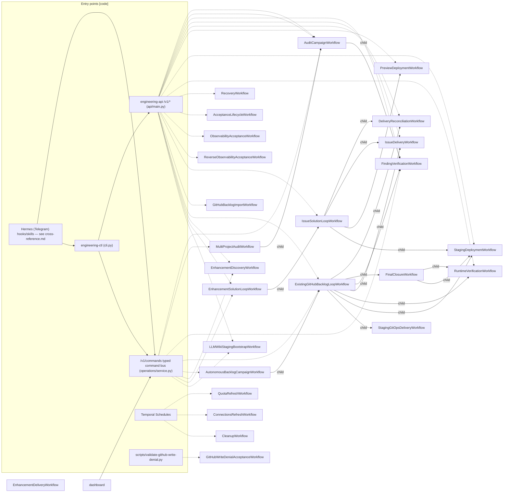

# Temporal flows inventory (engineering-control)

Generated 2026-09-27 from code at repository HEAD `807d648` (branch `go-status/2026-09-17`) and the live Temporal service at `127.0.0.1:7233`, namespace `engineering-control`. Read-only: no workflow was started, signalled or changed to produce this.

**Sources of truth.** Each fact is tagged: **[code]** = defined in code/config (path:line relative to the `engineering-control` repo unless absolute); **[live]** = observed on the running system (command given). `D:<n>` = `src/engineering_control/workflows/definitions.py:<n>`.

**Live-history caveat.** Namespace retention is 30 days (`temporal operator namespace describe` -> `workflowExecutionRetentionTtl: 2592000s`) **[live]**. "Never run" below means *no execution in the retained window (after ~2026-08-28)*; older runs cannot be seen.

## How the platform runs workflows

- **One activity type.** Every production workflow step is the single activity `execute_control_step` (`src/engineering_control/activities/core.py:505`) called with `{step, payload}`. The *step name* selects the handler; the task queue is chosen per step by `ControlledWorkflow._activity_queue` (D:298-397). The activity catalogue below therefore lists **steps** (217, from the dispatcher allowlist `core.py:32-230` plus the 6 `acceptance.*` activities, which are real separate `@activity.defn`s in `src/engineering_control/validation/lifecycle.py:62-221`).
- **Default step options** [code]: `start_to_close_timeout` = 30 min unless the call passes `timeout_minutes`; `heartbeat_timeout` = 2 min; retry `ACTIVITY_RETRY` = initial 2 s, backoff 2.0, max interval 2 min, max 5 attempts, non-retryable: PolicyViolation, SecurityBlocker, ApprovalMismatch, DirtyWorktree, NotConfigured, SchemaViolation, MANUAL_AUTH_REQUIRED_CODEX/CLAUDE, PROVIDER_CLI_MISSING_CODEX/CLAUDE (D:45-62, D:160-175).
- **Dispatcher gates** [code] (`core.py:506-560`): step not allowlisted -> non-retryable `unknown or invalid control step`; step not allowed for that worker kind -> `PolicyViolation step <s> is not allowed on <kind> worker`; payload redacted by `SecretRedactor`; steps in `_mutation_steps` return a synthetic `DRY_RUN` envelope unless the payload has `dry_run: false` (`core.py:527-530`).
- **Provider engines** [code]: codex -> `codex exec --json --color never --ephemeral --strict-config --cd <worktree> --sandbox workspace-write|read-only --output-schema <f> --output-last-message <f> [--add-dir <git-metadata>] --model <m> --config model_reasoning_effort="<effort>" -` (`src/engineering_control/adapters/codex/client.py:94-121`), default model `gpt-5.6-terra` (`src/engineering_control/config.py:60`). claude -> `claude --print --output-format stream-json --verbose --json-schema <schema> --no-session-persistence --safe-mode --strict-mcp-config --mcp-config {"mcpServers":{}} --permission-mode dontAsk --tools <list> --allowed-tools <list> [--model <m>] [--effort <e>]` (`src/engineering_control/adapters/claude/client.py:70-95`); spec and checker model `claude-opus-5-5` (`config.py:66-67`). Effort: `resolve_agent_effort` (`src/engineering_control/models/core.py:89-109`): canaries low; writable, R3 or JUDGE-tier high; otherwise medium. Tools default Read,Glob,Grep,Bash (+Edit,Write when writable) (`claude/client.py:53-57`). Model/effort **actually used per run** is UNVERIFIED here (not read from run records).
- **Common signals/queries** (all `ControlledWorkflow` subclasses) [code] (D:81-133): signals `pause`, `resume`, `cancel`, `pause_after_current`, `stop_after_current`, `approval(payload)`, `skip(reason)`, `retry(step)`; query `status`. No updates are defined. No search attributes or memo are set anywhere (grep for `search_attributes|upsert_|memo` in `workflows/definitions.py` and `api/service.py` returns nothing) [code]; schedule actions carry none [live].
- **Write-policy gate** [code] `_github_write_step` (D:190-246): a `BLOCKED_BY_POLICY` result sets phase `AWAITING_WRITE_POLICY`; with patch `write-policy-alert-auto-resume-v1` it queues one `notify.write_policy_required` Telegram alert and re-tries every 5 min; otherwise waits for `retry(step)`.

## Workers and deployed revisions [live]

Repository HEAD `807d648`; deployed release `a9c8c62` (`readlink /opt/engineering-control/venv` on both hosts, swapped 2026-09-27 19:20 UTC). `git diff --stat a9c8c62 807d648` touches only `.go-status/cleanup-config.sh` and `.go-status/progress.json` (no runtime code). Pollers from `temporal task-queue describe --task-queue <q>`; units/PIDs from `systemctl show -p MainPID` and `ps -o lstart,args` (python path shows the venv actually loaded).

| Host | Unit | Task queue | Registers | Poller identity [live] | Code revision in process [live] | Process start (UTC) |
|---|---|---|---|---|---|---|
| controller | `engineering-temporal-worker.service` | `engineering-control` | engineering-worker (workflows/worker.py:18-27): ALL_WORKFLOWS + execute_control_step | `1877801@hermes-control` | `a9c8c62` | 2026-09-27 19:27:01 |
| controller | `engineering-github-worker.service` | `engineering-github` | engineering-role-worker kind=github (role_worker.py:22-31) | `1874232@hermes-control` | `a9c8c62` | 2026-09-27 19:20:49 |
| controller | `engineering-acceptance-worker.service` | `engineering-acceptance` | engineering-acceptance-worker (validation/worker.py:29-36): acceptance.* activities | `1699044@hermes-control` | `2b678d9` | 2026-09-16 23:24:32 |
| worker | `engineering-worker@codex.service` | `engineering-codex` | role worker kind=codex | `1751487@hermes-worker` | `a9c8c62` | 2026-09-27 19:27:06 |
| worker | `engineering-worker@claude.service` | `engineering-claude` | role worker kind=claude | `1751486@hermes-worker` | `a9c8c62` | 2026-09-27 19:27:06 |
| worker | `engineering-worker@browser.service` | `engineering-browser` | role worker kind=browser | `1751492@hermes-worker` | `a9c8c62` | 2026-09-27 19:27:06 |
| worker | `engineering-worker@scan.service` | `engineering-scan` | role worker kind=scan | `1751476@hermes-worker` | `a9c8c62` | 2026-09-27 19:27:06 |
| worker | `engineering-worker@delivery.service` | `engineering-delivery` | role worker kind=delivery | `1751488@hermes-worker` | `a9c8c62` | 2026-09-27 19:27:06 |
| worker | `engineering-release-worker.service` | `engineering-release` | role worker kind=release | `1751498@hermes-worker` | `a9c8c62` | 2026-09-27 19:27:06 |

Other units that do not poll Temporal task queues [live]:

| Host | Unit | Role | Code revision in process | Process start |
|---|---|---|---|---|
| controller | `engineering-api.service` | API; starts workflows (api/service.py) | `a9c8c62` | 2026-09-27 19:20:45 |
| controller | `engineering-scheduler.service` | oneshot: ensures the 3 schedules (scheduler.py:71-80) | `a9c8c62` | not running (oneshot, pid 0) |
| controller | `engineering-dashboard.service` | dashboard | `2b678d9` | 2026-09-17 10:22:21 |
| controller | `engineering-notifier.service` | Telegram notification outbox sender | `2b678d9` | 2026-09-17 02:51:31 |
| controller | `engineering-watchdog.service` | watchdog (pinned by drop-in 50-pin-venv.conf) | `2b678d9` | 2026-09-17 10:21:54 |
| controller | `engineering-evidence-ingest.service` | evidence ingest | `a9c8c62` | 2026-09-27 19:20:49 |

Worker kind -> allowed steps is `ControlActivities._worker_steps` (`core.py:274-468`); worker kind -> queue/unix user/unit is `ROLE_WORKER_REGISTRY` (`src/engineering_control/workflows/worker_registry.py:36-100`).

## Workflow types — summary

| Workflow type | Category | Status | Registered on | Runs retained [live] | Last run [live] | Triggers |
|---|---|---|---|---|---|---|
| `AuditCampaignWorkflow` | audit | ACTIVE | `engineering-temporal-worker` (controller) on `engineering-control` | 11 (COMPLETED 10, FAILED 1) | 2026-09-18T06:41Z FAILED | API, CLI, command bus, parent workflow |
| `MultiProjectAuditWorkflow` | audit | REGISTERED-NEVER-RUN | `engineering-temporal-worker` (controller) on `engineering-control` | 0 | — | CLI, command bus |
| `FindingVerificationWorkflow` | audit | ACTIVE | `engineering-temporal-worker` (controller) on `engineering-control` | 25 (FAILED 3, COMPLETED 22) | 2026-09-26T20:22Z COMPLETED | API, CLI, command bus, parent workflow |
| `IssueDeliveryWorkflow` | issue-loop | ACTIVE | `engineering-temporal-worker` (controller) on `engineering-control` | 95 (FAILED 18, COMPLETED 76, CANCELED 1) | 2026-09-27T10:25Z COMPLETED | API, CLI, parent workflow |
| `DeliveryReconciliationWorkflow` | issue-loop | REGISTERED-NEVER-RUN | `engineering-temporal-worker` (controller) on `engineering-control` | 0 | — | API, CLI, parent workflow |
| `FinalClosureWorkflow` | issue-loop | REGISTERED-NEVER-RUN | `engineering-temporal-worker` (controller) on `engineering-control` | 0 | — | parent workflow |
| `PreviewDeploymentWorkflow` | release | REGISTERED-NEVER-RUN | `engineering-temporal-worker` (controller) on `engineering-control` | 0 | — | API, CLI, parent workflow |
| `StagingDeploymentWorkflow` | release | REGISTERED-NEVER-RUN | `engineering-temporal-worker` (controller) on `engineering-control` | 0 | — | API, CLI, parent workflow |
| `RuntimeVerificationWorkflow` | release | REGISTERED-NEVER-RUN | `engineering-temporal-worker` (controller) on `engineering-control` | 0 | — | API, CLI, parent workflow |
| `RecoveryWorkflow` | release | REGISTERED-NEVER-RUN | `engineering-temporal-worker` (controller) on `engineering-control` | 0 | — | API, CLI |
| `QuotaRefreshWorkflow` | maintenance | SCHEDULED+ACTIVE | `engineering-temporal-worker` (controller) on `engineering-control` | 3844 (COMPLETED 3840, TIMED_OUT 4) | 2026-09-27T19:30Z COMPLETED | Temporal Schedule |
| `ConnectionsRefreshWorkflow` | maintenance | SCHEDULED+ACTIVE | `engineering-temporal-worker` (controller) on `engineering-control` | 536 (COMPLETED 536) | 2026-09-27T19:30Z COMPLETED | Temporal Schedule |
| `CleanupWorkflow` | maintenance | SCHEDULED+ACTIVE | `engineering-temporal-worker` (controller) on `engineering-control` | 32 (COMPLETED 32) | 2026-09-27T19:27Z COMPLETED | Temporal Schedule |
| `AcceptanceLifecycleWorkflow` | canary | ACTIVE | `engineering-temporal-worker` (controller) on `engineering-control` | 6 (COMPLETED 6) | 2026-08-31T19:36Z COMPLETED | API, CLI |
| `ObservabilityAcceptanceWorkflow` | canary | ACTIVE | `engineering-temporal-worker` (controller) on `engineering-control` | 31 (COMPLETED 31) | 2026-09-17T07:02Z COMPLETED | API |
| `ReverseObservabilityAcceptanceWorkflow` | canary | ACTIVE | `engineering-temporal-worker` (controller) on `engineering-control` | 30 (FAILED 3, COMPLETED 27) | 2026-09-17T07:02Z COMPLETED | API |
| `IssueSolutionLoopWorkflow` | issue-loop | ACTIVE | `engineering-temporal-worker` (controller) on `engineering-control` | 2 (COMPLETED 2) | 2026-09-21T22:34Z COMPLETED | API, CLI, parent workflow |
| `GitHubBacklogImportWorkflow` | issue-loop | ACTIVE | `engineering-temporal-worker` (controller) on `engineering-control` | 39 (COMPLETED 39) | 2026-09-26T18:27Z COMPLETED | API, CLI |
| `StagingGitOpsDeliveryWorkflow` | release | ACTIVE | `engineering-temporal-worker` (controller) on `engineering-control` | 7 (COMPLETED 7) | 2026-09-27T12:56Z COMPLETED | parent workflow |
| `ExistingGitHubBacklogLoopWorkflow` | issue-loop | ACTIVE | `engineering-temporal-worker` (controller) on `engineering-control` | 31 (COMPLETED 19, FAILED 11, TERMINATED 1) | 2026-09-26T20:22Z COMPLETED | API, CLI, command bus, parent workflow |
| `AutonomousBacklogCampaignWorkflow` | issue-loop | REGISTERED-NEVER-RUN | `engineering-temporal-worker` (controller) on `engineering-control` | 0 | — | CLI, command bus |
| `EnhancementDiscoveryWorkflow` | enhancement | REGISTERED-NEVER-RUN | `engineering-temporal-worker` (controller) on `engineering-control` | 0 | — | API, command bus |
| `EnhancementDeliveryWorkflow` | enhancement | REGISTERED-NEVER-RUN | `engineering-temporal-worker` (controller) on `engineering-control` | 0 | — | **none found** |
| `EnhancementSolutionLoopWorkflow` | enhancement | REGISTERED-NEVER-RUN | `engineering-temporal-worker` (controller) on `engineering-control` | 0 | — | API, command bus |
| `LLMWikiStagingBootstrapWorkflow` | release | REGISTERED-NEVER-RUN | `engineering-temporal-worker` (controller) on `engineering-control` | 0 | — | API, CLI, command bus |
| `GitHubWriteDenialAcceptanceWorkflow` | canary | DEFINED-NOT-REGISTERED | ephemeral worker in `scripts/validate-github-write-denial.py:29` only | 3 (COMPLETED 3) | 2026-08-30T20:36Z COMPLETED | script |

## Workflow types — detail

### AuditCampaignWorkflow

- **Registered name / class**: `AuditCampaignWorkflow` / `AuditCampaignWorkflow` — `src/engineering_control/workflows/definitions.py:412` [code]
- **Purpose** [code]: Runs one audit campaign for one project: attests identities (superadmin for e2e/security presets, observer unless static-full), plans the coverage matrix, snapshots the source/deployment repos (after refreshing mirrors), runs fixed audit stages, then for each coverage cell (50 per run) a deterministic check plus one provider agent cell; candidate findings are verified by a child FindingVerificationWorkflow and, if publish_findings, published to GitHub.
- **Category**: audit
- **Task queue**: `engineering-control` [code]; live runs seen on `engineering-control` [live]
- **Registered on**: `ALL_WORKFLOWS` (D:3602-3628) -> `engineering-temporal-worker.service` on hermes-control, poller `1877801@hermes-control` on `engineering-control` [code+live].
- **Input** [code]: `AuditCampaignInput` (`src/engineering_control/workflows/inputs.py`)
- **Output** [code]: dict: status (COMPLETE/INCOMPLETE/BLOCKED/BLOCKED_BY_CREDENTIAL/CANCELLED), campaign_id, summary|blocker
- **Control flow** [code]: continue_as_new every 50 cells (D:487, D:694); checkpoint before every stage/cell (pause/resume/cancel signals); plan_only returns after campaign.plan (D:426); stage list depends on preset/e2e (D:712-737).
- **patched() markers** [code]: none
- **continue_as_new**: D:694, D:487; **timers (workflow.sleep)**: none; **wait_condition**: D:138 (inherited ControlledWorkflow._checkpoint pause wait) [code]
- **Steps** (source order; queue = default routing; engine per step) [code]:

  | # | Step | Call | start_to_close | Queue | Engine | Side effects | Line |
  |---|---|---|---|---|---|---|---|
  | 1 | `identity.superadmin_attest` | _step | 30 min | `engineering-browser` | none | HTTP/browser sessions against staging product; identity state | D:418 |
  | 2 | `identity.observer_attest` | _step | 30 min | `engineering-scan` | none | filesystem: mirrors/worktrees/toolchain on worker (git; network for installs) | D:422 |
  | 3 | `campaign.plan` | _step | 30 min | `engineering-control` | none | PostgreSQL metadata | D:425 |
  | 4 | `github.refresh_mirrors` | _step | 30 min | `engineering-github` | none | GitHub read | D:466, D:561 |
  | 5 | `project.snapshot` | _step | 30 min | `engineering-scan` | none | filesystem: mirrors/worktrees/toolchain on worker (git; network for installs) | D:467, D:562 |
  | 6 | `campaign.persist_snapshot_blockers` | _step | 30 min | `engineering-control` | none | PostgreSQL metadata | D:475 |
  | 7 | `campaign.finalize` | _step | 30 min | `engineering-control` | none | PostgreSQL metadata | D:496, D:702 |
  | 8 | `project.persist_snapshot` | _step | 30 min | `engineering-control` | none | PostgreSQL metadata | D:516, D:537 |
  | 9 | `project.snapshot_pair` | _step | 30 min | `engineering-scan` | none | filesystem: mirrors/worktrees/toolchain on worker (git; network for installs) | D:534 |
  | 10 | `campaign.persist_coverage` | _step | 30 min | `engineering-control` | none | PostgreSQL metadata | D:597 |
  | 11 | `audit.deterministic_cell` | _step | 30 min | `engineering-scan` | none | filesystem: mirrors/worktrees/toolchain on worker (git; network for installs) | D:604 |
  | 12 | `audit.prepare_agent_cell` | _step | 30 min | `engineering-control` | none | PostgreSQL metadata | D:608 |
  | 13 | `campaign.persist_cell_blocker` | _step | 30 min | `engineering-control` | none | PostgreSQL metadata | D:618, D:639 |
  | 14 | `audit.agent_cell` | _agent_step (+agent.record_start/persist_result) | 120 min | `engineering-codex` | codex (default) or claude per routing decision | runs native provider CLI in a worktree/workspace | D:627 |
  | 15 | `campaign.persist_cell_result` | _step | 30 min | `engineering-control` | none | PostgreSQL metadata | D:648 |
  | 16 | `finding.prepare_publication` | _step | 30 min | `engineering-control` | none | PostgreSQL metadata | D:675 |
  | 17 | `finding.publish` | _github_write_step (write policy) | 30 min | `engineering-github` | none | GitHub write (policy-gated) | D:680 |
  | 18 | `finding.persist_publication` | _step | 30 min | `engineering-control` | none | PostgreSQL metadata | D:684 |
  | 19 | `agent.persist_result` | dynamic (resolved by reading code) | 30 min | `engineering-control` | none | PostgreSQL metadata | — |
  | 20 | `agent.record_start` | dynamic (resolved by reading code) | 30 min | `engineering-control` | none | PostgreSQL metadata | — |
  | 21 | `audit.api_flow` | dynamic (resolved by reading code) | 120 min | `engineering-browser` | none | HTTP/browser sessions against staging product; identity state | — |
  | 22 | `audit.browser_flow` | dynamic (resolved by reading code) | 120 min | `engineering-browser` | none | HTTP/browser sessions against staging product; identity state | — |
  | 23 | `audit.classify_candidate` | dynamic (resolved by reading code) | 120 min | `engineering-control` | none | PostgreSQL metadata | — |
  | 24 | `audit.correlate_runtime` | dynamic (resolved by reading code) | 120 min | `engineering-scan` | none | filesystem: mirrors/worktrees/toolchain on worker (git; network for installs) | — |
  | 25 | `audit.discover_enhancements` | dynamic (resolved by reading code) | 120 min | `engineering-control` | none | PostgreSQL metadata | — |
  | 26 | `audit.kubernetes_observe` | dynamic (resolved by reading code) | 120 min | `engineering-scan` | none | filesystem: mirrors/worktrees/toolchain on worker (git; network for installs) | — |
  | 27 | `audit.llmwiki_consumer_suite` | dynamic (resolved by reading code) | 120 min | `engineering-browser` | none | HTTP/browser sessions against staging product; identity state | — |
  | 28 | `audit.static_deployment` | dynamic (resolved by reading code) | 120 min | `engineering-scan` | none | filesystem: mirrors/worktrees/toolchain on worker (git; network for installs) | — |
  | 29 | `audit.static_source` | dynamic (resolved by reading code) | 120 min | `engineering-scan` | none | filesystem: mirrors/worktrees/toolchain on worker (git; network for installs) | — |
  | 30 | `audit.verify_cleanup` | dynamic (resolved by reading code) | 120 min | `engineering-control` | none | PostgreSQL metadata | — |
  | 31 | `deployment.compare_live` | dynamic (resolved by reading code) | 120 min | `engineering-scan` | none | filesystem: mirrors/worktrees/toolchain on worker (git; network for installs) | — |
  | 32 | `deployment.render` | dynamic (resolved by reading code) | 120 min | `engineering-release` | none | Kubernetes/Helm (staging/preview) + render files | — |
  | 33 | `notify.write_policy_required` | dynamic (resolved by reading code) | 30 min | `engineering-control` | none | PostgreSQL NotificationOutbox row -> engineering-notifier -> Telegram | — |

  Heartbeat timeout 2 min and retry ACTIVITY_RETRY for every `_step` (D:160-175).
- **Child workflows** [code]: FindingVerificationWorkflow id `f'finding-verify-{finding_id}'` (D:661)
- **Gates / policies** [code]:
  - identity.superadmin_attest / identity.observer_attest results feed campaign.plan; plan blockers -> returns BLOCKED_BY_CREDENTIAL (D:524-531)
  - project.snapshot failure -> PROJECT_SNAPSHOT_UNAVAILABLE / EXTERNAL_DEPENDENCY_FAILURE recorded per cell (D:468-470)
  - pair snapshot BLOCKED or LIVE_REVISION_DRIFT -> BLOCKED (D:546)
  - >100000 cells -> BLOCKED COVERAGE_MATRIX_LIMIT (D:458); zero cells -> BLOCKED NO_APPLICABLE_COVERAGE_CELLS (D:586-596)
  - any stage returning BLOCKED/BLOCKED_BY_CREDENTIAL/FAILED -> BLOCKED (D:575-585)
  - finding.publish through _github_write_step: BLOCKED_BY_POLICY -> phase AWAITING_WRITE_POLICY + Telegram alert (D:190-246)
- **Triggers** [code]:
  - API: POST /v1/campaigns (src/engineering_control/api/main.py:550) -> ControlService.start_campaign (src/engineering_control/api/service.py:152)
  - API: POST /v1/audit-plan (src/engineering_control/api/main.py:558) -> plan_campaign execute_workflow plan_only (src/engineering_control/api/service.py:125)
  - command bus: POST /v1/commands action audit_plan/audit_start/audit_campaign (src/engineering_control/api/main.py:183 -> src/engineering_control/operations/service.py:263,272,304)
  - CLI: engineering-ctl audit / audit-plan / audit-start -> /v1/commands action audit_campaign (src/engineering_control/cli.py:309-314)
  - parent workflow: MultiProjectAuditWorkflow child (src/engineering_control/workflows/definitions.py:809)
- **Search attributes / memo**: none [code+live]
- **Live history** [live] (`temporal workflow list --limit 100000 -o json`, aggregated): 11 runs; {'COMPLETED': 10, 'FAILED': 1}; first 2026-08-30T20:33:56Z; last 2026-09-18T06:41:24Z `audit-llmwiki-47c8f362-85eb-4e9e-bc64-d50cc33f7401` -> FAILED; last completed close 2026-09-18T06:41:23. Last failure: `audit-llmwiki-47c8f362-85eb-4e9e-bc64-d50cc33f7401` — "Activity task failed <- invalid metadata activity input for campaign.persist_coverage <- coverage batch and total are inconsistent".
- **Status**: ACTIVE

### MultiProjectAuditWorkflow

- **Registered name / class**: `MultiProjectAuditWorkflow` / `MultiProjectAuditWorkflow` — `src/engineering_control/workflows/definitions.py:741` [code]
- **Purpose** [code]: Runs AuditCampaignWorkflow sequentially for falcone, musematic and llmwiki under one parent, recording a group status row after each child and aggregating SUCCESS/BLOCKED/FAILED.
- **Category**: audit
- **Task queue**: `engineering-control` [code]
- **Registered on**: `ALL_WORKFLOWS` (D:3602-3628) -> `engineering-temporal-worker.service` on hermes-control, poller `1877801@hermes-control` on `engineering-control` [code+live].
- **Input** [code]: `MultiProjectAuditInput` (`src/engineering_control/workflows/inputs.py`)
- **Output** [code]: dict: status SUCCESS/BLOCKED/FAILED/CANCELLED, project_results{project:{status,campaign_id,workflow_id,blocker}}
- **Control flow** [code]: Sequential child per project with checkpoint (pause/cancel) between projects; child failure mapped to FAILED/AUDIT_CHILD_WORKFLOW_FAILED (D:824-825).
- **patched() markers** [code]: none
- **continue_as_new**: none; **timers (workflow.sleep)**: none; **wait_condition**: D:138 (inherited ControlledWorkflow._checkpoint pause wait) [code]
- **Steps** (source order; queue = default routing; engine per step) [code]:

  | # | Step | Call | start_to_close | Queue | Engine | Side effects | Line |
  |---|---|---|---|---|---|---|---|
  | 1 | `campaign.group_status` | _step | 30 min | `engineering-control` | none | PostgreSQL metadata | D:784, D:797, D:850, D:868 |

  Heartbeat timeout 2 min and retry ACTIVITY_RETRY for every `_step` (D:160-175).
- **Child workflows** [code]: AuditCampaignWorkflow id `request.child_workflow_ids[project]` (D:809)
- **Gates / policies** [code]:
  - environment must be staging, preset in fixed set, campaign/child ids for exactly the 3 projects else ApplicationError PolicyViolation 'all-project audit binding is invalid' (D:772-782)
- **Triggers** [code]:
  - command bus: POST /v1/commands action audit_all_projects mode=start (src/engineering_control/operations/service.py:295)
  - CLI: engineering-ctl audit-all -> action audit_all_projects (src/engineering_control/cli.py:342-349)
- **Search attributes / memo**: none [code+live]
- **Live history** [live]: 0 retained runs (`temporal workflow count --query "WorkflowType='MultiProjectAuditWorkflow'"` -> 0).
- **Status**: REGISTERED-NEVER-RUN

### FindingVerificationWorkflow

- **Registered name / class**: `FindingVerificationWorkflow` / `FindingVerificationWorkflow` — `src/engineering_control/workflows/definitions.py:882` [code]
- **Purpose** [code]: Independently re-verifies one candidate finding: loads it, takes a fresh snapshot, reproduces it twice with a provider agent, evaluates controls, dedupes against GitHub and records the final disposition (CONFIRMED etc.).
- **Category**: audit
- **Task queue**: `engineering-control` [code]; live runs seen on `engineering-control` [live]
- **Registered on**: `ALL_WORKFLOWS` (D:3602-3628) -> `engineering-temporal-worker.service` on hermes-control, poller `1877801@hermes-control` on `engineering-control` [code+live].
- **Input** [code]: `FindingVerificationInput` (`src/engineering_control/workflows/inputs.py`)
- **Output** [code]: dict from finding.finalize (disposition/status) or {status, context}
- **Control flow** [code]: Two reproduction attempts (D:888) with checkpoints; controls exception mapped to BLOCKED VERIFICATION_INTEGRITY (D:908-925).
- **patched() markers** [code]: none
- **continue_as_new**: none; **timers (workflow.sleep)**: none; **wait_condition**: D:138 (inherited ControlledWorkflow._checkpoint pause wait) [code]
- **Steps** (source order; queue = default routing; engine per step) [code]:

  | # | Step | Call | start_to_close | Queue | Engine | Side effects | Line |
  |---|---|---|---|---|---|---|---|
  | 1 | `finding.load_candidate` | _step | 30 min | `engineering-control` | none | PostgreSQL metadata | D:885 |
  | 2 | `finding.fresh_snapshot` | _step | 30 min | `engineering-scan` | none | filesystem: mirrors/worktrees/toolchain on worker (git; network for installs) | D:886 |
  | 3 | `finding.prepare_verifier` | _step | 30 min | `engineering-control` | none | PostgreSQL metadata | D:891 |
  | 4 | `finding.record_terminal` | _step | 30 min | `engineering-control` | none | PostgreSQL metadata | D:896, D:900, D:921 |
  | 5 | `finding.reproduce` | _agent_step (+agent.record_start/persist_result) | 60 min | `engineering-claude` | claude (default) or codex via payload.provider | runs native provider CLI in a worktree/workspace | D:898 |
  | 6 | `finding.controls` | _step | 30 min | `engineering-control` | none | PostgreSQL metadata | D:904 |
  | 7 | `finding.dedupe` | _step | 30 min | `engineering-github` | none | GitHub read | D:926 |
  | 8 | `finding.finalize` | _step | 30 min | `engineering-control` | none | PostgreSQL metadata | D:930 |
  | 9 | `agent.persist_result` | dynamic (resolved by reading code) | 30 min | `engineering-control` | none | PostgreSQL metadata | — |
  | 10 | `agent.record_start` | dynamic (resolved by reading code) | 30 min | `engineering-control` | none | PostgreSQL metadata | — |

  Heartbeat timeout 2 min and retry ACTIVITY_RETRY for every `_step` (D:160-175).
- **Gates / policies** [code]:
  - prepare_verifier RATE_LIMITED/BLOCKED -> finding.record_terminal (D:895)
  - reproduction != SUCCESS -> terminal (D:899)
  - controls integrity failure -> BLOCKED VERIFICATION_INTEGRITY (D:921-925)
- **Triggers** [code]:
  - API: POST /v1/findings/verify (src/engineering_control/api/main.py:950 -> src/engineering_control/api/service.py:206)
  - command bus: action finding_verify (src/engineering_control/operations/service.py:390)
  - CLI: engineering-ctl verify-finding (src/engineering_control/cli.py:472-473)
  - parent workflow: AuditCampaignWorkflow (src/engineering_control/workflows/definitions.py:661), ExistingGitHubBacklogLoopWorkflow revalidation (src/engineering_control/workflows/definitions.py:2527)
- **Search attributes / memo**: none [code+live]
- **Live history** [live] (`temporal workflow list --limit 100000 -o json`, aggregated): 25 runs; {'FAILED': 3, 'COMPLETED': 22}; first 2026-09-22T14:15:25Z; last 2026-09-26T20:22:12Z `backlog-loop-musematic-66a97948-9f9d-4ae9-b204-e89f27e2712d-27604282-30bc-4052-8dc1-12f92bcd7dea-issue-1-revalidate-1125` -> COMPLETED; last completed close 2026-09-26T20:26:42. Last failure: `backlog-loop-musematic-66a97948-9f9d-4ae9-b204-e89f27e2712d-0e13b508-753b-405b-aa19-d933869aa800-issue-1-revalidate-1125` — "Activity task failed <- Git command failed (128): 707ba5dddfc45bad71841d3a85cecc3ae96334db^{commit} fatal: ambiguous argument '707ba5dddfc45bad71841d3a85cecc3ae96334db^{commit}': unknown revision or path not in the worki".
- **Status**: ACTIVE

### IssueDeliveryWorkflow

- **Registered name / class**: `IssueDeliveryWorkflow` / `IssueDeliveryWorkflow` — `src/engineering_control/workflows/definitions.py:942` [code]
- **Purpose** [code]: Produces a source PR for one confirmed finding/issue: ensures the GitHub issue, leases components and worktrees, prechecks, installs toolchain, writes an OpenSpec with a spec agent, runs the maker (source + deployment) and an independent checker, validates the ChangeSet deterministically and publishes the PR.
- **Category**: issue-loop
- **Task queue**: `engineering-control` [code]; live runs seen on `engineering-control` [live]
- **Registered on**: `ALL_WORKFLOWS` (D:3602-3628) -> `engineering-temporal-worker.service` on hermes-control, poller `1877801@hermes-control` on `engineering-control` [code+live].
- **Input** [code]: `IssueDeliveryInput` (`src/engineering_control/workflows/inputs.py`)
- **Output** [code]: dict: status (SOURCE_PR on success, else the blocking status), context
- **Control flow** [code]: Fixed ordered step list with checkpoint per step (D:953-977); maker dependency-resolution loop up to 2 rounds (D:1051-1096); leases released best-effort on every stop and on exception (D:1038, D:1047).
- **patched() markers** [code]: `delivery-prepare-toolchain-v1` (D:1129), `delivery-record-validation-findings-v1` (D:1012), `delivery-refresh-issue-body-v1` (D:1112), `delivery-resolve-dependencies-v1` (D:1065)
- **continue_as_new**: none; **timers (workflow.sleep)**: none; **wait_condition**: D:138 (inherited ControlledWorkflow._checkpoint pause wait) [code]
- **Steps** (source order; queue = default routing; engine per step) [code]:

  | # | Step | Call | start_to_close | Queue | Engine | Side effects | Line |
  |---|---|---|---|---|---|---|---|
  | 1 | `delivery.load_confirmed_finding` | _step | 30 min | `engineering-control` | none | PostgreSQL metadata | D:945 |
  | 2 | `delivery.record_validation_findings` | _step | 30 min | `engineering-control` | none | PostgreSQL metadata | D:1015 |
  | 3 | `delivery.persist_handoff` | _step | 30 min | `engineering-control` | none | PostgreSQL metadata | D:1030 |
  | 4 | `delivery.resolve_dependencies` | _step | 120 min | `engineering-scan` | none | filesystem: mirrors/worktrees/toolchain on worker (git; network for installs) | D:1069 |
  | 5 | `delivery.prepare_maker` | _step | 30 min | `engineering-control` | none | PostgreSQL metadata | D:1084 |
  | 6 | `delivery.invoke_maker` | _agent_step (+agent.record_start/persist_result) | 120 min | `engineering-codex` | codex (default; maker_provider) | runs native provider CLI in a worktree/workspace | D:1091 |
  | 7 | `delivery.refresh_issue_body` | _step | 30 min | `engineering-github` | none | GitHub read | D:1114 |
  | 8 | `delivery.release_leases` | _step | 30 min | `engineering-control` | none | PostgreSQL metadata | D:1136 |
  | 9 | `agent.persist_result` | dynamic (resolved by reading code) | 30 min | `engineering-control` | none | PostgreSQL metadata | — |
  | 10 | `agent.record_start` | dynamic (resolved by reading code) | 30 min | `engineering-control` | none | PostgreSQL metadata | — |
  | 11 | `delivery.acquire_leases` | dynamic (resolved by reading code) | 30 min | `engineering-control` | none | PostgreSQL metadata | — |
  | 12 | `delivery.allocate_worktrees` | dynamic (resolved by reading code) | 30 min | `engineering-scan` | none | filesystem: mirrors/worktrees/toolchain on worker (git; network for installs) | — |
  | 13 | `delivery.create_openspec` | dynamic (resolved by reading code) | 30 min | `engineering-control` | none | PostgreSQL metadata | — |
  | 14 | `delivery.deterministic_prechecks` | dynamic (resolved by reading code) | 30 min | `engineering-scan` | none | filesystem: mirrors/worktrees/toolchain on worker (git; network for installs) | — |
  | 15 | `delivery.ensure_issue` | dynamic (resolved by reading code) | 30 min | `engineering-control` | none | PostgreSQL metadata | — |
  | 16 | `delivery.invoke_checker` | dynamic (resolved by reading code) | 120 min | `engineering-claude` | claude (default; checker_provider) | runs native provider CLI in a worktree/workspace | — |
  | 17 | `delivery.invoke_deployment_maker` | dynamic (resolved by reading code) | 120 min | `engineering-codex` | codex (default; maker_provider) | runs native provider CLI in a worktree/workspace | — |
  | 18 | `delivery.invoke_spec` | dynamic (resolved by reading code) | 120 min | `engineering-claude` | claude (default; spec_provider) | runs native provider CLI in a worktree/workspace | — |
  | 19 | `delivery.persist_publication` | dynamic (resolved by reading code) | 30 min | `engineering-control` | none | PostgreSQL metadata | — |
  | 20 | `delivery.persist_worktree_leases` | dynamic (resolved by reading code) | 30 min | `engineering-control` | none | PostgreSQL metadata | — |
  | 21 | `delivery.prepare_checker` | dynamic (resolved by reading code) | 30 min | `engineering-control` | none | PostgreSQL metadata | — |
  | 22 | `delivery.prepare_deployment_maker` | dynamic (resolved by reading code) | 30 min | `engineering-control` | none | PostgreSQL metadata | — |
  | 23 | `delivery.prepare_publication` | dynamic (resolved by reading code) | 30 min | `engineering-control` | none | PostgreSQL metadata | — |
  | 24 | `delivery.prepare_spec` | dynamic (resolved by reading code) | 30 min | `engineering-control` | none | PostgreSQL metadata | — |
  | 25 | `delivery.prepare_toolchain` | dynamic (resolved by reading code) | 90 min | `engineering-scan` | none | filesystem: mirrors/worktrees/toolchain on worker (git; network for installs) | — |
  | 26 | `delivery.publish` | dynamic (resolved by reading code) | 30 min | `engineering-github` | none | GitHub write (policy-gated) | — |
  | 27 | `delivery.route_providers` | dynamic (resolved by reading code) | 30 min | `engineering-control` | none | PostgreSQL metadata | — |
  | 28 | `delivery.validate_changeset` | dynamic (resolved by reading code) | 120 min | `engineering-scan` | none | filesystem: mirrors/worktrees/toolchain on worker (git; network for installs) | — |
  | 29 | `notify.write_policy_required` | dynamic (resolved by reading code) | 30 min | `engineering-control` | none | PostgreSQL NotificationOutbox row -> engineering-notifier -> Telegram | — |

  Heartbeat timeout 2 min and retry ACTIVITY_RETRY for every `_step` (D:160-175).
- **Gates / policies** [code]:
  - any step status RATE_LIMITED/BLOCKED/FAILED/TIMED_OUT/CANCELLED/REQUEST_CHANGES/DRY_RUN stops the pipeline (D:1016-1039); at prepare_publication it persists a handoff
  - validate_changeset REQUEST_CHANGES with findings -> delivery.record_validation_findings (patch delivery-record-validation-findings-v1, D:1008-1015)
  - delivery.publish through _github_write_step: BLOCKED_BY_POLICY -> AWAITING_WRITE_POLICY (D:990)
  - provider failures mapped by _agent_step to MANUAL_AUTH_REQUIRED_*, PROVIDER_CLI_MISSING_*, RATE_LIMITED, SchemaViolation, PolicyViolation or PROVIDER_ACTIVITY_FAILED (D:268-296)
- **Triggers** [code]:
  - API: POST /v1/deliveries (src/engineering_control/api/main.py:961 -> src/engineering_control/api/service.py:193)
  - CLI: engineering-ctl delivery (src/engineering_control/cli.py:474-477)
  - parent workflow: IssueSolutionLoopWorkflow (src/engineering_control/workflows/definitions.py:1916), ExistingGitHubBacklogLoopWorkflow._issue_delivery (src/engineering_control/workflows/definitions.py:3352)
- **Search attributes / memo**: none [code+live]
- **Live history** [live] (`temporal workflow list --limit 100000 -o json`, aggregated): 95 runs; {'FAILED': 18, 'COMPLETED': 76, 'CANCELED': 1}; first 2026-09-22T15:44:54Z; last 2026-09-27T10:25:48Z `backlog-loop-musematic-66a97948-9f9d-4ae9-b204-e89f27e2712d-27604282-30bc-4052-8dc1-12f92bcd7dea-issue-1-retry-5-attempt-1` -> COMPLETED; last completed close 2026-09-27T11:21:58. Last failure: `backlog-loop-musematic-66a97948-9f9d-4ae9-b204-e89f27e2712d-27604282-30bc-4052-8dc1-12f92bcd7dea-issue-1-retry-2-attempt-1` — "Activity task failed <- invalid metadata activity input for agent.persist_result <- provider result identity does not match its immutable request".
- **Status**: ACTIVE

### DeliveryReconciliationWorkflow

- **Registered name / class**: `DeliveryReconciliationWorkflow` / `DeliveryReconciliationWorkflow` — `src/engineering_control/workflows/definitions.py:1140` [code]
- **Purpose** [code]: After a source PR, inspects its CI build, prepares/applies the deployment-repo promotion, publishes the promotion PR and runs a provider release review, ending at DEPLOY_PR.
- **Category**: issue-loop
- **Task queue**: `engineering-control` [code]
- **Registered on**: `ALL_WORKFLOWS` (D:3602-3628) -> `engineering-temporal-worker.service` on hermes-control, poller `1877801@hermes-control` on `engineering-control` [code+live].
- **Input** [code]: `DeliveryReconciliationInput` (`src/engineering_control/workflows/inputs.py`)
- **Output** [code]: dict: status (DEPLOY_PR on success), context
- **Control flow** [code]: Linear with checkpoints; promotion apply only when PROMOTION_READY (D:1158-1169).
- **patched() markers** [code]: none
- **continue_as_new**: none; **timers (workflow.sleep)**: none; **wait_condition**: D:138 (inherited ControlledWorkflow._checkpoint pause wait) [code]
- **Steps** (source order; queue = default routing; engine per step) [code]:

  | # | Step | Call | start_to_close | Queue | Engine | Side effects | Line |
  |---|---|---|---|---|---|---|---|
  | 1 | `reconcile.prepare_promotion` | _step | 30 min | `engineering-control` | none | PostgreSQL metadata | D:1158 |
  | 2 | `reconcile.apply_promotion` | _step | 60 min | `engineering-scan` | none | filesystem: mirrors/worktrees/toolchain on worker (git; network for installs) | D:1166 |
  | 3 | `reconcile.persist_promotion` | _step | 30 min | `engineering-control` | none | PostgreSQL metadata | D:1167 |
  | 4 | `reconcile.publish_promotion` | _github_write_step (write policy) | 30 min | `engineering-github` | none | GitHub write (policy-gated) | D:1173 |
  | 5 | `reconcile.persist_promotion_publication` | _step | 30 min | `engineering-control` | none | PostgreSQL metadata | D:1176 |
  | 6 | `reconcile.prepare_release_review` | _step | 30 min | `engineering-control` | none | PostgreSQL metadata | D:1181 |
  | 7 | `reconcile.invoke_release_reviewer` | _agent_step (+agent.record_start/persist_result) | 90 min | `engineering-claude` | claude (default; release_review_provider) | runs native provider CLI in a worktree/workspace | D:1184 |
  | 8 | `reconcile.persist_release_review` | _step | 30 min | `engineering-control` | none | PostgreSQL metadata | D:1189 |
  | 9 | `agent.persist_result` | dynamic (resolved by reading code) | 30 min | `engineering-control` | none | PostgreSQL metadata | — |
  | 10 | `agent.record_start` | dynamic (resolved by reading code) | 30 min | `engineering-control` | none | PostgreSQL metadata | — |
  | 11 | `notify.write_policy_required` | dynamic (resolved by reading code) | 30 min | `engineering-control` | none | PostgreSQL NotificationOutbox row -> engineering-notifier -> Telegram | — |
  | 12 | `reconcile.inspect_ci` | dynamic (resolved by reading code) | 30 min | `engineering-github` | none | GitHub read | — |
  | 13 | `reconcile.persist_ci` | dynamic (resolved by reading code) | 30 min | `engineering-control` | none | PostgreSQL metadata | — |
  | 14 | `reconcile.prepare` | dynamic (resolved by reading code) | 30 min | `engineering-control` | none | PostgreSQL metadata | — |

  Heartbeat timeout 2 min and retry ACTIVITY_RETRY for every `_step` (D:160-175).
- **Gates / policies** [code]:
  - status must be CANDIDATE_BUILT after CI (D:1153)
  - reconcile.publish_promotion via _github_write_step (D:1173)
  - release reviewer agent_invocation_status must be SUCCESS (D:1187)
- **Triggers** [code]:
  - API: POST /v1/deliveries/reconcile (src/engineering_control/api/main.py:969 -> src/engineering_control/api/service.py:223)
  - CLI: engineering-ctl reconcile (src/engineering_control/cli.py:484-487)
  - parent workflow: IssueSolutionLoopWorkflow (src/engineering_control/workflows/definitions.py:1953), ExistingGitHubBacklogLoopWorkflow._execute_full_delivery (src/engineering_control/workflows/definitions.py:2963)
- **Search attributes / memo**: none [code+live]
- **Live history** [live]: 0 retained runs (`temporal workflow count --query "WorkflowType='DeliveryReconciliationWorkflow'"` -> 0).
- **Status**: REGISTERED-NEVER-RUN

### FinalClosureWorkflow

- **Registered name / class**: `FinalClosureWorkflow` / `FinalClosureWorkflow` — `src/engineering_control/workflows/definitions.py:1194` [code]
- **Purpose** [code]: Closes one imported issue only after exact protected merges: merges the source PR, waits for the final build artifact, promotes/reviews the deployment change, merges the deployment PR, syncs worktrees, deploys to staging (child), verifies runtime (child), comments evidence and closes the issue.
- **Category**: issue-loop
- **Task queue**: `engineering-control` [code]
- **Registered on**: `ALL_WORKFLOWS` (D:3602-3628) -> `engineering-temporal-worker.service` on hermes-control, poller `1877801@hermes-control` on `engineering-control` [code+live].
- **Input** [code]: `FinalClosureInput` (`src/engineering_control/workflows/inputs.py`)
- **Output** [code]: dict: status FIXED on success, else BLOCKED + blocker
- **Control flow** [code]: Resumable from persisted state (FINAL_ISSUE_CLOSE_READY / FINAL_DEPLOYMENT_MERGE_PERSISTED / FINAL_SOURCE_MERGE_PERSISTED, D:1204-1216); waits up to 120 x 1 min for the build with workflow.sleep (D:1236-1264); patch final-closure-recovery-v2 adds checkpoints after irreversible merges.
- **patched() markers** [code]: `final-closure-recovery-v2` (D:1199)
- **continue_as_new**: none; **timers (workflow.sleep)**: D:1258; **wait_condition**: D:138 (inherited ControlledWorkflow._checkpoint pause wait) [code]
- **Steps** (source order; queue = default routing; engine per step) [code]:

  | # | Step | Call | start_to_close | Queue | Engine | Side effects | Line |
  |---|---|---|---|---|---|---|---|
  | 1 | `final.prepare` | _step | 30 min | `engineering-control` | none | PostgreSQL metadata | D:1203 |
  | 2 | `final.merge_source` | _github_write_step (write policy) | 30 min | `engineering-github` | none | GitHub write (policy-gated) | D:1223 |
  | 3 | `final.persist_source_merge` | _step | 30 min | `engineering-control` | none | PostgreSQL metadata | D:1232 |
  | 4 | `final.inspect_artifact` | _step | 30 min | `engineering-github` | none | GitHub read | D:1239 |
  | 5 | `final.persist_artifact` | _step | 30 min | `engineering-control` | none | PostgreSQL metadata | D:1271 |
  | 6 | `reconcile.prepare_promotion` | _step | 30 min | `engineering-control` | none | PostgreSQL metadata | D:1275 |
  | 7 | `reconcile.apply_promotion` | _step | 60 min | `engineering-scan` | none | filesystem: mirrors/worktrees/toolchain on worker (git; network for installs) | D:1278 |
  | 8 | `reconcile.persist_promotion` | _step | 30 min | `engineering-control` | none | PostgreSQL metadata | D:1279 |
  | 9 | `reconcile.publish_promotion` | _github_write_step (write policy) | 30 min | `engineering-github` | none | GitHub write (policy-gated) | D:1282 |
  | 10 | `reconcile.persist_promotion_publication` | _step | 30 min | `engineering-control` | none | PostgreSQL metadata | D:1285 |
  | 11 | `reconcile.prepare_release_review` | _step | 30 min | `engineering-control` | none | PostgreSQL metadata | D:1288 |
  | 12 | `reconcile.invoke_release_reviewer` | _agent_step (+agent.record_start/persist_result) | 90 min | `engineering-claude` | claude (default; release_review_provider) | runs native provider CLI in a worktree/workspace | D:1291 |
  | 13 | `reconcile.persist_release_review` | _step | 30 min | `engineering-control` | none | PostgreSQL metadata | D:1296 |
  | 14 | `final.authorize_deployment_merge` | _step | 30 min | `engineering-control` | none | PostgreSQL metadata | D:1302 |
  | 15 | `final.merge_deployment` | _github_write_step (write policy) | 30 min | `engineering-github` | none | GitHub write (policy-gated) | D:1305 |
  | 16 | `final.persist_deployment_merge` | _step | 30 min | `engineering-control` | none | PostgreSQL metadata | D:1310 |
  | 17 | `final.sync_worktrees` | _step | 30 min | `engineering-github` | none | GitHub read | D:1326 |
  | 18 | `backlog.register_child_run` | _step | 30 min | `engineering-control` | none | PostgreSQL metadata | D:1334, D:1370 |
  | 19 | `final.prepare_issue_close` | _step | 30 min | `engineering-control` | none | PostgreSQL metadata | D:1394 |
  | 20 | `final.comment_issue` | _github_write_step (write policy) | 30 min | `engineering-github` | none | GitHub write (policy-gated) | D:1406 |
  | 21 | `final.persist_comment` | _step | 30 min | `engineering-control` | none | PostgreSQL metadata | D:1409 |
  | 22 | `final.close_issue` | _github_write_step (write policy) | 30 min | `engineering-github` | none | GitHub write (policy-gated) | D:1414 |
  | 23 | `final.persist_issue_close` | _step | 30 min | `engineering-control` | none | PostgreSQL metadata | D:1417 |
  | 24 | `agent.persist_result` | dynamic (resolved by reading code) | 30 min | `engineering-control` | none | PostgreSQL metadata | — |
  | 25 | `agent.record_start` | dynamic (resolved by reading code) | 30 min | `engineering-control` | none | PostgreSQL metadata | — |
  | 26 | `notify.write_policy_required` | dynamic (resolved by reading code) | 30 min | `engineering-control` | none | PostgreSQL NotificationOutbox row -> engineering-notifier -> Telegram | — |

  Heartbeat timeout 2 min and retry ACTIVITY_RETRY for every `_step` (D:160-175).
- **Child workflows** [code]: StagingDeploymentWorkflow id `staging_id` (D:1342); RuntimeVerificationWorkflow id `verification_id` (D:1379)
- **Gates / policies** [code]:
  - final.prepare must be FINAL_CLOSURE_READY (D:1217)
  - merges/comment/close via _github_write_step (D:1223,1305,1406,1414)
  - FINAL_BUILD_WAIT_EXHAUSTED after 120 attempts (D:1262)
  - staging child must return STAGING_DEPLOYED and runtime child RUNTIME_VERIFIED (D:1353,1386)
- **Triggers** [code]:
  - parent workflow: ExistingGitHubBacklogLoopWorkflow (src/engineering_control/workflows/definitions.py:2873) when patch existing-backlog-final-closure-v1 is set and full delivery reached RUNTIME_VERIFIED
- **Search attributes / memo**: none [code+live]
- **Live history** [live]: 0 retained runs (`temporal workflow count --query "WorkflowType='FinalClosureWorkflow'"` -> 0).
- **Status**: REGISTERED-NEVER-RUN

### PreviewDeploymentWorkflow

- **Registered name / class**: `PreviewDeploymentWorkflow` / `PreviewDeploymentWorkflow` — `src/engineering_control/workflows/definitions.py:1422` [code]
- **Purpose** [code]: Deploys a ChangeSet to a preview environment: prepares and preflights, records a candidate, waits for an approval signal (or automatic approval), validates it, deploys, verifies and finalizes.
- **Category**: release
- **Task queue**: `engineering-control` [code]
- **Registered on**: `ALL_WORKFLOWS` (D:3602-3628) -> `engineering-temporal-worker.service` on hermes-control, poller `1877801@hermes-control` on `engineering-control` [code+live].
- **Input** [code]: `PreviewDeploymentInput` (`src/engineering_control/workflows/inputs.py`)
- **Output** [code]: dict: status PREVIEW_VERIFIED / PREVIEW_PREFLIGHT_VALIDATED / BLOCKED / DEPLOYMENT_FAILED / CANCELLED, context
- **Control flow** [code]: Waits on the 'approval' signal with wait_condition (D:1457); cancel signal records CANCELLED.
- **patched() markers** [code]: none
- **continue_as_new**: none; **timers (workflow.sleep)**: none; **wait_condition**: D:1457, D:138 (inherited ControlledWorkflow._checkpoint pause wait) [code]
- **Steps** (source order; queue = default routing; engine per step) [code]:

  | # | Step | Call | start_to_close | Queue | Engine | Side effects | Line |
  |---|---|---|---|---|---|---|---|
  | 1 | `deployment.record_terminal` | _step | 30 min | `engineering-control` | none | PostgreSQL metadata | D:246, D:1435, D:1444, D:1459 |
  | 2 | `preview.record_candidate` | _step | 30 min | `engineering-control` | none | PostgreSQL metadata | D:1449 |
  | 3 | `preview.validate_approval` | _step | 30 min | `engineering-control` | none | PostgreSQL metadata | D:1464 |
  | 4 | `preview.deploy` | _step | 60 min | `engineering-release` | none | Kubernetes/Helm (staging/preview) + render files | D:1470 |
  | 5 | `preview.verify` | _step | 60 min | `engineering-release` | none | Kubernetes/Helm (staging/preview) + render files | D:1471 |
  | 6 | `preview.finalize` | _step | 30 min | `engineering-control` | none | PostgreSQL metadata | D:1472 |
  | 7 | `preview.preflight` | dynamic (resolved by reading code) | 60 min | `engineering-release` | none | Kubernetes/Helm (staging/preview) + render files | — |
  | 8 | `preview.prepare` | dynamic (resolved by reading code) | 60 min | `engineering-control` | none | PostgreSQL metadata | — |

  Heartbeat timeout 2 min and retry ACTIVITY_RETRY for every `_step` (D:160-175).
- **Gates / policies** [code]:
  - project llmwiki -> ApplicationError PolicyViolation 'LLMWiki rejects preview and production targets' (D:1425-1430)
  - dry_run stops at PREVIEW_PREFLIGHT_VALIDATED (D:1443)
  - preview.validate_approval must return PREVIEW_APPROVED (D:1468)
  - preview.deploy is dry-run-gated in the dispatcher (_mutation_steps)
  - ActivityError -> deployment.record_terminal DEPLOYMENT_FAILED with ApprovalMismatch/PolicyViolation/SecurityBlocker/ReconciliationPending or DEPLOYMENT_ACTIVITY_FAILED (D:257-270)
- **Triggers** [code]:
  - API: POST /v1/deployments/prepare environment=preview (src/engineering_control/api/main.py:1020 -> src/engineering_control/api/service.py:276)
  - CLI: engineering-ctl deployment (src/engineering_control/cli.py:494-497)
  - parent workflow: IssueSolutionLoopWorkflow execution_mode=preview (src/engineering_control/workflows/definitions.py:1969)
- **Search attributes / memo**: none [code+live]
- **Live history** [live]: 0 retained runs (`temporal workflow count --query "WorkflowType='PreviewDeploymentWorkflow'"` -> 0).
- **Status**: REGISTERED-NEVER-RUN

### StagingDeploymentWorkflow

- **Registered name / class**: `StagingDeploymentWorkflow` / `StagingDeploymentWorkflow` — `src/engineering_control/workflows/definitions.py:1480` [code]
- **Purpose** [code]: Deploys a ChangeSet candidate to staging (pre-merge candidate pipeline): prepare, preflight, record candidate, approval (signal or automatic), validate approval, deploy, finalize.
- **Category**: release
- **Task queue**: `engineering-control` [code]
- **Registered on**: `ALL_WORKFLOWS` (D:3602-3628) -> `engineering-temporal-worker.service` on hermes-control, poller `1877801@hermes-control` on `engineering-control` [code+live].
- **Input** [code]: `StagingDeploymentInput` (`src/engineering_control/workflows/inputs.py`)
- **Output** [code]: dict: status STAGING_DEPLOYED / STAGING_PREFLIGHT_VALIDATED / BLOCKED / DEPLOYMENT_FAILED / CANCELLED, context (deployment_id)
- **Control flow** [code]: Waits on the 'approval' signal (D:1523) unless automatic_approval is returned by staging.record_candidate.
- **patched() markers** [code]: none
- **continue_as_new**: none; **timers (workflow.sleep)**: none; **wait_condition**: D:138 (inherited ControlledWorkflow._checkpoint pause wait), D:1523 [code]
- **Steps** (source order; queue = default routing; engine per step) [code]:

  | # | Step | Call | start_to_close | Queue | Engine | Side effects | Line |
  |---|---|---|---|---|---|---|---|
  | 1 | `deployment.record_terminal` | _step | 30 min | `engineering-control` | none | PostgreSQL metadata | D:246, D:1486, D:1494, D:1502, D:1509, D:1525 |
  | 2 | `staging.prepare` | _step | 30 min | `engineering-control` | none | PostgreSQL metadata | D:1490 |
  | 3 | `staging.preflight` | _step | 60 min | `engineering-release` | none | Kubernetes/Helm (staging/preview) + render files | D:1498 |
  | 4 | `staging.record_candidate` | _step | 30 min | `engineering-control` | none | PostgreSQL metadata | D:1507 |
  | 5 | `staging.validate_approval` | _step | 30 min | `engineering-control` | none | PostgreSQL metadata | D:1530 |
  | 6 | `staging.deploy` | _step | 60 min | `engineering-release` | none | Kubernetes/Helm (staging/preview) + render files | D:1535 |
  | 7 | `staging.finalize` | _step | 30 min | `engineering-control` | none | PostgreSQL metadata | D:1536 |

  Heartbeat timeout 2 min and retry ACTIVITY_RETRY for every `_step` (D:160-175).
- **Gates / policies** [code]:
  - dry_run stops at STAGING_PREFLIGHT_VALIDATED (D:1501)
  - staging.validate_approval must be STAGING_APPROVED (D:1533)
  - staging.deploy dry-run-gated (_mutation_steps)
  - ActivityError -> DEPLOYMENT_FAILED (D:1538-1540)
- **Triggers** [code]:
  - API: POST /v1/deployments/prepare environment=staging (src/engineering_control/api/main.py:1020 -> src/engineering_control/api/service.py:287)
  - CLI: engineering-ctl deployment (src/engineering_control/cli.py:494-497)
  - parent workflow: IssueSolutionLoopWorkflow (src/engineering_control/workflows/definitions.py:1969), FinalClosureWorkflow (src/engineering_control/workflows/definitions.py:1342), ExistingGitHubBacklogLoopWorkflow._execute_full_delivery (src/engineering_control/workflows/definitions.py:2993)
- **Search attributes / memo**: none [code+live]
- **Live history** [live]: 0 retained runs (`temporal workflow count --query "WorkflowType='StagingDeploymentWorkflow'"` -> 0).
- **Status**: REGISTERED-NEVER-RUN

### RuntimeVerificationWorkflow

- **Registered name / class**: `RuntimeVerificationWorkflow` / `RuntimeVerificationWorkflow` — `src/engineering_control/workflows/definitions.py:1544` [code]
- **Purpose** [code]: Verifies a staging deployment: runtime snapshot, deterministic checks, browser checks, then one independent provider review per prepared request, and finalizes to RUNTIME_VERIFIED or a blocker.
- **Category**: release
- **Task queue**: `engineering-control` [code]
- **Registered on**: `ALL_WORKFLOWS` (D:3602-3628) -> `engineering-temporal-worker.service` on hermes-control, poller `1877801@hermes-control` on `engineering-control` [code+live].
- **Input** [code]: `RuntimeVerificationInput` (`src/engineering_control/workflows/inputs.py`)
- **Output** [code]: dict: status RUNTIME_VERIFIED / BLOCKED / CANCELLED, context
- **Control flow** [code]: Loop over runtime_review_requests with checkpoints (D:1586-1616).
- **patched() markers** [code]: none
- **continue_as_new**: none; **timers (workflow.sleep)**: none; **wait_condition**: D:138 (inherited ControlledWorkflow._checkpoint pause wait) [code]
- **Steps** (source order; queue = default routing; engine per step) [code]:

  | # | Step | Call | start_to_close | Queue | Engine | Side effects | Line |
  |---|---|---|---|---|---|---|---|
  | 1 | `runtime.record_failure` | _step | 30 min | `engineering-control` | none | PostgreSQL metadata | D:1570, D:1590, D:1611, D:1630 |
  | 2 | `runtime.prepare_review` | _step | 30 min | `engineering-control` | none | PostgreSQL metadata | D:1581 |
  | 3 | `runtime.independent_review` | _agent_step (+agent.record_start/persist_result) | 60 min | `engineering-codex` | codex (default) or per request provider | runs native provider CLI in a worktree/workspace | D:1595 |
  | 4 | `runtime.finalize` | _step | 30 min | `engineering-control` | none | PostgreSQL metadata | D:1617 |
  | 5 | `agent.persist_result` | dynamic (resolved by reading code) | 30 min | `engineering-control` | none | PostgreSQL metadata | — |
  | 6 | `agent.record_start` | dynamic (resolved by reading code) | 30 min | `engineering-control` | none | PostgreSQL metadata | — |
  | 7 | `runtime.browser_checks` | dynamic (resolved by reading code) | 60 min | `engineering-browser` | none | HTTP/browser sessions against staging product; identity state | — |
  | 8 | `runtime.deterministic_checks` | dynamic (resolved by reading code) | 60 min | `engineering-scan` | none | filesystem: mirrors/worktrees/toolchain on worker (git; network for installs) | — |
  | 9 | `runtime.snapshot` | dynamic (resolved by reading code) | 60 min | `engineering-control` | none | PostgreSQL metadata | — |

  Heartbeat timeout 2 min and retry ACTIVITY_RETRY for every `_step` (D:160-175).
- **Gates / policies** [code]:
  - runtime.snapshot BLOCKED/RATE_LIMITED stops (D:1576)
  - review != SUCCESS -> runtime.record_failure RATE_LIMITED/RUNTIME_REVIEW_FAILED (D:1605-1615)
  - ActivityError mapped to MANUAL_AUTH_REQUIRED_*, PROVIDER_CLI_MISSING_*, RATE_LIMITED, RuntimeObservationUnavailable, BrowserRunnerFailure, SecurityBlocker, PolicyViolation, SchemaViolation or RUNTIME_ACTIVITY_FAILED (D:1545-1558, D:1622-1634)
- **Triggers** [code]:
  - API: POST /v1/deployments/verify-runtime (src/engineering_control/api/main.py:1046 -> src/engineering_control/api/service.py:315)
  - CLI: engineering-ctl verify-runtime (src/engineering_control/cli.py:504-507)
  - parent workflow: FinalClosureWorkflow (src/engineering_control/workflows/definitions.py:1379), ExistingGitHubBacklogLoopWorkflow._execute_full_delivery (src/engineering_control/workflows/definitions.py:3032)
- **Search attributes / memo**: none [code+live]
- **Live history** [live]: 0 retained runs (`temporal workflow count --query "WorkflowType='RuntimeVerificationWorkflow'"` -> 0).
- **Status**: REGISTERED-NEVER-RUN

### RecoveryWorkflow

- **Registered name / class**: `RecoveryWorkflow` / `RecoveryWorkflow` — `src/engineering_control/workflows/definitions.py:1638` [code]
- **Purpose** [code]: Rollback/recovery of a deployment: inspects, validates the artifact binding, prepares a recovery candidate, waits for an approval signal, validates it, executes and verifies the recovery.
- **Category**: release
- **Task queue**: `engineering-control` [code]
- **Registered on**: `ALL_WORKFLOWS` (D:3602-3628) -> `engineering-temporal-worker.service` on hermes-control, poller `1877801@hermes-control` on `engineering-control` [code+live].
- **Input** [code]: `RecoveryInput` (`src/engineering_control/workflows/inputs.py`)
- **Output** [code]: dict: status RECOVERED / RECOVERY_PLAN_VALIDATED / FORWARD_RECOVERY_REQUIRED / BLOCKED / CANCELLED, context
- **Control flow** [code]: Waits on the 'approval' signal (D:1664).
- **patched() markers** [code]: none
- **continue_as_new**: none; **timers (workflow.sleep)**: none; **wait_condition**: D:1664 [code]
- **Steps** (source order; queue = default routing; engine per step) [code]:

  | # | Step | Call | start_to_close | Queue | Engine | Side effects | Line |
  |---|---|---|---|---|---|---|---|
  | 1 | `recovery.inspect` | _step | 30 min | `engineering-control` | none | PostgreSQL metadata | D:1651 |
  | 2 | `recovery.validate_binding` | _step | 30 min | `engineering-control` | none | PostgreSQL metadata | D:1654 |
  | 3 | `recovery.prepare_candidate` | _step | 30 min | `engineering-control` | none | PostgreSQL metadata | D:1660 |
  | 4 | `recovery.record_failure` | _step | 30 min | `engineering-control` | none | PostgreSQL metadata | D:1666, D:1687 |
  | 5 | `recovery.validate_approval` | _step | 30 min | `engineering-control` | none | PostgreSQL metadata | D:1670 |
  | 6 | `recovery.execute` | _step | 60 min | `engineering-release` | none | Kubernetes/Helm (staging/preview) + render files | D:1676 |
  | 7 | `recovery.verify` | _step | 60 min | `engineering-control` | none | PostgreSQL metadata | D:1677 |

  Heartbeat timeout 2 min and retry ACTIVITY_RETRY for every `_step` (D:160-175).
- **Gates / policies** [code]:
  - dry_run or FORWARD_RECOVERY_REQUIRED stops after validate_binding (D:1655)
  - validate_approval must be RECOVERY_APPROVED (D:1674)
  - recovery.execute dry-run-gated (_mutation_steps)
  - ActivityError mapped to ApprovalMismatch/PolicyViolation/ProtectedRecoveryPRRequired or RECOVERY_ACTIVITY_FAILED (D:1639-1688)
- **Triggers** [code]:
  - API: POST /v1/deployments/rollback (src/engineering_control/api/main.py:1031 -> src/engineering_control/api/service.py:300)
  - CLI: engineering-ctl rollback (src/engineering_control/cli.py:523-526)
- **Search attributes / memo**: none [code+live]
- **Live history** [live]: 0 retained runs (`temporal workflow count --query "WorkflowType='RecoveryWorkflow'"` -> 0).
- **Status**: REGISTERED-NEVER-RUN

### QuotaRefreshWorkflow

- **Registered name / class**: `QuotaRefreshWorkflow` / `QuotaRefreshWorkflow` — `src/engineering_control/workflows/definitions.py:1692` [code]
- **Purpose** [code]: Every 30 minutes, probes each provider CLI (codex, claude) on its own worker for auth/quota state and persists the snapshots used by provider-health checks.
- **Category**: maintenance
- **Task queue**: `engineering-control` [code]; live runs seen on `engineering-control` [live]
- **Registered on**: `ALL_WORKFLOWS` (D:3602-3628) -> `engineering-temporal-worker.service` on hermes-control, poller `1877801@hermes-control` on `engineering-control` [code+live].
- **Input** [code]: `QuotaRefreshInput` (`src/engineering_control/workflows/inputs.py`)
- **Output** [code]: dict: status COMPLETE, snapshots[]
- **Control flow** [code]: Linear.
- **patched() markers** [code]: none
- **continue_as_new**: none; **timers (workflow.sleep)**: none; **wait_condition**: none [code]
- **Steps** (source order; queue = default routing; engine per step) [code]:

  | # | Step | Call | start_to_close | Queue | Engine | Side effects | Line |
  |---|---|---|---|---|---|---|---|
  | 1 | `quota.refresh` | _step | 30 min | `engineering-codex` | codex/claude CLI --version/auth probe | runs native provider CLI in a worktree/workspace | D:1697 |
  | 2 | `quota.persist` | _step | 30 min | `engineering-control` | none | PostgreSQL metadata | D:1698 |

  Heartbeat timeout 2 min and retry ACTIVITY_RETRY for every `_step` (D:160-175).
- **Gates / policies** [code]:
  - none beyond dispatcher allowlist; schedule pause_on_failure=True
- **Triggers** [code]:
  - Temporal Schedule: engineering-quota-refresh every 30 min (src/engineering_control/scheduler.py:36-45; interval src/engineering_control/workflows/schedule_intervals.py:20)
  - schedule live: `engineering-quota-refresh` spec {'interval': [{'interval': '1800s'}]} paused=False next 2026-09-27T20:00:00Z [live]
- **Search attributes / memo**: none [code+live]
- **Live history** [live] (`temporal workflow list --limit 100000 -o json`, aggregated): 3844 runs; {'COMPLETED': 3840, 'TIMED_OUT': 4}; first 2026-08-28T19:30:00Z; last 2026-09-27T19:30:00Z `quota-refresh-scheduled-2026-09-27T19:30:00Z` -> COMPLETED; last completed close 2026-09-27T19:30:00. Last failure: `quota-refresh-scheduled-2026-09-05T20:12:00Z` — "workflowExecutionTimedOut".
- **Status**: SCHEDULED+ACTIVE

### ConnectionsRefreshWorkflow

- **Registered name / class**: `ConnectionsRefreshWorkflow` / `ConnectionsRefreshWorkflow` — `src/engineering_control/workflows/definitions.py:1703` [code]
- **Purpose** [code]: Every 15 minutes, re-runs the bounded read-only connection-health probes so the dashboard connection snapshot does not decay to DEGRADED.
- **Category**: maintenance
- **Task queue**: `engineering-control` [code]; live runs seen on `engineering-control` [live]
- **Registered on**: `ALL_WORKFLOWS` (D:3602-3628) -> `engineering-temporal-worker.service` on hermes-control, poller `1877801@hermes-control` on `engineering-control` [code+live].
- **Input** [code]: `ConnectionsRefreshInput` (`src/engineering_control/workflows/inputs.py`)
- **Output** [code]: dict: status COMPLETE, scope, result
- **Control flow** [code]: Single step.
- **patched() markers** [code]: none
- **continue_as_new**: none; **timers (workflow.sleep)**: none; **wait_condition**: none [code]
- **Steps** (source order; queue = default routing; engine per step) [code]:

  | # | Step | Call | start_to_close | Queue | Engine | Side effects | Line |
  |---|---|---|---|---|---|---|---|
  | 1 | `connections.refresh` | _step | 30 min | `engineering-control` | none | PostgreSQL metadata + outbound probes | D:1712 |

  Heartbeat timeout 2 min and retry ACTIVITY_RETRY for every `_step` (D:160-175).
- **Gates / policies** [code]:
  - none beyond dispatcher allowlist; schedule pause_on_failure=True
- **Triggers** [code]:
  - Temporal Schedule: engineering-connections-refresh every 15 min (src/engineering_control/scheduler.py:46-55; interval schedule_intervals.py:21)
  - note: command refresh_connections / CLI recheck-connections runs the probes directly without this workflow (src/engineering_control/operations/service.py:347-349 via ConnectionHealthProjector, src/engineering_control/cli.py:383-385)
  - schedule live: `engineering-connections-refresh` spec {'interval': [{'interval': '900s'}]} paused=False next 2026-09-27T19:45:00Z [live]
- **Search attributes / memo**: none [code+live]
- **Live history** [live] (`temporal workflow list --limit 100000 -o json`, aggregated): 536 runs; {'COMPLETED': 536}; first 2026-09-22T05:45:00Z; last 2026-09-27T19:30:00Z `connections-refresh-scheduled-2026-09-27T19:30:00Z` -> COMPLETED; last completed close 2026-09-27T19:30:00. No failed/timed-out/terminated run retained.
- **Status**: SCHEDULED+ACTIVE

### CleanupWorkflow

- **Registered name / class**: `CleanupWorkflow` / `CleanupWorkflow` — `src/engineering_control/workflows/definitions.py:1717` [code]
- **Purpose** [code]: Nightly retention cleanup: discovers expired worktree leases, files, preview namespaces and DB rows, protects active ones, inspects each worker's files and stale identities; in execute mode authorizes and deletes on each worker, recovers stale identities, removes worktrees and orphan snapshots and deletes metadata rows.
- **Category**: maintenance
- **Task queue**: `engineering-control` [code]; live runs seen on `engineering-control` [live]
- **Registered on**: `ALL_WORKFLOWS` (D:3602-3628) -> `engineering-temporal-worker.service` on hermes-control, poller `1877801@hermes-control` on `engineering-control` [code+live].
- **Input** [code]: `CleanupInput` (`src/engineering_control/workflows/inputs.py`)
- **Output** [code]: dict: status DRY_RUN / COMPLETE / BLOCKED, context
- **Control flow** [code]: Linear; dry_run branch returns DRY_RUN after inspection (D:1730-1739); any ActivityError -> cleanup.finalize BLOCKED CLEANUP_ACTIVITY_FAILED (D:1770-1779).
- **patched() markers** [code]: `cleanup-orphan-worktrees-v1` (D:1761), `cleanup-orphan-worktrees-v1` (D:1731)
- **continue_as_new**: none; **timers (workflow.sleep)**: none; **wait_condition**: none [code]
- **Steps** (source order; queue = default routing; engine per step) [code]:

  | # | Step | Call | start_to_close | Queue | Engine | Side effects | Line |
  |---|---|---|---|---|---|---|---|
  | 1 | `cleanup.discover` | _step | 30 min | `engineering-control` | none | PostgreSQL metadata | D:1722 |
  | 2 | `cleanup.protect_active` | _step | 30 min | `engineering-scan` | none | filesystem: mirrors/worktrees/toolchain on worker (git; network for installs) | D:1723 |
  | 3 | `cleanup.inspect_evidence_files` | _step | 30 min | `engineering-control` | none | filesystem deletes of retained files (execute) / stat (inspect) | D:1724 |
  | 4 | `cleanup.inspect_delivery_files` | _step | 30 min | `engineering-delivery` | none | filesystem deletes of retained files (execute) / stat (inspect) | D:1725 |
  | 5 | `cleanup.inspect_browser_files` | _step | 30 min | `engineering-browser` | none | filesystem deletes of retained files (execute) / stat (inspect) | D:1726 |
  | 6 | `identity.inspect_stale` | _step | 30 min | `engineering-browser` | none | HTTP/browser sessions against staging product; identity state | D:1727 |
  | 7 | `cleanup.inspect_codex_files` | _step | 30 min | `engineering-codex` | none | filesystem deletes of retained files (execute) / stat (inspect) | D:1728 |
  | 8 | `cleanup.inspect_preview_namespaces` | _step | 30 min | `engineering-release` | none | Kubernetes preview namespaces (delete when executing) | D:1729 |
  | 9 | `cleanup.prune_orphan_worktrees` | _step | 30 min | `engineering-scan` | none | filesystem: mirrors/worktrees/toolchain on worker (git; network for installs) | D:1733, D:1762 |
  | 10 | `cleanup.finalize` | _step | 30 min | `engineering-control` | none | PostgreSQL metadata | D:1736, D:1742, D:1766, D:1771 |
  | 11 | `cleanup.authorize` | _step | 30 min | `engineering-control` | none | PostgreSQL metadata | D:1740 |
  | 12 | `cleanup.execute_evidence_files` | _step | 30 min | `engineering-control` | none | filesystem deletes of retained files (execute) / stat (inspect) | D:1746 |
  | 13 | `cleanup.execute_delivery_files` | _step | 30 min | `engineering-delivery` | none | filesystem deletes of retained files (execute) / stat (inspect) | D:1749 |
  | 14 | `cleanup.execute_browser_files` | _step | 30 min | `engineering-browser` | none | filesystem deletes of retained files (execute) / stat (inspect) | D:1752 |
  | 15 | `identity.recover_stale` | _step | 30 min | `engineering-browser` | none | HTTP/browser sessions against staging product; identity state (mutating) | D:1755 |
  | 16 | `cleanup.execute_codex_files` | _step | 30 min | `engineering-codex` | none | filesystem deletes of retained files (execute) / stat (inspect) | D:1756 |
  | 17 | `cleanup.execute_preview_namespaces` | _step | 30 min | `engineering-release` | none | Kubernetes preview namespaces (delete when executing) | D:1757 |
  | 18 | `cleanup.execute` | _step | 30 min | `engineering-scan` | none | filesystem: mirrors/worktrees/toolchain on worker (git; network for installs) | D:1760 |
  | 19 | `cleanup.execute_metadata` | _step | 30 min | `engineering-control` | none | PostgreSQL metadata | D:1765 |

  Heartbeat timeout 2 min and retry ACTIVITY_RETRY for every `_step` (D:160-175).
- **Gates / policies** [code]:
  - schedule passes dry_run = not ENGINEERING_CLEANUP_EXECUTION_ENABLED at scheduler start (scheduler.py:59)
  - every execute step checks settings.cleanup_execution_enabled on its own worker (retention.py:229, scan.py:611, metadata.py:7363, preview_cleanup.py:90) -> ApplicationError 'cleanup execution is disabled by policy'
  - execute steps are dry-run-gated in the dispatcher (_mutation_steps), except cleanup.prune_orphan_worktrees which honours dry_run itself
  - cleanup.authorize BLOCKED -> BLOCKED (D:1741)
  - metadata execution verifies the controller authorization sha256 (metadata.py:7398)
- **Triggers** [code]:
  - Temporal Schedule: engineering-safe-cleanup every 24h at 03:00 UTC (src/engineering_control/scheduler.py:56-67)
  - schedule live: `engineering-safe-cleanup` spec {'interval': [{'interval': '86400s', 'phase': '10800s'}]} paused=False next 2026-09-28T03:00:00Z [live]
- **Search attributes / memo**: none [code+live]
- **Live history** [live] (`temporal workflow list --limit 100000 -o json`, aggregated): 32 runs; {'COMPLETED': 32}; first 2026-08-29T03:00:00Z; last 2026-09-27T19:27:30Z `cleanup-scheduled-2026-09-27T19:27:30Z` -> COMPLETED; last completed close 2026-09-27T19:28:02. No failed/timed-out/terminated run retained.
- **Status**: SCHEDULED+ACTIVE

### AcceptanceLifecycleWorkflow

- **Registered name / class**: `AcceptanceLifecycleWorkflow` / `AcceptanceLifecycleWorkflow` — `src/engineering_control/workflows/definitions.py:1783` [code]
- **Purpose** [code]: Synthetic end-to-end lifecycle used only by the bounded acceptance worker: runs six acceptance.* activities (snapshot, worktree, maker, checker, evidence, transition) against a validation root, with no real provider or repository.
- **Category**: canary
- **Task queue**: `engineering-control` [code]; live runs seen on `engineering-acceptance-control-validation-06308fc1-9e7c-40b7-bb3b-5e2389413862`, `engineering-control` [live]
- **Registered on**: `ALL_WORKFLOWS` (D:3602-3628) -> `engineering-temporal-worker.service` on hermes-control, poller `1877801@hermes-control` on `engineering-control` [code+live].
- **Input** [code]: `AcceptanceLifecycleInput` (`src/engineering_control/workflows/inputs.py`)
- **Output** [code]: dict: final acceptance context
- **Control flow** [code]: Six raw execute_activity calls, 2 min start_to_close, 10 s heartbeat, ACTIVITY_RETRY (D:1798-1815).
- **patched() markers** [code]: none
- **continue_as_new**: none; **timers (workflow.sleep)**: none; **wait_condition**: D:138 (inherited ControlledWorkflow._checkpoint pause wait) [code]
- **Steps** (source order; queue = default routing; engine per step) [code]:

  | # | Step | Call | start_to_close | Queue | Engine | Side effects | Line |
  |---|---|---|---|---|---|---|---|
  | 1 | `acceptance.checker` | dynamic (resolved by reading code) | 2 min | `engineering-acceptance (AcceptanceLifecycleInput.activity_task_queue)` | none | synthetic files under acceptance_root | — |
  | 2 | `acceptance.evidence` | dynamic (resolved by reading code) | 2 min | `engineering-acceptance (AcceptanceLifecycleInput.activity_task_queue)` | none | synthetic files under acceptance_root | — |
  | 3 | `acceptance.maker` | dynamic (resolved by reading code) | 2 min | `engineering-acceptance (AcceptanceLifecycleInput.activity_task_queue)` | none | synthetic files under acceptance_root | — |
  | 4 | `acceptance.project_snapshot` | dynamic (resolved by reading code) | 2 min | `engineering-acceptance (AcceptanceLifecycleInput.activity_task_queue)` | none | synthetic files under acceptance_root | — |
  | 5 | `acceptance.transition` | dynamic (resolved by reading code) | 2 min | `engineering-acceptance (AcceptanceLifecycleInput.activity_task_queue)` | none | synthetic files under acceptance_root | — |
  | 6 | `acceptance.worktree` | dynamic (resolved by reading code) | 2 min | `engineering-acceptance (AcceptanceLifecycleInput.activity_task_queue)` | none | synthetic files under acceptance_root | — |

  Heartbeat timeout 2 min and retry ACTIVITY_RETRY for every `_step` (D:160-175); acceptance.* use 10 s heartbeat (D:1813).
- **Gates / policies** [code]:
  - activity_task_queue must be engineering-acceptance or engineering-acceptance-validation-* (<=128 chars) else ValueError (D:1788-1792)
  - acceptance worker refuses to start unless ENGINEERING_ACCEPTANCE_ENABLED and acceptance_root under temporary_root (src/engineering_control/validation/worker.py:17-21)
- **Triggers** [code]:
  - API: POST /v1/validation/lifecycle (src/engineering_control/api/main.py:1125 -> src/engineering_control/api/service.py:356)
  - CLI: engineering-ctl validate-lifecycle (src/engineering_control/cli.py:533-536)
- **Search attributes / memo**: none [code+live]
- **Live history** [live] (`temporal workflow list --limit 100000 -o json`, aggregated): 6 runs; {'COMPLETED': 6}; first 2026-08-30T18:33:21Z; last 2026-08-31T19:36:47Z `acceptance-e70c1614-bd55-4016-89aa-fb59a647dd3f` -> COMPLETED; last completed close 2026-08-31T19:36:50. No failed/timed-out/terminated run retained.
- **Status**: ACTIVE

### ObservabilityAcceptanceWorkflow

- **Registered name / class**: `ObservabilityAcceptanceWorkflow` / `ObservabilityAcceptanceWorkflow` — `src/engineering_control/workflows/definitions.py:1820` [code]
- **Purpose** [code]: Read-only native provider canary for dashboard observability: Codex maker then Claude checker in a scratch workspace, with registration, finalize and guaranteed workspace cleanup.
- **Category**: canary
- **Task queue**: `engineering-control` [code]; live runs seen on `engineering-control` [live]
- **Registered on**: `ALL_WORKFLOWS` (D:3602-3628) -> `engineering-temporal-worker.service` on hermes-control, poller `1877801@hermes-control` on `engineering-control` [code+live].
- **Input** [code]: `ObservabilityAcceptanceInput` (`src/engineering_control/workflows/inputs.py`)
- **Output** [code]: dict from observability.finalize (terminal_status COMPLETED/FAILED)
- **Control flow** [code]: try/finally cleanup (D:1846-1847).
- **patched() markers** [code]: none
- **continue_as_new**: none; **timers (workflow.sleep)**: none; **wait_condition**: none [code]
- **Steps** (source order; queue = default routing; engine per step) [code]:

  | # | Step | Call | start_to_close | Queue | Engine | Side effects | Line |
  |---|---|---|---|---|---|---|---|
  | 1 | `observability.register` | _step | 30 min | `engineering-control` | none | PostgreSQL metadata | D:1826 |
  | 2 | `observability.prepare_workspace` | _step | 30 min | `engineering-scan` | none | filesystem: mirrors/worktrees/toolchain on worker (git; network for installs) | D:1827 |
  | 3 | `observability.prepare_codex` | _step | 30 min | `engineering-control` | none | PostgreSQL metadata | D:1829 |
  | 4 | `observability.invoke_codex` | _agent_step (+agent.record_start/persist_result) | 10 min | `engineering-codex` | codex | runs native provider CLI in a worktree/workspace | D:1830 |
  | 5 | `observability.finalize` | _step | 30 min | `engineering-control` | none | PostgreSQL metadata | D:1834, D:1843 |
  | 6 | `observability.prepare_claude` | _step | 30 min | `engineering-control` | none | PostgreSQL metadata | D:1838 |
  | 7 | `observability.invoke_claude` | _agent_step (+agent.record_start/persist_result) | 10 min | `engineering-claude` | claude | runs native provider CLI in a worktree/workspace | D:1839 |
  | 8 | `observability.cleanup_workspace` | _step | 30 min | `engineering-scan` | none | filesystem: mirrors/worktrees/toolchain on worker (git; network for installs) | D:1847 |
  | 9 | `agent.persist_result` | dynamic (resolved by reading code) | 30 min | `engineering-control` | none | PostgreSQL metadata | — |
  | 10 | `agent.record_start` | dynamic (resolved by reading code) | 30 min | `engineering-control` | none | PostgreSQL metadata | — |

  Heartbeat timeout 2 min and retry ACTIVITY_RETRY for every `_step` (D:160-175).
- **Gates / policies** [code]:
  - codex result != SUCCESS -> FAILED (D:1833)
  - provider auth/CLI errors via _agent_step
- **Triggers** [code]:
  - API: POST /v1/validation/observability (src/engineering_control/api/main.py:1139 -> src/engineering_control/api/service.py:378)
- **Search attributes / memo**: none [code+live]
- **Live history** [live] (`temporal workflow list --limit 100000 -o json`, aggregated): 31 runs; {'COMPLETED': 31}; first 2026-08-30T18:33:35Z; last 2026-09-17T07:02:43Z `observability-acceptance-902989df-a637-47e9-8228-a23f65eab0bc` -> COMPLETED; last completed close 2026-09-17T07:02:58. No failed/timed-out/terminated run retained.
- **Status**: ACTIVE

### ReverseObservabilityAcceptanceWorkflow

- **Registered name / class**: `ReverseObservabilityAcceptanceWorkflow` / `ReverseObservabilityAcceptanceWorkflow` — `src/engineering_control/workflows/definitions.py:1851` [code]
- **Purpose** [code]: Same canary in the opposite direction: Claude maker then Codex checker.
- **Category**: canary
- **Task queue**: `engineering-control` [code]; live runs seen on `engineering-control` [live]
- **Registered on**: `ALL_WORKFLOWS` (D:3602-3628) -> `engineering-temporal-worker.service` on hermes-control, poller `1877801@hermes-control` on `engineering-control` [code+live].
- **Input** [code]: `ObservabilityAcceptanceInput` (`src/engineering_control/workflows/inputs.py`)
- **Output** [code]: dict from observability.finalize
- **Control flow** [code]: try/finally cleanup (D:1877-1878).
- **patched() markers** [code]: none
- **continue_as_new**: none; **timers (workflow.sleep)**: none; **wait_condition**: none [code]
- **Steps** (source order; queue = default routing; engine per step) [code]:

  | # | Step | Call | start_to_close | Queue | Engine | Side effects | Line |
  |---|---|---|---|---|---|---|---|
  | 1 | `observability.register` | _step | 30 min | `engineering-control` | none | PostgreSQL metadata | D:1857 |
  | 2 | `observability.prepare_workspace` | _step | 30 min | `engineering-scan` | none | filesystem: mirrors/worktrees/toolchain on worker (git; network for installs) | D:1858 |
  | 3 | `observability.prepare_claude_maker` | _step | 30 min | `engineering-control` | none | PostgreSQL metadata | D:1860 |
  | 4 | `observability.invoke_claude_maker` | _agent_step (+agent.record_start/persist_result) | 10 min | `engineering-claude` | claude | runs native provider CLI in a worktree/workspace | D:1861 |
  | 5 | `observability.finalize` | _step | 30 min | `engineering-control` | none | PostgreSQL metadata | D:1865, D:1874 |
  | 6 | `observability.prepare_codex_checker` | _step | 30 min | `engineering-control` | none | PostgreSQL metadata | D:1869 |
  | 7 | `observability.invoke_codex_checker` | _agent_step (+agent.record_start/persist_result) | 10 min | `engineering-codex` | codex | runs native provider CLI in a worktree/workspace | D:1870 |
  | 8 | `observability.cleanup_workspace` | _step | 30 min | `engineering-scan` | none | filesystem: mirrors/worktrees/toolchain on worker (git; network for installs) | D:1878 |
  | 9 | `agent.persist_result` | dynamic (resolved by reading code) | 30 min | `engineering-control` | none | PostgreSQL metadata | — |
  | 10 | `agent.record_start` | dynamic (resolved by reading code) | 30 min | `engineering-control` | none | PostgreSQL metadata | — |

  Heartbeat timeout 2 min and retry ACTIVITY_RETRY for every `_step` (D:160-175).
- **Gates / policies** [code]:
  - claude result != SUCCESS -> FAILED (D:1864)
- **Triggers** [code]:
  - API: POST /v1/validation/observability/reverse (src/engineering_control/api/main.py:1156 -> src/engineering_control/api/service.py:395)
- **Search attributes / memo**: none [code+live]
- **Live history** [live] (`temporal workflow list --limit 100000 -o json`, aggregated): 30 runs; {'FAILED': 3, 'COMPLETED': 27}; first 2026-08-30T18:34:06Z; last 2026-09-17T07:02:43Z `reverse-observability-acceptance-ef725e5e-c572-4e81-8278-8a4b8692eed8` -> COMPLETED; last completed close 2026-09-17T07:02:57. Last failure: `reverse-observability-acceptance-16add1f7-39eb-48bc-89ce-542f87b9ee3b` — "Activity task failed <- invalid metadata activity input for agent.record_start <- provider telemetry step is not allowlisted".
- **Status**: ACTIVE

### IssueSolutionLoopWorkflow

- **Registered name / class**: `IssueSolutionLoopWorkflow` / `IssueSolutionLoopWorkflow` — `src/engineering_control/workflows/definitions.py:1882` [code]
- **Purpose** [code]: Legacy audit-finding loop: selects confirmed findings of a campaign up to maximum_items, and for each leases the component and runs IssueDeliveryWorkflow (up to 3 review attempts), then optionally reconciliation and a preview/staging deployment child.
- **Category**: issue-loop
- **Task queue**: `engineering-control` [code]; live runs seen on `engineering-control` [live]
- **Registered on**: `ALL_WORKFLOWS` (D:3602-3628) -> `engineering-temporal-worker.service` on hermes-control, poller `1877801@hermes-control` on `engineering-control` [code+live].
- **Input** [code]: `IssueSolutionLoopInput` (`src/engineering_control/workflows/inputs.py`)
- **Output** [code]: dict: status COMPLETE/PAUSED/CANCELLED, results[]
- **Control flow** [code]: Per-item loop with skip signal handling (D:1902-1909); component lease always released in finally (D:1998-1999).
- **patched() markers** [code]: none
- **continue_as_new**: none; **timers (workflow.sleep)**: none; **wait_condition**: D:138 (inherited ControlledWorkflow._checkpoint pause wait) [code]
- **Steps** (source order; queue = default routing; engine per step) [code]:

  | # | Step | Call | start_to_close | Queue | Engine | Side effects | Line |
  |---|---|---|---|---|---|---|---|
  | 1 | `loop.load_selection` | _step | 30 min | `engineering-control` | none | PostgreSQL metadata | D:1891 |
  | 2 | `loop.record_skip` | _step | 30 min | `engineering-control` | none | PostgreSQL metadata | D:1903 |
  | 3 | `loop.acquire_component` | _step | 30 min | `engineering-control` | none | PostgreSQL metadata | D:1910 |
  | 4 | `loop.record_blocker` | _step | 30 min | `engineering-control` | none | PostgreSQL metadata | D:1936 |
  | 5 | `loop.record_item` | _step | 30 min | `engineering-control` | none | PostgreSQL metadata | D:1994 |
  | 6 | `loop.release_component` | _step | 30 min | `engineering-control` | none | PostgreSQL metadata | D:1999 |
  | 7 | `loop.finalize` | _step | 30 min | `engineering-control` | none | PostgreSQL metadata | D:2000 |

  Heartbeat timeout 2 min and retry ACTIVITY_RETRY for every `_step` (D:160-175).
- **Child workflows** [code]: IssueDeliveryWorkflow id `f'{workflow.info().workflow_id}-issue-{ordinal}-review-{review_attempt}'` (D:1916); DeliveryReconciliationWorkflow id `f'{workflow.info().workflow_id}-issue-{ordinal}-reconcile'` (D:1953); PreviewDeploymentWorkflow' if request.execution_mode == 'preview' else 'Staging id `f'{workflow.info().workflow_id}-issue-{ordinal}-deploy'` (D:1969)
- **Gates / policies** [code]:
  - execution_mode in plan-only/source-pr/preview/staging else ValueError (D:1887)
  - 1<=maximum_items<=100 and 1<=component_concurrency<=4 (D:1889)
  - loop.acquire_component BLOCKED -> PAUSED (D:1911)
  - delivery BLOCKED/FAILED/RATE_LIMITED/TIMED_OUT/REQUEST_CHANGES -> loop.record_blocker, PAUSED (D:1929-1944)
  - reconcile/deploy non-success -> PAUSED (D:1963-1993)
- **Triggers** [code]:
  - API: POST /v1/loops (src/engineering_control/api/main.py:621), POST /v1/loop-plan (src/engineering_control/api/main.py:629), POST /v1/loop-start (src/engineering_control/api/main.py:652) -> src/engineering_control/api/service.py:407
  - CLI: engineering-ctl backlog-plan -> /v1/loop-plan (src/engineering_control/cli.py:571-574)
  - parent workflow: EnhancementSolutionLoopWorkflow (src/engineering_control/workflows/definitions.py:3551)
- **Search attributes / memo**: none [code+live]
- **Live history** [live] (`temporal workflow list --limit 100000 -o json`, aggregated): 2 runs; {'COMPLETED': 2}; first 2026-09-18T06:27:39Z; last 2026-09-21T22:34:13Z `loop-llmwiki-defef39e-b0ae-4a36-8863-dd59f08e960c-b68adb58-c184-4585-a5d9-f766ae33cfd7` -> COMPLETED; last completed close 2026-09-21T22:34:13. No failed/timed-out/terminated run retained.
- **Status**: ACTIVE

### GitHubBacklogImportWorkflow

- **Registered name / class**: `GitHubBacklogImportWorkflow` / `GitHubBacklogImportWorkflow` — `src/engineering_control/workflows/definitions.py:2007` [code]
- **Purpose** [code]: Reads the open GitHub issues of one allowlisted project (filtered), persists them as a backlog campaign and plans them; performs no GitHub writes.
- **Category**: issue-loop
- **Task queue**: `engineering-control` [code]; live runs seen on `engineering-control` [live]
- **Registered on**: `ALL_WORKFLOWS` (D:3602-3628) -> `engineering-temporal-worker.service` on hermes-control, poller `1877801@hermes-control` on `engineering-control` [code+live].
- **Input** [code]: `GitHubBacklogImportInput` (`src/engineering_control/workflows/inputs.py`)
- **Output** [code]: dict: context from backlog.plan (or BLOCKED/FAILED/CANCELLED)
- **Control flow** [code]: Three steps with checkpoints (D:2033-2038).
- **patched() markers** [code]: none
- **continue_as_new**: none; **timers (workflow.sleep)**: none; **wait_condition**: D:138 (inherited ControlledWorkflow._checkpoint pause wait) [code]
- **Steps** (source order; queue = default routing; engine per step) [code]:

  | # | Step | Call | start_to_close | Queue | Engine | Side effects | Line |
  |---|---|---|---|---|---|---|---|
  | 1 | `backlog.github_import` | dynamic (resolved by reading code) | 30 min | `engineering-github` | none | GitHub read | — |
  | 2 | `backlog.persist_import` | dynamic (resolved by reading code) | 30 min | `engineering-control` | none | PostgreSQL metadata | — |
  | 3 | `backlog.plan` | dynamic (resolved by reading code) | 30 min | `engineering-control` | none | PostgreSQL metadata | — |

  Heartbeat timeout 2 min and retry ACTIVITY_RETRY for every `_step` (D:160-175).
- **Gates / policies** [code]:
  - project in falcone/musematic/llmwiki else PolicyViolation (D:2012-2017)
  - source github-open and filter in bugs/bugs-and-docs/security/enhancements/all else PolicyViolation (D:2018-2029)
  - 1<=maximum_items<=500 (D:2030)
- **Triggers** [code]:
  - API: POST /v1/backlogs/import (src/engineering_control/api/main.py:687 -> src/engineering_control/api/service.py:422)
  - CLI: engineering-ctl backlog-import (src/engineering_control/cli.py:556-559)
- **Search attributes / memo**: none [code+live]
- **Live history** [live] (`temporal workflow list --limit 100000 -o json`, aggregated): 39 runs; {'COMPLETED': 39}; first 2026-08-30T19:27:45Z; last 2026-09-26T18:27:27Z `backlog-import-musematic-66a97948-9f9d-4ae9-b204-e89f27e2712d` -> COMPLETED; last completed close 2026-09-26T18:27:42. No failed/timed-out/terminated run retained.
- **Status**: ACTIVE

### StagingGitOpsDeliveryWorkflow

- **Registered name / class**: `StagingGitOpsDeliveryWorkflow` / `StagingGitOpsDeliveryWorkflow` — `src/engineering_control/workflows/definitions.py:2043` [code]
- **Purpose** [code]: Post-merge staging GitOps delivery for a published ChangeSet: polls PR checks (with a CI baseline gate), merges source then deployment PRs, optionally tags a release, waits for main CI and the image build, gates on environment health (up to 3 remediation rounds with an environment issue), waits for the Argo image pin, triggers and waits for the Argo sync, verifies pinned workloads and closes the delivered issue.
- **Category**: release
- **Task queue**: `engineering-control` [code]; live runs seen on `engineering-control` [live]
- **Registered on**: `ALL_WORKFLOWS` (D:3602-3628) -> `engineering-temporal-worker.service` on hermes-control, poller `1877801@hermes-control` on `engineering-control` [code+live].
- **Input** [code]: `StagingGitOpsDeliveryInput` (`src/engineering_control/workflows/inputs.py`)
- **Output** [code]: dict: status STAGING_VERIFIED / BLOCKED / CANCELLED, blocker, evidence{merge_sha, release_tag, image_tag, argo_revision, ...}
- **Control flow** [code]: All waiting is durable: _poll with workflow.sleep (1 min x 90 for checks/runs, 30 s rounds for merge/sync/verify, 1 min x 30 for the pin, 2 min after remediation) (D:2084-2107, D:2122-2279); checkpoint per poll.
- **patched() markers** [code]: none
- **continue_as_new**: none; **timers (workflow.sleep)**: D:2098, D:2311; **wait_condition**: D:138 (inherited ControlledWorkflow._checkpoint pause wait) [code]
- **Steps** (source order; queue = default routing; engine per step) [code]:

  | # | Step | Call | start_to_close | Queue | Engine | Side effects | Line |
  |---|---|---|---|---|---|---|---|
  | 1 | `gitops.prepare` | _step | 30 min | `engineering-control` | none | PostgreSQL + kubectl/Argo CD (staging) | D:2055 |
  | 2 | `gitops.persist_result` | _step | 30 min | `engineering-control` | none | PostgreSQL + kubectl/Argo CD (staging) | D:2073 |
  | 3 | `gitops.release_tag` | _github_write_step (write policy) | 30 min | `engineering-github` | none | GitHub write (policy-gated) | D:2169 |
  | 4 | `gitops.close_issue` | _github_write_step (write policy) | 30 min | `engineering-github` | none | GitHub write (policy-gated) | D:2268 |
  | 5 | `gitops.environment_check` | _step | 30 min | `engineering-control` | none | PostgreSQL + kubectl/Argo CD (staging) | D:2284, D:2312 |
  | 6 | `gitops.environment_issue` | _github_write_step (write policy) | 30 min | `engineering-github` | none | GitHub write (policy-gated) | D:2296, D:2315 |
  | 7 | `gitops.remediate` | _step | 30 min | `engineering-control` | none | PostgreSQL + kubectl/Argo CD (staging) | D:2310 |
  | 8 | `gitops.image_pin` | dynamic (resolved by reading code) | 30 min | `engineering-github` | none | GitHub read | — |
  | 9 | `gitops.merge` | dynamic (resolved by reading code) | 30 min | `engineering-github` | none | GitHub write (policy-gated) | — |
  | 10 | `gitops.pr_checks` | dynamic (resolved by reading code) | 30 min | `engineering-github` | none | GitHub read | — |
  | 11 | `gitops.sync_status` | dynamic (resolved by reading code) | 30 min | `engineering-control` | none | PostgreSQL + kubectl/Argo CD (staging) | — |
  | 12 | `gitops.trigger_sync` | dynamic (resolved by reading code) | 30 min | `engineering-control` | none | PostgreSQL + kubectl/Argo CD (staging) | — |
  | 13 | `gitops.verify_workloads` | dynamic (resolved by reading code) | 30 min | `engineering-control` | none | PostgreSQL + kubectl/Argo CD (staging) | — |
  | 14 | `gitops.workflow_run` | dynamic (resolved by reading code) | 30 min | `engineering-github` | none | GitHub read | — |
  | 15 | `notify.write_policy_required` | dynamic (resolved by reading code) | 30 min | `engineering-control` | none | PostgreSQL NotificationOutbox row -> engineering-notifier -> Telegram | — |

  Heartbeat timeout 2 min and retry ACTIVITY_RETRY for every `_step` (D:160-175).
- **Gates / policies** [code]:
  - gitops.prepare must be READY (or ALREADY_VERIFIED) (D:2056-2062)
  - blockers: SOURCE_PR_CI_TIMEOUT, SOURCE_PR_CI_FAILED/SOURCE_PR_CI_REGRESSION, SOURCE_PR_MERGE_BLOCKED/DEPLOYMENT_PR_MERGE_BLOCKED, PROTECTED_MERGE_FAILED, RELEASE_TAG_FAILED, MAIN_CI_TIMEOUT/FAILED, IMAGE_BUILD_TIMEOUT/FAILED, ENVIRONMENT_UNHEALTHY, IMAGE_NOT_PINNED, ARGO_OPERATION_BUSY, ARGO_SYNC_FAILED/TIMEOUT, STAGING_VERIFICATION_FAILED, DELIVERED_ISSUE_CLOSE_FAILED (D:2130-2278)
  - merge, release_tag, environment_issue and close_issue go through _github_write_step (write policy) (D:2148-2155, 2169, 2296, 2268)
- **Triggers** [code]:
  - parent workflow: ExistingGitHubBacklogLoopWorkflow._staging_gitops_delivery (src/engineering_control/workflows/definitions.py:3127) when gitops.flow_for_project says enabled (patch existing-backlog-staging-gitops-v1)
- **Search attributes / memo**: none [code+live]
- **Live history** [live] (`temporal workflow list --limit 100000 -o json`, aggregated): 7 runs; {'COMPLETED': 7}; first 2026-09-26T07:20:19Z; last 2026-09-27T12:56:38Z `backlog-loop-musematic-94a83947-65f3-4f44-99fe-b1881a002983-70ad7d74-af7e-43b7-98c2-957abf7592f3-issue-1-staging-gitops-retry-4` -> COMPLETED; last completed close 2026-09-27T13:59:17. No failed/timed-out/terminated run retained.
- **Status**: ACTIVE

### ExistingGitHubBacklogLoopWorkflow

- **Registered name / class**: `ExistingGitHubBacklogLoopWorkflow` / `ExistingGitHubBacklogLoopWorkflow` — `src/engineering_control/workflows/definitions.py:2366` [code]
- **Purpose** [code]: Main issue-resolution loop over imported GitHub issues of one backlog campaign: per issue refreshes mirrors, revalidates the issue against current source (materializing a finding and running FindingVerificationWorkflow if needed), runs IssueDeliveryWorkflow attempts up to correction_limit+1, then (full-delivery) either the post-merge StagingGitOpsDeliveryWorkflow or the legacy reconcile -> staging -> runtime -> FinalClosure chain; pauses for operator retry/skip/cancel on blockers.
- **Category**: issue-loop
- **Task queue**: `engineering-control` [code]; live runs seen on `engineering-control` [live]
- **Registered on**: `ALL_WORKFLOWS` (D:3602-3628) -> `engineering-temporal-worker.service` on hermes-control, poller `1877801@hermes-control` on `engineering-control` [code+live].
- **Input** [code]: `ExistingGitHubBacklogLoopInput` (`src/engineering_control/workflows/inputs.py`)
- **Output** [code]: dict: status COMPLETE/BLOCKED/PAUSED/STOPPED/CANCELLED/AWAITING_STAGING_DELIVERY/BLOCKED_BY_DELIVERY, compacted results[], results_total
- **Control flow** [code]: Nested loops with operator waits (wait_condition on cancel/skip/retry signals, D:2613, D:3315); pause_after_current/stop_after_current honoured between issues (D:3223-3266); CI-repair re-delivery up to 2 rounds (D:3185); 12 patch markers gate behaviour for replay; returned results compacted (D:2341-2362).
- **patched() markers** [code]: `existing-backlog-register-child-runs-v1` (D:2391), `existing-backlog-sequential-source-pr-v1` (D:2392), `existing-backlog-after-current-controls-v1` (D:2393), `existing-backlog-final-closure-v1` (D:2394), `global-backlog-child-blocker-return-v1` (D:2395), `existing-backlog-register-run-v1` (D:2396), `existing-backlog-delivery-operator-pause-v1` (D:2675), `existing-backlog-staging-gitops-v1` (D:2811), `existing-backlog-refresh-mirrors-v1` (D:2476), `existing-backlog-full-delivery-orchestration-v1` (D:2805), `existing-backlog-resilient-loop-steps-v1` (D:3284), `existing-backlog-gitops-ci-repair-v1` (D:3153)
- **continue_as_new**: none; **timers (workflow.sleep)**: none; **wait_condition**: D:3259, D:2613, D:3315, D:138 (inherited ControlledWorkflow._checkpoint pause wait) [code]
- **Steps** (source order; queue = default routing; engine per step) [code]:

  | # | Step | Call | start_to_close | Queue | Engine | Side effects | Line |
  |---|---|---|---|---|---|---|---|
  | 1 | `backlog.load_execution` | _step | 30 min | `engineering-control` | none | PostgreSQL metadata | D:2397, D:2554, D:2648 |
  | 2 | `backlog.register_run` | _step | 30 min | `engineering-control` | none | PostgreSQL metadata | D:2402 |
  | 3 | `backlog.record_loop_state` | _step | 30 min | `engineering-control` | none | PostgreSQL metadata | D:2434, D:2470, D:2580, D:2612, D:2624, D:2724, D:2739, D:2764, D:2777, D:2780, D:2852, D:2867, D:2895, D:2911, D:3160, D:3171, D:3237, D:3251, D:3262, D:3290, D:3299, D:3324 |
  | 4 | `github.refresh_mirrors` | _step | 30 min | `engineering-github` | none | GitHub read | D:2478 |
  | 5 | `backlog.revalidate_gate` | _step | 30 min | `engineering-control` | none | PostgreSQL metadata | D:2484 |
  | 6 | `backlog.record_skip` | _step | 30 min | `engineering-control` | none | PostgreSQL metadata | D:2632, D:3332 |
  | 7 | `gitops.flow_for_project` | _step | 30 min | `engineering-control` | none | PostgreSQL + kubectl/Argo CD (staging) | D:2812 |
  | 8 | `backlog.register_child_run` | _step | 30 min | `engineering-control` | none | PostgreSQL metadata | D:2953, D:2983, D:3021 |
  | 9 | `backlog.materialize_candidate` | dynamic (resolved by reading code) | 30 min | `engineering-control` | none | PostgreSQL metadata | — |
  | 10 | `backlog.record_revalidation` | dynamic (resolved by reading code) | 30 min | `engineering-control` | none | PostgreSQL metadata | — |

  Heartbeat timeout 2 min and retry ACTIVITY_RETRY for every `_step` (D:160-175).
- **Child workflows** [code]: StagingDeploymentWorkflow id `staging_id` (D:2993); RuntimeVerificationWorkflow id `verification_id` (D:3032); workflow_type id `child_id` (D:2963); FinalClosureWorkflow id `closure_id` (D:2873); IssueDeliveryWorkflow id `delivery_workflow_id` (D:3352); StagingGitOpsDeliveryWorkflow id `child_id` (D:3127); FindingVerificationWorkflow id `verification_workflow_id` (D:2527)
- **Gates / policies** [code]:
  - project allowlist and delivery_mode source-pr/full-delivery else PolicyViolation (D:2379-2390)
  - backlog.load_execution BLOCKED returns immediately (D:2398)
  - mirror refresh failure -> CANONICAL_MIRROR_REFRESH_FAILED (D:2476-2480)
  - revalidate gate blockers; operator pause required for blockers containing R3/MIGRATION/SECRET/CREDENTIAL/CROSS_TENANT/PRODUCTION/EXTERNAL_DRIFT/REVISION_DRIFT/APPROVAL (D:3368-3384)
  - CORRECTION_LIMIT_EXHAUSTED after correction_limit+1 REQUEST_CHANGES attempts (D:2737-2752)
  - LOOP_STEP_FAILED_<STEP> pause when a bookkeeping step fails (patch existing-backlog-resilient-loop-steps-v1, D:3268-3299)
  - without patch existing-backlog-full-delivery-orchestration-v1 full-delivery returns BLOCKED_BY_DELIVERY (D:2805-2810)
  - global campaign child returns BLOCKED immediately instead of waiting (D:2571, D:2723)
- **Triggers** [code]:
  - API: POST /v1/backlogs/{campaign_id}/start (src/engineering_control/api/main.py:801), POST /v1/loop-start (src/engineering_control/api/main.py:652) -> src/engineering_control/api/service.py:456
  - command bus: action solve_issue / solve_backlog (src/engineering_control/operations/service.py:221, src/engineering_control/operations/service.py:251) after write-policy approval activation
  - CLI: engineering-ctl issue-start (solve_issue, src/engineering_control/cli.py:399-408), backlog-start (solve_backlog, src/engineering_control/cli.py:607-612)
  - parent workflow: AutonomousBacklogCampaignWorkflow (src/engineering_control/workflows/definitions.py:3441)
- **Search attributes / memo**: none [code+live]
- **Live history** [live] (`temporal workflow list --limit 100000 -o json`, aggregated): 31 runs; {'COMPLETED': 19, 'FAILED': 11, 'TERMINATED': 1}; first 2026-09-18T06:20:07Z; last 2026-09-26T20:22:07Z `backlog-loop-musematic-66a97948-9f9d-4ae9-b204-e89f27e2712d-27604282-30bc-4052-8dc1-12f92bcd7dea` -> COMPLETED; last completed close 2026-09-27T12:56:11. Last failure: `backlog-loop-musematic-66a97948-9f9d-4ae9-b204-e89f27e2712d-53cd93dd-bbd8-4435-bbae-225eb0f9601d` — "Activity task failed <- backlog child run idempotency binding changed".
- **Status**: ACTIVE

### AutonomousBacklogCampaignWorkflow

- **Registered name / class**: `AutonomousBacklogCampaignWorkflow` / `AutonomousBacklogCampaignWorkflow` — `src/engineering_control/workflows/definitions.py:3388` [code]
- **Purpose** [code]: One global selector across the three projects' backlog campaigns: repeatedly selects the next eligible issue and runs it as a single-issue ExistingGitHubBacklogLoopWorkflow child (one active issue at a time), recording each result.
- **Category**: issue-loop
- **Task queue**: `engineering-control` [code]
- **Registered on**: `ALL_WORKFLOWS` (D:3602-3628) -> `engineering-temporal-worker.service` on hermes-control, poller `1877801@hermes-control` on `engineering-control` [code+live].
- **Input** [code]: `AutonomousBacklogCampaignInput` (`src/engineering_control/workflows/inputs.py`)
- **Output** [code]: dict from global_backlog.finalize (COMPLETE/STOPPED/CANCELLED)
- **Control flow** [code]: while-not-cancelled loop; WAITING -> workflow.sleep 30-900 s (D:3415-3425); continue_as_new every 25 iterations (D:3423, D:3477); pause/stop_after_current honoured after each child (D:3468-3476).
- **patched() markers** [code]: none
- **continue_as_new**: D:3478, D:3424; **timers (workflow.sleep)**: D:3421; **wait_condition**: D:138 (inherited ControlledWorkflow._checkpoint pause wait), D:3476 [code]
- **Steps** (source order; queue = default routing; engine per step) [code]:

  | # | Step | Call | start_to_close | Queue | Engine | Side effects | Line |
  |---|---|---|---|---|---|---|---|
  | 1 | `global_backlog.register` | _step | 30 min | `engineering-control` | none | PostgreSQL metadata | D:3408 |
  | 2 | `global_backlog.select_next` | _step | 30 min | `engineering-control` | none | PostgreSQL metadata | D:3413 |
  | 3 | `global_backlog.finalize` | _step | 30 min | `engineering-control` | none | PostgreSQL metadata | D:3427, D:3472, D:3479 |
  | 4 | `global_backlog.record_result` | _step | 30 min | `engineering-control` | none | PostgreSQL metadata | D:3464 |

  Heartbeat timeout 2 min and retry ACTIVITY_RETRY for every `_step` (D:160-175).
- **Child workflows** [code]: ExistingGitHubBacklogLoopWorkflow id `child_id` (D:3441)
- **Gates / policies** [code]:
  - exact policy binding: 3 projects, staging, maximum_risk R2, 1 active issue, 1 deployment, correction limits 5/3, production False else PolicyViolation 'global backlog policy is outside the staging R2 mission boundary' (D:3393-3407)
- **Triggers** [code]:
  - command bus: action start_autonomous_backlog (src/engineering_control/operations/service.py:201)
  - CLI: engineering-ctl global-backlog-start (src/engineering_control/cli.py:622-627)
- **Search attributes / memo**: none [code+live]
- **Live history** [live]: 0 retained runs (`temporal workflow count --query "WorkflowType='AutonomousBacklogCampaignWorkflow'"` -> 0).
- **Status**: REGISTERED-NEVER-RUN

### EnhancementDiscoveryWorkflow

- **Registered name / class**: `EnhancementDiscoveryWorkflow` / `EnhancementDiscoveryWorkflow` — `src/engineering_control/workflows/definitions.py:3485` [code]
- **Purpose** [code]: Enhancement scan for one project/campaign: loads audit evidence, prepares discovery, runs a provider discovery agent, validates evidence, dedupes locally and against GitHub, runs a provider product review and persists the candidate enhancement.
- **Category**: enhancement
- **Task queue**: `engineering-control` [code]
- **Registered on**: `ALL_WORKFLOWS` (D:3602-3628) -> `engineering-temporal-worker.service` on hermes-control, poller `1877801@hermes-control` on `engineering-control` [code+live].
- **Input** [code]: `EnhancementDiscoveryInput` (`src/engineering_control/workflows/inputs.py`)
- **Output** [code]: dict: status CANDIDATE_ENHANCEMENT / DUPLICATE / DRY_RUN / BLOCKED..., context
- **Control flow** [code]: Linear with checkpoints; dry_run stops after preparation (D:3495).
- **patched() markers** [code]: none
- **continue_as_new**: none; **timers (workflow.sleep)**: none; **wait_condition**: D:138 (inherited ControlledWorkflow._checkpoint pause wait) [code]
- **Steps** (source order; queue = default routing; engine per step) [code]:

  | # | Step | Call | start_to_close | Queue | Engine | Side effects | Line |
  |---|---|---|---|---|---|---|---|
  | 1 | `agent.persist_result` | dynamic (resolved by reading code) | 30 min | `engineering-control` | none | PostgreSQL metadata | — |
  | 2 | `agent.record_start` | dynamic (resolved by reading code) | 30 min | `engineering-control` | none | PostgreSQL metadata | — |
  | 3 | `enhancement.dedupe` | dynamic (resolved by reading code) | 30 min | `engineering-control` | none | PostgreSQL metadata | — |
  | 4 | `enhancement.discover` | dynamic (resolved by reading code) | 120 min | `engineering-codex` | codex (default) | runs native provider CLI in a worktree/workspace | — |
  | 5 | `enhancement.github_dedupe` | dynamic (resolved by reading code) | 30 min | `engineering-github` | none | GitHub read | — |
  | 6 | `enhancement.load_evidence` | dynamic (resolved by reading code) | 30 min | `engineering-control` | none | PostgreSQL metadata | — |
  | 7 | `enhancement.persist` | dynamic (resolved by reading code) | 30 min | `engineering-control` | none | PostgreSQL metadata | — |
  | 8 | `enhancement.prepare_discovery` | dynamic (resolved by reading code) | 30 min | `engineering-control` | none | PostgreSQL metadata | — |
  | 9 | `enhancement.product_review` | dynamic (resolved by reading code) | 120 min | `engineering-codex` | claude request (engineering.py:441 provider=CLAUDE); queue from payload 'provider' (default codex) | runs native provider CLI in a worktree/workspace | — |
  | 10 | `enhancement.validate_evidence` | dynamic (resolved by reading code) | 30 min | `engineering-control` | none | PostgreSQL metadata | — |

  Heartbeat timeout 2 min and retry ACTIVITY_RETRY for every `_step` (D:160-175).
- **Gates / policies** [code]:
  - DUPLICATE from either dedupe ends the run (D:3511-3515)
  - BLOCKED/FAILED/RATE_LIMITED stop (D:3516)
- **Triggers** [code]:
  - API: POST /v1/enhancements/discover (src/engineering_control/api/main.py:862 -> src/engineering_control/api/service.py:499)
  - command bus: action enhancement_discover (src/engineering_control/operations/service.py:351)
- **Search attributes / memo**: none [code+live]
- **Live history** [live]: 0 retained runs (`temporal workflow count --query "WorkflowType='EnhancementDiscoveryWorkflow'"` -> 0).
- **Status**: REGISTERED-NEVER-RUN

### EnhancementDeliveryWorkflow

- **Registered name / class**: `EnhancementDeliveryWorkflow` / `EnhancementDeliveryWorkflow` — `src/engineering_control/workflows/definitions.py:3522` [code]
- **Purpose** [code]: For an approved enhancement: creates its OpenSpec and either records a publication dry run or publishes it to GitHub and persists the publication.
- **Category**: enhancement
- **Task queue**: `engineering-control` [code]
- **Registered on**: `ALL_WORKFLOWS` (D:3602-3628) -> `engineering-temporal-worker.service` on hermes-control, poller `1877801@hermes-control` on `engineering-control` [code+live].
- **Input** [code]: `EnhancementDeliveryInput` (`src/engineering_control/workflows/inputs.py`)
- **Output** [code]: dict: status DRY_RUN / PUBLISHED / BLOCKED, context
- **Control flow** [code]: Linear.
- **patched() markers** [code]: none
- **continue_as_new**: none; **timers (workflow.sleep)**: none; **wait_condition**: none [code]
- **Steps** (source order; queue = default routing; engine per step) [code]:

  | # | Step | Call | start_to_close | Queue | Engine | Side effects | Line |
  |---|---|---|---|---|---|---|---|
  | 1 | `enhancement.load_approved` | _step | 30 min | `engineering-control` | none | PostgreSQL metadata | D:3525 |
  | 2 | `enhancement.create_openspec` | _step | 30 min | `engineering-control` | none | PostgreSQL metadata | D:3528 |
  | 3 | `enhancement.publication_dry_run` | _step | 30 min | `engineering-control` | none | PostgreSQL metadata | D:3530 |
  | 4 | `enhancement.publish` | _github_write_step (write policy) | 30 min | `engineering-github` | none | GitHub write (policy-gated) | D:3532 |
  | 5 | `enhancement.persist_publication` | _step | 30 min | `engineering-control` | none | PostgreSQL metadata | D:3537 |
  | 6 | `notify.write_policy_required` | dynamic (resolved by reading code) | 30 min | `engineering-control` | none | PostgreSQL NotificationOutbox row -> engineering-notifier -> Telegram | — |

  Heartbeat timeout 2 min and retry ACTIVITY_RETRY for every `_step` (D:160-175).
- **Gates / policies** [code]:
  - enhancement.load_approved must be APPROVED else BLOCKED ENHANCEMENT_APPROVAL_REQUIRED (D:3526)
  - enhancement.publish via _github_write_step and dry-run-gated in dispatcher
- **Triggers** [code]:
  - **none found**: no `start_workflow`/`execute_workflow` in `src/` or `scripts/` and no `execute_child_workflow` names it (grep, see Discrepancies).
- **Search attributes / memo**: none [code+live]
- **Live history** [live]: 0 retained runs (`temporal workflow count --query "WorkflowType='EnhancementDeliveryWorkflow'"` -> 0).
- **Status**: REGISTERED-NEVER-RUN

### EnhancementSolutionLoopWorkflow

- **Registered name / class**: `EnhancementSolutionLoopWorkflow` / `EnhancementSolutionLoopWorkflow` — `src/engineering_control/workflows/definitions.py:3542` [code]
- **Purpose** [code]: For an approved enhancement: prepares a solution campaign and (unless dry-run/plan-only) runs one IssueSolutionLoopWorkflow child for it.
- **Category**: enhancement
- **Task queue**: `engineering-control` [code]
- **Registered on**: `ALL_WORKFLOWS` (D:3602-3628) -> `engineering-temporal-worker.service` on hermes-control, poller `1877801@hermes-control` on `engineering-control` [code+live].
- **Input** [code]: `EnhancementSolutionLoopInput` (`src/engineering_control/workflows/inputs.py`)
- **Output** [code]: child IssueSolutionLoop result, or DRY_RUN/BLOCKED
- **Control flow** [code]: Single child (D:3551).
- **patched() markers** [code]: none
- **continue_as_new**: none; **timers (workflow.sleep)**: none; **wait_condition**: none [code]
- **Steps** (source order; queue = default routing; engine per step) [code]:

  | # | Step | Call | start_to_close | Queue | Engine | Side effects | Line |
  |---|---|---|---|---|---|---|---|
  | 1 | `enhancement.load_approved` | _step | 30 min | `engineering-control` | none | PostgreSQL metadata | D:3545 |
  | 2 | `enhancement.prepare_solution` | _step | 30 min | `engineering-control` | none | PostgreSQL metadata | D:3548 |

  Heartbeat timeout 2 min and retry ACTIVITY_RETRY for every `_step` (D:160-175).
- **Child workflows** [code]: IssueSolutionLoopWorkflow id `f'{workflow.info().workflow_id}-solution'` (D:3551)
- **Gates / policies** [code]:
  - load_approved must be APPROVED else BLOCKED ENHANCEMENT_APPROVAL_REQUIRED (D:3546)
- **Triggers** [code]:
  - API: POST /v1/enhancements/{enhancement_id}/run (src/engineering_control/api/main.py:930 -> src/engineering_control/api/service.py:513)
  - command bus: action enhancement_run (src/engineering_control/operations/service.py:380)
- **Search attributes / memo**: none [code+live]
- **Live history** [live]: 0 retained runs (`temporal workflow count --query "WorkflowType='EnhancementSolutionLoopWorkflow'"` -> 0).
- **Status**: REGISTERED-NEVER-RUN

### LLMWikiStagingBootstrapWorkflow

- **Registered name / class**: `LLMWikiStagingBootstrapWorkflow` / `LLMWikiStagingBootstrapWorkflow` — `src/engineering_control/workflows/definitions.py:3573` [code]
- **Purpose** [code]: Plans (and only with execute + matching approval binding) reconciles the first-stage LLMWiki staging environment.
- **Category**: release
- **Task queue**: `engineering-control` [code]
- **Registered on**: `ALL_WORKFLOWS` (D:3602-3628) -> `engineering-temporal-worker.service` on hermes-control, poller `1877801@hermes-control` on `engineering-control` [code+live].
- **Input** [code]: `LLMWikiStagingBootstrapInput` (`src/engineering_control/workflows/inputs.py`)
- **Output** [code]: plan dict, or execute result
- **Control flow** [code]: Linear.
- **patched() markers** [code]: none
- **continue_as_new**: none; **timers (workflow.sleep)**: none; **wait_condition**: none [code]
- **Steps** (source order; queue = default routing; engine per step) [code]:

  | # | Step | Call | start_to_close | Queue | Engine | Side effects | Line |
  |---|---|---|---|---|---|---|---|
  | 1 | `llmwiki.bootstrap.plan` | _step | 30 min | `engineering-github` | none | GitHub read | D:3584 |
  | 2 | `llmwiki.bootstrap.execute` | _step | 120 min | `engineering-release` | none | Kubernetes/Helm (staging/preview) + render files | D:3595 |

  Heartbeat timeout 2 min and retry ACTIVITY_RETRY for every `_step` (D:160-175).
- **Gates / policies** [code]:
  - project llmwiki + environment staging else PolicyViolation (D:3578-3583)
  - plan blockers -> BLOCKED (D:3587)
  - approval binding mismatch -> ApplicationError ApprovalMismatch (D:3589-3594)
  - llmwiki.bootstrap.execute also requires settings.llmwiki_staging_bootstrap_enabled (src/engineering_control/activities/core.py:536 SecurityBlocker 'LLMWiki staging bootstrap execution is disabled')
- **Triggers** [code]:
  - API: POST /v1/bootstrap-plan (src/engineering_control/api/main.py:569 -> src/engineering_control/api/service.py:530), POST /v1/bootstrap (src/engineering_control/api/main.py:577 -> src/engineering_control/api/service.py:544)
  - command bus: action llmwiki_bootstrap_plan (src/engineering_control/operations/service.py:392)
  - CLI: engineering-ctl bootstrap-plan / bootstrap (src/engineering_control/cli.py:539-548)
- **Search attributes / memo**: none [code+live]
- **Live history** [live]: 0 retained runs (`temporal workflow count --query "WorkflowType='LLMWikiStagingBootstrapWorkflow'"` -> 0).
- **Status**: REGISTERED-NEVER-RUN

### GitHubWriteDenialAcceptanceWorkflow

- **Registered name / class**: `GitHubWriteDenialAcceptanceWorkflow` / `GitHubWriteDenialAcceptanceWorkflow` — `src/engineering_control/validation/github_write.py:42` [code]
- **Purpose** [code]: Acceptance probe proving the GitHub worker denies writes when policy is disabled: sends one finding.publish acceptance payload to the real engineering-github queue and returns the typed denial.
- **Category**: canary
- **Task queue**: `engineering-github-denial-acceptance-<uuid> (ephemeral)` [code]; live runs seen on `engineering-github-denial-acceptance-43aededf47b54ab49185979a252f1788`, `engineering-github-denial-acceptance-6414ff7098ac4e7280a6ed8500735e87`, `engineering-github-denial-acceptance-70608548ca8044119956b350b2bb1ea2` [live]
- **Registered on**: not in `ALL_WORKFLOWS` (D:3602-3628); registered only by the ephemeral `Worker` inside `scripts/validate-github-write-denial.py:29` while that script runs [code]. No live poller [live].
- **Input** [code]: none
- **Output** [code]: dict: the denial result
- **Control flow** [code]: One raw activity, schedule_to_start 30 s, start_to_close 2 min, maximum_attempts 1 (src/engineering_control/validation/github_write.py:47-61).
- **patched() markers** [code]: none
- **continue_as_new**: none; **timers (workflow.sleep)**: none; **wait_condition**: none [code]
- **Steps** (source order; queue = default routing; engine per step) [code]:

  | # | Step | Call | start_to_close | Queue | Engine | Side effects | Line |
  |---|---|---|---|---|---|---|---|
  | 1 | `finding.publish` | dynamic (resolved by reading code) | 2 min | `engineering-github` | none | GitHub write (policy-gated) | — |

  Heartbeat timeout 2 min and retry ACTIVITY_RETRY for every `_step` (D:160-175).
- **Gates / policies** [code]:
  - classify_write_denial requires BLOCKED_BY_POLICY, POLICY_DISABLED, no external command (github_write.py:14-38)
- **Triggers** [code]:
  - script: scripts/validate-github-write-denial.py:34 (ephemeral Worker on engineering-github-denial-acceptance-<uuid>, :28-31)
- **Search attributes / memo**: none [code+live]
- **Live history** [live] (`temporal workflow list --limit 100000 -o json`, aggregated): 3 runs; {'COMPLETED': 3}; first 2026-08-30T19:28:35Z; last 2026-08-30T20:36:24Z `github-write-denial-acceptance-6414ff7098ac4e7280a6ed8500735e87` -> COMPLETED; last completed close 2026-08-30T20:36:24. No failed/timed-out/terminated run retained.
- **Status**: DEFINED-NOT-REGISTERED

## Flow map

CLI edges go to API/BUS endpoints (see each workflow's Triggers). `EnhancementDeliveryWorkflow` has no incoming edge (no trigger found).

## Activity (step) catalogue

All rows are the `execute_control_step` activity with the given step, except `acceptance.*` (own activities on `engineering-acceptance`). Queue = `_activity_queue` result for an empty payload (D:298-397); provider steps may route to the other provider's queue from the payload. Worker kinds = `ControlActivities._worker_steps` (`core.py:274-468`). Handler = handler class whose `supported_steps` contains the step. Dry-run gated = in `_mutation_steps` (`core.py:247-270`). Timeouts are per call site; heartbeat 2 min for all `_step` calls. [code]

| Step | Queue | Worker kinds allowed | Handler | Engine | Side effects | Dry-run gated | GitHub-write gated | Used by (workflow: start_to_close min) |
|---|---|---|---|---|---|---|---|---|
| `acceptance.checker` | `engineering-acceptance (AcceptanceLifecycleInput.activity_task_queue)` | engineering-acceptance-worker | AcceptanceActivities (validation/lifecycle.py) | none | synthetic files under acceptance_root |  |  | AcceptanceLifecycle: 2 |
| `acceptance.evidence` | `engineering-acceptance (AcceptanceLifecycleInput.activity_task_queue)` | engineering-acceptance-worker | AcceptanceActivities (validation/lifecycle.py) | none | synthetic files under acceptance_root |  |  | AcceptanceLifecycle: 2 |
| `acceptance.maker` | `engineering-acceptance (AcceptanceLifecycleInput.activity_task_queue)` | engineering-acceptance-worker | AcceptanceActivities (validation/lifecycle.py) | none | synthetic files under acceptance_root |  |  | AcceptanceLifecycle: 2 |
| `acceptance.project_snapshot` | `engineering-acceptance (AcceptanceLifecycleInput.activity_task_queue)` | engineering-acceptance-worker | AcceptanceActivities (validation/lifecycle.py) | none | synthetic files under acceptance_root |  |  | AcceptanceLifecycle: 2 |
| `acceptance.transition` | `engineering-acceptance (AcceptanceLifecycleInput.activity_task_queue)` | engineering-acceptance-worker | AcceptanceActivities (validation/lifecycle.py) | none | synthetic files under acceptance_root |  |  | AcceptanceLifecycle: 2 |
| `acceptance.worktree` | `engineering-acceptance (AcceptanceLifecycleInput.activity_task_queue)` | engineering-acceptance-worker | AcceptanceActivities (validation/lifecycle.py) | none | synthetic files under acceptance_root |  |  | AcceptanceLifecycle: 2 |
| `agent.persist_result` | `engineering-control` | controller | MetadataActivityHandler(controller) | none | PostgreSQL metadata |  |  | AuditCampaign: 30; DeliveryReconciliation: 30; EnhancementDiscovery: 30; FinalClosure: 30; FindingVerification: 30; IssueDelivery: 30; ObservabilityAcceptance: 30; ReverseObservabilityAcceptance: 30; RuntimeVerification: 30 |
| `agent.record_start` | `engineering-control` | controller | MetadataActivityHandler(controller) | none | PostgreSQL metadata |  |  | AuditCampaign: 30; DeliveryReconciliation: 30; EnhancementDiscovery: 30; FinalClosure: 30; FindingVerification: 30; IssueDelivery: 30; ObservabilityAcceptance: 30; ReverseObservabilityAcceptance: 30; RuntimeVerification: 30 |
| `audit.agent_cell` | `engineering-codex` | claude, codex | ProviderActivityHandler(codex/claude) | codex (default) or claude per routing decision | runs native provider CLI in a worktree/workspace |  |  | AuditCampaign: 120 |
| `audit.api_flow` | `engineering-browser` | browser | BrowserActivityHandler(browser) | none | HTTP/browser sessions against staging product; identity state |  |  | AuditCampaign: 120 |
| `audit.browser_flow` | `engineering-browser` | browser | BrowserActivityHandler(browser) | none | HTTP/browser sessions against staging product; identity state |  |  | AuditCampaign: 120 |
| `audit.classify_candidate` | `engineering-control` | controller | EngineeringActivityHandler(controller) | none | PostgreSQL metadata |  |  | AuditCampaign: 120 |
| `audit.correlate_runtime` | `engineering-scan` | scan | ScanActivityHandler(scan) | none | filesystem: mirrors/worktrees/toolchain on worker (git; network for installs) |  |  | AuditCampaign: 120 |
| `audit.deterministic_cell` | `engineering-scan` | scan | ScanActivityHandler(scan) | none | filesystem: mirrors/worktrees/toolchain on worker (git; network for installs) |  |  | AuditCampaign: 30 |
| `audit.discover_enhancements` | `engineering-control` | controller | EngineeringActivityHandler(controller) | none | PostgreSQL metadata |  |  | AuditCampaign: 120 |
| `audit.kubernetes_observe` | `engineering-scan` | scan | ScanActivityHandler(scan) | none | filesystem: mirrors/worktrees/toolchain on worker (git; network for installs) |  |  | AuditCampaign: 120 |
| `audit.llmwiki_consumer_suite` | `engineering-browser` | browser | BrowserActivityHandler(browser) | none | HTTP/browser sessions against staging product; identity state |  |  | AuditCampaign: 120 |
| `audit.prepare_agent_cell` | `engineering-control` | controller | MetadataActivityHandler(controller) | none | PostgreSQL metadata |  |  | AuditCampaign: 30 |
| `audit.static_deployment` | `engineering-scan` | scan | ScanActivityHandler(scan) | none | filesystem: mirrors/worktrees/toolchain on worker (git; network for installs) |  |  | AuditCampaign: 120 |
| `audit.static_source` | `engineering-scan` | scan | ScanActivityHandler(scan) | none | filesystem: mirrors/worktrees/toolchain on worker (git; network for installs) |  |  | AuditCampaign: 120 |
| `audit.verify_cleanup` | `engineering-control` | controller | EngineeringActivityHandler(controller) | none | PostgreSQL metadata |  |  | AuditCampaign: 120 |
| `backlog.approval_candidate` | `engineering-control` | controller | EngineeringActivityHandler(controller) | none | PostgreSQL metadata |  |  | **none** — allowlisted + handled by EngineeringActivityHandler but dispatched by no workflow (API uses MetadataRepository directly, api/main.py:751-790) |
| `backlog.github_import` | `engineering-github` | github | GitHubActivityHandler(github) | none | GitHub read |  |  | GitHubBacklogImport: 30 |
| `backlog.load_execution` | `engineering-control` | controller | EngineeringActivityHandler(controller) | none | PostgreSQL metadata |  |  | ExistingGitHubBacklogLoop: 30 |
| `backlog.materialize_candidate` | `engineering-control` | controller | EngineeringActivityHandler(controller) | none | PostgreSQL metadata |  |  | ExistingGitHubBacklogLoop: 30 |
| `backlog.persist_import` | `engineering-control` | controller | EngineeringActivityHandler(controller) | none | PostgreSQL metadata |  |  | GitHubBacklogImport: 30 |
| `backlog.plan` | `engineering-control` | controller | EngineeringActivityHandler(controller) | none | PostgreSQL metadata |  |  | GitHubBacklogImport: 30 |
| `backlog.record_approval` | `engineering-control` | controller | EngineeringActivityHandler(controller) | none | PostgreSQL metadata |  |  | **none** — allowlisted + handled by EngineeringActivityHandler but dispatched by no workflow (API uses MetadataRepository directly, api/main.py:751-790) |
| `backlog.record_loop_state` | `engineering-control` | controller | EngineeringActivityHandler(controller) | none | PostgreSQL metadata |  |  | ExistingGitHubBacklogLoop: 30 |
| `backlog.record_retry` | `engineering-control` | controller | EngineeringActivityHandler(controller) | none | PostgreSQL metadata |  |  | **none** — allowlisted + handled by EngineeringActivityHandler but dispatched by no workflow (API uses MetadataRepository directly, api/main.py:751-790) |
| `backlog.record_revalidation` | `engineering-control` | controller | EngineeringActivityHandler(controller) | none | PostgreSQL metadata |  |  | ExistingGitHubBacklogLoop: 30 |
| `backlog.record_skip` | `engineering-control` | controller | EngineeringActivityHandler(controller) | none | PostgreSQL metadata |  |  | ExistingGitHubBacklogLoop: 30 |
| `backlog.register_child_run` | `engineering-control` | controller | EngineeringActivityHandler(controller) | none | PostgreSQL metadata |  |  | ExistingGitHubBacklogLoop: 30; FinalClosure: 30 |
| `backlog.register_run` | `engineering-control` | controller | EngineeringActivityHandler(controller) | none | PostgreSQL metadata |  |  | ExistingGitHubBacklogLoop: 30 |
| `backlog.revalidate_gate` | `engineering-control` | controller | EngineeringActivityHandler(controller) | none | PostgreSQL metadata |  |  | ExistingGitHubBacklogLoop: 30 |
| `campaign.finalize` | `engineering-control` | controller | MetadataActivityHandler(controller) | none | PostgreSQL metadata |  |  | AuditCampaign: 30 |
| `campaign.group_status` | `engineering-control` | controller | MetadataActivityHandler(controller) | none | PostgreSQL metadata |  |  | MultiProjectAudit: 30 |
| `campaign.persist_cell_blocker` | `engineering-control` | controller | MetadataActivityHandler(controller) | none | PostgreSQL metadata |  |  | AuditCampaign: 30 |
| `campaign.persist_cell_result` | `engineering-control` | controller | MetadataActivityHandler(controller) | none | PostgreSQL metadata |  |  | AuditCampaign: 30 |
| `campaign.persist_coverage` | `engineering-control` | controller | MetadataActivityHandler(controller) | none | PostgreSQL metadata |  |  | AuditCampaign: 30 |
| `campaign.persist_snapshot_blockers` | `engineering-control` | controller | MetadataActivityHandler(controller) | none | PostgreSQL metadata |  |  | AuditCampaign: 30 |
| `campaign.plan` | `engineering-control` | controller | EngineeringActivityHandler(controller) | none | PostgreSQL metadata |  |  | AuditCampaign: 30 |
| `cleanup.authorize` | `engineering-control` | controller | MetadataActivityHandler(controller) | none | PostgreSQL metadata |  |  | Cleanup: 30 |
| `cleanup.discover` | `engineering-control` | controller | MetadataActivityHandler(controller) | none | PostgreSQL metadata |  |  | Cleanup: 30 |
| `cleanup.execute` | `engineering-scan` | scan | ScanActivityHandler(scan) | none | filesystem: mirrors/worktrees/toolchain on worker (git; network for installs) | yes |  | Cleanup: 30 |
| `cleanup.execute_browser_files` | `engineering-browser` | browser | RetentionActivityHandler(browser) | none | filesystem deletes of retained files (execute) / stat (inspect) | yes |  | Cleanup: 30 |
| `cleanup.execute_codex_files` | `engineering-codex` | codex | RetentionActivityHandler(codex) | none | filesystem deletes of retained files (execute) / stat (inspect) | yes |  | Cleanup: 30 |
| `cleanup.execute_delivery_files` | `engineering-delivery` | delivery | RetentionActivityHandler(delivery) | none | filesystem deletes of retained files (execute) / stat (inspect) | yes |  | Cleanup: 30 |
| `cleanup.execute_evidence_files` | `engineering-control` | controller | RetentionActivityHandler(controller) | none | filesystem deletes of retained files (execute) / stat (inspect) | yes |  | Cleanup: 30 |
| `cleanup.execute_metadata` | `engineering-control` | controller | MetadataActivityHandler(controller) | none | PostgreSQL metadata | yes |  | Cleanup: 30 |
| `cleanup.execute_preview_namespaces` | `engineering-release` | release | PreviewCleanupActivityHandler(release) | none | Kubernetes preview namespaces (delete when executing) | yes |  | Cleanup: 30 |
| `cleanup.finalize` | `engineering-control` | controller | MetadataActivityHandler(controller) | none | PostgreSQL metadata |  |  | Cleanup: 30 |
| `cleanup.inspect_browser_files` | `engineering-browser` | browser | RetentionActivityHandler(browser) | none | filesystem deletes of retained files (execute) / stat (inspect) |  |  | Cleanup: 30 |
| `cleanup.inspect_codex_files` | `engineering-codex` | codex | RetentionActivityHandler(codex) | none | filesystem deletes of retained files (execute) / stat (inspect) |  |  | Cleanup: 30 |
| `cleanup.inspect_delivery_files` | `engineering-delivery` | delivery | RetentionActivityHandler(delivery) | none | filesystem deletes of retained files (execute) / stat (inspect) |  |  | Cleanup: 30 |
| `cleanup.inspect_evidence_files` | `engineering-control` | controller | RetentionActivityHandler(controller) | none | filesystem deletes of retained files (execute) / stat (inspect) |  |  | Cleanup: 30 |
| `cleanup.inspect_preview_namespaces` | `engineering-release` | release | PreviewCleanupActivityHandler(release) | none | Kubernetes preview namespaces (delete when executing) |  |  | Cleanup: 30 |
| `cleanup.protect_active` | `engineering-scan` | scan | ScanActivityHandler(scan) | none | filesystem: mirrors/worktrees/toolchain on worker (git; network for installs) |  |  | Cleanup: 30 |
| `cleanup.prune_orphan_worktrees` | `engineering-scan` | scan | ScanActivityHandler(scan) | none | filesystem: mirrors/worktrees/toolchain on worker (git; network for installs) |  |  | Cleanup: 30 |
| `connections.refresh` | `engineering-control` | controller | ConnectionsActivityHandler(controller) | none | PostgreSQL metadata + outbound probes |  |  | ConnectionsRefresh: 30 |
| `delivery.acquire_leases` | `engineering-control` | controller | MetadataActivityHandler(controller) | none | PostgreSQL metadata |  |  | IssueDelivery: 30 |
| `delivery.allocate_worktrees` | `engineering-scan` | scan | ScanActivityHandler(scan) | none | filesystem: mirrors/worktrees/toolchain on worker (git; network for installs) |  |  | IssueDelivery: 30 |
| `delivery.create_openspec` | `engineering-control` | controller | MetadataActivityHandler(controller) | none | PostgreSQL metadata |  |  | IssueDelivery: 30 |
| `delivery.deterministic_prechecks` | `engineering-scan` | scan | ScanActivityHandler(scan) | none | filesystem: mirrors/worktrees/toolchain on worker (git; network for installs) |  |  | IssueDelivery: 30 |
| `delivery.ensure_issue` | `engineering-control` | controller | MetadataActivityHandler(controller) | none | PostgreSQL metadata |  |  | IssueDelivery: 30 |
| `delivery.invoke_checker` | `engineering-claude` | claude, codex | ProviderActivityHandler(codex/claude) | claude (default; checker_provider) | runs native provider CLI in a worktree/workspace |  |  | IssueDelivery: 120 |
| `delivery.invoke_deployment_maker` | `engineering-codex` | claude, codex | ProviderActivityHandler(codex/claude) | codex (default; maker_provider) | runs native provider CLI in a worktree/workspace |  |  | IssueDelivery: 120 |
| `delivery.invoke_maker` | `engineering-codex` | claude, codex | ProviderActivityHandler(codex/claude) | codex (default; maker_provider) | runs native provider CLI in a worktree/workspace |  |  | IssueDelivery: 120 |
| `delivery.invoke_spec` | `engineering-claude` | claude, codex | ProviderActivityHandler(codex/claude) | claude (default; spec_provider) | runs native provider CLI in a worktree/workspace |  |  | IssueDelivery: 120 |
| `delivery.load_confirmed_finding` | `engineering-control` | controller | MetadataActivityHandler(controller) | none | PostgreSQL metadata |  |  | IssueDelivery: 30 |
| `delivery.persist_handoff` | `engineering-control` | controller | MetadataActivityHandler(controller) | none | PostgreSQL metadata |  |  | IssueDelivery: 30 |
| `delivery.persist_publication` | `engineering-control` | controller | MetadataActivityHandler(controller) | none | PostgreSQL metadata |  |  | IssueDelivery: 30 |
| `delivery.persist_worktree_leases` | `engineering-control` | controller | MetadataActivityHandler(controller) | none | PostgreSQL metadata |  |  | IssueDelivery: 30 |
| `delivery.prepare_checker` | `engineering-control` | controller | MetadataActivityHandler(controller) | none | PostgreSQL metadata |  |  | IssueDelivery: 30 |
| `delivery.prepare_deployment_maker` | `engineering-control` | controller | MetadataActivityHandler(controller) | none | PostgreSQL metadata |  |  | IssueDelivery: 30 |
| `delivery.prepare_maker` | `engineering-control` | controller | MetadataActivityHandler(controller) | none | PostgreSQL metadata |  |  | IssueDelivery: 30 |
| `delivery.prepare_publication` | `engineering-control` | controller | MetadataActivityHandler(controller) | none | PostgreSQL metadata |  |  | IssueDelivery: 30 |
| `delivery.prepare_spec` | `engineering-control` | controller | MetadataActivityHandler(controller) | none | PostgreSQL metadata |  |  | IssueDelivery: 30 |
| `delivery.prepare_toolchain` | `engineering-scan` | scan | ScanActivityHandler(scan) | none | filesystem: mirrors/worktrees/toolchain on worker (git; network for installs) |  |  | IssueDelivery: 90 |
| `delivery.publish` | `engineering-github` | github | DeliveryActivityHandler(delivery/github) | none | GitHub write (policy-gated) |  | yes | IssueDelivery: 30 |
| `delivery.record_validation_findings` | `engineering-control` | controller | MetadataActivityHandler(controller) | none | PostgreSQL metadata |  |  | IssueDelivery: 30 |
| `delivery.refresh_issue_body` | `engineering-github` | controller, github | GitHubActivityHandler(github) | none | GitHub read |  |  | IssueDelivery: 30 |
| `delivery.release_leases` | `engineering-control` | controller | MetadataActivityHandler(controller) | none | PostgreSQL metadata |  |  | IssueDelivery: 30 |
| `delivery.resolve_dependencies` | `engineering-scan` | scan | ScanActivityHandler(scan) | none | filesystem: mirrors/worktrees/toolchain on worker (git; network for installs) |  |  | IssueDelivery: 120 |
| `delivery.route_providers` | `engineering-control` | controller | MetadataActivityHandler(controller) | none | PostgreSQL metadata |  |  | IssueDelivery: 30 |
| `delivery.validate_changeset` | `engineering-scan` | scan | ScanActivityHandler(scan) (fallback dispatch, scan.py:274) | none | filesystem: mirrors/worktrees/toolchain on worker (git; network for installs) |  |  | IssueDelivery: 120 |
| `deployment.compare_live` | `engineering-scan` | scan | ScanActivityHandler(scan) | none | filesystem: mirrors/worktrees/toolchain on worker (git; network for installs) |  |  | AuditCampaign: 120 |
| `deployment.record_terminal` | `engineering-control` | controller | MetadataActivityHandler(controller) | none | PostgreSQL metadata |  |  | PreviewDeployment: 30; StagingDeployment: 30 |
| `deployment.render` | `engineering-release` | release | ReleaseActivityHandler(release) | none | Kubernetes/Helm (staging/preview) + render files |  |  | AuditCampaign: 120 |
| `enhancement.create_openspec` | `engineering-control` | controller | EngineeringActivityHandler(controller) | none | PostgreSQL metadata |  |  | EnhancementDelivery: 30 |
| `enhancement.dedupe` | `engineering-control` | controller | EngineeringActivityHandler(controller) | none | PostgreSQL metadata |  |  | EnhancementDiscovery: 30 |
| `enhancement.discover` | `engineering-codex` | claude, codex, controller | ProviderActivityHandler(codex/claude) | codex (default) | runs native provider CLI in a worktree/workspace |  |  | EnhancementDiscovery: 120 |
| `enhancement.github_dedupe` | `engineering-github` | controller, github | DeliveryActivityHandler(delivery/github) | none | GitHub read |  |  | EnhancementDiscovery: 30 |
| `enhancement.load_approved` | `engineering-control` | controller | EngineeringActivityHandler(controller) | none | PostgreSQL metadata |  |  | EnhancementDelivery: 30; EnhancementSolutionLoop: 30 |
| `enhancement.load_evidence` | `engineering-control` | controller | EngineeringActivityHandler(controller) | none | PostgreSQL metadata |  |  | EnhancementDiscovery: 30 |
| `enhancement.persist` | `engineering-control` | controller | EngineeringActivityHandler(controller) | none | PostgreSQL metadata |  |  | EnhancementDiscovery: 30 |
| `enhancement.persist_publication` | `engineering-control` | controller | EngineeringActivityHandler(controller) | none | PostgreSQL metadata |  |  | EnhancementDelivery: 30 |
| `enhancement.prepare_discovery` | `engineering-control` | controller | EngineeringActivityHandler(controller) | none | PostgreSQL metadata |  |  | EnhancementDiscovery: 30 |
| `enhancement.prepare_solution` | `engineering-control` | controller | EngineeringActivityHandler(controller) | none | PostgreSQL metadata |  |  | EnhancementSolutionLoop: 30 |
| `enhancement.product_review` | `engineering-codex` | claude, codex, controller | ProviderActivityHandler(codex/claude) | claude request (engineering.py:441 provider=CLAUDE); queue from payload 'provider' (default codex) | runs native provider CLI in a worktree/workspace |  |  | EnhancementDiscovery: 120 |
| `enhancement.publication_dry_run` | `engineering-control` | controller | EngineeringActivityHandler(controller) | none | PostgreSQL metadata |  |  | EnhancementDelivery: 30 |
| `enhancement.publish` | `engineering-github` | controller, github | DeliveryActivityHandler(delivery/github) | none | GitHub write (policy-gated) | yes | yes | EnhancementDelivery: 30 |
| `enhancement.validate_evidence` | `engineering-control` | controller | EngineeringActivityHandler(controller) | none | PostgreSQL metadata |  |  | EnhancementDiscovery: 30 |
| `final.authorize_deployment_merge` | `engineering-control` | controller | MetadataActivityHandler(controller) | none | PostgreSQL metadata |  |  | FinalClosure: 30 |
| `final.close_issue` | `engineering-github` | github | DeliveryActivityHandler(delivery/github) | none | GitHub write (policy-gated) | yes | yes | FinalClosure: 30 |
| `final.comment_issue` | `engineering-github` | github | DeliveryActivityHandler(delivery/github) | none | GitHub write (policy-gated) | yes | yes | FinalClosure: 30 |
| `final.inspect_artifact` | `engineering-github` | github | DeliveryActivityHandler(delivery/github) | none | GitHub read |  |  | FinalClosure: 30 |
| `final.merge_deployment` | `engineering-github` | github | DeliveryActivityHandler(delivery/github) | none | GitHub write (policy-gated) | yes | yes | FinalClosure: 30 |
| `final.merge_source` | `engineering-github` | github | DeliveryActivityHandler(delivery/github) | none | GitHub write (policy-gated) | yes | yes | FinalClosure: 30 |
| `final.persist_artifact` | `engineering-control` | controller | MetadataActivityHandler(controller) | none | PostgreSQL metadata |  |  | FinalClosure: 30 |
| `final.persist_comment` | `engineering-control` | controller | MetadataActivityHandler(controller) | none | PostgreSQL metadata |  |  | FinalClosure: 30 |
| `final.persist_deployment_merge` | `engineering-control` | controller | MetadataActivityHandler(controller) | none | PostgreSQL metadata |  |  | FinalClosure: 30 |
| `final.persist_issue_close` | `engineering-control` | controller | MetadataActivityHandler(controller) | none | PostgreSQL metadata |  |  | FinalClosure: 30 |
| `final.persist_source_merge` | `engineering-control` | controller | MetadataActivityHandler(controller) | none | PostgreSQL metadata |  |  | FinalClosure: 30 |
| `final.prepare` | `engineering-control` | controller | MetadataActivityHandler(controller) | none | PostgreSQL metadata |  |  | FinalClosure: 30 |
| `final.prepare_issue_close` | `engineering-control` | controller | MetadataActivityHandler(controller) | none | PostgreSQL metadata |  |  | FinalClosure: 30 |
| `final.sync_worktrees` | `engineering-github` | github | DeliveryActivityHandler(delivery/github) | none | GitHub read |  |  | FinalClosure: 30 |
| `finding.controls` | `engineering-control` | controller | MetadataActivityHandler(controller) | none | PostgreSQL metadata |  |  | FindingVerification: 30 |
| `finding.dedupe` | `engineering-github` | controller, github | DeliveryActivityHandler(delivery/github) | none | GitHub read |  |  | FindingVerification: 30 |
| `finding.finalize` | `engineering-control` | controller | MetadataActivityHandler(controller) | none | PostgreSQL metadata |  |  | FindingVerification: 30 |
| `finding.fresh_snapshot` | `engineering-scan` | scan | ScanActivityHandler(scan) | none | filesystem: mirrors/worktrees/toolchain on worker (git; network for installs) |  |  | FindingVerification: 30 |
| `finding.load_candidate` | `engineering-control` | controller | MetadataActivityHandler(controller) | none | PostgreSQL metadata |  |  | FindingVerification: 30 |
| `finding.persist_publication` | `engineering-control` | controller | MetadataActivityHandler(controller) | none | PostgreSQL metadata |  |  | AuditCampaign: 30 |
| `finding.prepare_publication` | `engineering-control` | controller | MetadataActivityHandler(controller) | none | PostgreSQL metadata |  |  | AuditCampaign: 30 |
| `finding.prepare_verifier` | `engineering-control` | controller | MetadataActivityHandler(controller) | none | PostgreSQL metadata |  |  | FindingVerification: 30 |
| `finding.publish` | `engineering-github` | controller, github | DeliveryActivityHandler(delivery/github) | none | GitHub write (policy-gated) |  | yes | AuditCampaign: 30; GitHubWriteDenialAcceptance: 2 |
| `finding.record_terminal` | `engineering-control` | controller | MetadataActivityHandler(controller) | none | PostgreSQL metadata |  |  | FindingVerification: 30 |
| `finding.reproduce` | `engineering-claude` | claude, codex, controller | ProviderActivityHandler(codex/claude) | claude (default) or codex via payload.provider | runs native provider CLI in a worktree/workspace |  |  | FindingVerification: 60 |
| `github.refresh_mirrors` | `engineering-github` | github | GitHubActivityHandler(github) | none | GitHub read |  |  | AuditCampaign: 30; ExistingGitHubBacklogLoop: 30 |
| `gitops.close_issue` | `engineering-github` | github | GitHubActivityHandler(github), GitOpsGitHubHandler(github) | none | GitHub write (policy-gated) |  | yes | StagingGitOpsDelivery: 30 |
| `gitops.environment_check` | `engineering-control` | controller | GitOpsControllerHandler(controller) | none | PostgreSQL + kubectl/Argo CD (staging) |  |  | StagingGitOpsDelivery: 30 |
| `gitops.environment_issue` | `engineering-github` | github | GitHubActivityHandler(github), GitOpsGitHubHandler(github) | none | GitHub write (policy-gated) |  | yes | StagingGitOpsDelivery: 30 |
| `gitops.flow_for_project` | `engineering-control` | controller | GitOpsControllerHandler(controller) | none | PostgreSQL + kubectl/Argo CD (staging) |  |  | ExistingGitHubBacklogLoop: 30 |
| `gitops.image_pin` | `engineering-github` | github | GitHubActivityHandler(github), GitOpsGitHubHandler(github) | none | GitHub read |  |  | StagingGitOpsDelivery: 30 |
| `gitops.merge` | `engineering-github` | github | GitHubActivityHandler(github), GitOpsGitHubHandler(github) | none | GitHub write (policy-gated) |  | yes | StagingGitOpsDelivery: 30 |
| `gitops.persist_result` | `engineering-control` | controller | GitOpsControllerHandler(controller) | none | PostgreSQL + kubectl/Argo CD (staging) |  |  | StagingGitOpsDelivery: 30 |
| `gitops.pr_checks` | `engineering-github` | github | GitHubActivityHandler(github), GitOpsGitHubHandler(github) | none | GitHub read |  |  | StagingGitOpsDelivery: 30 |
| `gitops.prepare` | `engineering-control` | controller | GitOpsControllerHandler(controller) | none | PostgreSQL + kubectl/Argo CD (staging) |  |  | StagingGitOpsDelivery: 30 |
| `gitops.release_tag` | `engineering-github` | github | GitHubActivityHandler(github), GitOpsGitHubHandler(github) | none | GitHub write (policy-gated) |  | yes | StagingGitOpsDelivery: 30 |
| `gitops.remediate` | `engineering-control` | controller | GitOpsControllerHandler(controller) | none | PostgreSQL + kubectl/Argo CD (staging) |  |  | StagingGitOpsDelivery: 30 |
| `gitops.sync_status` | `engineering-control` | controller | GitOpsControllerHandler(controller) | none | PostgreSQL + kubectl/Argo CD (staging) |  |  | StagingGitOpsDelivery: 30 |
| `gitops.trigger_sync` | `engineering-control` | controller | GitOpsControllerHandler(controller) | none | PostgreSQL + kubectl/Argo CD (staging) |  |  | StagingGitOpsDelivery: 30 |
| `gitops.verify_workloads` | `engineering-control` | controller | GitOpsControllerHandler(controller) | none | PostgreSQL + kubectl/Argo CD (staging) |  |  | StagingGitOpsDelivery: 30 |
| `gitops.workflow_run` | `engineering-github` | github | GitHubActivityHandler(github), GitOpsGitHubHandler(github) | none | GitHub read |  |  | StagingGitOpsDelivery: 30 |
| `global_backlog.finalize` | `engineering-control` | controller | EngineeringActivityHandler(controller) | none | PostgreSQL metadata |  |  | AutonomousBacklogCampaign: 30 |
| `global_backlog.record_result` | `engineering-control` | controller | EngineeringActivityHandler(controller) | none | PostgreSQL metadata |  |  | AutonomousBacklogCampaign: 30 |
| `global_backlog.register` | `engineering-control` | controller | EngineeringActivityHandler(controller) | none | PostgreSQL metadata |  |  | AutonomousBacklogCampaign: 30 |
| `global_backlog.select_next` | `engineering-control` | controller | EngineeringActivityHandler(controller) | none | PostgreSQL metadata |  |  | AutonomousBacklogCampaign: 30 |
| `identity.inspect_stale` | `engineering-browser` | browser | BrowserActivityHandler(browser) | none | HTTP/browser sessions against staging product; identity state |  |  | Cleanup: 30 |
| `identity.observer_attest` | `engineering-scan` | scan | ScanActivityHandler(scan) | none | filesystem: mirrors/worktrees/toolchain on worker (git; network for installs) |  |  | AuditCampaign: 30 |
| `identity.recover_stale` | `engineering-browser` | browser | BrowserActivityHandler(browser) | none | HTTP/browser sessions against staging product; identity state (mutating) | yes |  | Cleanup: 30 |
| `identity.superadmin_attest` | `engineering-browser` | browser | BrowserActivityHandler(browser) | none | HTTP/browser sessions against staging product; identity state |  |  | AuditCampaign: 30 |
| `llmwiki.bootstrap.execute` | `engineering-release` | release | ReleaseActivityHandler(release) (mutation branch, core.py) | none | Kubernetes/Helm (staging/preview) + render files | yes |  | LLMWikiStagingBootstrap: 120 |
| `llmwiki.bootstrap.plan` | `engineering-github` | github | GitHubActivityHandler(github) | none | GitHub read |  |  | LLMWikiStagingBootstrap: 30 |
| `loop.acquire_component` | `engineering-control` | controller | EngineeringActivityHandler(controller) | none | PostgreSQL metadata |  |  | IssueSolutionLoop: 30 |
| `loop.finalize` | `engineering-control` | controller | EngineeringActivityHandler(controller) | none | PostgreSQL metadata |  |  | IssueSolutionLoop: 30 |
| `loop.load_selection` | `engineering-control` | controller | EngineeringActivityHandler(controller) | none | PostgreSQL metadata |  |  | IssueSolutionLoop: 30 |
| `loop.record_blocker` | `engineering-control` | controller | EngineeringActivityHandler(controller) | none | PostgreSQL metadata |  |  | IssueSolutionLoop: 30 |
| `loop.record_item` | `engineering-control` | controller | EngineeringActivityHandler(controller) | none | PostgreSQL metadata |  |  | IssueSolutionLoop: 30 |
| `loop.record_skip` | `engineering-control` | controller | EngineeringActivityHandler(controller) | none | PostgreSQL metadata |  |  | IssueSolutionLoop: 30 |
| `loop.release_component` | `engineering-control` | controller | EngineeringActivityHandler(controller) | none | PostgreSQL metadata |  |  | IssueSolutionLoop: 30 |
| `notify.write_policy_required` | `engineering-control` | controller | EngineeringActivityHandler(controller) | none | PostgreSQL NotificationOutbox row -> engineering-notifier -> Telegram |  |  | AuditCampaign: 30; DeliveryReconciliation: 30; EnhancementDelivery: 30; FinalClosure: 30; IssueDelivery: 30; StagingGitOpsDelivery: 30 |
| `observability.cleanup_workspace` | `engineering-scan` | scan | ScanActivityHandler(scan) | none | filesystem: mirrors/worktrees/toolchain on worker (git; network for installs) |  |  | ObservabilityAcceptance: 30; ReverseObservabilityAcceptance: 30 |
| `observability.finalize` | `engineering-control` | controller | MetadataActivityHandler(controller) | none | PostgreSQL metadata |  |  | ObservabilityAcceptance: 30; ReverseObservabilityAcceptance: 30 |
| `observability.invoke_claude` | `engineering-claude` | claude | ProviderActivityHandler(codex/claude) | claude | runs native provider CLI in a worktree/workspace |  |  | ObservabilityAcceptance: 10 |
| `observability.invoke_claude_maker` | `engineering-claude` | claude | ProviderActivityHandler(codex/claude) | claude | runs native provider CLI in a worktree/workspace |  |  | ReverseObservabilityAcceptance: 10 |
| `observability.invoke_codex` | `engineering-codex` | codex | ProviderActivityHandler(codex/claude) | codex | runs native provider CLI in a worktree/workspace |  |  | ObservabilityAcceptance: 10 |
| `observability.invoke_codex_checker` | `engineering-codex` | codex | ProviderActivityHandler(codex/claude) | codex | runs native provider CLI in a worktree/workspace |  |  | ReverseObservabilityAcceptance: 10 |
| `observability.prepare_claude` | `engineering-control` | controller | MetadataActivityHandler(controller) | none | PostgreSQL metadata |  |  | ObservabilityAcceptance: 30 |
| `observability.prepare_claude_maker` | `engineering-control` | controller | MetadataActivityHandler(controller) | none | PostgreSQL metadata |  |  | ReverseObservabilityAcceptance: 30 |
| `observability.prepare_codex` | `engineering-control` | controller | MetadataActivityHandler(controller) | none | PostgreSQL metadata |  |  | ObservabilityAcceptance: 30 |
| `observability.prepare_codex_checker` | `engineering-control` | controller | MetadataActivityHandler(controller) | none | PostgreSQL metadata |  |  | ReverseObservabilityAcceptance: 30 |
| `observability.prepare_workspace` | `engineering-scan` | scan | ScanActivityHandler(scan) | none | filesystem: mirrors/worktrees/toolchain on worker (git; network for installs) |  |  | ObservabilityAcceptance: 30; ReverseObservabilityAcceptance: 30 |
| `observability.register` | `engineering-control` | controller | MetadataActivityHandler(controller) | none | PostgreSQL metadata |  |  | ObservabilityAcceptance: 30; ReverseObservabilityAcceptance: 30 |
| `preview.deploy` | `engineering-release` | release | ReleaseActivityHandler(release) | none | Kubernetes/Helm (staging/preview) + render files | yes |  | PreviewDeployment: 60 |
| `preview.finalize` | `engineering-control` | controller | MetadataActivityHandler(controller) | none | PostgreSQL metadata |  |  | PreviewDeployment: 30 |
| `preview.preflight` | `engineering-release` | release | ReleaseActivityHandler(release) | none | Kubernetes/Helm (staging/preview) + render files |  |  | PreviewDeployment: 60 |
| `preview.prepare` | `engineering-control` | controller | MetadataActivityHandler(controller) | none | PostgreSQL metadata |  |  | PreviewDeployment: 60 |
| `preview.record_candidate` | `engineering-control` | controller | MetadataActivityHandler(controller) | none | PostgreSQL metadata |  |  | PreviewDeployment: 30 |
| `preview.validate_approval` | `engineering-control` | controller | MetadataActivityHandler(controller) | none | PostgreSQL metadata |  |  | PreviewDeployment: 30 |
| `preview.verify` | `engineering-release` | release | ReleaseActivityHandler(release) | none | Kubernetes/Helm (staging/preview) + render files |  |  | PreviewDeployment: 60 |
| `project.persist_snapshot` | `engineering-control` | controller | EngineeringActivityHandler(controller) | none | PostgreSQL metadata |  |  | AuditCampaign: 30 |
| `project.snapshot` | `engineering-scan` | scan | ScanActivityHandler(scan) | none | filesystem: mirrors/worktrees/toolchain on worker (git; network for installs) |  |  | AuditCampaign: 30 |
| `project.snapshot_pair` | `engineering-scan` | scan | ScanActivityHandler(scan) | none | filesystem: mirrors/worktrees/toolchain on worker (git; network for installs) |  |  | AuditCampaign: 30 |
| `quota.persist` | `engineering-control` | controller | MetadataActivityHandler(controller) | none | PostgreSQL metadata |  |  | QuotaRefresh: 30 |
| `quota.refresh` | `engineering-codex` | claude, codex | ProviderActivityHandler(codex/claude) | codex/claude CLI --version/auth probe | runs native provider CLI in a worktree/workspace |  |  | QuotaRefresh: 30 |
| `reconcile.apply_promotion` | `engineering-scan` | scan | ScanActivityHandler(scan) | none | filesystem: mirrors/worktrees/toolchain on worker (git; network for installs) | yes |  | DeliveryReconciliation: 60; FinalClosure: 60 |
| `reconcile.inspect_ci` | `engineering-github` | github | DeliveryActivityHandler(delivery/github) | none | GitHub read |  |  | DeliveryReconciliation: 30 |
| `reconcile.invoke_release_reviewer` | `engineering-claude` | claude, codex | ProviderActivityHandler(codex/claude) | claude (default; release_review_provider) | runs native provider CLI in a worktree/workspace |  |  | DeliveryReconciliation: 90; FinalClosure: 90 |
| `reconcile.persist_ci` | `engineering-control` | controller | MetadataActivityHandler(controller) | none | PostgreSQL metadata |  |  | DeliveryReconciliation: 30 |
| `reconcile.persist_promotion` | `engineering-control` | controller | MetadataActivityHandler(controller) | none | PostgreSQL metadata |  |  | DeliveryReconciliation: 30; FinalClosure: 30 |
| `reconcile.persist_promotion_publication` | `engineering-control` | controller | MetadataActivityHandler(controller) | none | PostgreSQL metadata |  |  | DeliveryReconciliation: 30; FinalClosure: 30 |
| `reconcile.persist_release_review` | `engineering-control` | controller | MetadataActivityHandler(controller) | none | PostgreSQL metadata |  |  | DeliveryReconciliation: 30; FinalClosure: 30 |
| `reconcile.prepare` | `engineering-control` | controller | MetadataActivityHandler(controller) | none | PostgreSQL metadata |  |  | DeliveryReconciliation: 30 |
| `reconcile.prepare_promotion` | `engineering-control` | controller | MetadataActivityHandler(controller) | none | PostgreSQL metadata |  |  | DeliveryReconciliation: 30; FinalClosure: 30 |
| `reconcile.prepare_release_review` | `engineering-control` | controller | MetadataActivityHandler(controller) | none | PostgreSQL metadata |  |  | DeliveryReconciliation: 30; FinalClosure: 30 |
| `reconcile.publish_promotion` | `engineering-github` | github | DeliveryActivityHandler(delivery/github) | none | GitHub write (policy-gated) | yes | yes | DeliveryReconciliation: 30; FinalClosure: 30 |
| `recovery.execute` | `engineering-release` | release | ReleaseActivityHandler(release) | none | Kubernetes/Helm (staging/preview) + render files | yes |  | Recovery: 60 |
| `recovery.inspect` | `engineering-control` | controller | MetadataActivityHandler(controller) | none | PostgreSQL metadata |  |  | Recovery: 30 |
| `recovery.prepare_candidate` | `engineering-control` | controller | MetadataActivityHandler(controller) | none | PostgreSQL metadata |  |  | Recovery: 30 |
| `recovery.record_failure` | `engineering-control` | controller | MetadataActivityHandler(controller) | none | PostgreSQL metadata |  |  | Recovery: 30 |
| `recovery.validate_approval` | `engineering-control` | controller | MetadataActivityHandler(controller) | none | PostgreSQL metadata |  |  | Recovery: 30 |
| `recovery.validate_binding` | `engineering-control` | controller | MetadataActivityHandler(controller) | none | PostgreSQL metadata |  |  | Recovery: 30 |
| `recovery.verify` | `engineering-control` | controller | MetadataActivityHandler(controller) | none | PostgreSQL metadata |  |  | Recovery: 60 |
| `runtime.browser_checks` | `engineering-browser` | browser | BrowserActivityHandler(browser) | none | HTTP/browser sessions against staging product; identity state |  |  | RuntimeVerification: 60 |
| `runtime.deterministic_checks` | `engineering-scan` | scan | ScanActivityHandler(scan) | none | filesystem: mirrors/worktrees/toolchain on worker (git; network for installs) |  |  | RuntimeVerification: 60 |
| `runtime.finalize` | `engineering-control` | controller | MetadataActivityHandler(controller) | none | PostgreSQL metadata |  |  | RuntimeVerification: 30 |
| `runtime.independent_review` | `engineering-codex` | claude, codex, controller | ProviderActivityHandler(codex/claude) | codex (default) or per request provider | runs native provider CLI in a worktree/workspace |  |  | RuntimeVerification: 60 |
| `runtime.prepare_review` | `engineering-control` | controller | MetadataActivityHandler(controller) | none | PostgreSQL metadata |  |  | RuntimeVerification: 30 |
| `runtime.record_failure` | `engineering-control` | controller | MetadataActivityHandler(controller) | none | PostgreSQL metadata |  |  | RuntimeVerification: 30 |
| `runtime.snapshot` | `engineering-control` | controller | MetadataActivityHandler(controller) | none | PostgreSQL metadata |  |  | RuntimeVerification: 60 |
| `staging.deploy` | `engineering-release` | release | ReleaseActivityHandler(release) | none | Kubernetes/Helm (staging/preview) + render files | yes |  | StagingDeployment: 60 |
| `staging.finalize` | `engineering-control` | controller | MetadataActivityHandler(controller) | none | PostgreSQL metadata |  |  | StagingDeployment: 30 |
| `staging.preflight` | `engineering-release` | release | ReleaseActivityHandler(release) | none | Kubernetes/Helm (staging/preview) + render files |  |  | StagingDeployment: 60 |
| `staging.prepare` | `engineering-control` | controller | MetadataActivityHandler(controller) | none | PostgreSQL metadata |  |  | StagingDeployment: 30 |
| `staging.record_candidate` | `engineering-control` | controller | MetadataActivityHandler(controller) | none | PostgreSQL metadata |  |  | StagingDeployment: 30 |
| `staging.validate_approval` | `engineering-control` | controller | MetadataActivityHandler(controller) | none | PostgreSQL metadata |  |  | StagingDeployment: 30 |

## Schedules

Defined in `src/engineering_control/scheduler.py:34-67` [code], applied by the oneshot `engineering-scheduler.service` via `ensure_schedule` (`scheduler.py:71-80`). Live values from `temporal schedule describe --schedule-id <id> -o json` [live].

| Schedule id | Spec [live] | Target workflow | Workflow id prefix | Queue | Overlap | Paused [live] | Actions so far [live] | Last action [live] | Next action [live] | Code ref |
|---|---|---|---|---|---|---|---|---|---|---|
| `engineering-connections-refresh` | {'interval': [{'interval': '900s'}]} | `ConnectionsRefreshWorkflow` | `connections-refresh-scheduled` | `engineering-control` | SCHEDULE_OVERLAP_POLICY_SKIP | False | 536 | 2026-09-27T19:30:00Z | 2026-09-27T19:45:00Z | `src/engineering_control/scheduler.py:46-55` |
| `engineering-quota-refresh` | {'interval': [{'interval': '1800s'}]} | `QuotaRefreshWorkflow` | `quota-refresh-scheduled` | `engineering-control` | SCHEDULE_OVERLAP_POLICY_SKIP | False | 4101 | 2026-09-27T19:30:00Z | 2026-09-27T20:00:00Z | `src/engineering_control/scheduler.py:36-45` |
| `engineering-safe-cleanup` | {'interval': [{'interval': '86400s', 'phase': '10800s'}]} | `CleanupWorkflow` | `cleanup-scheduled` | `engineering-control` | SCHEDULE_OVERLAP_POLICY_SKIP | False | 35 | 2026-09-27T19:27:30Z | 2026-09-28T03:00:00Z | `src/engineering_control/scheduler.py:56-67` |

Code and live agree on all three (interval 30 min / 15 min / 24 h at +3 h; overlap SKIP; `pause_on_failure=True` in code — not shown by describe output). The cleanup schedule's `CleanupInput(dry_run=not cleanup_execution_enabled)` is baked in when the scheduler runs (`scheduler.py:59`); it last ran after the 2026-09-27 19:20 deploy [code+live].

## Workflow types seen in history but not defined in the repository (ORPHAN) [live]

46 types appear in retained history but are not in `src/`. All ran on ad-hoc task queues (one per type) between 2026-08-30 and 2026-09-03, i.e. one-off review/canary scripts from the go-live period. Source located by grepping `/home/hermes/engineering` (depth <= 4, *.py/*.sh/*.js) for the type name; most names were produced dynamically or by scripts since edited, so their source is UNVERIFIED.

| Type | Runs | Statuses | Last run | Task queue(s) | Source (grep) |
|---|---|---|---|---|---|
| `ClosureInFlightRecoveryWorkflow` | 6 | {'FAILED': 1, 'COMPLETED': 5} | 2026-09-03T14:47Z | `closure-021-3cf15b25d5e2`, `closure-021-6a991339c9ae`, `closure-021-78257ae3cbea`, `closure-021-d97979569810`, `closure-021-edaad9910c1f`, `closure-021-f54e140e8e3b` | `go-live/20260901T193928Z-findings-closure.SUPERSEDED-20260917/scripts/run-inflight-recovery-fixture.py:149` |
| `EngineeringGitHubCanaryWorkflow` | 1 | {'COMPLETED': 1} | 2026-08-31T05:04Z | `engineering-github-live-matrix-1b298cf925fa46028ba59393287e381e` | `canary/github_canary_workflow.py:10` |
| `ExactNativeClaudeCorrectedReleaseReviewWorkflow` | 1 | {'COMPLETED': 1} | 2026-08-30T10:37Z | `engineering-claude-final-review-bc95d4e` | UNVERIFIED (name not found on disk) |
| `ExactNativeClaudeFinalReleaseReviewWorkflow` | 1 | {'FAILED': 1} | 2026-08-30T11:06Z | `final-release-claude-review-9bcf357` | UNVERIFIED (name not found on disk) |
| `ExactNativeClaudeFinalReleaseReviewWorkflow0afd61d` | 1 | {'COMPLETED': 1} | 2026-08-30T12:28Z | `final-release-claude-review-0afd61d` | UNVERIFIED (name not found on disk) |
| `ExactNativeClaudeFinalReleaseReviewWorkflow5a2f3ab` | 1 | {'COMPLETED': 1} | 2026-08-30T12:04Z | `final-release-claude-review-5a2f3ab` | UNVERIFIED (name not found on disk) |
| `ExactNativeClaudeFinalReleaseReviewWorkflowCd232bf` | 1 | {'COMPLETED': 1} | 2026-08-30T11:40Z | `final-release-claude-review-cd232bf` | UNVERIFIED (name not found on disk) |
| `ExactNativeClaudeFinalReleaseReviewWorkflowR2` | 1 | {'FAILED': 1} | 2026-08-30T11:21Z | `final-release-claude-review-9bcf357-r2` | UNVERIFIED (name not found on disk) |
| `ExactNativeClaudeReleaseReviewWorkflow` | 1 | {'COMPLETED': 1} | 2026-08-30T10:03Z | `engineering-claude-final-review-b595f6d` | UNVERIFIED (name not found on disk) |
| `FinalCandidateClaudeFollowupFef4491Workflow` | 1 | {'COMPLETED': 1} | 2026-08-30T22:29Z | `final-candidate-followup-fef4491` | `run-final-review-403c7c6.py:19` |
| `FinalCandidateClaudeReview056878dWorkflow` | 1 | {'COMPLETED': 1} | 2026-08-30T20:10Z | `final-candidate-review-056878d` | UNVERIFIED (name not found on disk) |
| `FinalCandidateClaudeReview057d18b` | 1 | {'COMPLETED': 1} | 2026-08-30T19:34Z | `final-claude-review-057d18b` | UNVERIFIED (name not found on disk) |
| `FinalCandidateClaudeReview2046003Workflow` | 2 | {'TERMINATED': 1, 'COMPLETED': 1} | 2026-08-30T20:03Z | `final-candidate-review-2046003` | UNVERIFIED (name not found on disk) |
| `FinalCandidateClaudeReview24b6c3b` | 1 | {'COMPLETED': 1} | 2026-08-30T18:51Z | `final-claude-review-24b6c3b` | UNVERIFIED (name not found on disk) |
| `FinalCandidateClaudeReview403c7c6Workflow` | 2 | {'COMPLETED': 2} | 2026-08-30T22:01Z | `final-candidate-review-403c7c6` | UNVERIFIED (name not found on disk) |
| `FinalCandidateClaudeReview508234dV2Workflow` | 4 | {'COMPLETED': 4} | 2026-08-30T22:42Z | `final-candidate-review-508234d-v2` | UNVERIFIED (name not found on disk) |
| `FinalCandidateClaudeReview508234dWorkflow` | 2 | {'COMPLETED': 1, 'FAILED': 1} | 2026-08-30T22:26Z | `final-candidate-review-508234d` | UNVERIFIED (name not found on disk) |
| `FinalCandidateClaudeReview51d2d14Workflow` | 3 | {'FAILED': 1, 'COMPLETED': 2} | 2026-08-30T21:50Z | `final-candidate-review-51d2d14` | UNVERIFIED (name not found on disk) |
| `FinalCandidateClaudeReview5be6538Workflow` | 1 | {'COMPLETED': 1} | 2026-08-30T21:17Z | `final-candidate-review-5be6538` | UNVERIFIED (name not found on disk) |
| `FinalCandidateClaudeReview6379c15Workflow` | 1 | {'COMPLETED': 1} | 2026-08-30T21:14Z | `final-candidate-review-6379c15` | UNVERIFIED (name not found on disk) |
| `FinalCandidateClaudeReview9826f4dWorkflow` | 1 | {'COMPLETED': 1} | 2026-08-30T20:20Z | `final-candidate-review-9826f4d` | `run-final-review-2046003.py:20` |
| `FinalCandidateClaudeReviewA4550a0` | 1 | {'TERMINATED': 1} | 2026-08-30T18:42Z | `final-claude-review-a4550a0` | UNVERIFIED (name not found on disk) |
| `FinalCandidateClaudeReviewA4550a0V2` | 1 | {'COMPLETED': 1} | 2026-08-30T18:43Z | `final-claude-review-a4550a0-v2` | UNVERIFIED (name not found on disk) |
| `FinalCandidateClaudeReviewAe72a42` | 1 | {'COMPLETED': 1} | 2026-08-30T19:12Z | `final-claude-review-ae72a42` | UNVERIFIED (name not found on disk) |
| `FinalCandidateClaudeReviewBa3cae0V1Workflow` | 4 | {'COMPLETED': 4} | 2026-08-30T23:10Z | `final-candidate-review-ba3cae0-v1` | UNVERIFIED (name not found on disk) |
| `FinalCandidateClaudeReviewBb57d4dWorkflow` | 1 | {'COMPLETED': 1} | 2026-08-30T20:15Z | `final-candidate-review-bb57d4d` | UNVERIFIED (name not found on disk) |
| `FinalCandidateClaudeReviewC3811f8Workflow` | 1 | {'COMPLETED': 1} | 2026-08-30T21:35Z | `final-candidate-review-c3811f8` | UNVERIFIED (name not found on disk) |
| `FinalCandidateClaudeReviewE17a021Workflow` | 1 | {'COMPLETED': 1} | 2026-08-30T21:45Z | `final-candidate-review-e17a021` | UNVERIFIED (name not found on disk) |
| `FinalCandidateClaudeReviewF8a889cWorkflow` | 1 | {'COMPLETED': 1} | 2026-08-30T20:53Z | `final-candidate-review-f8a889c` | UNVERIFIED (name not found on disk) |
| `FinalCandidateClaudeReviewFa5fe09V1Workflow` | 4 | {'COMPLETED': 4} | 2026-08-30T23:36Z | `final-candidate-review-fa5fe09-v1` | `run-final-review-f8a889c.py:21` |
| `FinalCandidateClaudeReviewWorkflow` | 1 | {'COMPLETED': 1} | 2026-08-30T09:09Z | `engineering-claude-final-review-34be9bc` | `run-final-review-2046003.py:176` |
| `FinalCandidateClaudeReviewWorkflowV2` | 1 | {'CANCELED': 1} | 2026-08-30T09:15Z | `engineering-claude-final-review-0af885b` | UNVERIFIED (name not found on disk) |
| `FinalCandidateClaudeReviewWorkflowV3` | 1 | {'COMPLETED': 1} | 2026-08-30T09:17Z | `engineering-claude-final-review-e87ce42` | UNVERIFIED (name not found on disk) |
| `FinalCandidateClaudeReviewWorkflowV4` | 1 | {'COMPLETED': 1} | 2026-08-30T09:23Z | `engineering-claude-final-review-e87ce42-r1` | UNVERIFIED (name not found on disk) |
| `FinalCandidateClaudeReviewWorkflowV5` | 1 | {'CANCELED': 1} | 2026-08-30T09:28Z | `engineering-claude-final-review-e87ce42-worker` | UNVERIFIED (name not found on disk) |
| `FinalCandidateClaudeReviewWorkflowV6` | 1 | {'CANCELED': 1} | 2026-08-30T09:46Z | `engineering-claude-final-review-e87ce42-final` | UNVERIFIED (name not found on disk) |
| `FinalConvergenceClaudeReview0f1a64cWorkflow` | 5 | {'COMPLETED': 5} | 2026-08-31T07:39Z | `final-convergence-claude-review-0f1a64c` | UNVERIFIED (name not found on disk) |
| `FinalConvergenceClaudeReview4d708adWorkflow` | 5 | {'COMPLETED': 5} | 2026-08-31T08:04Z | `final-convergence-claude-review-4d708ad` | `run-final-github-dashboard-claude-review-e4c7d7e.py:21` |
| `FinalConvergenceClaudeReview5386727Workflow` | 5 | {'COMPLETED': 5} | 2026-08-31T07:05Z | `final-convergence-claude-review-5386727` | UNVERIFIED (name not found on disk) |
| `FinalConvergenceClaudeReview7de9f65Workflow` | 7 | {'COMPLETED': 6, 'FAILED': 1} | 2026-08-31T05:53Z | `final-convergence-claude-review-7de9f65` | UNVERIFIED (name not found on disk) |
| `FinalConvergenceClaudeReviewA3c4f77Workflow` | 8 | {'COMPLETED': 8} | 2026-08-31T06:31Z | `final-convergence-claude-review-a3c4f77` | UNVERIFIED (name not found on disk) |
| `FinalConvergenceClaudeReviewBd63f76Workflow` | 6 | {'COMPLETED': 6} | 2026-08-31T06:07Z | `final-convergence-claude-review-bd63f76` | UNVERIFIED (name not found on disk) |
| `FinalConvergenceClaudeReviewE4c7d7eWorkflow` | 5 | {'FAILED': 1, 'COMPLETED': 4} | 2026-08-31T05:36Z | `final-convergence-claude-review-e4c7d7e` | UNVERIFIED (name not found on disk) |
| `FinalObserverAttestation9826f4dWorkflow` | 3 | {'COMPLETED': 3} | 2026-08-30T20:35Z | `final-observer-attestation-9826f4d` | UNVERIFIED (name not found on disk) |
| `FinalObserverAttestationFa5fe09Workflow` | 3 | {'COMPLETED': 3} | 2026-08-31T05:12Z | `final-observer-attestation-fa5fe09` | `run-final-observer-attestations.py:14` |
| `GitHubPolicyActorClaudeReview28a6907Workflow` | 1 | {'COMPLETED': 1} | 2026-08-31T05:21Z | `github-policy-actor-review-28a6907` | `run-github-policy-actor-review-28a6907.py:20` |

## Discrepancies

1. **Registered but no retained run** [code vs live]: `MultiProjectAuditWorkflow`, `DeliveryReconciliationWorkflow`, `FinalClosureWorkflow`, `PreviewDeploymentWorkflow`, `StagingDeploymentWorkflow`, `RuntimeVerificationWorkflow`, `RecoveryWorkflow`, `AutonomousBacklogCampaignWorkflow`, `EnhancementDiscoveryWorkflow`, `EnhancementDeliveryWorkflow`, `EnhancementSolutionLoopWorkflow`, `LLMWikiStagingBootstrapWorkflow` (12 types). Retention is 30 days, so older runs may have existed.
2. **Defined but not registered on a standing worker**: `GitHubWriteDenialAcceptanceWorkflow` (`src/engineering_control/validation/github_write.py:41`) is not in `ALL_WORKFLOWS`; only the ephemeral script worker registers it (3 retained runs, last 2026-08-30).
3. **Registered with no trigger**: `EnhancementDeliveryWorkflow` (D:3521) — no `start_workflow`/`execute_workflow` in `src/` or `scripts/`, no parent starts it, no schedule. `WorkflowName.ENHANCEMENT_DELIVERY` exists in `src/engineering_control/workflows/names.py` but is unused by `api/service.py`.
4. **Allowlisted steps no workflow dispatches**: `backlog.approval_candidate`, `backlog.record_approval`, `backlog.record_retry` (handled by `EngineeringActivityHandler`, `activities/engineering.py:128-131,254-261`) — the API performs approvals directly through `MetadataRepository` (`api/main.py:751-790`).
5. **Orphan types**: 46 workflow types in history are not defined in the repository (table above).
6. **Task queues in code with no pollers**: none among the 9 standing queues (all have exactly one poller). Queues that appear only in history (per-type ad-hoc queues above, `engineering-acceptance-control-validation-<uuid>`, `engineering-github-denial-acceptance-<hex>`, `engineering-github-live-matrix-<hex>`) have no poller now [live]. `AcceptanceLifecycleWorkflow` accepts any `engineering-acceptance-validation-*` queue (D:1788-1792); only `engineering-acceptance` is polled.
7. **Deployed revision != repository HEAD**: role/temporal/github/api workers run `a9c8c62`; HEAD is `807d648` (only `.go-status/` files differ, no runtime code). **But** `engineering-acceptance-worker` (polls `engineering-acceptance`), `engineering-dashboard`, `engineering-notifier` and `engineering-watchdog` processes still run the `2b678d9` venv (started 2026-09-16/17; watchdog pinned deliberately by drop-in). The deploy script does not restart the acceptance worker, dashboard or notifier (`.go-status/deploy-2026-09-22.sh` step 6 lists api, temporal-worker, scheduler, evidence-ingest, github-worker and the worker-host role workers).
8. **Recent failures worth noting** [live]: `ExistingGitHubBacklogLoopWorkflow` 11 FAILED + 1 TERMINATED of 31; `IssueDeliveryWorkflow` 18 FAILED of 95; `QuotaRefreshWorkflow` 4 TIMED_OUT of 3844 (last 2026-09-05). Each type's last failure message is in its detail section.
9. **CleanupWorkflow identity step**: every retained cleanup run reports `identity.inspect_stale` BLOCKED with `musematic: SUPERADMIN_AUTHENTICATION_FAILED` (observed in runs `cleanup-scheduled-2026-09-27T03:00:00Z`, `...T19:27:30Z`) [live].

## UNVERIFIED

- Model/effort actually used by past provider runs (only code defaults read).
- Runs older than the 30-day retention window.
- Source files of 37 orphan workflow types.
- `pause_on_failure` on live schedules (not present in `schedule describe` JSON output).
- `sudo ec-ops` was not used: `ec-ops` is not on PATH for user hermes (`which ec-ops` -> not found); everything above needed no privilege.

